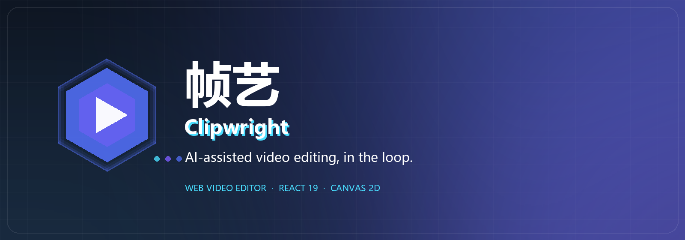
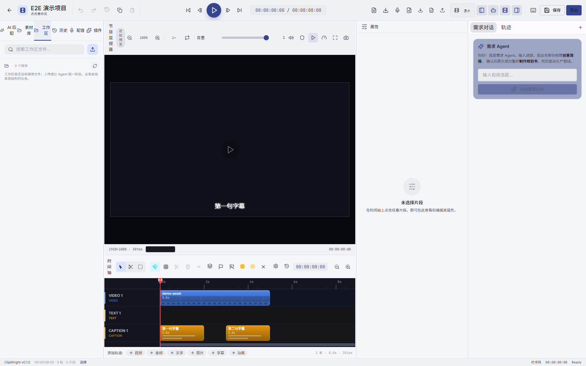

<div align="center">



# 帧艺 · Clipwright Engine

**The orchestration engine behind 帧艺 Clipwright.**

One main agent dispatching stage subagents, capability-resolved tools, and a plugin surface for everything else.

[English](README.md) · [简体中文](README.zh-CN.md)

<br/>


</div>

## Overview

**Clipwright Engine** is the Python backend of the Clipwright AI video-creation system: a FastAPI service where
**one main agent** plans the work and dispatches **stage subagents** to turn a topic into a rendered video — and
keeps a receipt for every step.

The loop is deliberately human-in-the-loop: the engine drafts, the web editor lets you review the timeline, and
a revised instruction continues the same task. Every round is a real `Task` with goals, limits, events and
degradation receipts — not a hidden prompt chain.

The engine knows *how* to run agents, tools and plugins; **what** those plugins are and how they behave belongs
to the plugins themselves.

<br/>



<p align="center"><sub>The engine powers the Clipwright web editor: every clip on this timeline came from a real Agent run.</sub></p>

## Key Features

- **One main agent, stage subagents** — a single main agent owns the plan and calls
  `delegate_agent(stage=…)` to dispatch structure → material → edit → animation → audio → quality as stage
  subagents. Each stage has structured inputs/outputs, its own run record and writes back to a shared blackboard;
  failures return to the main agent, which decides whether to redo, skip or accept. The retired six-stage
  pipeline is no longer an execution path — goals, soft-landing/closeout, the `capped` terminal state,
  pause/resume and deterministic continuation live in the task kernel.
- **Capability-resolved tools** — 44+ atomic tools and 4 skills are resolved by semantic capability names at call
  time, so plugins can take over without touching agent code. Tools self-declare permission tiers; missing
  capability is a first-class state, not an exception.
- **Plugin-first contribution surface** — tools, skills, hooks, prompts, UI slots, export presets, display specs
  and provider families are all plugin contributions (42 built-in plugins). Disable a plugin and its capability
  disappears — no hidden built-in back-fill.
- **Provider families live in plugins** — LLM, TTS, embedding, rerank and STT implementations are plugin-owned;
  the engine only exposes protocols and registries, plus capability bits (tool result style, vision format,
  model listing, audio refs) instead of vendor-name branches.
- **Contract-driven GenUI** — the agent can emit declarative display specs; the engine sanitizes and assembles
  them against per-plugin contracts, and passes the result to the editor. No contract, no spec.
- **Workspace & media pipeline** — per-task workspaces, `materials/` as the only writable area, FFmpeg rendering,
  subtitle burn-in, motion-graphics/hyperframes, render queues with priorities and resumable artifacts.
- **Realtime by SSE** — 31 event types (task, agent-run, tool, subagent, degradation, closeout, progress…) share
  one sequence model; reconnecting resumes from `since_seq`.
- **Evidence over claims** — degradation receipts, closeout reports, run/attempt addressing and golden replay make
  every delivered video reproducible and every failure explainable.
- **Tested where it hurts** — 5.1k pytest tests, strict prompt lint, and a ruff error gate in CI.

## Quick Start

Clipwright runs as two processes: the **engine** (this repo, port 8080) and the **web editor**
(Vite, port 5173).

### Prerequisites

- **Python 3.12+** and pip
- **MongoDB** (engine metadata) and **ffmpeg** on `PATH`
- **Node.js 20+** and npm (only for the web editor)

### 1. Start the engine

```bash
git clone https://github.com/Zam233/Clipwright_Enigine.git
cd Clipwright_Enigine

python -m venv .venv
# Windows: .venv\Scripts\activate    macOS/Linux: source .venv/bin/activate
pip install -e ".[dev]"

cp .env.example .env          # Windows: copy .env.example .env
# make sure MongoDB (mongod) is running
python -m clipwright.main     # serves http://localhost:8080
```

On Windows you can skip the manual steps and start everything at once:

```powershell
powershell -ExecutionPolicy Bypass -File scripts\start.ps1
```

`scripts\start.ps1` checks `ffmpeg` and the model cache, starts MongoDB, the engine on `:8080`
and the web editor on `:5173` (add `-NoFrontend` to run the engine only). It expects the editor at
`J:\Clipweight-Client`; if yours lives elsewhere, adjust the `$frontend` path at the top of the script.

### 2. Start the web editor (optional)

```bash
git clone https://github.com/Zam233/Clipweight_Client.git
cd Clipweight_Client

npm ci
npm run dev
```

Open <http://localhost:5173>. The Vite dev server proxies `/api` to the engine (`:8080`).

> 2026-11-08：账号/市场服务（ClipWright Server，`:8090`）已从本仓库与前端剥离——没有账号、登录、
> CREADIT 与市场；需要鉴权时只在「设置 → 后端配置」配置本地 API 令牌。

## Tech Stack

| Layer | Choice |
| --- | --- |
| Runtime | Python 3.12 + FastAPI (pinned `>=0.115,<0.162`) |
| Data | Pydantic v2 + MongoDB (pymongo) |
| Agents | In-house task kernel: one main agent + stage subagents |
| Tools | `ToolRegistry` + capability resolution + per-tool permission tiers |
| Plugins | Unified contribution contract, signed manifests, enable/disable rollback |
| Media | FFmpeg (render, trim, subtitle burn-in), motion graphics / hyperframes |
| Retrieval | ChromaDB + plugin-provided embedding/rerank providers |
| Realtime | SSE (task events / session timeline / render progress / agent stream) |
| Testing | pytest (5.1k), prompt lint (strict), ruff error gate |

## License

[Mozilla Public License 2.0](LICENSE) © Clipwright contributors.
