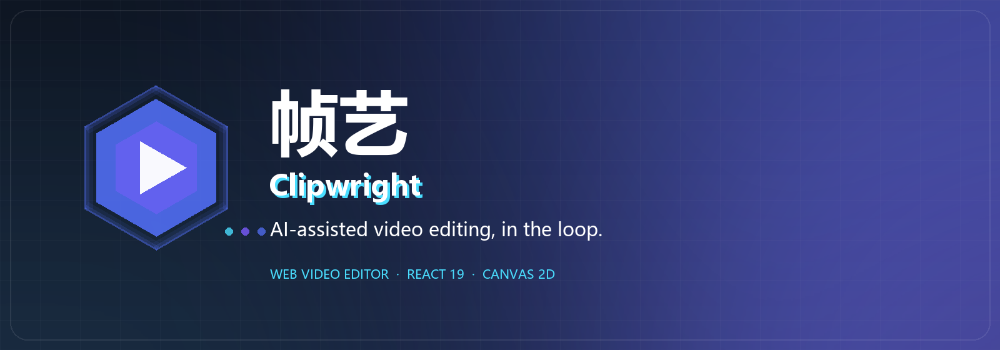
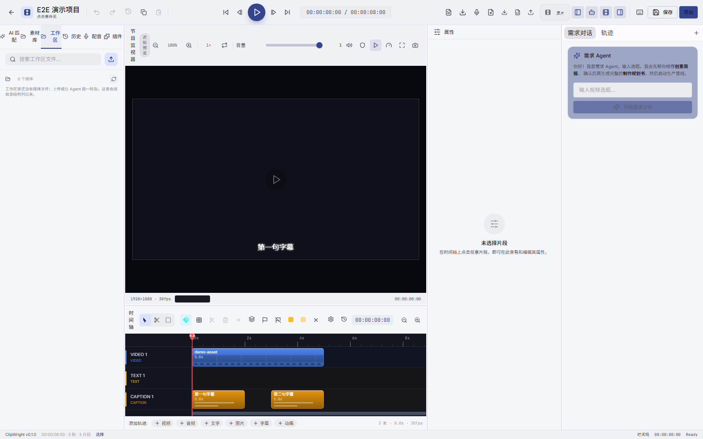

<div align="center">



# 帧艺 · Clipwright Engine

**帧艺 Clipwright 背后的编排引擎。**

主 Agent 规划并派发阶段子 Agent、按能力解析的工具，以及把其余一切交给插件的扩展面。

[English](README.md) · [简体中文](README.zh-CN.md)

<br/>


</div>

## 简介

**Clipwright Engine** 是 Clipwright AI 视频创作系统的 Python 后端：一个 FastAPI 服务，由**一个主 Agent**
规划，并把各阶段工作派给**阶段子 Agent**，从而把选题变成成片——并且为每一步留下可核对的凭据。

产品逻辑刻意做成**人在回路**：引擎出草稿，Web 编辑器让你在时间轴上审阅，
一条修改指令继续同一个任务。每一轮都是真实的 `Task`，带目标、限额、事件与降级收据——
而不是藏在背后的提示词链。

引擎知道**怎么**跑 Agent、工具与插件；**插件是什么、怎么表现**，属于插件自己。

<br/>



<p align="center"><sub>引擎驱动 Clipwright Web 编辑器：这条时间轴上的每个片段都来自一次真实的 Agent 运行。</sub></p>

## 核心特性

- **一个主 Agent + 阶段子 Agent**：主 Agent 独占规划与收尾，用 `delegate_agent(stage=…)` 把
  结构 → 素材 → 剪辑 → 动画 → 音频 → 质检派给阶段子 Agent。每个阶段有结构化输入/输出、自己的 run 记录，
  并写回共享黑板；失败回到主 Agent，由它决定重派、跳过还是接受。老六阶段管线已不是执行路径；
  目标、软着陆/收口、`capped` 终态、暂停/恢复与确定性续跑都在任务内核里。
- **按能力名解析的工具**：44+ 原子工具与 4 个技能在调用时刻按语义能力名解析，插件可以接管而无需改 Agent；
  工具自声明权限档位，能力缺失是一等状态而不是异常分支。
- **插件优先的贡献面**：工具、技能、Hook、提示词、UI 插槽、导出预设、display spec 与 provider 家族
  都是插件贡献（内置 42 个插件）。禁用插件，对应能力就消失——没有隐藏的内置兜底。
- **Provider 家族归插件**：LLM / TTS / 嵌入 / 重排序 / STT 的实现都在插件里；引擎只提供协议与注册表，
  以及能力位（工具结果风格、视觉消息格式、模型清单、音频引用）而非厂商名分支。
- **契约驱动的 GenUI**：Agent 可以输出声明式展示 spec；引擎按插件契约做清洗与装配后交给编辑器。
  没有契约，就没有 spec。
- **工作区与媒体管线**：每任务独立工作区、`materials/` 是唯一可写区；FFmpeg 渲染、字幕烧入、
  动效/hyperframes、带优先级的渲染队列与可恢复产物。
- **SSE 实时链路**：31 种事件类型（任务、Agent run、工具、子 Agent、降级、收口、进度……）
  共用一套序号模型，断线按 `since_seq` 续传。
- **证据优先于声称**：降级收据、收尾报告、run/attempt 归属与 golden replay，让每条成片可复现、
  每次失败可解释。
- **在真正会疼的地方测试**：5.1k pytest 用例、严格的提示词 lint、CI 中的 ruff 错误门禁。

## 快速开始

Clipwright 由两个进程组成：**引擎**（本仓库，端口 8080）与 **Web 编辑器**（Vite，端口 5173）。

### 前置条件

- **Python 3.12+** 与 pip
- **MongoDB**（引擎元数据）与 **ffmpeg**（需在 `PATH` 中）
- **Node.js 20+** 与 npm（仅 Web 编辑器需要）

### 1. 启动引擎

```bash
git clone https://github.com/Zam233/Clipwright_Enigine.git
cd Clipwright_Enigine

python -m venv .venv
# Windows: .venv\Scripts\activate    macOS/Linux: source .venv/bin/activate
pip install -e ".[dev]"

cp .env.example .env          # Windows: copy .env.example .env
# 确认 MongoDB（mongod）已在运行
python -m clipwright.main     # 服务地址 http://localhost:8080
```

Windows 上也可以跳过手工步骤，一键拉起全部进程：

```powershell
powershell -ExecutionPolicy Bypass -File scripts\start.ps1
```

`scripts\start.ps1` 会先体检 `ffmpeg` 与模型缓存，然后启动 MongoDB、引擎（`:8080`）与 Web 编辑器（`:5173`）；
加 `-NoFrontend` 只启引擎。脚本默认按 `J:\Clipweight-Client` 查找前端，路径不同请改脚本顶部的 `$frontend`。

### 2. 启动 Web 编辑器（可选）

```bash
git clone https://github.com/Zam233/Clipweight_Client.git
cd Clipweight_Client

npm ci
npm run dev
```

打开 <http://localhost:5173>。Vite 开发服务器把 `/api` 代理到引擎（`:8080`）。

## 技术栈

| 层 | 选型 |
| --- | --- |
| 运行时 | Python 3.12 + FastAPI（锁定 `>=0.115,<0.162`） |
| 数据 | Pydantic v2 + MongoDB（pymongo） |
| Agent | 自研任务内核：一个主 Agent + 阶段子 Agent |
| 工具 | `ToolRegistry` + 能力解析 + 工具自声明权限档位 |
| 插件 | 统一贡献契约、清单签名、启停回滚 |
| 媒体 | FFmpeg（渲染、裁剪、字幕烧入）、动效 / hyperframes |
| 检索 | ChromaDB + 插件提供的嵌入/重排序 provider |
| 实时 | SSE（任务事件 / 会话时间线 / 渲染进度 / Agent 流） |
| 测试 | pytest（5.1k）、提示词 lint（严格）、ruff 错误门禁 |

## 许可证

[Mozilla Public License 2.0](LICENSE) © Clipwright contributors。
