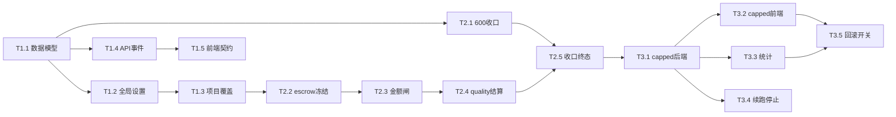

# Clipwright Agent 终止机制开发计划

> 依据：`docs/agent-termination-prd-2026-11-02.md`（271 行）与 `docs/agent-termination-research-2026-11-02.md`（263 行）。本文件是实施计划，不重写 PRD。所有代码位置均按本轮核对的当前基线记录；实施时以提交后的行号复核。

## 0. 口径基线

| 硬输入 | 本计划落地口径 |
|---|---|
| 裁定 1 | **口径 A**：结构性 `max_steps=600`，普通轮次跑到 600 后进入收口；收口独立为 8 轮/128 次收尾工具调用/600 秒；4000 工具调用、单请求 24 工具轮次保持不变，命中任一结构护栏都进入收口，不直接终止。项目覆盖优先于全局 settings，且只作用于之后创建的任务。 |
| 裁定 2 | 主 agent 预算托管（escrow）：金额预算存在时冻结质量预留；主 agent 的金额闸只看扣除预留后的可用金额；quality 派发时使用预留并单独记账。轮次/工具调用不预留。全 0/null 语义不改变。 |
| 裁定 3 | `capped` 新增为独立 `TaskStatus`，不算 done、不进成功率；会话映射为 `plan_ready`；终态文案为“已到达运行上限，已完成收尾交付（不等同于全部完成）”。 |
| 裁定 4 | `TaskFinish.completed/unfinished` 永久保留，capped 必须有内容；收口报告优先，确定性 fallback 兜底。`task_end.detail.reason` 暂不停用，后端并行产出；新代码只读 `terminal_reason`。 |
| 沿用 PRD | `TaskLimits` 的 max_turns/max_tool_calls/max_wall_sec=0 仍是不限，budget_usd=null 仍是不设金额上限。 |
| 沿用 PRD | 用户 stop 仍调用后端 `kernel.cancel()` 真中止并写 `user_stopped`；pause 不是终态。 |
| 沿用 PRD | 终态只由 Kernel 收口；旧事件只增不删，旧字段不删除，checkpoint 新字段必须有默认。 |
| 沿用 PRD | 工具权限仍由工具自声明 tier/capability/dry-run 决定，收口只缩减工具面。 |
| 沿用 PRD | final_timeline、plan_only 规划书、降级收据等领域完成门槛不绕过；时间线 writer 守卫不改。 |

**与 PRD 的差异清单**

1. §1.1/§5/§6/§11/§13：400 与 90% 阈值改为结构性 `max_steps=600`；删除 90% 提前收口的执行含义，收口窗口独立保留。
2. §4.2、§5.3、§8、§9、§10、§13：capped 不再映射 `done`，新增独立 `TaskStatus='capped'`，不进成功率，requirements 会话回 `plan_ready`。
3. 新增 §4.5 与 §8 escrow 实施项：冻结质量 agent 金额预留、主 agent 可用金额、quality 释放/结算与可见性。
4. §3/§4/§8/§9：新增 `BudgetEscrow`、`TaskUsage.quality_cost_usd`、终态预算明细和 task_end detail 字段。
5. §14 开放问题 1、2、3、5 均由作者裁定关闭；问题 4 按“保留完成/未完成清单”关闭，旧字段不下线。

## 1. 目标与非目标

### 目标

- 在 Kernel 形成 600 轮结构护栏、独立收口窗口和可追溯终态。
- 在金额预算存在时，保证 quality agent 拥有冻结额度；主 agent 不能挤占，quality 不能被主 agent 提前耗尽。
- 让 capped 在后端、SSE、REST、前端状态、会话和统计中成为一致的中性终态。
- 保持旧 checkpoint、旧 task_end.reason、旧前端读取路径可用，并把 completed/unfinished 做成强契约。

### 非目标

- 不做 goal driver 跨轮自治；不自动唤醒被取消或重启的 Goal。
- 不改变 `TaskLimits` 全 0=不限、budget_usd=null=无金额上限语义。
- 不重写工具权限体系，不在 agent 内写死工具名或质量工具名。
- 不重写前端终态机；只扩展现有状态表、映射和展示。
- 不把项目级配置放进 workspace 全局配置；项目覆盖必须随 project 记录持久化。
- 不在本任务运行 pytest、vitest、tsc、py_compile 或任何测试命令。

## 2. 现状影响面分析

### 2.1 终止与结构护栏

| 位置 | 影响 | 危险等级 |
|---|---|---|
| `clipwright/services/agent_loop.py:57-62`：`STRUCTURAL_MAX_ROUNDS/CALLS/TOOL_ROUNDS` | 400 改 600；4000/24 不变；结构命中需返回 closeout 信号而非直接 LoopAborted 终态 | 高危：轮次判定 |
| `agent_loop.py:309-317,556-562`：max_rounds/max_calls | 任务实例的 max_steps 与单次请求 24 取最小；不能把 TaskLimits 0 解释成有限预算 | 高危 |
| `agent_kernel.py:953-987`：`_guard/_on_tool_call` | 接入 escrow 成本记账、quality stage 识别、soft_landing 幂等事件 | 高危：预算闸接线 |
| `agent_kernel.py:1047-1114` | 当前触闸直接 `failed`，改为 normal gate→closeout，capped 终态由收口完成后落定 | 高危 |
| `agent_kernel.py:1116-1322`、`:1418-1456` | `_finish`/正常 finish 统一写 terminal_reason、清单和 escrow 结算 | 高危 |
| `agent_kernel.py:1364-1410`：`_control_hit/_gate_hit` | 金额判定改为 `cost_usd >= budget - reserve`; 轮次/工具调用原 TaskLimits 闸保留其语义，结构护栏另行收口 | 高危 |
| `agent_kernel.py:1412-1416`、`:1509-1669` | reset 清理 escrow 临时态；checkpoint 读写新增结构必须兼容未知 enum | 高危 |
| `agent_kernel.py:636-656`、`:610-619` | 任务创建时解析项目覆盖→全局 settings→默认 600；冻结金额预留快照 | 高危 |

### 2.2 数据、API、会话与项目

| 位置 | 影响 |
|---|---|
| `clipwright/schema/task.py:20-26,135-185,196-232` | TaskStatus 新增 capped；TerminalReason、Goal、BudgetEscrow、TaskFinish/TaskUsage 字段；TASK_TERMINAL 更新。 |
| `clipwright/api/task.py:217-305,410+` | REST task/event/cancel/resume 输出新字段；终态 resume 仍 409。 |
| `clipwright/api/requirements.py:295-305` | stop 返回 terminal_reason 与 escrow 摘要，旧字段保留。 |
| `services/requirements_service.py:3225-3347` | 续跑携带 previous_task_id、previous_goal_id 和 escrow 规则；新任务重新冻结，不能继承已消耗额度。 |
| `services/requirements_service.py:3424-3534` | `_release_session_after_task` 仅 `done→pipeline_done`，`capped/failed/cancelled→plan_ready`；消息 metadata 写 terminal_reason/escrow。 |
| `services/requirements_service.py:505` 的 stale release | 状态集合增加 capped，不能把 capped 卡在 pipeline_running。 |
| `services/task_project_sync.py:15-18,101-128,190-253` | 仅保留 writer/agent_sig 守卫；不写项目 timeline terminal_reason；项目配置写入另行走 project JSON。 |
| `api/project.py:62-80,216-272`、`services/project_manager.py:98-159` | 真实项目记录是 JSON；用已有 `agent_state: Any` 承载 `agent_state.termination.soft_landing_round` 和 `quality_budget_reserve_ratio`，更新仍走 ProjectUpdateRequest/读改写。不是新增虚构集合或 workspace 配置。 |
| `config.py:115-137,169-173` | 新增全局 settings 键；默认值通过 Settings 声明。 |
| `services/settings_store.py:81-92,95-130,154-176`、`main.py:114-117` | 全局覆盖存 `settings.json`；启动时必须先 `apply_all(settings)`，之后才初始化插件/路由；运行中保存可影响后续创建任务，不回写已创建任务快照。 |

### 2.3 质量阶段与统计

| 位置 | 影响 | 危险等级 |
|---|---|---|
| `tool/surface.py:43-82,184-195` | `delegate_agent` 是唯一派发入口，quality 只是 stage 参数；不得新增硬编码质量工具。 |
| `services/stage_subagent.py:311-361,382-419,501-579,650-668` | `run_stage` 根据 stage 装配输入；quality 产物是 `issues/redo_agent`，StageResult 返回 cost_usd/tokens/tool_calls；这是 escrow 解冻/质量账记账的真实派发链。 |
| `services/stage_inputs.py:26,341+`、`stage_closure.py:10-49`、`stage_merge.py:32` | quality 输入是 timeline，合并产物为 issues/redo_agent；quality 不进入返工闭包。 |
| `agent_kernel.py:1023-1030` | delegate_agent 成功后增量同步时间线；quality 不应错误改变 timeline writer。 |
| `services/agent_run.py:505+` | AgentRun 记录 cost/status；阶段 run usage 不得与 task usage 重复计费，TaskUsage 只由 Kernel 接收工具结果计一次。 |
| `services/evaluation.py:102-145,148-176` | task gate_passed 明确排除 capped；子 run success_rate 与 task_success_rate 都过滤 capped。 |
| `src/pages/admin/PipelineAdminPage.tsx:104-115,263-264` | pipeline 统计另有 completed 口径；若该页消费 Task 数据需排除 capped，旧渲染 status 需增加 neutral 分支。 |

### 2.4 前端高危穷举点

- `src/types/task.ts:8-23,115-143`：TaskStatus union、TaskFinish、Task 字段。
- `src/stores/taskStore.ts:92-109,346-365`：terminalStatusOf、task_end 折叠；先读 `detail.terminal_reason`，reason 仅兼容回退。
- `src/features/task/labels.ts:18-29,80-100`：`Record<TaskStatus,string>` 与终态 reason 文案。
- `src/features/task/TaskToolbar.tsx:39-71`：`STATUS_ACTIONS: Record<TaskStatus,...>`，capped 只能 view，不能 resume/cancel/inject。
- `src/features/task/TaskFinishSummary.tsx:31-48`：终态数组与错误色判定；capped 用中性色，不显示失败。
- `src/features/task/EventFeed.tsx:47-55,130-140`：soft_landing/goal_update 新事件可展开，task_end 不再一律 error 色。
- `src/features/task/eventSchema.ts:18-51,183-190,225-239,255+`：事件集合和 TaskEndDetail 新字段；新增事件必须同步后端 union。
- `src/features/task/TaskListSection.tsx:21-25`、`PlanPanel.tsx:30,65,167`、`EditorPage.tsx:477`、`AgentPanel.tsx:1199-1224,1527+`：终态颜色、开始/离开编辑器、运行条停止按钮和 session 状态分支均需审查。

## 3. 数据与契约增量

| 对象/字段 | 类型/默认 | nullable 语义 | checkpoint/API/前端策略 |
|---|---|---|---|
| `TaskStatus` | Literal 增加 `capped` | 非空状态 | `TASK_TERMINAL` 纳入；旧客户端未知值按 unknown_terminal，发布前同步前端。 |
| `TerminalReason` | achieved/capped/blocked/user_cancelled/externally_interrupted/dry_run_completed/plan_only_completed/budget_exhausted/model_error/invalid_completion | Task 旧数据可 null | checkpoint 字符串；未知值不丢任务，保留 `legacy_terminal_reason`/unknown view。 |
| `Goal` | PRD 字段沿用；`max_rounds=600` | Task.goal 可 null | 旧 checkpoint 缺省 null；新任务初始化快照。 |
| `Task.closeout` | dict：mode、trigger_round、closeout_rounds_used、deliverable_status | 默认 `{}` | sidecar 不单独存，随 Task checkpoint；旧客户端忽略。 |
| `BudgetEscrow` | `budget_usd: float|null`、`reserve_usd: float`、`main_available_usd: float|null`、`main_spent_usd`、`quality_reserved_spent_usd`、`released_usd`、`status`、`ratio` | budget null 时整个托管为 disabled，reserve=0，不造上限 | 新模型字段默认 disabled/0；REST、finish、task_end、日志同形。 |
| `TaskUsage.quality_cost_usd` | float=0；`quality_turns`、`quality_tool_calls` int=0 | 非 nullable | 阶段 run 仍有自身 cost；Kernel 仅在 delegate_agent quality 结果回调处累加一次。 |
| `TaskFinish.terminal_reason` | `TerminalReason|null` | 老任务 null | `reason` 继续并行产出；前端新代码只读 terminal_reason，缺失再 legacy mapper。 |
| `TaskFinish.budget_escrow` | `BudgetEscrowSnapshot|null` | 老任务 null | capped/quality/预算终态必须可见；cancel 也保留冻结/已用快照。 |
| `task_end.detail` | `terminal_reason`、`goal_status`、`goal_id`、`closeout_mode`、`completed`、`unfinished`、`budget_escrow`、`quality_usage` | 新字段可缺省，completed/unfinished 保留 | `reason` 不停产；SSE/REST 同码。 |
| `goal_update` | 新事件；goal_id/status/rounds_used/max_rounds/blocker_streak/blocked_reason/terminal_reason | detail 固定字段 | 后端 EVENT_TYPES 与 `eventSchema.ts` 同步；旧客户端忽略。 |
| `soft_landing` | 新事件；trigger/rounds_used/max_steps/tools_policy/goal_id | 一次且幂等 | 前端折叠显示进入收口。 |
| `TaskRequest.extra` | `project_id` 或现有 `proceed_project_id` | 缺省无项目配置 | 创建时解析项目 JSON，不将项目配置动态读入运行中 Task。 |

### 预算默认决策

- 金额预留采用**比例 20% + 最低定额 0.05 USD（取较大值）+ 上限 2.00 USD**：`reserve=min(budget*ratio_floor, cap)`，默认 `ratio=0.20`、`floor=0.05`、`cap=2.00`；比例适合不同片长，定额保证小预算质量 agent 不被零头饿死，纯定额会让大预算预留不足。
- 可配置键：`agent_quality_budget_reserve_ratio=0.20`、`agent_quality_budget_reserve_floor_usd=0.05`、`agent_quality_budget_reserve_cap_usd=2.00`。项目 `agent_state.termination` 同名字段优先覆盖全局。
- `budget_usd=null` 时 escrow 状态为 `unbounded`，不冻结虚构美元；仍显示 `reserve_usd=null`、quality cost 实际记账。预留不是为了制造限制。
- 轮次/工具调用**不预留**：质量阶段消耗的轮次和工具调用也受结构 600/4000/24 保护，但拆分非金额额度会造成主 agent 提前收口或质量派发无法执行；新增金额托管已足够隔离付费风险。

## 4. 预留预算（escrow）专项设计

### 4.1 状态机

```text
disabled(null budget) ───────────────────────────────> settled
frozen(reserve held) ──quality dispatched──> in_use ──quality end──> settled
frozen ──cancel/error before quality──> released_to_report (never spendable by main)
frozen ──main gate──> main_available excludes reserve
```

创建任务时从项目配置、全局 settings、默认值解析预算与比例，计算并冻结快照。计划确认时不重新计算，避免用户在运行中改配置造成漂移；quality 派发前把状态置 `in_use`。quality 完成后将实际 `cost_usd` 计入 `quality_reserved_spent_usd`，差额记 `released_usd` 但不能回流主 agent；任务取消/质量未运行则记 `released_usd` 并保留审计值。

### 4.2 闸门接线

1. `_on_tool_call` 继续累计 `TaskUsage.cost_usd`；quality 的工具结果按 stage=quality 累加 `quality_cost_usd`，不得再次加到主 agent 可用消费。
2. `_gate_hit` 的金额判定变为：`budget_usd is not None and main_spent_usd >= budget_usd - reserve_usd`；金额闸命中进入收口，不执行新的 costly 主 agent 工具。
3. quality 派发入口是 `stage_subagent.run_stage()`，上游 `delegate_agent` 在 `tool/surface.py` 执行。派发前校验 `stage=quality`、`timeline` 输入和 escrow 状态；只有这一入口可解冻/使用预留。
4. 质量阶段耗尽/失败不把质量费用伪装成主 agent 费用；StageResult 的 `cost_usd/tokens/tool_calls` 保持 run 级，TaskUsage 增量由 Kernel 单次接收。
5. 收口模式禁止 `delegate_agent`，因此不会把冻结预留用于补派 quality；quality 未运行必须在 completed/unfinished 写 `quality_not_run`，不得偷塞收口。

### 4.3 可见性

- `TaskFinish.budget_escrow`：预留、主 agent 已用、quality 已用、释放、剩余（质量侧）完整快照。
- `task_end.detail.budget_escrow` 与 `quality_usage`：事件流首屏可见，旧字段 reason/completed/unfinished 并行。
- `checkpoint` detail 与结构化日志：固定写 `budget_usd/reserve_usd/main_spent_usd/quality_spent_usd/released_usd`；金额 null 写 `unbounded`。
- 前端 `TaskFinishSummary` 直接显示“质量预算预留 $X，主 agent 使用 $Y，质量使用 $Z，未使用 $R”；null 显示“金额上限未配置，质量费用仅记账”。

### 4.4 边界表

| 边界 | 行为 |
|---|---|
| `budget_usd=null` | escrow=unbounded，reserve 不冻结，不凭空产生质量上限；quality 继续实际记账。 |
| reserve > total | clamp 到总预算，且至少保留主 agent 可执行金额；预算小于 floor 时 reserve=min(total, total*ratio)，不让主 agent 变成零额度。 |
| quality 未运行 | 预留不转主 agent；released 记账，unfinished 写 quality_not_run。 |
| 任务取消 | 立即 cancel，不执行质量；冻结额标 released，不追加收口调用，completed/unfinished 保留已知证据。 |
| 续跑任务 | 新 Task 重新按当前项目配置冻结；previous_task_id/goal 只带历史，不继承旧余额，避免跨任务重复可花。 |
| 主 agent 已达可用金额 | 进入收口；收口不动预留，quality 只有在已进入派发且状态 in_use 时继续结算。 |

**取舍对比**：项目配置存 `agent_state.termination` 而非 workspace 全局，是因为项目 JSON 已有 `agent_state: Any` 和 `ProjectManager.save()` 读改写；workspace 只适合作品文件，不适合作品级策略，放 workspace 会造成跨项目漂移。比例+floor+cap 而非单一比例，是为了同时覆盖小预算质量饿死与大预算预留不足。预留在任务创建冻结而非 quality 派发前计算，是为了让运行中的配置不可漂移且主 agent 一开始就知道可用额度。轮次/工具调用不 escrow，是因为它们是行为护栏，不是可计费资源；拆分会改变 0=不限语义。capped 用新 status 而非 done+flag，是因为成功率、会话映射和旧 done 语义必须可查询区分，单独 flag 会迫使每个消费者同时理解两个字段。

## 5. 工作分解（WBS）

> **执行进度（M1/M2/M3 已落地）**：T1.1–T1.5、T2.1–T2.5、T3.1–T3.5 全部完成，
> `py_compile` / `tsc --noEmit` 通过，端到端（假 driver 跑满 600 轮）实测走到
> `status=capped + terminal_reason=capped + 收尾报告落盘`；人工验收仍待走查。
>
> **M1**：`schema/task.py`（`TerminalReason`/`GoalStatus`/`Goal`/`EscrowState`/`BudgetEscrow`/`Closeout`、
> `Task.goal|terminal_reason|blocker_code|closeout|escrow`、`TaskFinish.terminal_reason`、`TaskStatus='capped'`
> 已进 `TASK_TERMINAL`）、`config.py` + `config_schema.py`（13 个 `agent_*` 键与元数据）、
> 新服务 `services/agent_policy.py`（项目 > 全局 > 默认解析 + escrow 冻结）、`agent_kernel.create()`
> 快照 `_snapshot_termination_policy()`、`kernel.cancel()` 写 `user_cancelled`、`stop_task()` 返回
> `terminal_reason/goal_status`、`api/project.py` 新增 `GET|PATCH /{id}/termination`、
> 前端 `types/task.ts` / `labels.ts` / `TaskToolbar.tsx` / `taskStore.terminalStatusOf`。
>
> **M2**：`agent_loop.STRUCTURAL_MAX_ROUNDS=600`、`_CLOSEOUT_BLOCK` 收口提示词、`build_tools(closeout)`
> 只留只读档位（71 → 25 个工具）+ 质量阶段派发唯一例外（`_closeout_extra_tools`，余额不足即收回）、
> `_executor` 拒绝收口期派非 quality 阶段；`agent_kernel` 新增 `_enter_closeout` / `_closeout_hit` /
> `_main_budget`（金额闸用 `budget - reserve`）/ `_sync_escrow` / `_closeout_evidence` /
> `_write_closeout_report`（`reports/agent-closeout.json`，失败也要填 `completed/unfinished`）/
> `_classify_gate` / `_success_terminal_reason` / `_settle_quality_usage`（唯一结算入口，防双计）。
>
> **M3**：`requirements_service._release_session_after_task`（capped → `plan_ready` + 专门文案）、
> `_continue_as_task` 携带 `previous_terminal_reason/blocker_code/closeout_status`，
> `context_loader._instruction_digest` 把它们讲给新任务；`evaluation.py` 把 capped 从成功率
> 分子/分母里排除并单列 `capped_count`；`TaskFinishSummary` 显示收口/质量预算/终态；
> 两个开关 `agent_terminal_reason_v1` / `agent_capped_status_v1` 已接线可回滚。

### M1：数据契约与配置落盘（可独立发布）

| 编号 | 目标 | 文件与函数 | 前置 | 人工验收 | 规模 | 风险 |
|---|---|---|---|---|---|---|
| T1.1 | 增加终态、Goal、escrow、usage/finish 字段并兼容旧 checkpoint | `schema/task.py:20-232`；前端 `src/types/task.ts:8-143` | 无 | 旧 JSON 缺字段仍能在 REST 展示；新 Task 输出字段默认完整 | M | 高 |
| T1.2 | 增加全局设置与 settings store 读取 | `config.py:115-173`、`settings_store.py:95-176`、`main.py:114-117` | T1.1 | 管理配置页保存键后，重启日志显示已应用；未保存仍用默认 | S | 中 |
| T1.3 | 接入项目级覆盖真实落点 | `api/project.py:62-80,216-272`、`project_manager.py:98-159` | T1.2 | 项目 JSON 的 `agent_state.termination` 可读写；无字段回退全局；新任务快照不随运行中修改变化 | M | 高 |
| T1.4 | 终态/事件 API 契约增量 | `api/task.py:217-305`、`api/requirements.py:295-305`、`schema/task.py:28-63` | T1.1 | GET task、events、stop 返回同一 terminal_reason 与 escrow；旧 reason 仍存在 | M | 高 |
| T1.5 | 前端集中类型/事件解析 | `types/task.ts`、`features/task/eventSchema.ts:18-51,183-239` | T1.1/T1.4 | unknown event/unknown enum 不崩溃，旧事件继续显示 | M | 高 |

### M2：600 轮收口与 escrow 执行（可独立灰度）

| 编号 | 目标 | 文件与函数 | 前置 | 人工验收 | 规模 | 风险 |
|---|---|---|---|---|---|---|
| T2.1 | 结构护栏改为 600 并建立 closeout state | `agent_loop.py:57-62,309-317`、`agent_kernel.py:953-1114` | T1.1 | 第 600 轮进入 soft_landing；不出现第 601 次普通工具副作用；4000/24 仍只是收口 | M | 高 |
| T2.2 | 实现 escrow 计算、冻结、结算和 checkpoint | `agent_kernel.py:636-656,1509-1669`、`schema/task.py` | T1.1/T1.3 | budget=1 美元时预留 0.20（受 floor/cap）；checkpoint 重启余额不丢；null 显示 unbounded | L | 高 |
| T2.3 | 将 escrow 接入 `_gate_hit` 与 `_on_tool_call` | `agent_kernel.py:959-1002,1364-1410`、`agent_loop.py:319-504` | T2.2 | 主 agent 到 0.8 美元即收口，不能花预留；cost_unknown 仍可见 | L | 高 |
| T2.4 | quality 派发使用预留并分离 stage/task usage | `tool/surface.py:43-82,184-195`、`stage_subagent.py:311-361,382-668`、`agent_run.py:505+` | T2.2/T2.3 | quality run 消费预留、TaskFinish 分开显示主/质量费用；失败不双计 | L | 高 |
| T2.5 | 收口报告、completed/unfinished、终态事件统一 | `agent_kernel.py:1116-1322,1418-1456` | T2.1/T2.3 | capped 生成报告并有清单；报告异常时 fallback 仍有清单；reason 与 terminal_reason 并行 | L | 高 |

### M3：capped 全链路、会话与统计/UI（可独立发布）

| 编号 | 目标 | 文件与函数 | 前置 | 人工验收 | 规模 | 风险 |
|---|---|---|---|---|---|---|
| T3.1 | 后端 capped 状态与 session 映射 | `schema/task.py`、`requirements_service.py:3424-3534,505`、`api/task.py` | T2.5 | capped 任务终态 REST/SSE 一致，session 为 plan_ready，不能 resume | M | 高 |
| T3.2 | 前端 capped 状态表、工具条、摘要、事件展示 | `taskStore.ts:92-109,346-365`、`labels.ts`、`TaskToolbar.tsx:39-71`、`TaskFinishSummary.tsx:31-105`、`EventFeed.tsx`、`eventSchema.ts` | T3.1 | 页面显示中性 capped 文案，只有查看结果，无继续/取消/插话；清单有内容 | M | 高 |
| T3.3 | 排除成功率的所有统计口径 | `services/evaluation.py:102-176`、`api/eval.py:45-62`、`PipelineAdminPage.tsx:104-115` | T3.1 | capped 数量不增加成功数，也不被错误计为失败成功；指标总数按产品口径明确 | M | 高 |
| T3.4 | 续跑和停止携带 terminal/escrow 历史 | `requirements_service.py:3225-3347,3363-3422`、`AgentPanel.tsx:1527-1571` | T3.1/T2.2 | stop 仍真中止；下一任务重新冻结；消息/时间线有停止与原因 | M | 中 |
| T3.5 | 关闭开关与回滚路径 | `config.py`、settings API、前后端状态映射 | T3.1-T3.4 | 关闭开关后旧终态逻辑可恢复，新字段不丢、旧客户端不崩 | S | 中 |

## 6. 依赖与顺序



T1.2/T1.4 可并行；T1.3 依赖全局字段定义。T2.1 与 T2.2 可并行，但 T2.3 必须在 escrow 数据结构后，T2.4 必须在金额闸和 quality 真实入口核实后。T3.2/T3.3/T3.4 可并行。先落数据后改判定：否则运行中遇到新字段/新 enum 时 checkpoint、旧客户端和事件投影无法解释，判定代码即使正确也会丢任务或误判成功。

## 7. 每期发布与回滚

| 期次 | 开关（默认） | 发布前提 | 回滚步骤 |
|---|---|---|---|
| M1 | `agent_terminal_reason_v1=false`、`goal_blocker_v1=false`、`agent_soft_landing_enabled=false` | schema/API 可读旧数据；新字段只写可选 | 设置 reason/goal 开关 false，保留 nullable 字段和事件兼容。 |
| M2 | `agent_soft_landing_enabled=true`、`agent_soft_landing_round=600`、`agent_closeout_rounds=8`、`agent_closeout_tool_calls=128`、`agent_closeout_wall_sec=600`；`agent_quality_budget_escrow_v1=true`；ratio/floor/cap 为 0.20/0.05/2.00 | 600/4000/24 边界人工走查；quality 能独立结算 | 关闭 soft landing 与 escrow v1；恢复旧 gate 行为，保留字段和日志，不删除 checkpoint。 |
| M3 | `agent_terminal_reason_v1=true`、`goal_blocker_v1=true`、`agent_capped_status_v1=true`、`agent_stats_exclude_capped_v1=true` | 前端所有 Record/switch 已补 capped；会话和统计人工验收 | 关闭 capped projection/UI 开关，旧客户端按 unknown_terminal/legacy mapper 展示；后端仍读新字段，不把历史 capped 改写 done。 |

运行中项目配置不热更新当前 Task：任务创建时把解析结果和 escrow 快照写入 Task，理由是热变更会让同一任务的预算、600 阈值和审计口径漂移；配置变更只影响之后创建的任务。作者若要求立即生效，必须另开“任务级动态策略版本”设计，不在本计划内。

## 8. 风险登记册

| 风险 | 成因 | 影响面 | 缓解 | 触发后的应急动作 |
|---|---|---|---|---|
| 新 status 打崩旧前端穷举 | `labels.ts:18`、`TaskToolbar.tsx:39` 是 Record<TaskStatus>；多个终态数组没有 capped | 编译失败或终态按钮错误 | 先补 union/Record/数组，再放量；未知值仍有 fallback | 关闭 `agent_capped_status_v1`，前端回退 unknown_terminal 展示。 |
| escrow 算错饿死 quality/提前收口 | `agent_kernel.py:1384` 金额闸与 `stage_subagent.py:576-668` 阶段成本口径不同 | 质量不执行或主 agent 过早收口 | 冻结快照、clamp、阶段/任务 usage 分离、日志对账 | 关闭 escrow v1，质量费用只记账，人工补质量阶段。 |
| 600 轮成本上升 | `agent_loop.py:60` 从 400 放宽，模型可能重复摸底 | token/墙钟/并发上升 | 保持无进展/重复失败闸；600 只是结构 max_steps，不取消 4000/24 | 临时把 `agent_soft_landing_round` 设 480 或关闭 on，保留新字段。 |
| 项目覆盖配置漂移 | `project.json.agent_state` 与全局 `settings.json` 两层写入并存 | 同项目任务口径不一致 | 创建时解析并快照来源/版本；不读取运行中变更 | 清理项目覆盖，回退全局；对受影响任务按快照审计。 |
| checkpoint 未知枚举反序列化失败 | `agent_kernel.py:1663` 直接 `Task.model_validate(data)` | 重启后任务消失、watcher 卡住 | loader 捕获 enum，保留原值诊断并 unknown view | 将任务标 externally_interrupted/plan_ready，人工导出原 checkpoint。 |
| quality run/task usage 双计 | `stage_subagent.py` 已有 StageResult.cost，`_on_tool_call` 又汇总工具结果 | 预算被错误扣两次 | 明确唯一 TaskUsage 入口与 run_id 对账 | 冻结质量阶段派发，按 run 报告手工核账后重放。 |
| capped 被统计为成功 | `evaluation.py:114-116` 旧 gate_passed 只看 done/reason，前端 PipelineAdminPage 有独立 completed 口径 | 成功率虚高 | task success 过滤 terminal_reason=capped；统计增加 excluded_capped | 关闭统计新口径，回滚看板展示并标注数据待重算。 |
| 收口报告覆盖用户时间线 | `task_project_sync.py:190-213` writer/agent_sig 守卫 | 编辑器内容被覆盖 | closeout 只调用已有 guarded sync，失败只 warning | 关闭 closeout sync，只读项目结果，不恢复已覆盖内容。 |

## 9. 人工验收清单

### M1

1. 操作：读取旧 checkpoint（无 goal/terminal_reason/escrow）。期望：REST 正常返回，字段为 null/默认，不丢任务。
2. 操作：保存全局 `agent_soft_landing_round=600`，重启服务。期望：`settings_store.apply_all()` 在插件加载前应用，日志可见。
3. 操作：在项目 JSON 的 `agent_state.termination.soft_landing_round` 写 720，创建新任务。期望：Task 快照为 720；运行中再改项目字段，当前任务不变。
4. 操作：创建新任务查看 task_start/task REST。期望：budget escrow 字段存在；budget=null 显示 unbounded。

### M2

5. 操作：模拟普通 round 599、600、601。期望：600 进入 soft_landing；601 不执行普通工具，只有收口工具面。
6. 操作：触发 4000 次工具调用或单请求 24 轮。期望：进入收口，不直接 failed；4000/24 事件说明实际触发点。
7. 操作：预算 1.00 USD、默认比例运行主 agent。期望：主 agent 金额闸按 0.80 USD 可用额度判定；预留 0.20 不会被主 agent 花掉。
8. 操作：quality 派发并产生 0.12 USD StageResult。期望：quality_usage=0.12，主 agent spent 不增加该笔，剩余预留可见。
9. 操作：质量未运行而进入收口。期望：completed/unfinished 含 `quality_not_run`，不在收口中偷偷派 quality。

### M3 / capped 全链路

10. 操作：让任务在 600 轮进入收口并成功写 closeout。期望：后端 status=capped，terminal_reason=capped，TaskFinish.completed/unfinished 有内容，`task_end.reason` 仍存在。
11. 操作：从 SSE、REST、刷新页面检查同一任务。期望：前端 `terminalStatusOf` 读 terminal_reason 显示 capped；TaskToolbar 只有“查看结果”，没有继续/暂停/取消。
12. 操作：观察 requirements session。期望：capped 回 `plan_ready`，不是 `pipeline_done`；用户可继续发新指令。
13. 操作：查看成功率统计，包含一个 achieved、一个 capped。期望：分母/排除规则按产品设定显示，capped 不计成功。
14. 操作：旧事件只有 reason、没有 terminal_reason。期望：前端 legacy mapper 正常显示；新事件的 goal_update/soft_landing 可展开且未知字段不崩溃。
15. 操作：运行中点击停止。期望：后端协程真取消、session plan_ready、消息和 timeline 各留 user_stopped；TaskFinish 清单不被空数组覆盖。
16. 操作：停止后续跑创建新 Task。期望：previous_task_id/goal 历史可见，escrow 重新冻结而不是继承旧余额。

## 10. 估算与里程碑

| 里程碑 | 任务 | 估算人日 |
|---|---|---:|
| M1 | T1.1 2、T1.2 1、T1.3 2、T1.4 1.5、T1.5 1.5 | 8 |
| M2 | T2.1 2、T2.2 3、T2.3 2、T2.4 3、T2.5 2.5 | 12.5 |
| M3 | T3.1 1.5、T3.2 2.5、T3.3 1.5、T3.4 1.5、T3.5 1 | 8 |
| **合计** | 15 项 | **28.5** |

关键路径为 T1.1→T1.2/T1.3→T2.2→T2.3→T2.4→T2.5→T3.1→T3.2，约 20.5 人日；两名熟悉后端/前端的交付人员并行可压到 12–14 个工作日，不含人工验收等待。若只能先做一件事，先做 **T1.1 数据契约 + T2.2 escrow 快照**：它同时锁住新 status 的兼容形状与质量预算的不可漂移事实，后续判定和 UI 才有稳定输入。

## 11. 需要作者拍板（≤4 条）

1. 项目覆盖字段是否沿用现有 `agent_state.termination`，还是要把项目记录顶层增加 `termination_config`；本计划选前者以避免项目 schema/迁移。
2. 默认质量预留是否接受 20% + 0.05 USD floor + 2.00 USD cap；若只要比例，删除 floor/cap 会增加小预算质量饿死风险。
3. capped 统计的分母是否从有效任务中排除（本计划排除 capped，既不成功也不失败）；这会改变“成功率”与“终态分布”两个指标的展示方式。
4. `agent_terminal_reason_v1` 与 `agent_capped_status_v1` 是否同批上线；本计划先后端兼容、再前端启用，避免新 status 到达旧 UI。

## 附：一行口径对照

若作者本意是“600 触发收口 + 更晚硬顶（例如 800）”，只改 `agent_soft_landing_round`（600→触发值）与 `agent_soft_landing_max_steps`（结构 max_steps 600→800）两个常量；不另开提前量设计。按本次裁定采用口径 A 时，两者都为 600，收口窗口仍独立为 8/128/600。
