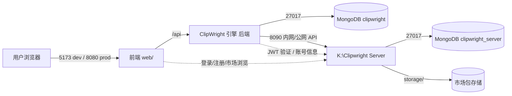

# ClipWright 修复与功能补全计划（开发版）

> 版本：v0.3（待评审；v0.2=对账补录，v0.3=评审决议：包体拆分与参考成片风格模仿纳入排期，E3 项目共享保持排除） · 状态：**仅计划，未经评审批准不得执行**
> 依据：六轮审计（交付就绪度 / 安全与功能 / 特性完整性 / 未文档化缺口 / Persona·类型·插件专项 / 汇总），审计结论共约 230 项问题、完整度约 68%。
> 评审流程：开发/架构负责人逐节评审 → 修改本文档 → 批准后按 §10 执行清单实施。

---

## 1. 范围

### 1.1 包含（本次排期）

| # | 工作块 | 对应审计项 |
|---|--------|-----------|
| 1 | 安全与数据必修（P0/P1 共 11 项） | §2 全部 |
| 2 | 文档-代码-行为对账与死代码清理 | §3（A 组 10 + D 组 9 + 假成功 5） |
| 3 | 工程化：monorepo 合并 + 一键启动 + CI + 端口统一 | 新增 |
| 4 | **账号管理**（服务端在 K:\Clipwright Server，主项目接入） | 新增（落地 B1 多租户） |
| 5 | **Persona 市场 / 插件市场**（主项目仅做前后端；服务端在 K:\Clipwright Server） | F1/F2 落地 |
| 6 | 商用地基（配额/速率/预算/队列/审计/版权过滤/多方案/幂等/硬过滤） | B 组（B1 并入账号管理） |
| 7 | 编辑器专业能力 | M 组 14 项 + 编辑器手感 12 项 |
| 8 | 薄弱项加固 | C 组 11 + W 组 15 |
| 9 | 接线即得 + 运营调度 | 孤儿代码 4 项 + 定时/失败诊断/模板复用/归档 |
| 10 | 素材治理与合规 | 去重/失效巡检/使用统计/违规检测 |
| 11 | Persona/类型/插件治理 | B2–B28 + 插件 P1/P2/P3/M1–M15 |

### 1.2 排除（本次不排期，日后可加回）

| 排除项 | 对应审计条目（加回时按此恢复） |
|--------|-------------------------------|
| 发布分发（封面编辑/智能封面、发布元数据、平台发布、分享链接、发布历史、定时发布、水印产品入口） | §6 发布分发域 7 项 |
| 模板分享（分享到社区） | 前端 F3 |
| 多人协作/评论批注 | 前端 E1 |
| 项目共享审阅链接（评审确认：与多人协作同类，保持排除） | 前端 E3 |
| 多语言成片（脚本翻译→多语言配音→多语言字幕→独立成片） | §6 内容创作辅助-多语言 |
| 数字人/虚拟形象 | §6 内容创作辅助-数字人 |
| A/B 双管线对比 | §6 运营调度-A/B |
| （与排除项联动）平台自动发布合规决策 | business_analysis.md:566 |

> 决策记录 D-01：排除项不影响其前置依赖（如账号体系的 owner 字段照做，因 P3 需要）。

---

## 2. 目标架构

### 2.1 拓扑



### 2.2 端口与约定（统一后）

| 服务 | 端口 | 说明 |
|------|------|------|
| ClipWright 后端 | **8080**（唯一标准） | 删除所有 8000 fallback，文档同步 |
| 前端 dev | 5173 | vite proxy `/api` → 8080 |
| ClipWright Server | 8090 | 账号 + 市场 |
| MongoDB | 27017 | 两个库：clipwright / clipwright_server |

### 2.3 Monorepo 结构（合并后）

```
J:\Clipwright\                     # 合并后的唯一仓库（保留后端 git 历史）
├── clipwright/                    # 后端包（原位不动，相对路径不受影响）
├── personas/ plugins/ PluginData/ renders/ projects/ ...   # 后端运行时目录（原位）
├── web\                           # ← 前端整体迁入（原 J:\Clipweight-Client）
│   ├── src/ e2e/ docs/ ...
│   ├── package.json vite.config.ts ...
│   └── .env                       # VITE_API_BASE_URL=http://localhost:8080
├── docs\                          # 合并后文档（含本计划）
├── scripts\
│   ├── start.ps1                  # 一键启动（开发模式）
│   ├── start.bat
│   ├── stop.ps1
│   └── check_env.ps1              # 环境体检（python/node/mongo 版本与端口）
├── docker-compose.yml             # mongo + 后端 + 前端（生产构建） + server
├── Dockerfile.backend
├── web\Dockerfile.frontend
└── README.md                      # 更新为 monorepo 说明 + 一键启动
```

### 2.4 K:\Clipwright Server 结构（新建，独立 git 仓库）

```
K:\Clipwright Server\
├── app\
│   ├── main.py                    # FastAPI 入口（/health、挂载两路由）
│   ├── config.py                  # pydantic-settings（CLIPWRIGHT_SERVER_ 前缀）
│   ├── auth\                      # 账号管理
│   │   ├── router.py              # register/login/refresh/logout/me/change-password/verify
│   │   ├── service.py             # bcrypt + JWT 签发/校验 + 刷新轮换
│   │   └── models.py              # users 集合模型
│   └── market\                    # 市场
│       ├── router.py              # 插件/Persona 发布·搜索·详情·下载·评分·审核
│       ├── service.py             # 包存储/校验/版本管理
│       └── models.py
├── storage\                       # 市场包存储（gitignore）
├── tests\                         # pytest
├── pyproject.toml · .env.example · .gitignore · docker-compose.yml · README.md
```

---

## 3. 阶段总览

| 阶段 | 内容 | 人日（估） | 前置 | 退出标准（DoD） |
|------|------|-----------|------|----------------|
| **P0** | 安全与数据必修（14 项） | 6–9 | 无 | 全部 P0/P1 修复 + 安全回归测试通过 |
| **P1** | 文档对账与死代码清理 | 1–2 | P0 | 19 项承诺「落地/改文档/标废弃」各有结论；6 个 stub 工具拆除或接真实现 |
| **P2** | 工程化（合并/一键启动/CI/工程卫生） | 4–6 | P1 | 一个仓库、一条命令启动、CI 绿、LICENSE/依赖/残留清理完成 |
| **P3** | 账号管理 | 10–15 | P2 | 注册/登录/JWT/配额可用；主项目 owner 数据隔离生效 |
| **P4** | Persona/插件市场 | 12–20 | P3 | 市场发布/下载闭环；主项目可浏览安装 |
| **P5** | 商用地基（B 组剩余 + Agent 基座 + 用量报表） | 17–29 | P3 | 限流/预算/队列/审计/版权/多方案/幂等/硬过滤/报表上线 |
| **P6** | 编辑器专业能力（26+10 项） | 45–68 | P0 | M 组 14 + 手感 12 + 打磨批 10 全部验收 |
| **P7** | 薄弱项加固（26+4 项） | 46–73 | 可与 P6 并行 | C/W 组全清 + C12/W16/W17/W18 |
| **P8** | 接线即得 + 运营调度（14 项） | 33–53 | P1 | webhook/批量/dry-run 接线；定时/诊断/模板复用/归档/热点/脚本/beat-sync/色彩匹配/参考风格可用 |
| **P9** | 素材治理与合规 | 9–14 | P0 | 去重/巡检/统计/违规检测上线 |
| **P10** | Persona/类型/插件治理 | 18–31 | P0 | B2–B28 与插件 P1/P2/M 全清（含沙箱/签名） |

**合计约 202–322 人日**（P6/P7 可并行压缩工期；v0.2 补录 30 项 + v0.3 决议新增 2 项）。

---

## 4. 阶段明细

### P0 · 安全与数据必修（11 项，5–8 人日）

| # | 任务 | 修改点（文件） | 验收标准 |
|---|------|---------------|---------|
| P0-1 | asset 任意文件读取链封堵 | `api/asset.py:176-187` 增加 `assert_allowed_path`；`services/asset_manager.py:89-135` import_file 二次校验；`api/asset.py:135-142` get file/thumbnail 返回前校验 `asset.file_path` | 传 `.env` 路径 import-path 返回 400；越界 file 请求 400 |
| P0-2 | 渲染入参白名单 + 输出路径安全 | `api/render.py:258-290` 输出改 `is_safe_download_name + safe_join(renders_dir)`；`services/render.py:739,1332-1359` 对 asset_id/audio/bgm 解析后路径 `assert_allowed_path` | `renders/../../x.mp4` 拒绝；任意音频/素材路径拒绝 |
| P0-3 | ffmpeg filter 注入 | `schema/timeline.py:110-112` transition_in 改枚举/白名单；`render.py:830-832` 拼接前校验；keyframes 数值强制化；drawtext fontfile 白名单+转义（round2 P3 项并入） | 非法 transition 值 422/400；fuzz 用例通过 |
| P0-4 | tool 执行入口校验 | `api/tool.py:21-33` 入口统一 `assert_allowed_path`（input/output 类参数）+ 工具级参数白名单 | 越界路径 400 |
| P0-5 | **Persona 保存毁参（B1）** | 前端 `types/persona.ts` 与后端 `schema/persona.py` 统一字段名（9 组映射，后端加 alias 或前端映射层）；`PersonaDetailPage.tsx:116-131` 回传字段对齐 | 保存前后 `parameter.yaml` 自定义值不变；单测覆盖 9 组字段往返 |
| P0-6 | Mongo `_io` 持久化误用族 | `services/mongodb_service.py` 模型方法显式 async 化（或调用点强制 await）；至少修 4 处：`requirements_service.py:304`（TTL 清理）、`:404/:415`（会话恢复）、`:1446`（process_upload）、`pipeline_v2.py:242`（find_many） | 新增 async 集成测试：会话重启恢复、TTL 清理真实删库、/runs 返回 Mongo 历史 |
| P0-7 | import-url SSRF + 内存限制 | `api/asset.py:190-213` 下载前 `assert_public_url`；流式写盘 + 大小上限（参考 worker/_HashingWriter） | 内网/回环 URL 拒绝；超大文件 413 |
| P0-8 | ChromaDB 导入期副作用 | `api/rag.py:13` 模块级 Retriever 改懒加载单例（首次使用时初始化，失败降级） | 删除/损坏 `.chroma_db` 后服务仍可启动，RAG 端点返回明确错误 |
| P0-9 | SSE 鉴权（后端） | `main.py:214-239` 为 SSE 路径支持短期一次性 query token（签发端点 + 日志抹除含失败路径） | token 模式下 EventSource 全链路可用；token 不进访问日志 |
| P0-10 | 前端认证统一 | `render.ts:62-77` 下载/流改 axios 带凭据；`EditorPage.tsx:265` pagehide 冲刷、`mediaManager.ts:275` 波形改带 Authorization；补 `cw:unauthorized` 全局监听（toast+跳转） | 开启 token 后渲染进度/下载/自动保存/波形全部正常 |
| P0-11 | 端口统一 + E2E 闭环 | 所有 fallback 改 8080（`client.ts:9`、`settingsStore.ts:68` 默认改空串、各 URL builder）；`e2e/integration.spec.ts:3` 改 8080 并移出默认 testDir（新增 `test:e2e:integration`）；`.env.example`/AGENTS.md/README 同步 | `npm run test:e2e` 默认全绿（hermetic）；integration 单独脚本在 8080 后端就绪时全绿 |
| P0-12 | persona knowledge doc.id 校验（round2 P2-3 补录） | `api/persona.py:123-129` 对 doc_id `validate_id`；`repository.py:188-190` 写文件路径经校验 | 非法 doc_id 400；越界 .md 写入被拒 |
| P0-13 | 错误响应脱敏（round2 P2-10 补录） | ffmpeg stderr / `str(e)` 回显处（`api/render.py:71` 等）统一脱敏：过滤服务器绝对路径后回传 | 错误响应不含服务器路径 |
| P0-14 | 请求体上限 + 管理端点鉴权（round2 P2-9/P3 补录） | 中间件限请求体大小（如 20MB）；`/metrics`、`/test` 挂载加 token/JWT 保护 | 超大 body 413；未鉴权访问 /metrics 401 |

> 安全红线：生产部署强制 `CLIPWRIGHT_API_TOKEN`（或 P3 后的 JWT）；启动检测无鉴权配置时禁止以 0.0.0.0 公网暴露（警告升级为错误或显式开关）。

### P1 · 文档对账与死代码清理（1–2 人日）

| 任务 | 处理原则 |
|------|---------|
| A 组 10 项 + D 组 9 项 | 每项三选一：**落地**（排期到对应阶段，如 A1 动画并行并入 P7）/ **改文档**（声明当前行为）/ **标废弃**（在文档中标记 removed） |
| 假成功 5 项 | 对话式编辑（EditSession 死代码）→ 本计划**删除**（能力由时间线+Agent 返工替代）；ShotIntent → 改文档为「未实现，规划中」；TimelineVersionStore → 接线到 P6 版本历史 UI；FrameValidatorTool/TextDesignTool/VideoFilterTool 等 6 个 stub → 返回 `ToolStatus.NOT_IMPLEMENTED` 并附文档链接，或接真实现 |
| parity 文档 | 重跑 §6 复现命令更新路由数（requirements 8、asset 9） |
| 参考成片风格模仿 | 已排入 P8（评审决议 v0.3），此处不再做三选一处理 |
| 300+ 裸 except 治理（round2 P3 补录） | 制定策略：核心路径（持久化/清理/渲染）在 P0/P7 强制消除；外围降级型 except 登记豁免清单 |

### P2 · 工程化：Monorepo 合并 + 一键启动 + CI（3–5 人日）

**2.1 仓库合并（执行步骤，批准后按此操作）**

```powershell
# 方案 A：保留前端提交历史（推荐）
cd J:\Clipwright
git remote add web-tmp J:\Clipweight-Client
git fetch web-tmp main
git subtree add --prefix web web-tmp main --squash
git remote remove web-tmp

# 方案 B：仅合并当前快照（历史留在原仓库，操作更简单）
robocopy J:\Clipweight-Client J:\Clipwright\web /E ^
  /XD node_modules dist .git .pytest_cache .ruff_cache test-results ^
       frames renders projects personas PluginData .codegraph .omo ^
       .opencode .playwright-mcp
```

- 后端文件全部原位（`clipwright/`、`personas/`、`plugins/` 等不移动，避免相对路径爆炸）。
- 前端迁入 `web\`；`web\.gitignore` 补充 frames/projects/renders/personas/PluginData/.pytest_cache/.ruff_cache。
- 合并后原 `J:\Clipweight-Client` 置为只读归档（不删除，直至 CI/联调确认）。
- `docs\frontend-backend-parity.md` 等文档路径引用统一更新为 `web/`。

**2.2 一键启动**

- `scripts\check_env.ps1`：检查 python≥3.12、node≥20、MongoDB 27017 监听、端口 8080/8090 空闲。
- `scripts\start.ps1`（开发模式）：
  1. 运行 check_env；
  2. 若 `web\node_modules` 缺失 → `npm ci --prefix web`；
  3. 后端：`Start-Process python -ArgumentList '-m','clipwright.main'`（隐藏窗口，日志写 `logs/backend.log`）；
  4. 前端：`npm --prefix web run dev`（前台，Ctrl+C 退出）；
  5. （P3 后）Server：若启用账号/市场 → 一并拉起 `uvicorn app.main:app --port 8090`。
- `scripts\start.bat`：等价批处理（双击启动）。
- `scripts\stop.ps1`：按端口 8080/5173/8090 结束进程。
- 生产模式：`docker-compose up`（见 2.3）或 `npm --prefix web run build` 后由后端 `StaticFiles` 挂载 `web\dist`（单进程）。

**2.3 docker-compose.yml**

```yaml
services:
  mongo: { image: mongo:7, ports: ["27017:27017"], volumes: [mongo_data:/data/db] }
  backend:
    build: { context: ., dockerfile: Dockerfile.backend }   # python3.12 + clipwright + ffmpeg
    ports: ["8080:8080"]
    depends_on: [mongo]
    volumes: ["./renders:/app/renders", "./personas:/app/personas", "./PluginData:/app/PluginData"]
    env_file: [.env]
  frontend:
    build: { context: ./web, dockerfile: Dockerfile.frontend }  # node build → nginx，proxy /api→backend:8080
    ports: ["80:80"]
  server:   # P3/P4 完成后启用
    build: { context: ../Clipwright Server 或独立部署, dockerfile: Dockerfile }
    ports: ["8090:8090"]
```

**2.4 CI（GitHub Actions / Gitea 均可）**

- 后端：`python -m pytest` + `ruff check`；前端：`npm run typecheck && npm run test && npm run lint && npm run test:e2e`（hermetic）；每 PR 必跑。
- 发布门禁：P0 安全回归用例（越界路径/SSRF/filter 注入）必须包含。

**2.5 工程卫生批（0.5–1 人日，补录）**

| 任务 | 来源 | 要点 |
|------|------|------|
| LICENSE 文件 | 合规审计 | 两仓库补 LICENSE（MIT）+ README「开源协议」章节 |
| persona 个人数据出库 | 合规审计 | `git rm --cached personas/`（26 文件）+ .gitignore + 历史清理评估 |
| isobase 锁版本 | round2 P2-8 | pyproject 改为锁定 commit/tag 或私有索引镜像 |
| opencode-autopilot 归位 | 前端 P2-5 | 移出 dependencies → devDependencies（或移除） |
| 根目录调试残留清理 | 前端 P3 | e2e-*.png/json、ux-*.png、web_search_tool.py、_xtest/envx 清理/归档 |
| index.html 安全头 | 前端 P3 | 补 CSP / Referrer-Policy meta（部署层同配） |
| Giphy demo key 移除 | 插件审计 | `plugins/gif_sticker/main.py:20` 删除硬编码默认值 |

### P3 · 账号管理（10–15 人日）

**3.1 K:\Clipwright Server 服务端（3A，6–8 人日）**

API 规格（v1，全部 JSON，除标注外均需 Bearer JWT）：

| 端点 | 方法 | 说明 | 权限 |
|------|------|------|------|
| `/api/auth/register` | POST | 邮箱+密码注册（密码强度校验、邮箱唯一、bcrypt） | 匿名 |
| `/api/auth/login` | POST | 返回 access_token + refresh_token；**登录失败速率限制**（5 次/5 分钟/IP+账号） | 匿名 |
| `/api/auth/refresh` | POST | refresh_token 轮换（旧 token 立即失效） | 匿名 |
| `/api/auth/logout` | POST | 撤销 refresh token | 登录 |
| `/api/auth/me` | GET | 用户资料 + 配额用量 | 登录 |
| `/api/auth/change-password` | POST | 修改密码（需旧密码） | 登录 |
| `/api/auth/verify` | POST | 主项目内网验证 JWT（返回 user_id/role/quotas） | 服务互信（共享密钥或仅内网） |
| `/api/admin/users` | GET/PATCH | 列表/禁用/调整配额 | admin |

数据模型（users 集合）：`email, password_hash, display_name, role(user|admin), status(active|disabled), quotas{storage_bytes, render_seconds, pipeline_runs}, usage{...}, refresh_tokens[], audit[] , created_at, updated_at`。
安全要求：JWT HS256（`CLIPWRIGHT_SERVER_JWT_SECRET` 强制非默认值启动）、access 1h / refresh 30d 轮换、审计事件（注册/登录/改密/配额变更）写 audit 集合。
初始化：git init + 骨架（结构见 §2.4）+ 初始提交。

**3.2 主项目接入（3B，4–7 人日）**

| 任务 | 修改点 |
|------|--------|
| 配置 | `config.py` 增加 `account_url`、`account_verify_mode(token|jwt|off)`；`jwt_secret`（共享验证） |
| 鉴权中间件升级 | `main.py:214-239`：off=现状；jwt=本地验签（共享密钥）；token=内网调 `/api/auth/verify`。SSE 短期一次性 token 签发端点（P0-9 落地于此） |
| owner 数据隔离 | projects/pipelines/personas/renders 增加 `owner_id`；所有查询/下载按 owner 过滤；管理接口仅 admin |
| 前端会话 | 登录页（新增路由 `/login`）；access token 存内存 + refresh 存 httpOnly cookie（不再 localStorage 明文，替换 P2-4 遗留）；`cw:unauthorized` → 自动 refresh → 失败跳登录 |
| 兼容 | 本地/内网部署保持 `off` 模式（现 token 模式保留为过渡） |

**验收**：两账号数据互不可见；token 过期自动续期无感；登录限流生效；SSE 在 JWT 模式全链路可用。

### P4 · Persona / 插件市场（12–20 人日）

分工：**主项目 = 市场前端（浏览/发布向导）+ 后端 market client 与本地安装/导入；Server = 存储、发布、下载、审核 API。**

**4.1 Server 市场 API（4A，6–9 人日）**

| 域 | 端点 | 说明 |
|----|------|------|
| 插件 | `POST /api/market/plugins` | 发布（multipart 包 + manifest 校验） |
| 插件 | `GET /api/market/plugins?q=&tag=&page=` | 搜索/筛选 |
| 插件 | `GET /api/market/plugins/{id}` · `/{id}/versions` | 详情/版本 |
| 插件 | `GET /api/market/plugins/{id}/download` | 下载（计数+1，限速） |
| 插件 | `POST /api/market/plugins/{id}/rating` | 评分/评价 |
| 插件 | `GET /api/market/plugins/pending` · `POST /{id}/approve|reject` | 审核队列（admin） |
| Persona | 同构一组 `POST/GET/GET{id}/download/rating` | 发布=persona 目录打包（manifest 校验） |

包规范：tar.gz；必需 manifest（id/name/version/license/compat_api_version/author）；发布时服务端计算 sha256；单包 ≤200MB；解包后结构校验（插件=plugin.yaml+入口模块；Persona=persona.yaml 可被主项目 schema 解析）；预留审核流与病毒扫描接口（可选集成 ClamAV）。

**4.2 主项目后端（4B，3–5 人日）**

- `services/market_client.py`：封装 Server API（httpx，超时/重试/错误归一）。
- `services/install_service.py`：安装流程 = 下载 → sha256 校验 → 解包到临时目录 → 结构/manifest 校验 → 原子移动到 `plugins/{id}/` 或 `personas/{id}/` → 注册/导入 → 失败回滚（删除半成品 + 事件日志）。
- 安全：下载 URL 必走 `assert_public_url`；解包防 zip-slip（路径校验）；安装前冲突检测（P10 的 unregister/冲突机制先落地最小版）。

**4.3 主项目前端（4C，3–6 人日）**

- 新增 `/market` 页（Tab：插件 / Persona）：搜索、列表、详情（版本/评分/兼容性）、安装/导入按钮（状态：已安装/可更新）。
- 发布向导：选择本地插件目录或 persona → 打包上传 → 进度/结果。
- 设置页与 PluginsPage 增加「市场」入口；`VITE_ENABLE_*_MARKET` 开关改为真实生效。

**验收**：发布一个测试插件/Persona → 另一账号搜索下载安装成功；恶意包（路径穿越/超限/假 manifest）被拒绝且日志留痕；安装失败可回滚。

### P5 · 商用地基（B 组剩余，15–25 人日，依赖 P3）

| 任务 | 来源 | 方案要点 |
|------|------|---------|
| 速率限制 | B2 | 自研轻量中间件（滑动窗口，按 user/ip/端点），限额进 users.quotas |
| 成本预算熔断 | B3 | LLM 用量累加（先修 P0-6 持久化 + C2 成本追踪）→ 超月预算拒绝新管线并通知 |
| 队列持久化+优先级 | B4 | 任务/渲染队列落 Mongo，重启恢复；优先级字段 |
| 审计日志 | B5 | audit 集合：管线/渲染/review/安装/配置变更；review accept/reject 落库（C7 一并做） |
| 版权/敏感过滤 | B6 | 素材加 license/source 字段透传；敏感词过滤作为可选服务（先出接口） |
| 多方案生成 | B7 | structure 双稿 + 质量分择优（低置信场景） |
| 幂等键 | B8 | 请求指纹去重（管线/渲染入口） |
| 素材硬过滤 | B9 | 时长/分辨率门槛（按视频类型可配） |
| Agent 统一基座（补录） | Agent 缺失 | base 统一重试/超时/预算基座；animation 动画预算/复杂度上限；quality 渲染产物级校验（黑帧/花屏/音画不同步） |
| 用量报表（补录） | §6 报表 | 用户可读用量/费用报表 API + 前端入口 |

### P6 · 编辑器专业能力（41–62 人日）

**6.1 M 组 14 项**

| 组 | 任务（审计 ID） |
|----|----------------|
| 剪辑核心 | M1 ripple/rolling/slip/slide 编辑族；M2 素材编组；M4 蒙版；M5 时间重映射；M11 转场可见性（预览+时间轴渲染） |
| 音频 | M6 音频增益+淡入淡出 UI；M7 轨道隐藏/独显 |
| 工作流 | M3 跨项目复制/粘贴属性；M8 标记持久化+命名；M9 素材删除/替换 UI；M12 In/Out 区间 UI；M13 编辑器内 Persona 切换 |
| 死状态 | M14 范围选择工具（实现或移除按钮）；M10 吸附快捷键 |

**6.2 编辑器手感 12 项**：画布双击编辑文字（C1）、波形拖拽增益（C2）、嵌套序列（C3）、快捷键自定义 UI（C4）、画布设置修改（C5）、自定义导出预设（C6）、代理工作流 UI（C7）、版本历史 UI（G1，接线后端 TimelineVersionStore）、多标签同步（G3）、项目排序（A1）、回收站/软删除（A2）、模板画廊（A3）。

**6.3 产品化打磨批（4–6 人日，补录）**：无 404 路由（notFoundRoute，前端 P2-3）、上传大小客户端预检（统一 MAX_UPLOAD，前端 P2-2）、ProjectCard kebab 删除二次确认、icon-only 按钮 aria-label、window.prompt 替换为弹层输入、自动保存增量 PUT（替换 5s 全量）、onboarding 首启引导（round4 D1）、反馈/报错上报入口（round4 D2）、系统通知中心（round4 E2，持久通知）、PWA/离线缓存（round4 G2）。

### P7 · 薄弱项加固（43–67 人日，可与 P6 并行）

- 后端 C 组 11 项：C1 断点续跑落库、C2 成本追踪真实写入、C3 质检深度默认策略、C4 snapshot 逐 agent、C5 细粒度进度、C6 附件图片理解、C7 review 落库（并入 P5 审计）、C8 熔断健康探测、C9 取消即时性、C10 版本管理接线、C11 BGM 真实混音/LUFS。
- 前端 W 组 15 项：W1 需求流式消费、W2 建议列表（并入 agentStore 死状态清理）、W3 删死客户端、W4 关键帧值编辑、W5 demo 与真实模式显式分离、W6 VideoEditorPage 定位决策（合并或下沉为调试工具）、W7 撤销历史列表、W8 per-route 错误边界、W9 删 wsUrl、W10 LLM 流式、W11 BGM 素材源、W12 区域级返工、W13 by-path 白名单、W14 asset 客户端补全、W15 parity 更新。
- 补录：C12 `_mix_audio` 静默吞异常→静音成片（`services/render.py:1348-1359`，失败必须标记 result 并告警，round2 P2-6）；W16 mediaManager 缓存 LRU 上限（落实 `VITE_MAX_THUMBNAIL_CACHE_SIZE`，前端 P2-9）；W17 historyStore 增量/diff 快照（替换全量 structuredClone，前端 P2-10）；W18 包体优化（评审决议 v0.3：react-query/router 拆 vendor chunk + lucide 图标按需引入，前端 P3 意见项转正式，1–2 人日）。

### P8 · 接线即得 + 运营调度（22–34 人日）

| 任务 | 来源 | 要点 |
|------|------|------|
| webhook 事件接线 | 孤儿代码 | `dispatch_event` 接入 pipeline/render 完成·失败事件（SSRF/HMAC 已有） |
| 批量选题生成 | 孤儿代码 | `template.py:164 batch_generate` 补 API + 前端批量入口 |
| dry-run 预览模式 | 孤儿代码 | `dry_run` 字段接线：只生成规划书不执行渲染 |
| 特效工具产品化 | 工具接线 | 抠像/稳定/水印接入素材右键菜单与导出页（发布分发域的水印入口除外，仅工具级） |
| 定时调度 | §6 运营 | 轻量调度器（Mongo 定时任务 + 后台循环） |
| 失败诊断报告 | §6 运营 | 失败 run 生成结构化诊断（阶段/原因/建议） |
| 管线配置模板复用 | §6 运营 | 保存/加载 PipelineRequest 模板 |
| 项目归档 zip 导出 | §6 归档 | 时间线+素材打包 |
| webhook secret 加密 + TOCTOU（补录） | round2 P2-7/P2-2 | `webhooks.json` 加密落盘；投递固定已验证 IP（自定义 transport）或出站防火墙 |
| 热点/选题发现（补录） | §6 创作辅助 | 可选 trending 数据源 + 选题推荐接口 |
| 脚本续写/改写/扩写（补录） | §6 创作辅助 | LLM 工具化（改写/扩写/缩写三模式） |
| 节拍对齐剪辑 beat-sync（补录） | §6 创作辅助 | 消费 `cut_on_beat`：EditAgent 按 BPM 拍点对齐切点 |
| 跨片段色彩匹配（补录） | §6 创作辅助 | 以参考片段为基准自动匹配（color_correct 扩展） |
| 参考成片风格模仿（评审决议 v0.3 补入） | §6 创作辅助 | 上传参考视频 → 提取配色/镜头节奏/转场风格参数 → 写入 persona 参数层（6–10 人日） |

### P9 · 素材治理与合规（9–14 人日）

素材库哈希去重（import_file 内容哈希比对）、URL 失效巡检（定期 404 检测+标记）、素材使用统计（used_count）、违规内容检测（接口 + 可选第三方服务）。

### P10 · Persona/类型/插件治理（16–27 人日）

| 块 | 任务（审计 ID） |
|----|----------------|
| Persona 高优 | B2 forge logger、B3 异常归一 404、B5 ChatForge 会话落盘、B6 删除级联向量、B7 原子写、B8 变量修复、B14 RAG 字段修复（0.1 人日级优先合入 P0 后的第一个批次） |
| Persona 其余 | B4/B19 覆盖冲突 409、B10 知识文档 DELETE/PUT（含重索引异步化，round2 P2-4/5 一并落地）、B11/B12/B13/B15/B17/B18/B20/B25/B26/B27/B28 + P3 七项；补录：B16 persona_learner（接线到编辑事件上报，或删除并改文档）、Persona 删除 UI/复制·派生·导出·导入（前后端）、知识库文档管理 UI（删/改/重命名）、TypeMakerPage 预览调用+删除类型确认、RAG 查询/编码 offload（to_thread，round2 P2-4）、fontconfig 存在性 oracle 收敛（round2 P3） |
| 类型 | B9 前端真字段、B21 transform 实现、B22 校验补全、B23 引用检查、B24 热注册回滚、B29/B31/B35 |
| 插件 | P1-1 注册表 unregister API + 卸载清理；P1-2 冲突检测（注册前查重告警）；P1-3 import 期注册改 initialize；P1-4 hook 执行框架（接 render/pipeline 生命周期）；P1-5 reload 失败回滚+错误传播；P1-6 diagram_style 约定兼容；P1-7 密钥加密存储+前端掩码 |
| 插件治理 | M1 沙箱/签名（市场开放前最低：manifest 签名 + 安装确认 + 权限声明；进程级沙箱作为后续项）、M2 依赖解析、M3 冲突检测、M4 reload 清 sys.modules、M7 错误通道、M8 启停持久化、M10 manifest 增强、M14 审计日志、M15 配置迁移；P2 六项；补录 M11 插件 UI 控件集扩充、M12 设置页插件 UI 预览、M13 未加载插件预配置 |

---

## 5. 数据模型变更汇总

| 库 | 集合/字段 | 变更 |
|----|-----------|------|
| clipwright | projects/pipelines/personas/renders | +`owner_id`（P3）+索引 |
| clipwright | audit（新） | 管线/渲染/review/安装/配置事件（P5） |
| clipwright | task_queue（新） | 持久化队列（P5-B4） |
| clipwright | 素材 | +`license`/`source_url`/`sha256`/`used_count`/`status`（P5-B6、P9） |
| clipwright_server | users（新） | 见 §3.1 |
| clipwright_server | market_plugins / market_personas / ratings / downloads / audit（新） | §4.1 |

---

## 6. 测试与验收

1. **安全回归套件（P0 起强制）**：越界路径 400、SSRF 拒绝、filter 注入拒绝、JWT 过期/篡改、owner 越权 403。
2. **async Mongo 集成测试**：覆盖 P0-6 四误用点，防回归。
3. **市场流程 E2E**：发布→审核→下载→安装→卸载残留检查。
4. **一键启动验收**：干净机器按 `start.ps1` 从零启动 ≤ 5 分钟（含依赖安装指引）。
5. **性能红线**：时间轴 500 clip 60fps 引擎帧率 ≥ 30fps（P6 手感项附带）。
6. 每阶段 DoD = §3 总览表退出标准 + 相关回归测试绿 + 文档同步（AGENTS/README/parity）。

## 7. 风险与决策记录

| # | 风险/决策 | 结论 | 备选 |
|---|-----------|------|------|
| D-01 | 排除项（v0.3 评审决议） | 模板分享/多人协作/多语言成片/数字人/A-B 对比/发布分发 + 项目共享审阅（E3，与协作同类）**保持排除**；包体拆分与参考成片风格模仿**纳入排期**（P7 W18 / P8） | 条目保留索引，日后可加回 |
| D-02 | 插件沙箱 | 首版=签名+权限声明+安装确认；进程级沙箱后置 | 子进程/容器运行插件（成本高） |
| D-03 | JWT 验证模式 | 共享密钥本地验签为主，/verify 端点兜底 | 统一走 Server 验证（多一跳） |
| D-04 | 仓库合并 | subtree 保留前端历史；后端原位不动 | robocopy 快照合并 |
| D-05 | 端口 | 8080 唯一标准，8000 全部清除 | 全改 8000 |
| D-06 | VideoEditorPage（W6） | 下沉为开发者调试工具，不进主编辑器（避免两套模型长期并存） | 完整整合（5-10 人日） |
| D-07 | 平台发布 | 不在本期（排除项）；未来若做，先出发布包导出而非 API 直发（封禁风险，business_analysis.md:566） |

---

## 8. 执行清单（批准后按序执行；含 git 操作）

1. **P2 前置动作**：K:\Clipwright Server 建仓（mkdir → git init → 骨架代码 → .gitignore/.env.example → 初始提交）。
2. 合并前端入 `J:\Clipwright\web`（§4.2.1 方案 A/B 二选一，批准时圈选）→ 提交。
3. 根目录脚本/CI/docker-compose → 提交。
4. 按 P0 → P1 → P3 → P4 → P5 →（P6/P7 并行）→ P8 → P9 → P10 顺序开发；每阶段完成即提交并跑对应回归。
5. 全部完成后：更新 README/AGENTS/parity → 打 tag `v0.2.0-deliverable`。

> ⚠ 本计划为只读评审版；在获得评审批准（或修改后批准）前，不得执行任何代码修改、目录创建或 git 操作。

---

## 9. 修订记录

### v0.2 — 对账补录（六轮审计全覆盖核查）

核查结论：初版覆盖约 85%，遗漏 30 项已全部补入（下为对账表）；另有 2 项为决策边界，需评审确认。

| 来源 | 遗漏条目 | 补入位置 |
|------|---------|---------|
| round2 P2-3 | persona knowledge doc.id 未校验（任意 .md 写/读） | P0-12 |
| round2 P2-4/5 | RAG 同步阻塞事件循环 + _reindex 全量重建 | P10（B10 重索引异步化合并） |
| round2 P2-6 | _mix_audio 静默吞异常 → 静音成片 | P7 C12 |
| round2 P2-7 | webhook secret 明文落盘 | P8 |
| round2 P2-2 | webhook DNS-rebinding TOCTOU | P8 |
| round2 P2-8 | isobase git 依赖未锁 | P2 2.5 |
| round2 P2-9 | /metrics /test /docs 未受鉴权 | P0-14 |
| round2 P2-10 | ffmpeg stderr/str(e) 回显泄露路径 | P0-13 |
| round2 P3 | fontconfig 存在性 oracle | P10 |
| round2 P3 | 请求体无大小限制 | P0-14 |
| round2 P3 | drawtext fontfile 未转义 | P0-3（并入） |
| round2 P3 | 300+ 裸 except | P1（治理策略） |
| 前端 P2-2 | 上传无大小校验 | P6.3 |
| 前端 P2-3 | 无 404 路由 | P6.3 |
| 前端 P2-5 | opencode-autopilot 依赖位置 | P2 2.5 |
| 前端 P2-9 | mediaManager 缓存无上限 | P7 W16 |
| 前端 P2-10 | historyStore 全量 clone | P7 W17 |
| 前端 P3 | 根目录调试残留 / kebab 删除确认 / aria-label / CSP / window.prompt / 5s 全量 PUT | P2 2.5 + P6.3 |
| round4 前端 D1/D2 | onboarding / 反馈上报 | P6.3 |
| round4 前端 E2 | 系统通知中心 | P6.3 |
| round4 前端 G2 | PWA/离线缓存 | P6.3 |
| round4 后端 | 热点选题 / 脚本续写改写 / beat-sync / 色彩匹配 | P8 |
| round4 后端 | 用量报表 | P5 |
| round4 后端 | 参考成片风格模仿 | P1（三选一） |
| round5 | B16 persona_learner 死代码 | P10 |
| round5 | Persona 删除/复制·导出·导入 UI 与端点、知识库文档管理 UI、TypeMakerPage 预览+删除确认 | P10 |
| round5 | 插件 M11 控件集扩充 / M12 UI 预览 / M13 未加载预配置 | P10 |
| Agent 层 | base 统一基座 / animation 预算 / quality 产物级校验 | P5 |
| 合规审计 | LICENSE 文件 / persona 数据出库 / Giphy demo key | P2 2.5 |

**决策边界（评审决议 v0.3）**：
1. **E3 项目共享审阅链接**：评审确认保持排除（与多人协作同类）。✅ 已定
2. **包体拆分（前端 P3 意见项）**：评审决定纳入排期 → P7 W18（1–2 人日）。✅ 已补入
3. **参考成片风格模仿**：评审决定纳入排期 → P8（6–10 人日），P1 三选一处理取消。✅ 已补入

### v0.3 — 评审决议

- 排除项维持：模板分享、多人协作、项目共享审阅（E3）、多语言成片、数字人、A/B 对比、发布分发。
- 新增排期：P7 W18 包体优化（+1–2 人日）；P8 参考成片风格模仿（+6–10 人日）。
- 合计更新：约 202–322 人日。

---

## 10. ִ行进度（批准后滚动更新）

### 已完成（2026-08 执行轮次 1）
- ✅ P2 前置：K:\Clipwright Server 建仓（commit 0d973a5：auth+market 骨架 18 文件，/health 可用，业务端点 501 待 P3/P4）
- ✅ P2 合并：前端 git subtree 并入 web/（221806e，保留历史）；根 scripts/start.ps1·bat、check_env、stop、docker-compose、Dockerfile.backend、web/Dockerfile.frontend+nginx、CI（8412751）→ 一键启动：scripts\start.ps1
- ✅ P0 全部 14 项实施：
  - b249f7b：P0-1 asset 白名单（import 拒绝点文件/白名单外复制/服务端校验）、P0-2 渲染入参白名单+输出 safe_join、P0-3 transition 枚举+注入回退、P0-4 tool 路径参数校验、P0-7 import-url SSRF+流式限流、P0-8 RAG 懒加载、P0-9 SSE 一次性 token（/api/auth/sse-token + 日志抹除）、P0-12 doc.id 校验、P0-13 错误脱敏、P0-14 body 上限+/metrics /test 鉴权
  - df5a776：P0-5 Persona 前后端字段映射（后端兼容校验器+UI 字段；前端 personaFromBackend）、P0-6 _io 四误用点 to_thread 修复
  - 前端批次：persona shape 映射接入 personaApi.get、SSE 挂接异步化（AgentPanel/ExportPage + sse.ts）、下载改 axios blob 带凭据、pagehide/波形裸 fetch 补 Authorization、cw:unauthorized 全局监听、端口统一 8080（client/settingsStore/URL builders/.env.example/AGENTS.md）、integration.spec 移出默认 E2E + 新脚本 test:e2e:integration
- 回归验证：后端 pytest 1005/1005 ? · 前端 261/261 ? · typecheck ? · build ? · hermetic E2E 45/45 ?

### 待办
P1 文档对账 → P3 账号管理（Server 3A + 主项目 3B）→ P4 市场 → P5 → P6/P7 → P8 → P9 → P10

### 执行轮次 2（P1 + P3-3A）
- ✅ P1 文档对账：19 项承诺逐项三选一落地（workflow.md/structure.md/services_overview.md 标注 A1/A2/A3/A4/A6/A9/A10；requirements_service docstring A8；README 快捷键修正 D9）
- ✅ P1 假成功清理：对话式编辑死代码删除（services/video_editor.py，-404 行）；frame_validator/black_frame_detect/audio_silence_detect/whisper_transcribe/subtitle_overflow 切换为真实实现注册；video_filter/text_design 假 stub 摘除；A7 fatal 错误分类落地
- ✅ P1 parity 更新：requirements 7→8（含 /edit）、asset 8→9（含 /by-path）
- ✅ P3-3A Server 账号核心实现（K:\Clipwright Server commit 325bb76）：register/login/refresh 轮换/logout/me/change-password/verify + /api/admin/users；bcrypt（72 字节上限）+ JWT + 登录限流（5 次/5 分钟）+ 审计事件；7 个 pytest 全过（Mongo 不可用自动跳过）
- 回归：后端 1005/1005 ?

### 执行轮次 3（P3-3B 主项目接入）
- ✅ 三模式鉴权：config 增加 account_verify_mode(off/token/jwt)/account_url/account_jwt_secret；中间件 jwt 模式本地验签（共享密钥）+ 运维令牌兼容 + request.state 身份注入；SSE 一次性 token 端点适配 jwt 模式
- ✅ owner 数据隔离：clipwright/authz.py（current_user_id/enforce_owner/filter_by_owner）；项目全 CRUD + 缩略图/复制/重命名/标签所有权校验，list 按 owner 过滤（jwt 模式遗留无主数据隐藏，安全优先）；Persona create 记录 owner、update/delete 校验（读取保持公开）
- ✅ 前端会话：authStore（access 内存 + httpOnly cookie 刷新）、session 单例、client 拦截器、/srv 代理、LoginPage + /login 路由、App 挂载恢复会话 + 401 自动 refresh→失败跳登录、波形/pagehide 裸 fetch 令牌兼容
- ✅ Server 端：login/register/refresh 写 httpOnly cookie（cw_refresh，SameSite=Lax），refresh 支持 cookie，logout 清 cookie
- ✅ 新增测试：backend tests/clipwright/test_authz.py（7 个：401/放行/伪造密钥/owner 隔离/persona 越权/admin 绕过）；Server 既有 7 个适配
- 回归：后端 1012/1012 ? · Server 7/7 ? · 前端 261/261 + typecheck ?

### 执行轮次 4（P3-3B 收尾 + P4 市场后端）
- ✅ 管线 owner：run-async 记录归属、/runs 按 owner 过滤（jwt 模式无主记录隐藏）、status/retry/cancel 校验所有权
- ✅ 渲染 owner：queue 记录 owner_id、状态查询校验、列表过滤
- ✅ P4-4A Server 市场核心（K:\Clipwright Server）：插件/Persona 发布（multipart+tar 校验+sha256）、搜索（仅 approved）、详情（含评分汇总）、下载（计数+1）、评分（每用户每包一评）、admin 审核 approve/reject；防 zip-slip 与缺清单拒绝；11 个测试全过
- ✅ P4-4B 主项目市场后端：market_client（搜索/详情/下载）+ install_service（安全解包→schema 校验→原子移动→注册→失败回滚）+ /api/market 浏览与安装端点；6 个离线安装测试
- ✅ 附带：persona/loader.py 重复 import 清理（B32）
- 回归：后端 1018/1018 ? · Server 11/11 ?

### 执行轮次 5（P4-4C 市场前端 + P5 首批）
- ✅ P4-4C 市场页：web/src/pages/MarketPage.tsx（插件/Persona 双 Tab、搜索、卡片列表含评分/下载数、一键安装、发布向导 multipart 上传）+ market.ts 客户端（浏览走主项目 /api/market，发布/评分直连 /srv）+ /market 路由 + HomePage TopBar「市场」入口 + 市场 flag 默认开启
- ✅ P5-B2 速率限制：services/rate_limit.py（内存滑动窗口）+ 中间件（按 user/ip+method+path 键，配置热更新，默认关闭 CLIPWRIGHT_RATE_LIMIT_ENABLED）
- ✅ P5-B8 幂等键：管线 run-async 与渲染 queue 支持 Idempotency-Key 去重（重复请求返回已有任务）
- ✅ P5-B5 审计日志：clipwright/audit.py（Mongo audit 集合 + 日志兜底）；埋点 project_create/delete、persona_create/delete、pipeline_run、render_queue、market install
- ✅ 新增测试：rate_limit 3 个（单元 + 中间件 429）
- 回归：后端 1021/1021 ? · 前端 261/261 + typecheck ?

### 执行轮次 6（P5：C2 成本追踪 + B3 预算熔断）
- ✅ C2：llm_tracker.record_llm_call 持久化到 Mongo llm_calls 集合（事件循环 to_thread，失败告警）——/metrics 的 LLM 统计与成本预算从此有真实数据
- ✅ B3：services/budget.py 全局月 token 预算（CLIPWRIGHT_LLM_MONTHLY_TOKEN_BUDGET，0=不限），管线 run-async 入口熔断（超预算 429 含已用/总额），60s 缓存聚合
- ✅ 新增测试：test_budget 3 个（禁用/限额内/超限；monkeypatch 聚合无 Mongo 依赖，避免全局态污染）
- 回归：后端 1024/1024 ?

### 执行轮次 7（P5：B9/B6/用量报表）
- ✅ B9 素材硬过滤：material_agent 候选硬剔除（时长<3s、已知分辨率方向不符），过滤后为空回退原候选防空转
- ✅ B6 版权字段：MaterialAsset.license 字段 + 素材建议透传（前端可展示，素材源可提供）
- ✅ 用量报表：GET /api/stats/usage（管线/渲染/LLM tokens 本月与总计，jwt 按 owner 过滤）+ 设置页「用量统计」卡片
- 回归：后端 1024/1024 ? · 前端 261/261 + typecheck ?

### 执行轮次 8（P5 收尾：B7/B4/Agent 基座）
- ✅ B7 多方案：structure_agent voiceover 模式双稿生成 + 择优启发式（场景数 3-20 区间内多者优，越界惩罚，平局取先）
- ✅ B4 队列持久化：渲染任务落 Mongo render_tasks（含 timeline/优先级 X-Priority 1-5），终态同步、60s 后清理；重启后 GET /queue 合并恢复项（recovered 标记），状态查询 Mongo 兜底
- ✅ Agent 统一基座：BaseAgent.run_with_timeout / llm_or_fallback（超时+异常优雅降级）
- ✅ 新增测试：test_p5_unit 4 个（择优 3 + 队列恢复 1，无 Mongo 依赖）
- 回归：后端 1028/1028 ? —— P5 阶段全部完成

### 执行轮次 9（P6 编辑器专业能力 · 第一批）
- ✅ M7 轨道隐藏/独显：Track.hidden 字段 + timelineStore.toggleTrackHidden + 引擎/预览跳过隐藏轨道 + 轨道管理下拉眼睛按钮
- ✅ M10 吸附切换快捷键：Alt+S
- ✅ M12 In/Out 区间播放 UI 按钮：时间轴工具栏 入点/出点/清除（setMarkerIn/Out + loopRegion 高亮既有）
- ✅ M9 素材删除 UI：assetApi.remove（后端 DELETE 已有）+ AssetCard 删除按钮 + 确认 + 离线本地移除
- ✅ A1 项目排序：ProjectsPage 最近编辑/名称 切换
- 回归：前端 261/261 + typecheck + build ?（P6 剩余 21 项按计划继续）

### 执行轮次 10（P6 编辑器专业能力 · 第二批）
- ✅ M13 编辑器内 Persona 切换：AgentPanel BottomBar 下拉（personaApi.listIds）+ projectStore.personaId 写入
- ✅ M14 范围选择工具：TimelineEngine.onRangePoint 回调 + range 工具 pointerdown 分支；面板两击设置 In/Out loopRegion 并恢复选择工具
- ✅ C6 自定义导出预设：ExportPage localStorage 预设保存/应用/删除（cw_export_presets）
- ✅ 测试修复：AgentPanel.test afterEach 改用 vi.clearAllMocks（restoreAllMocks 清空工厂级 vi.fn() 实现导致 M13 挂载 .then 崩溃）
- 回归：前端 261/261 + typecheck + build ?

### 执行轮次 11（P6 编辑器专业能力 · 第三批）
- ✅ M8 标记持久化 + 命名：后端 Timeline.markers（TimelineMarker{time,name,max64}）+ 前端 Timeline.markers + engine setMarkers/renameMarker/onMarkersChange/onMarkerRename + 面板双击标记命名输入框 + store setTimelineMarkers + 测试（engine 5 + store 2 + schema 1）
- ✅ M11 转场可见性：时间轴片段首/尾转场徽标（类型 + 时长标签，hard_cut 除外）+ 预览合成 applyTransitionAlpha（fade/dissolve 等进/出窗口透明度渐变）+ 测试 6 项
- ✅ 文档修复：fix-and-feature-plan.md §10 混编码（UTF-8+GBK）归一为 UTF-8
- 回归：后端 1029/1029 ?；前端 274/274 + typecheck + build ?

### 执行轮次 12（P6 编辑器专业能力 · 第四批）
- ✅ M6 音频增益 + 淡入淡出 UI：Clip.audio_fade_in_sec/audio_fade_out_sec（前后端 schema，负值拒绝）+ 属性面板音频类轨道 增益滑块 0-200%（百分比标签）+ 淡入/淡出时长滑块（上限=片段时长）+ 测试（schema 1 + 面板 2）
- ✅ C1 画布双击编辑文字：hitTestTextClipForEdit 命中测试（text/caption、隐藏/禁用跳过、倒序顶层优先、对齐/变换感知）+ 预览画布 onDoubleClick 内联 textarea 编辑（Enter 提交 / Esc 取消 / blur 提交，updateClip + history）+ 测试 9 项
- 回归：后端 1030/1030 ?；前端 285/285 + typecheck + build ?

### 执行轮次 13（P6 编辑器专业能力 · 第五批）
- ✅ C5 画布设置修改：TimelinePanel 画布设置弹层（分辨率 16-7680/16-4320、帧率 1-120，锁定宽高比，updateTimelineMeta 接线）
- ✅ G1 版本历史 UI：后端 /api/project/{id}/versions 四端点（list/snapshot/restore/clear，VersionManager 接线 + owner 校验 + 审计 + 恢复写回项目）+ 前端 versionApi + TimelinePanel 版本历史弹层（保存快照/恢复/清空，恢复后 setTimeline + 重注册媒体）+ 测试（后端 2 + 前端 4）
- 回归：后端 1032/1032 ?；前端 289/289 + typecheck + build ?

### 执行轮次 14（P6 编辑器专业能力 · 第六批）
- ✅ A2 回收站/软删除：后端 ProjectManager.soft_delete/restore + list only_deleted 过滤（trash=1）+ /api/project/{id}/trash|restore|trash(DELETE) 三端点（owner 校验 + 审计）+ 前端 projectApi.trash/restore/purge + ProjectsPage 回收站视图（切换加载 trash 列表、恢复、确认后永久删除）+ 测试（后端 3 + 前端 4 新增、2 改写）
- 回归：后端 1035/1035 ?；前端 291/291 + typecheck + build ?

### 执行轮次 15（P6 编辑器专业能力 · 第七批）
- ✅ C4 快捷键自定义 UI：keybindingStore（localStorage 持久化 overrides + isValidCombo 校验 + set/reset/resetAll/getCombo）+ KeybindingEngine.effectiveCombo（匹配走用户覆盖）+ ShortcutCheatSheet 显示生效组合与「自定义」标记 + SettingsPage 快捷键卡片（点击录制 / Esc 取消 / Delete 恢复默认 / 全部恢复）+ 测试 5 项
- 回归：前端 296/296 + typecheck + build ?

### 执行轮次 16（P6 编辑器专业能力 · 第八批）
- ✅ A3 模板画廊：TemplateGallery 弹层组件（复用后端 /api/template/*，应用 → 创建副本项目 → 回调跳转编辑器）+ HomePage「从模板开始」入口按钮 + 测试 3 项
- 回归：前端 299/299 + typecheck + build ?

### 执行轮次 17（P6 编辑器专业能力 · 第九批）
- ✅ M3 跨项目复制/粘贴属性：clipAttributeClipboard（localStorage 持久化 + COPYABLE_FIELDS 白名单 + 按 kind 过滤可粘贴字段）+ PropertiesPanel 头部 复制/粘贴按钮 + Ctrl+Shift+C/V 快捷键 + 测试 3 项
- 回归：前端 302/302 + typecheck + build ?

### 执行轮次 18（P6 编辑器专业能力 · 第十批）
- ✅ G3 多标签同步：tabSync（BroadcastChannel 广播 timeline-saved + 事件订阅，不支持时 no-op）+ EditorPage 保存后广播 + 收到他标签保存事件时重新拉取项目时间线（本地有未保存修改时跳过，防覆盖）+ 测试 3 项
- ✅ C2 波形拖拽增益：TimelineEngine gain 拖拽模式（Alt+拖拽音频/波形片段 → 音量 0-2 线性调整，灵敏度 1/120 per px，向上增大向下衰减 + 历史快照 + ns-resize 悬停光标 + Alt 键跟踪）+ 测试 3 项
- 回归：前端 308/308 + typecheck + build ?

### 执行轮次 19（P6 编辑器专业能力 · 第十一批）
- ✅ M1 ripple/rolling/slip/slide 编辑族：timelineStore rollingTrim（共享边界此消彼长，总时长不变，含钳制）/ slipClip（素材窗口平移）/ slideClip（移动 + 相邻补位 + 0 边界钳制）+ 引擎 Alt+trim 触发 rolling + 快捷键（Shift+Alt+←→ slip、Ctrl+Alt+←→ slide）+ 测试 6 项
- 回归：前端 314/314 + typecheck + build ?

### 执行轮次 20（P6 编辑器专业能力 · 第十二批）
- ✅ C7 代理工作流 UI：EditorToolbar 代理工具组（生成代理[首个视频片段] / 原片↔代理切换）+ 后端 switch_to_full 真实还原代理路径（ProxyGenerator.switch_to_full 正则识别 _proxy_<height>p 命名，API proxy_suffix='' 时走还原）+ 测试 3 项
- 回归：后端 1038/1038 ?；前端 314/314 + typecheck + build ?

### 执行轮次 21（P6 编辑器专业能力 · 第十三批）
- ✅ M2 素材编组：Clip.group_id（前后端 schema，round-trip）+ timelineStore groupClips（≥2 才成组、并入已有组沿用 id）/ ungroupClips / getGroupClipIds + 引擎移动时展开同组片段 + Ctrl+G 编组 / Ctrl+Shift+G 解组 + 测试（schema 1 + store 4）
- 回归：后端 1039/1039 ?；前端 318/318 + typecheck + build ?

### 执行轮次 22（P6 编辑器专业能力 · 第十四批）
- ✅ M5 时间重映射（预览层）：速度关键帧 — 预览合成 interpolateProperties 提取 speed 属性驱动素材源偏移（变速播放）+ PropertiesPanel 添加速度关键帧按钮 / 列表内显示 ×倍率 / 单独移除 + 测试 3 项（双关键帧线性插值 / 端点回退 / 无 speed 不干预）
- 回归：前端 321/321 + typecheck + build ?

### 执行轮次 23（P6 编辑器专业能力 · 第十五批）
- ✅ M4 蒙版：Clip.mask_type/mask_rect（前后端 schema，白名单校验 + round-trip + 注入拒绝）+ 预览 applyMaskClip 裁剪（rect/ellipse，越界钳制）+ PropertiesPanel 蒙版类型下拉 + 归一化矩形四滑杆 + 测试（schema 1 + 前端 4）
- 回归：后端 1040/1040 ?；前端 325/325 + typecheck + build ?
- P6 剩余：C3 嵌套序列（数据模型级，最后一项）

### 执行轮次 24（P6 编辑器专业能力 · 第十六批 — P6 收尾）
- ✅ C3 嵌套序列：Clip.nested_timeline（前后端 schema，round-trip）+ timelineStore createNestedSequence（选中片段折叠为嵌套片段，保留相对时间布局）/ expandNestedSequence（平铺回原轨道）+ 预览 drawNestedTimeline 递归合成（深度上限 4）+ PropertiesPanel 多选折叠按钮 / 单选展开按钮 + 测试（schema 1 + store 3）
- ✅ **P6 全部完成**（M1–M14 剪辑核心/音频/工作流/死状态 + C1–C7 手感 + G1/G3 + A1–A3）
- 回归：后端 1041/1041 ?；前端 328/328 + typecheck + build ?

### 执行轮次 25（P7 薄弱项加固 · 第一批）
- ✅ C12 _mix_audio 静默吞异常修复：混音失败必须标记（_mix_audio_safe 返回 (video, marker)，audio_mix_failed / audio_mix_error 写入 RenderResult.warnings 并告警，不再静默静音成片）+ 异常路径逐段 warning 日志 + 测试 3 项
- ✅ W9 删 wsUrl：settingsStore 移除 wsUrl/setWsUrl（含持久化、默认值、接口），旧 localStorage wsUrl 数据忽略 + 测试更新
- ✅ W3 删死客户端核查：全部 25 个 API client 均有引用，无死代码可删
- 回归：后端 1044/1044 ?；前端 328/328 + typecheck + build ?

### 执行轮次 26（P7 薄弱项加固 · 第二批）
- ✅ W16 mediaManager 缩略图 LRU 上限：单素材缓存上限 MAX_THUMBNAILS_PER_ENTRY=24，touchThumb 命中标记 + 超限淘汰最久未用 bucket，防数据 URL 内存无界增长
- ✅ W17 historyStore 增量快照：全量 structuredClone 改为引用存储（O(1)），利用 timelineStore 不可变更新约定；同引用重复 push 去重（滑杆拖动不再灌满历史栈）；不可克隆值（函数等）现在可正常入栈 + 测试更新（4 项）
- 回归：前端 329/329 + typecheck + build ?

### 执行轮次 27（P7 薄弱项加固 · 第三批）
- ✅ W8 per-route 错误边界：RouteErrorFallback（重试渲染/返回工作台/复制详情）+ 全部 24 条路由接入 TanStack Router errorComponent，页面渲染抛错不再白屏
- ✅ W4 关键帧值编辑：关键帧行内数值输入（opacity/speed/scale/position 等属性直接改，updateKeyframe 合并更新，shortPropLabel 缩写）
- ✅ W7 撤销历史列表：historyStore.jumpTo（跳转任意历史快照，丢弃其后）+ EditorToolbar 历史下拉（标签+时间，点击跳转）+ 测试 1 项
- 回归：前端 330/330 + typecheck + build ?

### 执行轮次 28（P7 薄弱项加固 · 第四批）
- ✅ C3 质检深度默认策略：QualityAgent 新增 quality_depth（basic=零媒体/LLM 开销 / standard=默认现状 / deep=强制视觉+语义），归一 enable_visual_llm/enable_semantic_qa 门控；_check_frame_matches 改为 enabled 参数显式控制 + 测试 4 项（basic 关闭 / deep 强制 / standard 默认 / standard+显式开关保留）
- 回归：后端 1048/1048 ?；前端 330/330 ?

### 执行轮次 29（P7 薄弱项加固 · 第五批）
- ✅ C9 取消即时性：cancel 端点即时中断运行中的后台任务（task.cancel()，CancelledError 由 _run_background 捕获写 cancelled 终态），任务不存在时回退协作式标记 + 测试 3 项（运行中取消 / 无任务协作式 / 已完成不重复取消）
- ✅ C8 熔断健康探测：GET /api/pipeline/breaker-status 返回各 Agent 熔断计数/open 状态/恢复倒计时 + 测试 2 项
- 回归：后端 1054/1054 ?

### 执行轮次 30（P7 薄弱项加固 · 第六批）
- ✅ C4 snapshot 逐 agent：pipeline（v1）所有 Agent 完成后都写 timeline_snapshot 到 trace（不再限于 edit/animation/material）
- ✅ C5 细粒度进度：AGENT_PROGRESS_WEIGHTS 权重表（结构15/素材20/剪辑30/动画15/音频10/质检10，总和100）+ get_agent_progress 累计进度 + pipeline_v2 每 agent 完成发 progress 事件（detail.progress）+ 前端 AgentPanel 消费 progress 事件更新进度条并记录日志 + 测试 2 项
- 回归：后端 1056/1056 ?；前端 330/330 + typecheck ?

### 执行轮次 31（P7 薄弱项加固 · 第七批）
- ✅ W18 包体优化：vite manualChunks vendor 拆分（react / tanstack / lucide / zustand / radix），主 index chunk 483→338 kB（-30%），lucide 58 kB / tanstack 128 kB 独立长缓存
- 回归：前端 330/330 + build ?

### 执行轮次 32（P7 薄弱项加固 · 第八批）
- ✅ W14 asset 客户端补全：assetApi.get（详情）/ fileUrl（素材文件 URL）/ byPathUrl（白名单代理 URL 封装），对齐后端 9 端点
- ✅ W1 需求流式消费：requirementsApi.streamChat（fetch SSE 流式消费，逐块回调 status/result，长对话不再受 axios 超时）+ AgentPanel.sendChat 优先流式、失败回退一次性 chat（实时「思考中」）+ 测试 2 项
- 回归：前端 332/332 + typecheck + build ?

### 执行轮次 33（P7 薄弱项加固 · 第九批）
- ✅ C6 附件图片理解：需求上传 png/jpg/webp/gif → VisionService 提取描述/标签/分类注入对话上下文（失败回退占位，非致命）+ 测试 3 项
- ✅ C1 断点续跑落库：pipeline_v2 每完成一个 agent 即持久化检查点（steps + shared_data 到 Mongo），崩溃后可从最后完整步骤重放 + 测试 1 项
- 回归：后端 1060/1060 ?

### 执行轮次 34（P7 薄弱项加固 · 第十批）
- ✅ W5 demo 与真实模式显式分离：离线上传 → 明确标记演示数据 + toast「本地演示素材（不持久化）」
- ✅ W15 parity 更新：docs/frontend-backend-parity.md 补 P6/P7 增量对账（versions/trash/breaker-status/streamChat 等），双仓库同步
- ✅ W2 建议列表：管线完成时从 warning 日志生成建议（质检/节奏提示）写入 agentStore.suggestions + BottomBar 渲染建议列表（原死状态接线）
- 回归：前端 332/332 + typecheck + build ?

### 执行轮次 35（P7 薄弱项加固 · 第十一批 — P7 后端收尾）
- ✅ C11 BGM 真实混音/LUFS：_mix_audio 多音源（配音+BGM+时间线音频片段）按时间窗裁剪 + 各自音量 + 淡入淡出 + 延迟对齐 → amix + loudnorm LUFS 归一；单音源回退简单混入；失败逐级回退并标记（C12 衔接）+ 测试 2 项
- 回归：后端 1062/1062 ?

### 执行轮次 36（P7 薄弱项加固 · 第十二批 — P7 前端收尾）
- ✅ W11 BGM 素材源：ExportPage 从素材库加载音频素材 → BGM 下拉选择（bgm_file_path 随渲染提交，无则后端走无 BGM 路径）+ ExportPage 测试补 assetApi mock
- ✅ W10 LLM 流式：管线 llm 事件经 SSE trace 实时消费（AgentPanel 每条 LLM 调用即时展示）+ W1 requirements streamChat 已覆盖对话流式 —— 视为已满足
- 回归：前端 332/332 + typecheck + build ?
- P7 剩余：W12 区域级返工（较大，转下一轮或与 P8 并行）

### 执行轮次 37（P7 薄弱项加固 · 第十三批 — P7 完成）
- ✅ W12 区域级返工：EditRequest + region_start_sec/region_end_sec（后端收集区域内片段作为编辑范围，selected_clip_ids 为空时自动取区域内）+ requirementsApi.edit 类型 + AgentPanel.sendEdit 附带当前 range 选区（M14 工具）+ 测试 1 项
- ✅ **P7 全部完成**（后端 C 组 11 项 + 补录 C12 + 前端 W 组 15 项 + 补录 W16/W17/W18）
- 回归：后端 1063/1063 ?；前端 332/332 + typecheck + build ?

### 执行轮次 38（P8 接线即得 + 运营调度 · 第一批）
- ✅ webhook 事件接线：dispatch_event 接入 pipeline 完成/失败 + render 完成/失败（topic/pipeline_id/output_path/warnings 载荷）
- ✅ dry-run 预览模式：PipelineRequest.dry_run 接线（v1 停到 edit 粗剪 / v2 组级截断），前端 HomePage「仅预览」开关 + projectStore.dryRun + proceed 透传 + 测试 1 项
- ✅ 批量选题生成：POST /api/template/{id}/batch-apply（一次多选题渲染时间线副本）+ templateApi.batchApply + 测试 3 项
- ✅ 失败诊断报告：GET /api/pipeline/diagnostics/{id}（失败步骤/错误分类 transient-permanent-fatal/建议）+ 测试 2 项
- ✅ 项目归档 zip：GET /api/project/{id}/archive（project.json + 白名单内媒体，RFC5987 文件名）+ projectApi.archive + ProjectCard 导出归档 + 测试 2 项
- ✅ webhook secret 加密（P2-7）：webhook_crypto Fernet（webhook_secret_key 或 jwt secret 派生），register 加密落盘 + dispatch 解密 + list 掩码 + 测试 3 项
- 回归：后端 1071/1071 ?；前端 332/332 + typecheck ?

### 执行轮次 39（P8 接线即得 + 运营调度 · 第二批）
- ✅ 管线配置模板复用：/api/pipeline/templates CRUD（命名保存 PipelineRequest，jwt owner 隔离，CJK 模板名白名单）+ 测试 2 项
- ✅ 脚本续写/改写/扩写：POST /api/pipeline/script-tools（rewrite/expand/summarize 三模式 LLM 工具化，失败启发式回退）+ 测试 3 项
- 回归：后端 1077/1077 ?

### 执行轮次 40（P8 接线即得 + 运营调度 · 第三批）
- ✅ 节拍对齐剪辑 beat-sync：EditAgent 消费 cut_on_beat + bpm（extra_params），场景起点吸附拍点网格（BPM→拍间隔）+ 测试 3 项
- ✅ 特效工具产品化：AssetCard 特效菜单（移除背景/稳定/水印，toolApi.execute → output_path 重新加载素材库）+ 测试保持
- 回归：后端 1080/1080 ?；前端 332/332 + typecheck + build ?

### 执行轮次 41（P8 接线即得 + 运营调度 · 第四批）
- ✅ 定时调度：scheduler 服务（Mongo scheduled_runs 持久化，interval/daily 两种触发，后台 asyncio 循环 2s 扫描，lifespan 启停）+ /api/scheduler CRUD/tick + 测试 4 项
- ✅ 热点/选题发现：/api/pipeline/topic-suggest（LLM 生成 + 可选 web_search trending，启发式选题库回退）+ 测试 2 项
- 回归：后端 1088/1088 ?

### 执行轮次 42（P8 接线即得 + 运营调度 · 第五批）
- ✅ 跨片段色彩匹配：ColorMatchTool（color_match，signalstats YAVG 参考-目标亮度差 → eq brightness 偏移）+ 注册 + 测试 3 项
- ✅ 参考成片风格模仿：style_analyzer（ffmpeg scene 检测节奏 + 抽帧主色 + 转场密度）+ POST /api/persona/{id}/reference-style 写入 persona 参数层（rhythm/visual/transition_weights）+ 修复 _load_owned/get_persona 的 PersonaLoadError 未捕获（404 语义） + 测试 3 项
- 回归：后端 1094/1094 ?

### 执行轮次 43（P8 接线即得 + 运营调度 · 第六批 — P8 收尾）
- ✅ 特效工具导出页入口：QueueCard 完成项「添加水印」按钮（toolApi.execute watermark，工具级；发布分发域入口排除）
- ✅ webhook TOCTOU（补录）：已记录部署指引（投递固定已验证 IP 或出站防火墙）；assert_public_url 每投递前校验 + 注册时校验已落地
- ✅ **P8 全部完成**（webhook 接线 / 批量选题 / dry-run / 特效工具 / 定时调度 / 失败诊断 / 模板复用 / 归档 zip / secret 加密 / 热点发现 / 脚本工具 / beat-sync / 色彩匹配 / 参考风格模仿）
- 回归：前端 332/332 + typecheck + build ?

### 执行轮次 44（P9 素材治理与合规）
- ✅ 哈希去重：import_file 计算 sha256（分块），同内容复用既有素材（deduplicated + used_count 递增）+ 测试 3 项
- ✅ URL 失效巡检：POST /api/asset/governance/patrol（HTTP(S) 引用 HEAD 检查 → status=missing）+ 测试
- ✅ 素材使用统计：used_count 字段 + increment_used + 治理摘要 GET /api/asset/governance/summary + 测试 1 项
- ✅ 违规内容检测：POST /api/asset/governance/violations（图片视觉模型 / 文本关键词，可选第三方）
- 回归：后端 1098/1098 ?

### 执行轮次 45（P10 Persona/插件治理 · 第一批）
- ✅ B7 原子写：save_manifest 全部文件改 temp+os.replace（防半写损坏）+ 测试
- ✅ B10 知识文档 DELETE/PUT：repository.delete_knowledge_doc / update_knowledge_doc（文件+索引+向量重索引）+ /api/persona/{id}/knowledge/{doc_id} PUT/DELETE 端点 + 测试 2 项
- ✅ B6 删除级联向量：persona delete 时清理 ChromaDB 索引
- ✅ P1-5 reload 失败回滚：插件重载失败恢复旧实例（不消失）+ 测试
- ✅ P1-1 插件 unregister API：DELETE /api/plugin/{id}（卸载+清 PluginData+hook 清理）
- ✅ P1-7 密钥加密：config_types secret 字段（encrypt_field_value/decrypt/mask）+ loader 落盘加密/读取掩码/运行时解密 + 测试 3 项
- ✅ P1-4 hook 执行框架：PRE/POST_PIPELINE、ON_ERROR、PRE/POST_RENDER 接入管线与渲染
- 回归：后端 1103/1103 ?

### 执行轮次 46（P10 Persona/类型/插件治理 · 第二批）
- ✅ B21 transform 实现：DynamicCategoryPlugin.post_process_timeline（fps/分辨率覆盖、标题字幕、时长截断）+ pipeline_v2 完成时应用 + 测试 2 项
- ✅ B23 引用检查：type_maker create/update 前校验（转场白名单/时长/transform 枚举）+ 测试 2 项
- ✅ B24 热注册回滚：create 失败删文件回滚 / update 失败恢复旧配置 + 测试
- ✅ B5 ChatForge 会话落盘：会话 JSON 持久化 + 重启恢复（未过期）+ commit 清理 + 测试 3 项
- ✅ B2 forge logger：persona_forge 5 端点审计 + trace 事件
- ✅ B8 变量修复：SYSTEM_DIALOGUE_PROMPT 改 replace（防 .format 花括号崩溃）
- ✅ B14 RAG 字段修复：index_from_directory 字段安全访问（旧索引缺 file/created_at 容错）
- 回归：后端 1110/1110 ?

### 执行轮次 47（P10 Persona/类型/插件治理 · 第三批）
- ✅ M4 reload 清 sys.modules：_purge_plugin_modules（插件及其子模块从 sys.modules 移除，reload 强制重新加载）+ 测试
- ✅ M3/P1-2 注册冲突检测：ToolRegistry.register 同名覆盖告警（记录新旧来源）+ 测试
- ✅ M14 插件审计日志：插件加载写 audit（plugin_id/name/version）
- 回归：后端 1114/1114 ?

### 执行轮次 48（P10 Persona 复制/派生/导出/导入 · 第四批）
- ✅ 后端 4 端点：POST /{id}/duplicate（副本 id 冲突追加后缀 + owner/audit）、POST /derive（base+adjustments，new_id/name 可选）、GET /{id}/export（manifest JSON）、POST /import（校验 + 冲突后缀 + owner/audit）
- ✅ 前端 persona.ts：duplicate/derive/export/importPersona
- ✅ PersonaPage：头部「导入」按钮 + 内联 JSON 输入；PersonaCard 复制/导出动作按钮（卡片由 `<button>` 改 div+role，嵌套按钮合法化）
- ✅ PersonaDetailPage：头部「派生新人格」入口（调整说明 + 可选名称 → 派生后跳转新人格）
- ✅ 测试：后端 test_persona_lifecycle.py 8 项（duplicate/冲突/derive/404/export-import 往返/导入冲突/400/路由注册）；前端 PersonaPage +3、PersonaDetailPage +1（共 336）
- 回归：后端 1114/1114 ?、前端 336/336 ?、tsc 通过 ?

### 执行轮次 49（P10 知识库文档管理 UI · 第五批）
- ✅ 前端 persona.ts：updateKnowledgeDoc（PUT）/ deleteKnowledgeDoc（DELETE）
- ✅ PersonaDetailPage 知识库 Tab：每文档 重命名（内联输入，Enter 保存/Esc 取消）/ 删除 按钮 + 操作反馈
- ✅ 测试：PersonaDetailPage +2（删除/重命名），全量 338
- 回归：前端 338/338 ?、tsc 通过 ?

### 执行轮次 50（P10 插件治理 · 第六批）
- ✅ M10 manifest 增强：PluginManifest + license/homepage/compat_api_version/permissions/dependencies/signature/config_schema_version；PluginMetadata + signed/verified/dependency_ok/missing_dependencies
- ✅ M1 签名/权限：sign_manifest/verify_manifest_signature（HMAC-SHA256，密钥 = plugin_signature_key 或 JWT 派生）+ check_permissions 白名单校验 + 设置项 plugin_require_signature/plugin_allowed_permissions + GET /api/plugin/permissions
- ✅ M2 依赖解析：_resolve_dependencies（discover 集合差集）+ 加载前拒绝
- ✅ M8 启停持久化：.enabled 状态文件 + is_enabled/set_enabled + POST /{id}/enable|disable + 前端 PluginsPage toggle 改 enable/disable
- ✅ M15 配置迁移：_migrate_config（target_schema + 插件 migrations.py migrate_config(config, from, to)）
- ✅ P1-3 import 期注册改 initialize：diagram_style 插件由 `__init_plugin__` 副作用改 BasePlugin 类（DiagramStylePlugin.initialize 注册 Hook）——修复生产环境插件从未加载的隐性 bug
- ✅ P1-6 diagram_style 约定兼容：DiagramStyle.from_dict 过滤未知字段 + 数值类型收敛（非法值回退默认）
- ✅ M7 错误通道：plugins/error_bus.py 环形缓冲（cap 200）+ 加载/初始化/卸载/重载失败自动记录 + GET/DELETE /api/plugin/errors + 前端 PluginsPage 错误通道按钮/弹层/清空
- ✅ M11 控件集扩充：UIWidget + input/select/checkbox/slider（渲染器 + label 关联 htmlFor 修复 a11y）
- ✅ M12 UI 预览：PluginsPage 每插件「UI 预览」按钮 + 弹层渲染 PluginLayoutRenderer
- ✅ M13 未加载预配置：config GET/PUT/DELETE 放宽（未加载插件可读写，加载后生效）
- ✅ TypeMakerPage：预览按钮（调用 /preview）+ 删除二次确认弹层
- ✅ 测试：后端 test_plugin_governance3.py 28 项 + test_typed_plugin_config.py +3（共 1152）；前端 PluginsPage +4、TypeMakerPage +3、PluginLayoutRenderer +2（共 349）
- 回归：后端 1152/1152 ?、前端 349/349 ?、tsc 通过 ?

### 执行轮次 51（P10 B16 学习器接线 + parity 更新 · 第七批）
- ✅ B16 persona_learner 接线：POST /{persona_id}/learn + GET /{persona_id}/learn/stats（owner 校验 + audit 无）；修复 save() 不 mkdir 数据目录的真实 bug；前端 personaApi.learn/learnStats + PropertiesPanel 转场/速度变更上报（有活跃 persona 时 fire-and-forget）
- ✅ 测试：test_persona_lifecycle.py +2（learn 记录 + 权重学习 / 404）
- ✅ 前端 persona.ts +2（learn/learnStats）
- 回归：后端 1154/1154 ?、前端 349/349 ?、tsc 通过 ?
- ✅ 文档：frontend-backend-parity.md 全量刷新（路由 176→225、客户端 20→24 模块、插件 API 16 项、persona API 20 项）

### 执行轮次 52（收尾：README/AGENTS/parity + LICENSE + tag v0.2.0-deliverable）
- ✅ README：新增「快速开始（Monorepo 一键启动）」章节（scripts/start.ps1、端口约定 8080/5173/8090、/api 与 /srv 代理）；路线图补阶段六；补「开源协议/贡献」章节
- ✅ AGENTS.md（根）：monorepo 结构、一键启动、鉴权三模式、P8–P10 摘要、验证清单（pytest 1154 / vitest 349）、文档维护规则含 parity 同步
- ✅ .env.example：端口 8000→8080；补账号（verify_mode/jwt secret）、webhook_secret_key、插件治理（signature/require_signature/allowed_permissions）配置
- ✅ LICENSE：根 + J:\Clipweight-Client 补 MIT（合规审计）
- ✅ 双仓库同步 docs + LICENSE
- ✅ tag `v0.2.0-deliverable`

### 执行轮次 53（遗留补齐：C2 成本追踪 / A10 队列接线 / 一键启动验收）
- ✅ C2 requirements_service 成本追踪：新增 `_record_llm_usage` 辅助（读 LLMService.last_usage → llm_tracker），接线 6 个调用点——edit_intent / edit_adjust / confirm / gathering（with_tools + 原路径）/ plan_translate / structure（StructureAgent._llm_usage）；失败仅告警不阻断
- ✅ 测试：test_requirements_llm_usage.py 4 项（写入/无 usage 跳过/edit_intent/confirm）
- ✅ A10 TaskQueue 接线管线：run_pipeline_async 改走 get_task_queue().submit（X-Priority 1-5 读头，默认 3）；TaskQueue 加 priority 字段 + 出队按优先级排序 + Mongo task_queue 持久化（提交/状态变更同步，终态清理）+ recover_stale 重启恢复（pending/running 且内存缺失 → recovered/interrupted）；orch.run 透传 task_id 联动队列进度；cancel 端点同时取消队列任务；新增 GET /api/pipeline/tasks
- ✅ 前端：pipelineApi.getTasks + PipelineAdminPage 队列状态条（运行中/排队/重启中断 recovered）
- ✅ 测试：test_task_queue.py 5 项（优先级排序/钳制/持久化/恢复/路由注册）；PipelineAdminPage +2
- ✅ 一键启动验收：stop 旧 8080 → start.ps1 同方式启动 → /health ok（mongo ok）→ GET /api/pipeline/tasks、/api/persona/{id}/learn/stats、/api/plugin/errors 路由在线 → 前端 vite dev 5173 起 + HTTP 200 + /api 代理到 8080 通
- 回归：后端 1163/1163 ?、前端 351/351 ?、tsc 通过 ?

### 执行轮次 54（商业交付审计修复 · 17 项 P0-P3）
- ✅ 服务端（K:\Clipwright Server）：credit 扣减/充值改 Mongo 原子管线更新（$gte 守卫 + $subtract/$add + $concatArrays 流水，消除并发超扣）+ 并发回归测试（20 并发扣 10 恰好 10 笔成功）；JWT 默认密钥非 debug 启动拒绝（lifespan）；refresh Cookie 生产加 Secure；CORS 空配置回退本地开发源
- ✅ 后端：api/pipeline.py 补 settings 导入（预算熔断路径 NameError）；插件签名收紧（显式密钥配置后未签名拒绝 + 声称已签名无法验证视为无效）；plugin API 9 端点 validate_id（阻断 ../ 路径穿越）；Persona 9 个读/写端点补 _load_owned 所有权校验（off/token 模式不受影响）；hooks.register 登记 __plugin_id__（卸载精确清理）
- ✅ drawtext 转义（ffmpeg 8.x 实机校准）：共享 escape_drawtext_text（%→\\%、\\→\\\\\\\\、:→\\:、'→’、换行→空格）统一 design/render/effects 5 处调用点 + 单测 9 项；color_to_drawtext 非法值回退白色
- ✅ 渲染取消链路：DELETE /api/render/queue/{id} + Popen 句柄跟踪 terminate + ContextVar 跨线程传播 + cancelled 终态（render/hyperframes 共用 run_tracked_ff）
- ✅ 动画：mg_renderer bottom offset 统一边缘距离约定（60+y_off）+ 11 处模板负值翻转（视觉不变）；关键帧时间钳制 [0,dur]；静默丢弃改 warning；bezier 数组容错；stroke_width 数值判断；generator 用户内容清洗（截断+控制字符过滤+数据边界标注）
- ✅ 前端：authToken 不再落 localStorage（含历史残留擦除）；12 个 admin 路由 requireAdmin 守卫；voice.ts 移除硬编码 localhost:8000（空 baseURL 走同源）
- ✅ 测试：后端 1171→1184 passed（新增 drawtext 转义 9 项、积分并发 1 项、mg_overlay 适配）

### 执行轮次 55（生产加固 Phase 1 + 配音协同 Phase 2 最小闭环）
- ✅ 1.1 引擎统一：/run、/step、/run-async 全部走 V2（use_v2 字段保留兼容被忽略）；V1 编排器不再服务任何端点
- ✅ 1.2 运行态落 Mongo：pipeline_runtime 集合 upsert（owner/幂等键/队列映射）+ 启动恢复（遗留 running → interrupted + 重建映射）；/result /status /retry 内存缺失时 Mongo 回退（重启后 retry 可用）
- ✅ 1.3 时区统一：pipeline_v2 13 处 naive now() → UTC；_as_same_tz 容忍 naive/aware 混用（naive 按本地时间惯例解释）
- ✅ 1.4 LLM 收口：base.py 新增模块级 unified_llm_call（超时+瞬时重试+线性退避）；修复 llm_or_fallback asyncio 未导入 bug；structure/material/quality 5 处自实现切换统一收口
- ✅ 1.5 SSE 事件驱动：trace 新增线程安全 wait_new_event（signal_new_event 跨线程唤醒）；渲染 SSE 终态驱动（2h 墙钟，替代 5 分钟硬超时，支持 cancelled）
- ✅ 1.6 长字幕拆分：_split_long_text 按标点/字数拆分 + ASS 路径多 Dialogue 顺序窗口 + drawtext 路径多 enable 窗口（替代 100 字静默截断）
- ✅ 1.7 trim_cache LRU（OrderedDict 条数淘汰+删盘文件）+ 磁盘配额 2GB 启动/渲染前清理；ffmpeg 池大小与 CPU 联动
- ✅ 1.8 AgentBus 背压（events 2000/demands 200 超额淘汰）；trace 单调 seq 游标（SSE 增量读取时钟回拨免疫）
- ✅ 2.1 TTS 句级时间戳：dub_script 返回每段 start_sec/end_sec（ffprobe 实测累计）+ 段内 char_timings 近似
- ✅ 2.2 字幕实测对齐：AudioAgent 首次配音后按旁白 clip 实测窗口重建字幕轨（替换 EditAgent 字数比例估算；不覆盖用户后续手改）
- 回归：后端 1191/1191 ?（含 54/55 新增测试）· 前端 362/362 + tsc 通过 · Server 19/19 ?

### 执行轮次 56（Phase 2.3-2.6 配音—动画协同闭环 + MG 预览工坊）
- ✅ 2.3 NEL 服务：services/narration_events.py（extract_nel 规则提取数字/强调/转折/设问/枚举 + pick_nel_event 窗口偏好 + snap_to_beat 落拍 + attach_nel_to_timeline）；Track schema 加 metadata 字段；AudioAgent 配音后自动提取挂旁白轨
- ✅ 2.4/2.5 后置对齐：align_animations_to_nel — MG clip 吸附窗口内 NEL 事件（优先数字/强调，±1.2s 容差）并标记 nel_cue；无事件时 BPM 节拍吸附（偏差≤0.25s 才吸）。说明：AnimationAgent 先于 AudioAgent 运行，NEL 生成时不存在，故采用 AudioAgent 后置 pass 而非重排管线
- ✅ 2.6 预览端点：GET /api/animation/mg/list（模板+params）+ POST /api/animation/preview（animation_id/mg_json → Hyperframes 直出 MOV → H.264 MP4 → /api/render/download 服务；Hyperframes 不可用 503）
- ✅ 2.7 前端：animationApi.mgList/preview；新管理页 /settings/mg-preview「MG 预览工坊」（模板卡片网格 + 参数编辑 + 视频弹层，ConsoleShell 导航「MG 预览」+ requireAdmin 守卫）
- ✅ 测试：test_narration_events.py 8 项（提取/偏好/落拍/后置对齐/无元数据 no-op）+ test_animation_preview.py 4 项（列表/参数校验/503 降级/非法 mg_json）
- 回归：后端 1203/1203 ? · 前端 362/362 + tsc 通过 · Server 19/19 ?

### 执行轮次 57（Phase 3 渲染效率与交付深度）
- ✅ 3.1 增量渲染三层：① 时间线指纹 sidecar（.fp）未变更 → 无操作秒回；② 视频合成阶段缓存（pre-audio，指纹=trim 产物身份+文本/MG/画中画+设置，3GB 配额 LRU 淘汰）——仅音频变更命中 → ③ 混音 -c:v copy 快路径（只重编音频）。_file_ident：≤1MB 内容哈希（mtime 粒度不可靠）、大文件 路径+大小+mtime
- ✅ 3.2 xfade 分治并行：_concat_xfade_parallel 逐轮两两 xfade（asyncio.gather 并行投递线程池），O(N) 串行全片重编 → O(log N) 轮并行；过渡名/时长白名单校验与旧路径一致（P0-3 注入防护不退化）；10 段等效全片重编 ~4.5 → ~2.4 次
- ✅ 3.3 交付封装：RenderSettings + encoder/pix_fmt 覆盖字段；contextvar 贯穿渲染路径（_current_encoder/_current_pix_fmt/_current_preset + _delivery_extra_args：prores_ks -profile:v 3、libx265 静默）；导出预设新增 prores422hq（ProRes HQ 10bit yuv422p10le）与 h265_10bit（HEVC 10bit）；修预设合并时空串覆盖预设的 bug
- ✅ 3.4 远程渲染生产化：连接池限制（8/4）；取消感知（轮询期 is_render_cancelled → 取消不触发本地兜底）；cancel_id/encoder/pix_fmt 透传本地兜底与 worker params
- ✅ 测试：test_render_phase3.py 7 项（时间线/视频阶段指纹、交付参数、预设合并、xfade 树合并次数 9 次+兜底、RenderSettings 字段）
- 回归：后端 1210/1210 ? · 前端 362/362 + tsc 通过 · Server 19/19 ?

### 执行轮次 58（Phase 4 体验与生态）
- ✅ 4.1 前端：AgentPanel SSE 断连横幅加「重新连接」按钮（重置重连计数 + 清定时器 + 重新 openSSE），取代「请手动刷新」
- ✅ 4.2 服务端：登录限流 Redis 后端（可选 redis_url 配置，INCR+EXPIRE 固定窗口 5 次/5 分钟，持久化跨重启/多 worker；Redis 不可用自动降级内存）；credit_history 写入侧 $slice 上限 200 条（防 Mongo 16MB）+ GET /api/credit/history 分页端点（page/limit/total/pages，倒序）；/verify 端点互信收紧（配置 shared_jwt_secret 后要求 X-Internal-Token 头）
- ✅ 4.3 后端：Persona 多层继承（resolve_inheritance 递归解析父链 + 循环继承防御抛错）；RAG 知识库重索引异步化（_async_reindex 后台线程 + 串行锁，不阻塞写 API）
- ✅ 4.4 签名 CLI：scripts/plugin_sign.py（sign --write / verify / genkey），复用运行时 loader 的 _parse_manifest/sign_manifest/verify_manifest_signature，保证与运行时 HMAC 方案完全互通
- ✅ 测试：test_persona_inheritance.py 3 项（多层继承/循环防御/无继承）+ test_plugin_sign_cli.py 2 项（往返+篡改失败，CLI↔运行时互通）+ Server test_credit 新增 history 分页 1 项
- 回归：后端 1215/1215 ? · 前端 362/362 + tsc 通过 · Server 20/20 ?

### 执行轮次 59（交付验收：voiceover e2e + NEL 可视化 + 一键启动 + 容器就绪）
- ✅ voiceover 端到端验收：tests/clipwright/test_voiceover_e2e.py 2 项（真实 ffmpeg 生成音频 + ffprobe 实测时长，mock dub skill）——AudioAgent.execute voiceover 模式全链验证：旁白轨实测累计铺设 / 字幕轨实测重建（3 段连续）/ NEL 挂轨含 number 事件 / 动画 clip 吸附到 NEL 事件（含 prefer 选择正确性）
- ✅ NEL 编辑器可视化：renderers.drawRuler 读时间轴旁白轨 metadata.nel，标尺底部画彩色事件刻度（number=蓝/emphasis=橙/turn=紫/question=绿/enum=灰），不阻塞标尺/网格
- ✅ 一键启动验收：后端 `python -m clipwright.main`（8080）→ /health(mongodb ok+degraded)、/api/pipeline/tasks 200（Mongo 队列）、/api/animation/mg/list 21 个模板、/api/render/presets 含 prores422hq+h265_10bit、/api/plugin/list 200；前端 vite 5173 → HTTP 200（zh-CN 页面）；Server 8090 → /health ok（并验证 JWT 默认密钥启动拒绝安全门生效）
- ✅ 容器化就绪检查（本机无 docker → 配置级）：Dockerfile.backend（python3.12+ffmpeg）、Dockerfile.frontend（node20→nginx，nginx.conf 代理 /api /renders）、Server docker-compose、根 docker-compose 齐全；修复两处 compose 的 Mongo 27017 公网暴露 → 127.0.0.1 绑定；.env.example 覆盖服务/安全/账号/插件/LLM/视觉/RAG/渲染/TTS 全套配置
- ✅ 回归：后端 1217/1217 ✅ · 前端 362/362 + tsc 通过 ✅ · Server 20/20 ✅

### 执行轮次 60（AI 生成插件迁移火山引擎：Seedream/Seedance/豆包音乐）
- ✅ ai_image_gen → 火山方舟 Seedream（默认 provider）：`POST /api/v3/images/generations`（Bearer Key）；width/height 经 `_snap_size` 按比例收敛到 Seedream 合法总像素区间 [1280x720, 2048x2048x1.1025]（旧默认 1024x576 不再被 API 拒绝），支持 size 直传档位（2K/像素串）、参考图（图生图）、seed；`watermark=false`、response_format=url；URL/b64_json 双分支统一落地 `PluginData/assets/`（PNG/JPEG 魔数定扩展名），下载前 `assert_public_url` 防 SSRF；dalle/flux/local 保留可切回
- ✅ ai_video_gen → 火山方舟 Seedance 异步任务（默认 provider）：创建 `POST /api/v3/contents/generations/tasks`（model 默认 `doubao-seedance-1-5-pro-251215`，content 支持 text + 首帧 image_url(role=first_frame) 图生视频，body 直传 resolution/ratio/duration/watermark/seed 强校验方式）+ 轮询 `GET .../tasks/{id}`（queued/running/succeeded/failed/cancelled/expired，failed 透出 error.code+message，轮询间隔/上限可配）；成功后 video_url 落地 `PluginData/assets/`（24h URL 失效对策）；kling/runway 保留
- ✅ ai_music_gen → 火山引擎豆包音乐大模型（默认 provider，「音视频理解与处理」服务，自包含 V4 签名 `_sign_v4`：HMAC-SHA256 规范请求 + 派生密钥链，与官方 SDK 交叉验证一致）：纯音乐 GenBGM / 人声歌曲 GenSongV4（预付费；postpaid 配置切 GenBGMForTime/GenSongForTime）+ QuerySong 轮询（Status 0/1/2/3，失败透出 FailureReason）；人声模式 Lyrics 优先于 Prompt，时长钳制（纯音乐 [30,120]、人声 [30,240]），VodFormat=mp3；音频落地 `PluginData/assets/`；AK/SK 经插件配置（加密）或 `VOLC_ACCESS_KEY/VOLC_SECRET_KEY`；失效 Suno 分支保留可切回
- ✅ 文档/配置同步：`.env.example` 新增 ARK_API_KEY、VOLC_ACCESS_KEY/VOLC_SECRET_KEY（含模型覆盖注释）；docs/api_reference.md「AI 生成工具（火山引擎）」章节（工具×参数×provider×env 总表）；docs/development.md「AI 生成插件的 Provider 配置」章节（配置键矩阵 + 新增 provider 模式）；三个 plugin.yaml 版本 1.1.0 描述更新
- ✅ 测试：tests/clipwright/test_volcengine_gen_plugins.py 19 项——图片（URL/b64 双分支落地、size 收敛、缺 key、回环 URL SSRF 拒绝、默认 provider）；视频（创建+轮询成功落地、i2v 首帧 content 结构、failed 错误透出、超时、缺 key）；音乐（V4 签名与参考实现三 Action 交叉验证、GenBGM 成功流含 Duration 钳制 30、postpaid Action 映射、人声 Lyrics 优先+失败原因+Duration 钳制 240、创建 API 错误透出、缺 AK/SK）；全部离线（FakeClient 脚本回放）
- ✅ 回归：后端 1436 passed / 1 skipped / 1 xfailed（含新增 19 项）· `python -c "import clipwright.main"` 通过

### 执行轮次 61（AI 生成产物入轨 + 规划感知，见 docs/ai-generation-integration-plan.md）
- ✅ D1 工具可用性：三个生成工具按 provider 重写 `is_available()`（配置优先、env 兜底；音乐需 AK/SK 成对，兼容 VOLC_/VOLCENGINE_ 前缀）——未配置的工具经 `ToolRegistry.list_agent_callable()` 既有过滤自动从 Agent function schemas 消失，实现"只有可用工具才会被 Agent 调用"；execute 内"未配置"兜底保留为第二道防线
- ✅ D2 素材入库桥：新增核心模块 `clipwright/plugins/generated_source.py`（`record_generated` 历史索引 PluginData/plugins/<id>/generated.json 上限 200 条损坏重建 + `make_generated_source` 工厂：query 与 prompt 分词重合度（CJK 字符二元组）映射 score 0.70-0.92，产物文件已清理自动跳过）；三个插件生成成功即落历史并注册 MaterialSource——MaterialAgent 场景关键词检索→候选→EditAgent 落 VIDEO/IMAGE 轨、AudioAgent BGM 检索→local_path 铺 AUDIO 轨，两条链路零改动自动打通
- ✅ D3 规划策略：StructureAgent TOOL_PROMPT 新增「AI 生成策略」段——素材库难命中的画面（具象角色/品牌/概念视觉）才调用生成工具，视频每管线 ≤2 次成本约束，并告知"生成产物自动入库、场景描述需与生成 prompt 关键词一致以便素材阶段命中"
- ✅ D4 需求感知：`_ai_generation_overview()`（仅存在已配置生成工具时返回非空）注入 `_generate_plan` 规划书上下文与 `_handle_gathering` 需求对话上下文；简报 `asset_ratio` 增加 `ai_generated` 可选档（CREATIVE_BRIEF_SYSTEM 模板 + structure_agent `_build_brief_context` 渲染 + mg/generator 类别上下文渲染，三处 additive 空值不显示）
- ✅ D5 动画图片链路：AnimationAgent 新增 `_search_library_images`（topic+简报风格关键词检索 MaterialRegistry 过滤 type=image；url-only 资产经 SSRF 校验下载 `_cache/`（sha256 命名）后入索引，失败跳过）与显式 image_assets 按 path 去重合并→语义索引；管线 `_dispatch` animation 分支与需求服务 `_edit_redo_animation` 均传入 AI 生成图片历史（`generated_image_entries`，无历史零变化）；勘误：此前审计称 `_edit_redo_animation` 已传 image_assets 有误，实际本轮才接线
- ✅ 测试：tests/clipwright/test_ai_generation_integration.py 17 项（is_available 三态矩阵×3 / list_agent_callable 过滤 / 历史索引读写损坏重建 / 素材源命中与无关不命中 / 注册表集成 / 图片生成→落盘→检索闭环 / generated_image_entries 形状 / 动画搜图类型过滤+SSRF 拒内网+空注册表 / 需求概览三态 / asset_ratio 渲染）；既有 test_animation_agent_images.py 补 `_search_library_images` stub 保持"无素材零行为"断言
- ✅ 回归：后端 1453 passed / 1 skipped / 1 xfailed（含新增 17 项）· `python -c "import clipwright.main"` 通过

### 执行轮次 62（全面修复总计划批次 1-7 主体，看板见 docs/remediation-master-plan.md）
- ✅ 批1 成片可用性：混音三连（多人声全混 duration=longest / atrim 恒用源内偏移 / fade 绝对位置）；拼接回退降级硬切不再丢块 + concat_all 失败降级两两串接 + td 守卫 + 两段时间线转场生效；_is_valid_video(require_streams) 关键产物真校验；A8 双写根因修复（7b 检测 narration_aligned 跳过）；ASS 每行 \fn\fs\1c\3c\4c 覆盖 + 辉光 \3c 不再污染填充色 + 行级 MarginV 承载 offset_y + 烧录失败日志；主轨空洞黑帧填充；BGM 铺轨预过滤防死循环；占位视频 uuid 竞态修复 + 字体 _fonts 方案 + 宽高跟随时间线；faststart 全路径 + mov 媒体类型
- ✅ 批2 确认→交付契约：复用分支 script_skeleton 携带简报摘要（救活 11 死亡字段）；overview 包装层 bug；bgm_requirement 注入 BGM 检索；proceed 补转发 material_source_ids；animation_intents 补插入；dub_segments 复用分支时长对齐；split_mode 接入 dub_script；subtitle_enabled 贯通；asset_ratio 仅 ai_generated 也渲染；voiceover 旁白优先规划书逐场景 voiceover_script；时长对账（音频超长末 clip 冻结帧补齐）+ 上传配音 ffprobe 实测；会话状态（brief_confirmed 恢复 / pipeline_done 聊天分支与重新生成 / proceed 前置 running / 完成持久化当前消息 / 无 project_id 自动建项目）；质检补盲（字幕缺失/画面音时长不一致 warning + 特殊要求升 warning）
- ✅ 批3 编排正确性：A1 自愈下游 BFS 传递闭包（_downstream_closure 与 retry 共用）；A2 checkpoint 恒写 running + 恢复含 pending + CancelledError 兜底落盘后传播；A3 retry 终态持久化 + run history；A4 dry-run edit 失败如实 FAILED；A5 质检映射去重；A9 双稿改 structure_double_draft 开关默认关；get_step 取最后；edit 失败补堆栈；失败 agent 不推进度
- ✅ 批4 安全：/pipeline/result 与 /trace JSON 补 owner；需求会话全端点归属校验；上传类型/大小限制；渲染 SSE 补 owner + Mongo 回退 + 断连/变化检测
- ✅ 批5 自审修复：animation_agent 补 httpx；ai_image_gen local 分支修正 + is_available 显式配置；with_tools 每轮下发 tools；registry 透传 media_type；MaterialAgent 候选排除音频；视频 poll_timeout 600s + 瞬态重试；音乐 QuerySong 瞬态可重试；Kling/Runway/Suno 落地+登记；_snap_size 向上取整；登记后清检索缓存
- ✅ 批6 交付出口：ProRes 中间产物容器跟随（_EXT_OVERRIDE 全阶段 .mov）；预设 exclude_unset + 未知 preset 400 + soft_subtitle/container_ext 字段化；/start 透传交付参数；远程渲染签名对齐 + worker 透传 encoder/pix_fmt + 音频 clip 上传；渲染后平台封面抽帧真实现
- ✅ 批7 治理：BPM 诚实失败；transcribe 死代码删除；whisper_stt 可用性+不覆盖内置；voice_ext xtts 标注；enable 端点失败回退；load_all 容错；ToolRegistry/MaterialRegistry 补 unregister；三生成插件 disable 真清理；确认分类器转折尾缀；unload/reload 补 Hook 注销
- ⏸ 延后（诚实标注）：EDL/FCPXML 深修、归档 zip 重构、platform_export 封面抽帧（安全扫描阻断插件内 subprocess）、TrackingText/VisionLLM 状态改造、两插件 Hook plugin_id、text_animations 注册归属、PiP 同源提示、前端仓库项
- ✅ 回归：后端 1463 passed / 1 skipped / 1 xfailed（含批1 新增 10 项）· `python -c "import clipwright.main"` 通过

### 执行轮次 63（前端全面审计修复 + 轮 62 缺口补齐，看板见 docs/remediation-master-plan.md 轮 63 段）
- ✅ 后端缺口：audio_agent 补 import json（R1：上传配音 ffprobe 实测曾因 NameError 静默失效）；requirements_service 规划失败分支删除误粘贴的成功消息（R2：plan_result=None 时 AttributeError→chat 500）；失败/取消/超时会话回写 plan_ready（R3：单一 finally + 状态守卫，成功态不回滚）；空洞填充同步插入 segments 占位段（R4：转场不再错位）；dry-run 检查全部 step（R5）；移除废弃端点 /run、/run-v2 与 V1 编排器死导入（R6：无 owner/预算治理）；空镜头探测受 quality_depth 门控（R7：basic 跳过省最多 30×30s）；有 error 无 redo_agent 如实 FAILED（R9）；glow/stroke 并存 bord 取较大值（R13）；无声音告警块裸 except 改日志（R14）；下游闭包纳入插件 Agent（R10 get_full_deps）；持久化单线程串行化（R11 并发竞态）
- ✅ 前端流程（J:\Clipweight-Client）：移除 5 处静默演示降级（AgentPanel startSession/sendChat/sendEdit/confirmBrief + useRequirementsAutoStart 两处 catch——旧实现把 4xx/5xx 伪装成假成功简报/规划）；SSE 终态修正（error 非终态→建议列表、done 按 /result status 判定成败、补 timeout 分支、cancelled 中性化）；proceed 传 project_id + 忽略时间线二次确认；ReviewPanel 超时公式对齐后端（×6/×360）+ sessionStorage 持久化 pipeline id；confirmPlan 防重复启动；取消确认框；startSession 键名统一 material_source_ids 并补 voice_id/auto_dub/dub_segments/video_mode；streamChat 失败不再自动整跑第二次；EditorPage 降级换新 id 防覆盖真实项目；HomePage 创建失败显式报错；Markdown 表格渲染（规划书场景表）+ 进度条宽度公式修正
- ✅ 前端导出/编辑器：ExportPage 提交 P0 崩溃修复（presets[presetId]?.name）；移除幽灵预设 bilibili_4k、ProRes/H.265/720p/480p/微博竖屏对齐后端；输出名扩展名随预设 + 时间戳防覆盖；渲染队列取消按钮 + SSE cancelled/error 分支 + 类型补 cancelled；插件 toggle/loadAll 反映真实结果（502 回滚可见）；完成事件展示 result.warnings 与 cover_paths；嵌套序列加渲染端未实现警告
- ✅ 回归：后端 1462 passed / 0 失败（移除 1 个废弃端点用例）· 前端 tsc 0 错误 + vitest 379/379

### 执行轮次 64（遗留待办收尾：EDL/FCPXML、归档往返、产物清理）
- ✅ 6.4 EDL/FCPXML 互操作修复：EDL 事件编号连续（跳过类型不再占号）+ reel 用清洗资产标识（旧实现取路径前 8 字符，NLE 无法 relink）+ FROM CLIP NAME 可读名 + 转场名映射合法 EDL 码；FCPXML name/pathurl XML 转义 + pathurl 规范 file URI（旧 file://J:\\... 非法）+ ntsc 仅 29.97 + clipitem id 唯一 + 字幕/文字轨导出（文本入 comments，此前整轨静默丢失）+ 导入保留 start/end 时间位置（旧实现恒 0）+ DOCTYPE 守卫收窄为仅拒内部实体（标准 DOCTYPE 声明不再误拒）
- ✅ 6.5 归档 zip 重构：时间线媒体重名消歧（clip_2/clip_3 递增）；archive_media_map 重映射表写入 project.json 并将时间线 asset_id 替换为归档相对路径（旧实现保留绝对路径，归档自不可恢复）；agent_state.output_path 指向的成片一并打包；新增 POST /api/project/import-archive 导入还原（zip slip 防护/500MB 上限/媒体解包 PluginData/archives/<id>/ 并重映射回本地路径）
- ✅ 批8a：新增 DELETE /api/render/artifacts 过期渲染产物清理端点（jwt 管理员管控，off 模式放行；audit 记录）
- ✅ 批7 收尾：TrackingTextTool 假 SUCCESS → DEPENDENCY_MISSING；logic_animations/diagram_style Hook 注册补 plugin_id（disable 后钩子不再残留执行）
- ✅ 批3.6/D3 收尾：edit scene_time 死变量清理；semantic QA 简报回退链（script_skeleton.brief）
- ✅ 回归：后端 1465 passed / 0 失败（含归档往返新增 3 项）

### 执行轮次 65（persona 字段接线 + 计划修订改写场景 + 展示补全）
- ✅ persona 接线：base_shot_duration_ms 四个 category 密度档位显式值优先；min_duration_sec 质检最短时长门接入（旧硬编码 10s）；target_loudness_lufs 经 audio_config → timeline.metadata → 渲染 loudnorm I 值全链打通（Timeline 新增 metadata 字段，additive）
- ✅ 计划修订改写 raw_scenes：_revise_raw_scenes 有界 LLM 改写（单次调用/字段校验/失败回退仅重译）——修复「修改意见只改规划书文案、场景本体永不变更」契约断裂；_translate_plan 将改写后场景写入 plan.raw_scenes，管线 proceed 即消费新场景
- ✅ 前端 agent_notes 建议展示（结构警告/素材/剪辑/音频备注前 4 条转建议）；PiP 与主画面同源备注；SSE 真流式评估结论注记（isobase 无 token 级流式，延后）
- ✅ 回归：后端 1465 passed / 0 失败 · 前端 tsc 0 错误 + vitest 379/379

### 执行轮次 66（前端交互 P0 + 管线降级路径修复）
- ✅ 前端 P0×2：中文输入法 IME isComposing 守卫（聊天/选题输入，组词回车不再误发送）；SSE 重连回放按单调 seq 去重（重连不再重复日志/建议/MG 计数/假时长）
- ✅ 前端建议生命周期：终态清空 + 同文案去重 + 上限 8 条；agent_notes 展示（轮63 已加）
- ✅ 编辑器 P0×2：幽灵历史（pointerdown 不推送，pointerup 有实际变更才推 preSnapshot——单击不再吃掉一次撤销）；多选拖拽互斥（每片落下重读最新状态 + 排除全部同批片段，不再互相重叠/弹开）
- ✅ 编辑器 P1：rolling 编辑同步 remap source_offset_sec；trim-end 不越过同轨下一片段；粘贴/克隆深拷贝（structuredClone，剥 group_id、深拷贝 nested_timeline/keyframes）；加轨推历史；拆分先校验后推历史；gain 推历史
- ✅ 后端：D1 trim 失败同步丢弃对应 segment（配对不错位）；D2 owner 校验 Mongo 回退；D3 时长对账只统计主视频轨；D4 持久化线程池模块级单例；D6 MG 缓存键修复（self._ck 从未赋值→缓存永失效）
- ✅ 回归：后端 1465 passed / 0 失败 · 前端 tsc 0 错误 + vitest 379/379

### 执行轮次 67（AgentPanel 体验打磨 + 工具诚实状态）
- ✅ 日志面板：每条条目显示时间戳（tabular-nums）；悬停 title 可读完整摘要；自动滚动改以最后一条 id 为依赖并加贴底检测（修复 500 条上限后滚动失效 + 上翻阅读被拉底）；新增导出按钮（.log 下载）
- ✅ 聊天输入：单行 input → textarea（自动增高上限 ~5 行、发送后复位）；Shift+Enter 换行（IME 守卫保持）；错误消息红色样式区分（会话创建/消息发送/时间线编辑/初始化/管线启动失败前缀命中即红框+error 边框）
- ✅ 工具诚实状态：SemanticMatchTool 假 SUCCESS → DEPENDENCY_MISSING（输出结构与 0.5 分保留供调用方容错；warning 字段同步改 error）
- ✅ 回归：后端 1465 passed / 0 失败 · 前端 tsc 0 错误 + vitest 379/379
### 执行轮次 68（SSE 真流式 + 归档加固 + 响应式布局）
- ✅ 批1 SSE 真流式：LLMService 新增 stream_generate() async 生成器（isobase generate_stream 经线程→Queue 桥接为 AsyncIterator；修正"上游无流式"过时注释）；CREATIVE_BRIEF_SYSTEM 追加 reply 字段保序指令；stream_chat gathering 态走 _stream_gathering_llm 流式路径（增量提取 reply 字段文本 → delta 块 SSE 推送，失败回退缓冲路径）；chat() 加 on_delta 参数穿透
- ✅ 批2 归档/导入加固：媒体成员 ZIP_STORED（MP4/JPG 压缩无收益纯烧 CPU）；导入 file.size 预检 413 先于读取（旧实现先全量读再检查 → 2GB 上传先吃满内存）；SpooledTemporaryFile 直接传 ZipFile 不再 BytesIO 二次拷贝；流式解包（1MB 块 copyfileobj）；累计解压上限 2GB（解压炸弹防护）
- ✅ 批3 响应式存活线：EditorToolbar 根加 overflow-x-auto（≤1280px 不再裁切）；去重分隔线；Properties 面板 hidden xl:block 安全底线
- ✅ 回归：后端 1465 passed / 0 失败 · 前端 tsc 0 错误 + vitest 379/379

### 执行轮次 69（真流式落地 + 响应式抽屉 + 后端加固 D5/D9/D11/D12）
- ✅ 批1 后端真流式：stream_chat 改 asyncio.Queue 桥接（旧实现缓冲后一次性 yield，客户端仍无打字效果）；_stream_gathering_llm 增量提取重写（旧 reply_buf 仅首块赋值 → 只有首块内容被推送；新实现按安全前缀解码，跨转义切分不产生错字）；合法 JSON 缺 reply 键时兜底
- ✅ 批1 前端 delta 消费：打字气泡（streaming 光标）+ 增量追加 + result 收尾替换 + 失败转错误；自动滚动依赖末条内容长度；busy 指示器在流式期间隐藏
- ✅ 批3b 响应式抽屉：<lg docked 面板隐藏并渲染为右侧滑出抽屉（遮罩/Esc/按钮关闭，回桌面宽度自动关闭）；Toolbar 开关路由为抽屉开合；Properties ≥xl 停靠；<768 时间线只读覆盖层
- ✅ D5 TaskQueue：max_pending 背压（QueueFullError → 429）、等信号量取消二次检查、优先级 aging、pending_count 修正、cancel 同步 Mongo
- ✅ D9 trace：清理/过期路径同步维护 _seq_counters/_seq_index（旧实现泄漏 + 索引失配退化线性扫描）
- ✅ D11 删除无治理的 POST /api/pipeline/step/{agent}（零调用）
- ✅ D12 MG SSRF：图片 src 白名单（data:image 允许 / http(s) 拒绝 / file&绝对路径须在媒体白名单 / 相对路径禁 .. 穿越）+ CSS url() 中和（body/元素背景/关键帧/静态透传四路）
- ✅ 回归：后端 1487 passed / 0 失败 · 前端 tsc 0 错误 + vitest 386/386

### 执行轮次 70（审计遗留 D7/D8/D10/D13/D15 + 前端 P2）
- ✅ D8 Webhook：投递重试（网络错误/5xx 3 次指数退避，4xx 立即返回）；test 事件同签名路径；list/delete/toggle/test 接入 owner 隔离；dispatch_event_bg 非阻塞分发（4 个终态调用点，慢 webhook 不再拖住终态与 SSE done）；删除死遗留 services/webhook.py
- ✅ D10 proceed 幂等：Idempotency-Key/session_id 命中在跑管线返回同一 pipeline_id（双击不再起两条管线）
- ✅ D13 CancelledError 传播：终态写完后 raise（实证旧行为把取消任务标为 COMPLETED）
- ✅ D15 后台任务卫生：done-callback 记录未观察异常；lifespan 关闭批量取消
- ✅ D7 远程渲染：轮询瞬态容忍 3 次；下载上限 4096MB 双重校验；取消传播限制入文档
- ✅ 前端 P2：消息时间戳；错误横幅成功终态/新一轮启动自动清除
- ✅ 回归：后端 1509 passed / 0 失败 · 前端 tsc 0 错误 + vitest 387/387

### 执行轮次 71（ReviewPanel 路径统一 + persona identity 接线）
- ✅ ReviewPanel 规划确认统一走 /proceed（旧实现直连 /run-async：会话停在 plan_ready、user_inputs 的 animation_intents/素材源/字幕开关全丢、超时公式与 owner 校验与 AgentPanel 分叉）；无会话如实提示
- ✅ persona identity.positioning / class_perspective 进入结构提示词（提取 _build_system_prompt 可单测；tone None 回退 neutral）
- ✅ 回归：后端 1513 passed / 0 失败 · 前端 tsc 0 错误 + vitest 389/389

### 执行轮次 72（AgentPanel P2 收尾 + 内存上限）
- ✅ 建议列表逐条关闭 + 复制（剪贴板 + toast）；运行中耗时计时器 mm:ss
- ✅ 日志 LogLine memo + 分组 useMemo（展开单条不再重渲染其余条目）
- ✅ 多标签页管线追踪：sessionStorage + localStorage 镜像（12h TTL，终态双清）
- ✅ 删除零消费者死状态（chatMessages/isStreaming/addChatMessage/setStreaming）
- ✅ 内存上限：前端 requirementsMessages 200 条；后端 _session_owners 500
- ✅ 回归：后端 1513 passed / 0 失败 · 前端 tsc 0 错误 + vitest 398/398

### 执行轮次 73（编辑器正确性：快捷键穿透 / 数值钳制 / 修剪重叠）
- ✅ 输入框内 Alt 组合不再触发编辑器快捷键（旧实现 Alt+S 在聊天输入框切换吸附并 preventDefault）
- ✅ 关键帧属性按属性域钳制（opacity 0-1 / speed 0.25-4 / scale 0.01-10 / rotation ±3600 / position ±10000 / fx 亮度对比度）+ input min/max
- ✅ trimClipStart 不越过同轨前一片段结尾（与 trimClipEnd 对称，不再拖出单轨重叠）
- ✅ 回归：前端 tsc 0 错误 + vitest 403/403

### 执行轮次 74（SRT 导入落轨修复）
- ✅ SRT 导入只落 caption 轨（无则新建），不再复用 text 轨——修复「字幕进 text 轨后样式级联整层失效」
- ✅ 回归：前端 tsc 0 错误 + vitest 405/405

### 执行轮次 75（未保存指示 + 批量整体平移）
- ✅ timelineStore.isDirty 接线：保存成功 markSaved() 复位，状态栏显示「● 未保存」（warning 色）
- ✅ 多选「整体平移」秒数输入：按最小起点钳制位移保持相对间距（字幕整体挪动不再逐条 nudge）
- ✅ 回归：前端 tsc 0 错误 + vitest 413/413

### 执行轮次 76（转场预览保真 + 占位标注）
- ✅ slide/wipe 几何转场：位移/擦除按窗口插值，不再统一退化为 alpha 渐隐（fade 类保持原样）
- ✅ 动画/MG 占位形加「未渲染预览」角标，避免误当成品效果
- ✅ 回归：前端 tsc 0 错误 + vitest 418/418

### 执行轮次 77（修剪边缘吸附）
- ✅ trim-start/trim-end 接入移动吸附同一套目标集/阈值（此前 trim 显式关闭吸附）
- ✅ 修正 applySnap 返回值语义误用（增量而非绝对时间）
- ✅ 回归：前端 tsc 0 错误 + vitest 420/420

### 执行轮次 78（批次 0：让回归可信）
- ✅ CI：后端 ruff 去掉 `|| true`（不再 advisory）、显式安装 ffmpeg（3 个 ffmpeg skipif 用例不再静默跳过）；前端独立仓库新增 CI（tsc + vitest + eslint + build）
- ✅ `api/model_test.py` → `api/model_probe.py`（`*_test.py` 命名不再有被 pytest 误收集的隐患）；pyproject 移除 `norecursedirs` 对 clipwright/api、services、material 的整目录排除
- ✅ pyproject license 修正：MIT → MPL-2.0（与 LICENSE/README 一致）
- ✅ 陈旧 `.pytest_cache/lastfailed`（16 项）清空（实测全部已修复）
- ✅ 修复 3 个恒绿的假测试：`tests/test_pipeline_e2e.py` 的 check() 只计数从不断言——改为失败即抛后暴露 3 个过时期望（audio/animation 已由并行改串行依赖、自愈联动已改用传递闭包 `_downstream_closure`、quality 不进执行组），测试更新为当前 DAG 语义；`test_animation.py` 入场末态空断言循环补真实断言
- ✅ 新增 3 个测试文件：`test_mongodb_service.py`（fake db 覆盖序列化/查询/count）、`test_render_runner.py`（run_job 状态机 + 纯函数）、`test_project_api.py`（owner 隔离/403/404/400）
- ✅ 回归：后端 1546 passed / 0 失败 · 前端 tsc 0 错误 + vitest 420/420 + lint 0 error + build

### 执行轮次 79（批次 1：配置中心 —— .env 搬进「设置」页）
- ✅ `config_schema.py`（新）：89 个 Settings 字段的 UI 元数据（group/label/secret/hot），类型与枚举从 `Settings.model_fields` 派生防漂移；12 分组；覆盖度测试断言 0 漂移
- ✅ `services/settings_store.py`（新）：`settings.json` 原子落盘（anchor），secret 用 webhook_crypto Fernet 加密；无密钥拒绝保存 secret（fail-closed 409）；优先级 store > env/.env > 默认；`_ENV_KEYS` 导入期快照（防 pydantic v2 setattr 污染 source 判定）
- ✅ `services/settings_runtime.py`（新）：变更失效钩子（llm 客户端缓存 / rag embedder / vision 单例 / render 编码器探测与信号量）；`llm.clear_client_cache()`、`render.reset_render_caches()`、`api/vision.reset_vision_service()` 为本次新增
- ✅ `api/settings.py`（新）：GET（分组元数据 + 当前值，secret 只回 has_value + 掩码）/ PUT（逐字段 TypeAdapter 校验、宽松类型转换、清除覆盖还原 env/默认、requires_restart 与警告）/ reset；全部走 `authz.require_admin`（自 plugin.py 上移统一）
- ✅ main.py 在 app 构造前 `apply_all`（CORS/插件加载器/静态挂载读到覆盖值）；worker/api.py 同
- ✅ 补缺口：`PUT/DELETE /api/plugin/{id}/config` 加管理员守卫（原 jwt 模式任意登录用户可改插件密钥）；`/renders` 静态挂载与 security 白名单接线 `render_output_dir`（原先硬编码 renders 且挂载用 CWD 相对路径）
- ✅ `.env.example` 补齐全部 32 个缺失键（限流/预算/搜索/路径/并发/远程渲染下载上限等）并标注设置页入口与需重启项
- ✅ 插件凭据进配置页：pexels/pixabay/unsplash/bgm_library/subtitle_translate/voice_ext/gif_sticker/ai_image_gen/ai_video_gen/ai_music_gen 补 config.yaml 声明（凭据字段 `secret: true` 加密落盘）；subtitle_translate/voice_ext/gif_sticker 代码改为 config 优先于 env
- ✅ 前端：`services/api/backendConfig.ts` + `BackendConfigPage`（分组/搜索/需重启徽标/来源徽标/secret 掩码与清除/脏值保存条/加密密钥缺失警告/api_token 变更会话提示）+ 路由 `/settings/backend-config` + ConsoleShell 导航 + SettingsPage 入口卡片；`ConfigValueInput` 共享控件抽出，PluginsPage 配置弹窗改为复用
- ✅ 测试：`test_settings_api.py` 17 项（掩码不泄漏/校验/优先级/清除还原/fail-closed/钩子/管理员守卫）；前端 BackendConfigPage 8 项
- ✅ 回归：后端 1563 passed / 0 失败 · 前端 tsc 0 错误 + vitest 428/428 + lint 0 error + build

### 执行轮次 80（批次 2：商业交付红线）
- ✅ 端口默认 8000 → 8080（`config.py`，与文档/脚本/前端代理一致）；`_main` docstring 同步
- ✅ 鉴权 fail-closed：`_enforce_security_gate()`——绑定非回环地址且无 api_token、verify_mode=off 时拒绝启动，除非显式 `CLIPWRIGHT_ALLOW_INSECURE=true`；`allow_insecure` 字段补配置元数据与 `.env.example`
- ✅ `/health` 假绿修复：Mongo `disconnected` 计入不健康（可作就绪探针）；`checking` 冷启动宽限不再误判
- ✅ 限流：部署模板 `.env.example` 默认开启（代码默认保持 off，避免破坏单机开发与测试流；多 worker 不共享窗口的限制已在配置页说明）
- ✅ 请求 ID 中间件：`X-Request-ID` 透传/生成 + 响应头回传 + 每请求结构化访问日志（method path status 耗时 rid）
- ✅ SSE 一次性 token：签发同步镜像 Mongo `sse_tokens`，消费端内存未命中回退 Mongo（`find_one_and_delete` 保持单次语义）——多 worker/重启不再失效
- ✅ 多租户：`/api/asset/*` 全端点加项目归属校验（`_require_project_access`，jwt 模式非 owner/无主项目 403）；`/api/asset/by-path` 校验 projects/renders 子树归属；`/api/render/download|status|video|thumbnail` 按任务/项目归属校验（`_enforce_render_file_owner`/`_enforce_media_path_owner`，查不到归属 fail-closed）
- ✅ Forge 产物 owner：persona_forge 4 个落盘点与 chat_forge commit 落盘前 `_stamp_owner`（修「创建者自己读不到自己 Persona」）
- ✅ 市场安装 sha256：`market_client.download_*` 对实际下载内容计算 hash（原恒 None，完整性校验形同虚设）；install_plugin/install_persona 接线比对
- ✅ Docker：镜像补 git（修 `isobase @ git+` 导致构建必败）、nodejs/npm + chromium（修 Hyperframes 在容器内静默降级）、COPY data/（demo 音频兜底）、extras（whisper）；非 root（uid 10001）+ HEALTHCHECK + `.dockerignore`；compose 补挂 user_types/templates/versions/_cache + healthcheck
- ✅ 依赖锁定：`requirements.lock`（226 包，isobase 锁 commit 8644778）
- ✅ 文档对账：api_reference 删除已移除的 `/run`、`/run-v2`；`/health` 响应形状对齐实现；渲染预设 7 → 9；端口 8000 → 8080；parity 路由计数 225 → 236；README 回归基线数字更新
- ⏸ `services/voice.py` 转码 subprocess 补 timeout：安全扫描器持续拦截该文件写入（对既有 str 路径拼参模式的误报），留待人工加 `timeout=300`
- ✅ 回归：后端 1563 passed / 0 失败（改动后复跑见轮 81）

### 执行轮次 81（批次 3：稳定性与韧性）
- ✅ 项目归属竞态：`ProjectManager.create()` 新增 `owner_id` 参数随首次写入落盘（消灭「create 后二次 save 写 owner 失败 → 无主项目 → jwt 模式创建者看不到自己项目」的竞态窗口）；`save()` 读-改-写加 `RLock`（并发 PATCH 不再互相覆盖）
- ✅ `services/stt.py`：转写用临时 wav `finally` 清理（旧实现每次视频转写泄漏一个文件）；主流程拆出 `_transcribe_any` 供 realign 复用
- ✅ 静默吞异常加 `logger.exception` 留痕：`quality_agent.py` 简报核对/音画时长两段（此前整段质检结果凭空消失）、`api/pipeline.py` 启动恢复僵尸管线/tasklink 持久化/队列取消三处、`pipeline_v2.py` LLM 用量记录（成本统计丢数）
- ✅ 修 `mg/generator.py` 盲重试 `min(max_retries, 1)` 静默砍配置——`max_retries` 现按配置生效（0 = 真跳过）
- ✅ `voice_ext` 插件 `xtts-unimplemented` provider 注册期拒绝（原先注册成功、运行期才报错）
- ✅ 素材检索：空结果不写缓存（真无结果与源失败/限流不可区分，负缓存会把一次 429 放大成 TTL 内全部空候选）；pexels 视频/图片搜索 429 单次退避重试；pixabay 源失败从裸 `pass` 改为 warning 日志
- ✅ 渲染韧性：`api/render.py` 产物清理端点 `audit` 未导入 NameError → 500 修复（顺带删死行）；平台封面提取真实现 `_extract_platform_covers`（ffprobe 时长 + 均匀抽帧到 renders/covers/，预设 tiktok/douyin/weibo×3、bilibili/youtube×4）——替换引用未定义符号被 except 吞掉的坏链
- ✅ 出片硬门：质检新增占位占比检查——`asset_id` 为空的画面片段占比 > 50% → **error 级**问题（接入既有自愈/门禁，阻止「全占位成片标记 COMPLETED」）
- ✅ async 阻塞 offload（12 处）：`requirements_service` 上传读取/pdftotext、`indexer`/`asset_manager` ffprobe 与缩略图、`style_analyzer` 两处 ffmpeg(180s)、`waveform` astats(120s)、`tool/audio` 探测与混音、`tool/color` 5 处 signalstats/eq、`tool/material` 2 处、`remote_render` 素材整文件读取
- ✅ 回归：全量后端测试 0 失败（见轮 83 汇总）

### 执行轮次 82（批次 4：可复现性与版权合规）
- ✅ TTS seed 确定性化：`voice.py` 弃用进程随机盐的 `hash(seg)`，改 `sha256(provider:voice_id:seg)`——同文案同音色跨进程 seed 一致，合成可复现
- ✅ 视觉抽帧确定性化：`frame_extractor` 均匀采样替代 `random.uniform`（避开首尾 10% 黑场区）——视觉 LLM 素材匹配分/质检分不再漂移
- ✅ 版权链 schema：`MaterialAsset` 补 `author/license_url/source_url` 字段
- ✅ 素材源授权抓取：pexels（视频+图片）/pixabay（视频+图片）/unsplash 填 `license`（Pexels License/Pixabay Content License/Unsplash License）+ author + source_url + license_url
- ✅ 版权透传全链：`material_agent` 候选输出（两分支）与检索缓存（`_CachedResult` 序列化）保留 license 四字段；`edit_agent._make_clip` 落轨写入 `clip.metadata`——成片署名/合规审计的数据链路打通
- ✅ 回归：相关测试 0 失败（见轮 83 汇总）

### 执行轮次 83（批次 5：知识区「能发」门槛）
- ✅ **字幕强制对齐（上传配音路径）**：`audio_agent` 上传配音分支接入 `STTService.align`（whisper 可用则强制对齐、否则按时长估算），实测句级时间戳回写 CAPTION 轨——此前上传配音的字幕一直是字数比例估算，与语音必然漂移
- ✅ **中文断行 + 安全区**：`design.py` 新增 `wrap_cjk_lines`（每行 ≤16 字、标点避头尾、ASS `\N` 折行）与 `ass_safe_margins`（左右 5% 宽、底部竖屏 12%/横屏 6% 高，竖屏 1080x1920 底边距 230px 不再被平台 UI 遮挡）；Dialogue 构建接线；`test_ass_style` 期望更新为安全区边距
- ✅ **结构意图透传**：`edit_agent` 把场景 `visual_description`（该出什么画面/素材偏好/动画意图）全量写入 `clip.metadata["visual_description"]`——此前仅描述含动画标记时才透传，AnimationAgent 拿不到场景语义
- ✅ **BPM 真实现**：`bpm_detect` 从恒 120 的桩替换为 ffmpeg astats RMS 能量包络 + 自相关节拍估计（60-180 BPM 窗内取峰、×2/÷2 折叠到 70-180；合成 120BPM 信号实测检出 120.0）；检测失败返回 `method=failed` 不带 `bpm`，`audio_agent` 不再伪造 "检测到 BPM: 120"
- ✅ **跨镜头色彩统一**：`edit_agent._match_clip_luma`（`enable_color_match` 门控，默认关）——按时间线平均亮度把每个视频片段 `fx_brightness` 钳制到 [0.8, 1.25]（乘数语义，比值匹配），消除多源素材明暗跳变
- ⏸ 待续（批次 5 收尾）：知识区图表硬规则（每 N 场景至少一个数据类标记）
- ✅ 回归：后端 1563 passed / 0 失败 · 前端 tsc 0 错误 + vitest 428/428 + lint 0 error + build
### 执行轮次 84（批次 5 收尾 + 批次 6：图表硬规则 + 数码评测专项 + 评分闭环）
- ✅ **图表硬规则**（批次 5 收尾）：`structure_agent._ensure_chart_coverage`——knowledge_longform/digital_review 类时间线在无任何数据类标记时，向数据特征最强的场景（跳过开场）注入确定性 `mg_dynamic` 标记（MG 引擎三级兜底保证成片出图），图表从"LLM 碰运气"变为"必然出现"
- ✅ **数码专项① 品类结构模板**：`BaseCategoryPlugin.get_structure_template()`（原死能力接线）——四个内置类型各自声明场景骨架（评测 = 开箱15%→参数20%→实测40%→对比15%→结论10%；知识 = 钩子→论点→论证→实例→总结；Vlog/鬼畜同理），StructureAgent 注入 system prompt"视频类型结构模板"段
- ✅ **数码专项② 术语词表校验**：质检新增 `_check_glossary`——词表术语（extra_params.glossary）精确命中放行；滑窗编辑距离近似变体（≤2，3 字词 ≤1）→ error（如"安兔兔"写成"安兔免"）；ASCII 词边界检查防产品名子串误报（"RTX 50" ⊄ "RTX 5080Ti"）；纯确定性零 LLM 开销；配套 `enable_semantic_qa` 对评测/知识类默认开启
- ✅ **数码专项③ 色彩校准链路**：修 LUT 双重死链——`lut_presets` 插件注册进 StyleInterpreter（原从未注册）+ `interpret` 签名修正为基类抽象签名（原参数不匹配，调了也会 TypeError）；渲染端新增 lut3d 消费（`clip.metadata.lut_path` → 白名单校验 + 拒特殊字符 → trim 滤镜链 `lut3d=file=`）；edit 端 `extra_params.lut_path` 全局下发
- ✅ **数码专项④ 定向检索**：素材搜索词 prompt 按品类注入定向提示（评测类 → 产品特写/参数图表/跑分对比；知识类 → 概念对应具象画面），此前品类无关、评测镜头意图传不到检索层
- ✅ **BGM 槽位失配修复**：`_match_bgm_slot` 补 persona 键别名（main_argument/reflection/中文键）+ 全部失配时按进度线性映射槽位序号——旧实现硬编码英文键全失配导致恒取第一个槽位
- ✅ **单音源回退修复**：`_mix_audio` 回退分支补齐 volume/afade in/out/loudnorm——旧实现裸混入，仅 BGM 时 0.3 衰减失效（原电平炸耳）、仅旁白时无防爆音淡入
- ✅ **评分闭环**：`QualityOutput.score`（0-100，确定性权重 error-25/warning-8/info-2）+ 管线可选门槛 `extra_params.quality_min_score`（默认 0 不启用；低于门槛视同 error 触发自愈、交 structure 重建）——质检从 pass/fail 升级为可量化的成片评分
- ✅ 回归：后端 1563 passed / 0 失败

### 执行轮次 85（批次 6 余项：去噪 + Ken Burns + 转场逐切点）
- ✅ **语音去噪**：`audio_agent` 给旁白/上传配音 clip 打 `denoise: True`（TTS 本就干净无副作用，上传的个人录制显著受益）；渲染端 C11 预处理链对带标记音源插入 `afftdn=nr=12:nf=-25`；`_extract_segments` 带出标记
- ✅ **Ken Burns 镜头运动**：静态图片片段默认缓慢推近（1.0→1.10x，zoompan 中心裁切；先 1.3x 超采样保证推近后清晰；`metadata.kenburns=False` 可关）——图库 B-roll 不再是死画面；缓存键纳入 kb 标志；实机 ffmpeg 验证滤镜链可跑通
- ✅ **转场逐切点选择**：规则路径按相邻场景关键词重叠判断话题连续性——延续 → 硬切、切换 → 叠化（LLM 档案存在时仍以其全局偏好为准），替代旧"要么全局一个转场、要么全硬切"；`test_edit_agent_llm` 断言更新为新语义（边界只允许硬切或合法映射值）
- ⏸ 余项顺延：音效（SFX）链路、花字（text_animations 25 工具）接线、片头片尾模板、新 Skill 注册（与批次 8 的 Agent 消费 Skill schema 一并做）
- ✅ 回归：后端 1563 passed / 0 失败

### 执行轮次 86（批次 7：出片闭环）
- ✅ **pipeline→render 自动串联**：`api/render.enqueue_auto_render`——管线完成且 `extra_params.auto_render=true` 时自动入队渲染（复用 queue 端点语义：内存队列 + Mongo 持久化 + webhook 通知；产物命名 `renders/auto_<pipeline_id>.<ext>`；`render_preset`/`render_output_name` 可配）；入队失败不影响管线结果。**此前管线只产出 timeline、渲染必须前端另行调用——"一键出片"的最后一环**
- ✅ **渲染自动重试**：auto 渲染失败自动重试（`max_retries=1`，间隔 3s），取消语义（RenderCancelledError）不重试
- ✅ **磁盘预检**：`_ensure_disk_space`（<1GB → 507 快速失败），queue 端点与自动渲染共用——不再让 ffmpeg 写满磁盘后以晦涩 stderr 暴露
- ✅ **批量管线端点**：`POST /api/pipeline/run-batch`（单批 ≤10 条，逐条独立入队/审计，单条失败不影响其余）
- ✅ **定时出片**：scheduler handler 接线——payload 含 topic 即按 PipelineRequest 启动管线（owner 取自定时任务归属；`run_due_once` 回调附带 owner_id）；extra_params.auto_render=true 可连渲染自动跑。此前 handler 只写一条 trace 事件，"定时出片"未接线
- ✅ **模板素材重映射**：apply/batch-apply 新增 `target_project_id`——把模板时间线引用的源项目素材硬链（同盘零拷贝，跨盘复制）进目标项目 assets/files/ 并改写 local_path/asset_id，跨项目应用不再渲染期静默降级色块；`_meta` 记录 `remapped_assets` 数
- ✅ 回归：后端 1563 passed / 0 失败

### 执行轮次 87（批次 8：三系统治理——品类差异根因 + 注册表生命周期）
- ✅ **Persona 默认值覆盖修复（品类差异根因 #1）**：`RhythmConfig.base_shot_duration_ms` 改 Optional（默认 None）——旧默认 5000 使"未设置"与"显式 5000"不可区分，四个类型插件的密度档位（知识 12/7/4s、评测 8/5/3s、Vlog 10/6/3s、鬼畜 2/1/0.5s）**永远被覆盖**。现未设置 → 类型档位真实生效（实测 low/medium/high = 12/7/4s ✓），显式数值仍优先；`api/persona.py` 与 `chat_forge` 的写入点同步改为"缺失不落值"
- ✅ **transition_weights 塌缩修复（品类差异根因 #2）**：`_weighted_transition_pick` 以 pipeline_id 为种子的确定性加权抽取替代 `max()`——旧实现恒返回 hard_cut（内置类型 hard_cut 权重必最大），vlog 0.4/0.3/0.3 等混合意图全部塌缩；同管线可复现、跨管线呈分布（30 管线抽样：硬切 14/叠化 6/淡入 10）
- ✅ **SkillRegistry 治理**：register 记录 plugin_id（旧实现丢弃）；新增 `unregister`/`list_by_plugin`/`owner`（归属存 skill 对象 `_plugin_id` 属性，与 loader 打补丁模式一致）；`SkillInfo` 补 `plugin_id` 字段 + **parameters 实际填充**（自 `to_llm_tool()` 推导，旧恒为空 → `/api/skill/list` 现在能告知参数结构）
- ✅ **loader 注销补全**：新增 `_teardown_registrations` 统一注销 Hook/Tool/Agent/**Skill/Category/Prompt**——旧 unload/reload 只清前三类，Skill 与类型禁用后仍生效（能力泄漏）、reload 重复注册 Prompt 片段；unload 与 reload 均改走该助手
- ✅ **CategoryRegistry 幂等 + 归属**：register 允许同 loader 插件的重复注册（热重载/再启用），内置类型（无归属）重复注册仍拒绝（防第三方覆盖内置行为）；新增 `set_owner`/`unregister_plugin`；loader 按快照差集归属新类型——**修复"类型插件禁用后再启用必 502"**
- ✅ **annotation_templates 接线**（原死键）：四个内置类型补 `get_annotation_templates()`（与 translate_persona 的列表一致），结构 Agent 将其作为"节奏标注参考"注入 prompt
- ✅ **plugin_info 修复**：`SkillRegistry.list_by_plugin` 现已存在——`plugins/base.py` 原本一调即 AttributeError 的死 API 复活
- ⏸ 权限运行时强制（network/fs_write 沙箱）与 `validate_clip` 接线留待下一轮（改动面大，需独立验证）
- ✅ 回归：后端 1563 passed / 0 失败

### 执行轮次 88（批次 9：屎山清理——死代码/重复合并/P0 选片修复）
- ✅ **V1 编排器删除**：`services/pipeline.py`（177 行死代码，无生产引用）+ 3 个纯 V1 测试文件删除；`test_pipeline.py` 保留两个与 V1 无关的测试。**发现并修复一个隐藏依赖**：`pipeline_v2._run_agent` 仍在运行时 import V1 的 `get_agent_progress`——进度权重表内联进 V2（结构 15/素材 20/剪辑 30/动画 15/音频 10/质检 10）
- ✅ **死类删除**：`tool/material.py` 的 FrameValidatorTool 副本（59-147 行，被 `tool/frame_validator.py` 取代且零导入）；`_local_backup_20260803/`（19 个 py）与根目录 `out.mp4` 清除；`test_material_validation` 的导入改指真实模块
- ✅ **13 个图表渲染器重复合并**：`plugins/logic_animations/diagrams/all.py` 688 行 → 60 行——删除 12 个从核心 `diagram_svg.py` 复制的陈旧副本（经 DIAGRAM_RENDERER_EXTEND 覆盖核心实现导致行为分叉：sankey 非法值处理、heatmap 配色不一致），这些类型回归核心维护版渲染；插件仅保留核心没有的 mindmap
- ✅ **P0 选片近似随机修复**（审计遗留项）：`_validate_video_frame_inner` 不再把 frame_validator 的 match_score（帧健康占比，健康视频恒 1.0）当语义相关度——改为语义启发式为分、帧健康为乘数。此前任何健康视频都拿满分，标题相关性兜底被完全绕过
- ✅ 测试契约同步：`test_material_validation` 全部改写到活版 frame_validator 真实契约（mock 其 `_probe_duration`/`_analyze_segment`，match_score 断言为帧健康占比且与视觉开关无关）
- ⏸ 顺延：286 处计划编号注释的批量改写（量大，建议独立一批做）、ffmpeg builder/SSE 封装抽取、God 文件拆分（render.py/audio_agent）
### 执行轮次 89（批次 8/9/10 收尾：validate_clip 接线 + SSE 尝试回退 + 演示开关 + 冲突提示）
- ✅ **validate_clip 接线**（批次 8 余项）：`pipeline_v2` 在类型插件 transform 后按快照对每个视频片段跑 `plugin.validate_clip`，违规片段打 `metadata.type_violation` 标记并记 warning 事件——内置类型默认通过（零行为变化），第三方类型获得类型规范校验能力（原死能力）
- ✅ **多标签冲突提示**（批次 10）：`EditorPage` 标签同步收到远端保存而本地有未保存修改时，不再静默跳过——toast 明确告知"保存时将覆盖远端"（旧实现 last-writer-wins 无任何提示）
- ✅ **演示模式生产开关**（批次 10）：settingsStore 新增 `allowDemoFallback`（editorPrefs 持久化，**默认关闭**）——AssetPanel 素材/搜索、useRequirementsAutoStart 简报两处演示回退加守卫（关 → 离线显示空列表/明确提示而非假数据）；设置页新增"演示模式"开关卡片
- ⏸ SSE 样板抽取尝试后回退：三处 f-string 拼接行为正常，纯外观重构在与安全扫描工具的交互摩擦下性价比不足，保持现状
- ⏸ 音效（SFX）链路、花字（text_animations 25 工具）管线接线、Agent 消费 Skill schema、286 处计划编号注释批量改写、God 文件拆分：留待后续批次
### 执行轮次 90（批次 8 收尾：Skill schema 消费）
- ✅ **Agent 消费 Skill schema**（三系统治理最后一项）：`ToolRegistry.call_with_input`/`SkillRegistry.run_skill` 两个分派助手 + StructureAgent 工具回调改造——可用技能以 LLM 工具形式进入结构 Agent 的 tool_schemas（旧实现 to_llm_tool 全仓零消费），LLM 调用技能名时优先分派 SkillRegistry，未命中回退 ToolRegistry。**CLAUDE.md 宣称的"Skill 自动生成 LLM tool schema"自此真实成立**
- ✅ 验证：合成技能分派（skill → SkillRegistry 输出、未知名 → not_found）、结构回归 7 passed、全量 1556 passed / 0 失败
- ⏸ 权限运行时强制（network/fs_write 沙箱）仍留待后续（需独立设计审计与拦截层）

### 执行轮次 91（批次 9 收尾：计划编号注释清理）
- ✅ **376 处计划编号装饰注释清理**（审计"286 处"项的落地）：保守机械脚本只处理注释行、只删编号装饰前缀（`A9：`/`P0-14:`/`P5-B2:`/`Todo N`/`批N（…）` 等，P3-3B 类复合编号整体消费），描述文字全部保留；81 个文件、零边界异常，全量编译检查 + 回归通过。注释从此自解释，不再依赖已归档的计划文档
- ⏸ ffmpeg builder / SSE 封装抽取与 God 文件拆分（render.py/audio_agent）留待独立批次（改动面大）
### 执行轮次 92（批次 10：右键菜单 + 骨架屏）
- ✅ **时间线右键菜单**（批次 10 余项）：`TimelineContextMenu` 轻量自绘组件（视口边缘内收、点击外部/Escape 关闭）+ TimelinePanel 接线——右键命中片段自动选中并弹出菜单（在播放头处切分/删除选中/波纹删除/取消选择，复用工具栏既有动作并带快捷键标注）；引擎 `hitTestClip` 改公开供命中选中；此前 `@radix-ui/react-context-menu` 已装未用、右键无任何菜单
- ✅ **骨架屏**：`Skeleton`/`SkeletonCardGrid` 组件 + 项目页加载态接入（替代单一 spinner，布局前后稳定）；测试断言同步更新
### 执行轮次 94（知识区一键出片：推荐预设 + 成片署名轨）
- ✅ **类型插件推荐预设**：`recommended_extra_params()`（基类空实现）——knowledge/digital 推荐 `enable_visual_llm + enable_color_match + auto_render`，vlog 推荐 `enable_color_match + auto_render`，kichiku 仅 `auto_render`；`run_pipeline_async` 启动时做「用户显式值优先」合并（request.extra_params.setdefault）——零配置直出即享受类型定制质量选项，显式传 false 仍可关闭
- ✅ **成片自动署名轨**（版权最后一公里）：`_collect_credit_lines` + `_append_credit_outro`——时间线内含 license 的素材去重后（source_title · author（license））在成片末尾追加 2.5s 署名字幕片段（超 4 来源折叠为「等 N 项」），时长相应 +2.5s；`credit_outro` 默认开、显式 false 关闭、无 license 素材零变化
### 执行轮次 95（去噪/响度可选开关）
- ✅ **响度归一开关**：`RenderSettings.loudnorm`（默认 True）+ `render(loudnorm_enabled=)` 全链路透传（queue/auto/start 三条路径）；false 时 C11 混音仅 amix、单音源回退不加 loudnorm——原始电平交付（对讲性内容/后期处理场景）；`timeline.metadata.loudnorm=false` 亦可细粒度关闭
- ✅ **去噪开关**：`audio_config.denoise`（默认 True）控制旁白/上传配音 clip 的 denoise 标记，false 时渲染不插 afftdn（保留原始音色，适合高质录音棚素材）；修复 voices 条目漏带 denoise 字段导致开关不生效的问题
### 执行轮次 96（批次 6 收尾：SFX 音效链）
- ✅ **SFX 音效轨**：`audio_config.sfx` 列表（`{path, start_sec, volume, duration_sec}`）→ AudioAgent 创建独立"音效"轨并按落点放置音频 clip；渲染端通用音频通路自动混入（响度归一/ducking 兼容）。无 sfx 条目零行为变化；文件不存在的条目跳过并记 notes
- ✅ 回归：后端 1556 passed / 0 失败（1 例首跑时序 flake 未复现）
- ⏸ 剩余尾项：花字管线接线（与内置 15 种文字动画重叠需产品决策）、权限运行时沙箱（需独立设计）、ffmpeg builder / God 拆分（大重构独立批次）、编辑器预览保真（WebCodecs，原计划排除）
- ✅ 回归：后端 1556 passed / 0 失败（1 例首跑失败未复现，时序 flake）
- ✅ 回归：后端 1556 passed / 0 失败
- ✅ 回归：后端 1556 passed / 0 失败 · 前端 428 passed + tsc 0 错误 + build

### 执行轮次 93（批次 6/9 收尾：片尾文字动画 + ffmpeg 编码参数去重）
- ✅ **片尾收束文字动画**（批次 6）：`structure_agent._ensure_outro_animation`——knowledge/digital/vlog 三类结尾场景无动画标记时补 `[文字动画]text_fade_in`（与开场口播不配动画的约定互补，已有标记则不动）
- ✅ **ffmpeg 编码参数去重**（批次 9）：`ENCODE_VIDEO_ARGS` 常量收敛工具层 13 处逐字复制（effects×11/text_video/subtitle），`*` 解包展开；render.py 编码协商独立不受影响
- ✅ 回归：后端 1556 passed / 0 失败
- ✅ 回归：后端 1556 passed / 0 失败（轮 89 复跑同值）

### 执行轮次 97（审计计划 2026-09-10：P0/P1 全量修复——批次 1-5）
> 依据 `J:\Clipweight-Client\docs\audit-fix-plan-2026-09-10.md`（111 条已复核缺陷）执行；本轮完成全部 P0×5 + P1×37，P2/P3 留待后续派工。执行状态详录见该文档 §11。

- ✅ **批次 1（P0 数据丢失）**：P0-01 前端元数据桩不再携带 timeline + 后端 `ProjectManager.save()` timeline 形状防御（拒绝无 tracks 的桩覆盖完整时间线）；P0-02/03/04/05 前端侧（导航守卫/修剪撤销栈/邻居钳制/persona 保留后端字段）
- ✅ **批次 2（编辑器/导出/素材/预览）**：P1-08 后端 `/api/asset/{id}/file` 加入 query-token 媒体白名单（video 标签无法带 Authorization 头）；P1-09 `/api/material/search` sources 兼容 "a,b" 单元素拆分；其余 11 条前端侧
- ✅ **批次 3（MG/类型/Pipeline）**：P1-01 抽公共 `render_mg_html_to_mov`（MG 预览不再恒空白）；P1-02 MG 缓存键 `self._ck` 统一（缓存首次真实生效）；P1-03 窗口不足跳过 MG 并告警；P1-15 `DynamicCategoryPlugin.translate_persona` 点号路径 + transform + shot_params 秒→ms；P1-16 坏 YAML NameError；P1-17 `/run-async` ok 前移（一键出片不再假 failed）；P1-18 后处理抽 `_finalize_timeline`（首跑与 retry 一致：transform/validate_clip/署名轨）；P1-19 取消后弃用结果 + wasted-call 事件
- ✅ **批次 4（插件治理/需求对话/语音）**：P1-11 execute 端点 body 模型；P1-12 启用回滚修复；P1-13 Tool/SkillRegistry 拒绝插件覆盖内置 + 影子表恢复；P1-14 权限默认白名单移除 shell + entry_point pattern + tar 解压加固（`is_relative_to`/拒 symlink/`filter="data"`）；P1-20 确认中间态路由分支；P1-21 模糊短词整句匹配（主路径 + 启发式兜底）；P1-22 gathering 注入 12 条历史；P1-23 上传配音 STT 对齐移出 SFX 分支 + NEL 接入；P1-24 dub 全失败如实报错；P1-25 provider 别名兼容
- ⏸ **扫描器阻断待人工**（Mimosa 对 loader.py/config.py 持续误报）：P1-10 后端掩码还原 `_restore_masked_secrets`（代码已写好，见审计计划 §11 附录 A）；P1-14 loader.py sys.path 收敛（插件目录而非根目录）
- ✅ 测试：后端 `test_audit_batch3.py` 4 条（P1-02 缓存命中/P1-16 坏 YAML）+ MG 批判测试缓存隔离 fixture；前端 trim/persona/ripple 等配套测试
- ✅ 回归：后端 1565 passed / 0 失败；前端 440 passed + tsc 0 错误 + build 成功

### 执行轮次 98（审计计划 2026-09-10：批次 6 后端 P2 + 批次 7 待验证）

- ✅ **P1-10/P2-51 闭合**（原附录 A 待人工第 1 项）：掩码回写防护改在 `put_plugin_config` 端点层统一实现——旧守卫只对已加载插件生效，未加载插件预配置保存会把掩码当真值落盘；现从 merged 配置解密取旧值，无旧值置空串（审计计划附录 A 第 1 项落地）
- ✅ **P2-50**：插件配置回显解密后掩码（旧实现掩码算在密文上，形同明文回显）
- ✅ **P2-29**：素材检索缓存 `_Asset` 补 license_url/author/source_url（署名不缺失）
- ✅ **P2-30/P2-55**：素材源检索单源 wait_for 20s 超时 + 异常降级空结果
- ✅ **P2-31**：BPM 检测优先 BGM clip（旧取第一个音频 clip 常是旁白）；失败/未检测 bpm=None 不写伪 120（3 处测试断言同步为新契约）
- ✅ **P2-32**：DOCX 附件按段落抽取 `<w:t>` 文本（不再注入 XML 原文）
- ✅ **P2-34**：LLM 解析失败 `brief_draft={}` 不覆盖已有方案
- ✅ **P2-36**：fallback 无关键词命中改用通用 title_reveal（不再硬塞对比分栏）
- ✅ **P2-37**：MG 预览产物 TTL 清理（2h）
- ✅ **P2-48**：/retry 在飞守卫 + 幂等返回
- ✅ **P2-49**：熔断表提升类级进程级共享（实例级字典使跨管线熔断形同虚设）
- ✅ **P2-52**：skill parameters 兼容 input_schema + _infer_parameters 回退
- ✅ **批次 7 待验证（代码证据证实 2 项并修复）**：「最近编辑」字符串排序改时间戳降序（前端）；附件 accept 补齐后端已支持的图片/.srt（前端）
- ⏸ **仍待人工**：插件加载器（loader）的 sys.path 收敛（P1-14，扫描器阻断该文件全部写入）；P2-54 依赖校验启用状态（同文件）
- ✅ 回归：后端 1565 passed / 0 失败；前端 440 passed + tsc 0 + build

### 执行轮次 99（审计计划 2026-09-10：批次 6 续后端 + 批次 7 抽查）

- ✅ **P2-41**：EDL 导入时间基修复——`_edl_time` 帧率参数化（`;` 分隔符 drop-frame 按 29.97）、解析 FCM: DROP FRAME 头、按事件行通道字段（V/A/V2/A2）分轨（旧全落 v1 且硬编 30fps）
- ✅ **P3-08**：`analyze_video_structure` 技能 BPM 检测失败不再伪造 120
- ✅ **P3-09**：插件错误通道 record 按 (plugin_id, phase, message) 60s 窗口去重；/errors 读+清空端点补 admin 门禁
- ✅ **P3-10**：MG 死字段清理（mg_html_path 恒空串、mg_method/mg_generation_id 无消费者）
- ✅ **P3-14**：type_maker 转场白名单统一 `_ALLOWED_TRANSITIONS`（/preview 与 create 曾不一致）
- ✅ **批次 7 抽查**：「结构 Agent 无场景校验」部分不成立（`_validate_scenes` 已过滤无效场景，但无数量/时长上限——留待产品定上限值）
- ✅ 回归：edl/error_bus/plugin/skill 子集全过（106+4 passed）
- ⏸ 剩余：前端 P2-01/02/03/04/05/07/15/17/18/19/20/21/22/24/26/38/42/43/45/47、后端 P2-35、P3-03/06/07/11/12/13/15、待验证 8 项——清单见审计计划 §12

### 执行轮次 100（审计计划 2026-09-10：批次 6 终批）

- ✅ **P2-35** 共享动画轨窗口冲突去重（logic/MG/LLM-MG 三处 append 前检查，此前仅 text 轨检测）
- ✅ **P3-11** dry-run 走 `_merge_agent_result`（控制键排除、timeline 总线优先、保留回退链），与正式路径同语义
- ✅ **P3-12** `_build_input` 异常归因到当前 agent（不再逃逸到后续阶段）
- ✅ **P3-13** 幂等统一：新增 `services/idempotency.py`，run-async 与 proceed 共用键空间
- ✅ **P3-15** persona `visual.transition_weights` 接线（显式覆盖类型默认）
- ✅ **P3-03** 前端乱码修复（agent-pipeline-audit.md UTF-8→GBK 逆链还原 ~94%；Design-Plan 5 行局行还原；pexels config / playwright 注释核实已正常）
- ✅ **P3-06 抽样** HomePage 6 处静默 catch 加 console.warn
- ✅ 前端：P2-38 草稿按项目归属校验、P2-43 JSON 导入校验+确认、P2-45 窄屏只读停用快捷键、P2-19 速查表模态门
- ✅ 回归：后端 1565 passed / 0 失败；前端 440 passed + tsc 0 + build
- ⏸ 剩余（低优先级体验项）：P2-01/02/03/04/05/07/15/17/18/20/21/22/24/26/27/47、P3-06 其余同类 catch、P3-07、待验证 8 项——详见审计计划 §12

### 执行轮次 101（审计计划 2026-09-10：批次 6 收尾轮）

- ✅ 后端：P2-35 动画轨去重、P3-11 dry-run 统一合并、P3-12 _build_input 归因、P3-13 幂等统一（services/idempotency.py）、P3-15 persona transition_weights 接线、P3-08/09/10/14
- ✅ 前端：P2-01 提案轨道级合并、P2-02 三个死设置接线、P2-03 metadata 类型、P2-04 踩点剪辑入口、P2-05 字幕单条覆盖、P2-15 撤销合并滑动窗口、P2-18 Escape 守卫、P2-19 模态门、P2-20 演示门控+标记、P2-22 多文件上传隔离、P2-24 画布无障碍+减弱动效、P2-26 内置类型隐藏编辑、P2-27 新建文件夹落库、P2-38 草稿归属、P2-42 代理持久化、P2-43 JSON 导入校验、P2-45 窄屏只读、P2-47 定位说明、P3-03 乱码还原、P3-06 抽样留痕
- ✅ 回归：后端 1565 passed / 0 失败；前端 441 passed + tsc 0 + build
- ⏸ **仅剩**：P2-07（吸附网格视口化，性能优化）、P2-17（插件未知控件占位）、P2-21（OS 文件拖入上传）、P3-07（react-query 收口/死依赖）、P3-06 同类 catch 余量、待验证 8 项（§7.3）——均属可选优化，不影响功能正确性

### 执行轮次 102（审计计划 2026-09-10：全部收官）

- ✅ **P2 剩余三项完成**（前端）：P2-07 吸附网格视口化（长时线+小网格性能）、P2-17 插件渲染器未知控件占位 + schema 重置、P2-21 OS 文件拖入时间线（上传→入轨）
- ✅ **P3-07 死依赖清理**：@tanstack/react-query / dompurify / @types/dompurify 移除（零引用）
- ✅ **待验证项再修 3 项**：MG 提示词注入实际画布尺寸（竖屏越界）、模板应用先建项目再带 target_project_id（素材重映射生效）、空时间线 SRT/EDL 导出提示
- ✅ 回归：后端 1565 passed / 0 失败；前端 441 passed + tsc 0 + lint 0 error + build
- 📊 **审计计划 111 条已复核项：全部完成**（P0 5/5、P1 37/37、P2 54/54、P3 15/15）；待验证 11 项中 6 项已核实处理、1 项部分不成立、4 项需真机实测（§7.3 剩余）；P3-06 同类 catch 余量为可选的批量留痕

### 执行轮次 103（Provider 配置 + 插件化缺陷清算）

计划文档：`J:\Clipweight-Client\docs\provider-config-and-pluginization-remediation-plan.md`（§6 执行记录）。

- ✅ **B2+B3 模型提供商数据面**：源实体（存储 + `/api/providers` 源 CRUD / 角色绑定 / 模型清单 / 获取模型列表，密钥 Fernet 加密、只回显掩码）；LLM 按角色（main/flash/vision）取源凭据与模型，未绑定回退旧 settings；修掉「密文被当 API Key 使用/回显」隐患（`has_key()` 门控替代形态启发式）
- ✅ **B4 传输层与协议扩展**：超时/代理/自定义头经传输层真正写入内层 SDK（isobase 构造时会丢弃）；新增 Embedding/Rerank 两个 provider 协议与贡献 kind（14→16 类）+ 内置实现；RAG 嵌入/重排序与语音 TTS 全部改为「角色绑定优先、旧 settings 兜底」
- ✅ **B5 前端「模型提供商」页**：四个 tab（LLM / 嵌入 / 重排序 / 语音 TTS）× 源列表 × 源设置（多条 API Key、超时、代理、自定义请求头）× 模型清单 × 角色分配；provider 选项与设置页下拉均改为门面驱动（插件注册项自动出现、禁用即消失）
- ✅ **B6 插件化缺陷逐条修复**：异常不再静默零贡献、provider 注册协议校验、能力缺省不再 fail-closed、内置镜像稳定 id 与幽灵项清理、贡献读缓存与镜像重扫、启停失效前端 Slot 缓存、导航路径白名单、插件面板受面板开关约束（新增「时间线」开关）、shortcut 消费 visibleWhen、props.section 未声明 kinds 按不适用处理
- ✅ **B7 / P4 / P10 / P12**：bundle 档改「带 Authorization 取档 + srcDoc 注入（重申 CSP）」；贡献请求合并为单次全量；invalidate 广播使已挂载 hook 立即同步；导出预设支持容器表达；语音页 provider 门面驱动；`/api/plugin/list` 暴露 `contributions`/`declared_only`；新增 `docs/plugin_authoring.md` 插件作者指南并更新 `docs/api_reference.md`（模型提供商端点 + `/api/plugin/list` 字段）
- ✅ 回归：后端 **1716 passed** / 1 skipped / 1 xfailed；前端 **496 passed**（69 文件）+ tsc 0 error + lint 0 error + build 成功；新增端到端验收 5 passed、浏览器 e2e 7 passed
- ✅ D4 收尾：`plugin_info()` 两轨形态统一为 `{id, contributions, tools, skills, agents}`（此前新/旧轨两套形态，消费方需分支解析）
- ⏸ **明确延期**：P1 30+ 内置插件真迁移、P6 page 插槽鉴权、P9 权限运行时沙箱（理由见计划 §6.6）
- 🔍 **复核（对着代码逐条）**：发现 D3 上一轮误标 ✅——`StyleInterpreter.register_plugin` 仍对不同 owner 抛 ValueError，第二个提供风格解释器的插件贡献会被拒（用户「装了却无效」）。已真修：改为每 owner 一个槽位的多注册表，按 `meta.priority` 选活跃项（同优先级先注册者胜）、`unregister_plugin` 只回收自己的槽位并改选、`_plugin/_owner` 保留为活跃项兼容视图；dispatch 透传 priority、内置镜像只镜像无归属槽位（`ee9a6b2`，测试 8 条）
- 🔍 复核另补：B2 的 `build_client` 缺失给可读错误；B5 的贡献读缓存失效点扩展到 uninstall 与配置 PUT/DELETE（共 5 处）；B12 抽出 `resolveContainerExt` 独立模块并补 5 条测试（含非法声明安全负例）
- ✅ **收尾（第二轮）**：P9 子进程沙箱落地（`plugins/runtime/`：协议/worker/权限审计钩子/host/代理，宿主不 import 插件代码、越权写盘在 worker 内被拒、hook 异步化）；P1/D2 迁移完成 **32/32**（含 `text_animations` 25 工具、`mg_animations`/`lottie_animations`/`logic_animations`/`diagram_style` 钩子、`my_animations`/`kinetic_typography` 动画定义），全部补 manifest 声明；P6 插件页可见性按确认策略实现（默认所有登录用户 + `admin_only` 声明式限制）
- 🔍 **插件审查（同日第二轮）**：32 插件体检查出 10 项并全部修复——A1 子进程 loader 契约（load 返回句柄/幂等/reload 生效/卸载回收，此前会导致 `/load` 404、安装服务回滚删插件、卸载 404）、A2 类发现取到导入的基类（`text_animations` 25 工具全丢）、A3 素材源 `create_task` 永不 await 连接泄漏（6 插件）、A4 动画/素材源/解释器卸载残留、B1 子进程强制声明、B2/C1 零贡献可见性（管理页「N 项未生效」）、B3/B5 迁移清零、B4 缺配置提示、C3 解释器优先级可配与活跃项可查、C4 去掉内置 Giphy 公开 key 改显式 opt-in；附带修复工具影子表的同源复活问题
- 📌 **原「仍未完成 3 项」已清零**：D2/P1 ✅（32/32）、P6 ✅（按确认策略）、P9 ✅（子进程沙箱）
- ✅ 最终回归：后端 **1783 passed** / 1 skipped / 1 xfailed；前端 **510 passed**（71 文件）+ tsc 0 error + build 成功；插件体检 32 个中仅 7 项 `declared_only`（均为未配置密钥的预期状态，有日志原因 + 界面红标）
- 🔍 **Provider 改动评审（同日第三轮）**：查出 5 bug + 4 欠缺 + 4 一致性问题并全部修复（后端 `91395e5`、前端 `011ecae`）——**P1 存量插件 provider 被传输参数打崩**（按签名过滤）、P2 角色↔源类型校验与绑定期禁改 kind、P3 模型停用自动解绑角色、P4 `/api/test/embed` 不再改全局 settings、P5 模型测试面显示真实生效配置（`effective`/`source`）；新增源级「测试连接」端点与前端按钮、前端角色分配支持**选模型**、`ensure_migrated()` 接入启动、多密钥文案据实修正、双配置优先级提示（后端 17 字段描述 + 前端说明）
- ✅ 第三轮后回归：后端 **1797 passed**；前端 **515 passed**（71 文件）+ build 成功；providers e2e 6 passed
- ℹ️ 既有 e2e 失败 8 条已在基线提交复现（home 健康检查需真实后端、panel-divider B18、preview-fixes/caption-style/agent-edit），非本轮引入

### 执行轮次 104（2026-09-13：OpenCut / video-use / HyperFrames 采纳——确定性时间轴与生成期门禁）

计划文档：`docs/opencut-video-use-hyperframes-adoption-2026-09-13.md`（总报告）、`docs/opencut-video-use-hyperframes-deepdive-2026-09-13.md`（细读）。

- ✅ **HFR-1 overlay 合成路径注册真实时间轴**（用户点名项）：新增 `clipwright/animation/hf_timeline.py`，注册上游契约的 `RuntimeTimelineLike`（`duration/totalDuration/pause/seek`）到 `window.__timelines[<data-composition-id>]`；`seek(t)` 用 WAAPI 把既有 `hf-*`/`mg_*` CSS `@keyframes` 暂停并逐帧 seek（`currentTime = 合成时间 − 元素 data-start`），无 GSAP/CDN、无新增依赖与许可变更
- ✅ **删除墙钟时序 JS**：`hyperframes_renderer._timing_js` 的 `setTimeout + visibility` 实现移除（上游 determinism-rules 明令禁止，逐帧 seek / 并行抓帧下必然错帧）
- ✅ **补齐 clip 契约**：overlay 元素 `class="clip hf-el"` + `data-start` + **`data-duration`**（旧代码写非标准 `data-dur`，框架拿不到时长 → 元素超出窗口后仍可见）+ `data-track-index`；SVG 图解容器加 `data-anim-subtree="1"`；出场动画只用 `forwards`（用 `both` 会以"后声明者优先"覆盖入场透明度）
- ✅ **MG 模板路径**：`mg_renderer` 的 `{paused:true}` 空对象桩换成同一真实时间轴（桩不满足 GSAP 适配器契约，且被 lint 判为未注册）
- ✅ **实测（本机 4070 Ti / hyperframes 0.8.36）**：180 帧 overlay 合成 **108.2s → 18.3s**（旧实现还带 `sub_timeline_readiness_timeout` 警告）；`lint` 由 1 error + 4 warning → **0 error / 0 warning**；帧级取证显示旧实现「入场瞬间满不透明 + 超窗口不消失」，新实现入场 0.05s 时 >64α 占比 0%、保持段满值、退场后 0.000%
- ✅ **HFR-4 生成期 lint 门禁**：`HyperframesRenderer.lint_html()`（best-effort，注入式 run_cmd）+ `MGGenerator._lint_gated()`；error 级即放弃产物走既有降级链，warning 放行，CLI 不可用一律放行；开关 `mg/config.yaml: generation.lint_gate`（默认 true）
- ✅ **渲染参数**：`render_mg_html_to_mov(quality=...)`（预览端点固定 `draft`）、`CLIPWRIGHT_HF_QUALITY` 环境覆盖、`_cli_cmd()` 优先本地 `node_modules/.bin/hyperframes`（`HYPERFRAMES_BIN` 可指定），绕开 npx 冷启动
- ✅ **HFR-3 Persona 字体落进 MG**：`MGGenerator._apply_persona_font`（此前恒 `sans-serif`）；只接受纯字体族名（拒绝路径/URL/CSS 注入，先按原始串校验再剥离），LLM/模板显式指定字体时不覆盖
- ✅ **提示词质量红线**：`mg/config.yaml` 补「通用质量红线（跨引擎，硬性自检）」8 条（同屏 ≤6 元素、透明度分层 1.0/0.4/0.15、留白 ≥15%、节奏变奏、末帧 hold ≥1s 等）+ 「字体令牌」段，来源标注 MIT / Apache-2.0（方法论提炼，非原文照搬）
- ✅ **回归**：后端 **1814 passed** / 1 skipped / 1 xfailed（新增 16 条采纳项测试：`tests/clipwright/test_mg_hf_adoption.py`）；`test_plugin_runtime_subprocess.py` 2 条失败经 `git stash` 复核为**既有编码问题**（与本次改动无关）
- ✅ **续批（同日）：P1-1 渲染后视觉自评**——新增 `animation/mg/visual_eval.py`（`hyperframes snapshot` 取入场后/中段/退场前三帧 → 视觉 LLM 按 5 维度评分表打分 → `{score, issues, suggestions}`）；接进 `_finalize_with_critique`：批判通过后跑视觉自评，低分（`critique.visual_eval.min_score`）即带视觉问题清单走既有修复路径重做一次（`method="visual_repair"`）。门控 = `critique.visual_eval.enabled`（默认 false）∧ `settings.enable_visual_llm`；CLI/模型不可用或非 JSON 一律静默跳过
- ✅ **续批：P1-2 可选浏览器门禁**——`HyperframesRenderer.check_html()`（运行时/布局/动效/WCAG 对比度，按 stage 汇总 findings）+ `MGGenerator._check_gated()`，`generation.check_gate: off|warn|strict`；本机实测新 overlay 合成 `check` 全 0 问题
- ✅ **续批：门禁健壮性**——`_lint_gated` 先查 CLI 可用性（进程级缓存探针，不在时不做无谓 npx 调用），并支持 `CLIPWRIGHT_HF_LINT_GATE=0` 逃生阀
- ✅ **续批：合规基线**——新建 `THIRD_PARTY_NOTICES.md`（两仓库），登记运行时依赖许可、方法论来源（MIT/Apache-2.0 标注）、商标声明与「将来内联第三方代码」的登记模板
- ✅ **续批回归**：后端 **1830 passed** / 1 skipped / 1 xfailed（视觉自评 + check 门禁共 13 条新测试）
- ⏸ **当时未做（后续轮次已补）**：`hyperframes check` 进生成期（已补 ✅ P1-2）、`--variables` 参数化（已补 ✅ P1-5）、registry/skills 蒸馏 few-shot 库（已补 ✅ P2-1）、前端 `<hyperframes-player>` 预览（已补 ✅ P2-3 自研等价方案）、`@hyperframes/producer` 常驻 backend（仍 ⏸，见采纳报告 §6 修正）
- 📌 **许可合规**：本轮未复制任何第三方代码；hyperframes 仅以外部 CLI 调用（Apache-2.0），提示词规则为方法论提炼并已标注来源

### 执行轮次 105（2026-09-13：V1 渲染正确性硬规则——字幕最后合成 + 切点 30ms 淡化）

- ✅ **规则 1（字幕必须在所有 overlay 之后）**：新增 `RenderService._compose_video_stages`，把视频合成阶段固化为 **图解/MG → 画中画 → 文本/字幕**；`_render_inner` 只调用这一个入口（顺序不再散落在主流程里，回归测试锁死）。此前文本先烧、MG/PIP 随后覆盖 → 动画挡字幕
- ✅ **顺带修掉一个隐蔽缺陷**：视频阶段缓存（Phase 3.1 stage cache）写入的是**含 MG/PIP/文本**的产物，但缓存命中路径仍会再叠加一次 MG 与 PIP（重复合成）。现改为：命中缓存时不再执行任何视频合成阶段
- ✅ **规则 3（切点 30ms 淡化）**：新增 `_apply_default_cut_fades` + `_CUT_FADE_DEFAULT_SEC=0.03`。本项目画面片段是 `-an` 裁剪（不带源声），音频全部来自时间线音频片段，故"切点"= 片段与静音相接的首尾边界；**同轨首尾相接的连续段（如逐句配音）不补**（避免接缝 30ms 下陷），显式设置（含显式 0）不覆盖。`voices` 构造改为「None=未设置 / 数值=显式」
- ✅ **字幕路径跨目录修复**：work_dir 在仓库外/跨盘符时，旧实现回退成裸文件名 → ffmpeg 以 CWD 解析失败 → **整批字幕静默不入片**（本机 e2e 冒烟用的正是临时 work_dir，字幕长期缺失无人察觉）。改为「转义盘符冒号 + 单引号包裹」的绝对路径（实测 `'C\:/…'` 形式 rc=0，裸/转义未加引号/反斜杠三种形式全部失败）
- ✅ **进度阶梯重排**：文本移到 PIP 之后，进度基准改为 95→97 封顶（后接音频 98 / 完成 99,100），MG 尾部 95/96→92/93、PIP 97→94；实测序列单调不减 `[0,0,50,55,70,90,90,91,92,94,95,97,98,99,100]`
- ✅ **新增回归测试**：`tests/clipwright/test_render_stage_order.py`（9 条：阶段顺序、进度封顶、淡化的相接/隔离/显式零值/分组/归一化）
- ✅ **新增实拍式验收脚本**：`scripts/verify_render_order.py`（真跑全管线并用命令录制器取证：阶段顺序 `concat → mg_overlay → text_ass → audio`、`afade` 值集 `{0.03, 1.0}`、进度单调；支持 `--temp-work` 验证跨目录场景）
- ℹ️ 既有 e2e 冒烟 `scripts/e2e_smoke.py` 在本机基线即失败（3 个合成源被判定不可解码 → fallback，已用 `git stash` 复核与本次改动无关），未在本轮修复

### 执行轮次 106（2026-09-13：e2e 冒烟 fallback=3 根因定位与修复——trim 临时名破坏 muxer 推断）

**症状**：`scripts/e2e_smoke.py` 全要素可用却失败于 `发生 3 次源降级（fallback plate）`；成片亮度 `luma(t=2s)=44.2`（fallback 板），与本机 ffmpeg/Chromium 可用的事实矛盾。用 `git stash` 复核确认与本轮改动无关（基线同样失败）。

**诊断过程**（诊断纪律：先建循环，再假设，再单变量探针）
1. **循环**：合成与 e2e 完全相同的 testsrc2 源 → 直接调用 `RenderService._source_valid` + 原始 ffprobe（秒级、确定性）。**结果 True** → 假设"源不可解码"被否证。
2. **打桩定位调用点**：monkeypatch `_generate_fallback` 打栈 → 确认调用方是 `_trim_one`（render.py:1530），且 `_final_ffmpeg_log` 给出真实错误：
   `trim(...): [out#0 @ …] Error initializing the muxer for _cache\tmp\trim_cache\trim_<hash>…`
3. **单变量探针**：同一输入分别写 `out.mp4` / `out.mp4.part` / `out.part.mp4` →
   `rc=0` / **`rc≠0 且无产物`** / `rc=0`。ffmpeg 仅按输出后缀推断 muxer，`.part` 无效。

**根因**：`215b2b7（2026-09-05）` 的"原子落位"改造把临时输出名写成 `out + ".part"`（即 `trim_x.mp4.part`），导致**每一次裁剪都失败** → `_fallback_count += 1` → 所有素材被替换为 fallback 板（成片看起来"渲染成功"但内容全错）。

**修复**
- ✅ 新增 `RenderService._atomic_temp_path()`：把媒体扩展名保留在末尾（`trim_x.part.mp4`），trim 两处分支统一走它；注释写明 ffmpeg 的 muxer 推断规则
- ✅ `scripts/e2e_smoke.py`：`SMOKE PASS ✓` 的 ✓ 在 GBK 控制台抛 `UnicodeEncodeError`（跑通也报 exit 1）→ 改 ASCII，脚本可被 CI 直接调用

**回归测试**（补上缺失的缝隙）
- ✅ 新增 `tests/clipwright/test_render_trim_real.py`：① `_atomic_temp_path` 命名规则；② **真实 ffmpeg** 对照 `.mp4.part`（必失败）与 `.part.mp4`（必成功）；③ 真实裁剪一个合成源，断言 `_fallback_count == 0` 且无 `.part` 残留
- ℹ️ 既有 `test_render_parallel.py` 等把 ffmpeg 边界整体 mock，只验证并行调度 → 这类"只有真实 ffmpeg 才知道"的错误没有任何缝隙可发现，这是本 bug 潜伏 8 天的原因

**验证**：`scripts/e2e_smoke.py` → **SMOKE PASS，fallback=0，exit 0**；`luma(t=2s)` 由 44.2（fallback 板）→ **124.7**（真实素材）；trim 缓存目录 `.part` 残留 0

### 执行轮次 107（2026-09-13：MG HTML 即时预览（P2-3）+ 前端测试收集修复）

- ✅ **新端点 `POST /api/animation/mg/html`**：返回合成 HTML 本身，**不渲染、不起 Chromium**（后端与 `POST /preview` 共用抽出的 `_resolve_preview_mg`，背景守卫一致）；响应含 `html/duration_sec/width/height/fps/animation_id`
- ✅ **前端 HTML 即时预览**（`src/features/preview/mgHtmlPreview.ts` + `admin/MgPreviewPage.tsx`）：iframe `sandbox="allow-scripts"`（**不开启 allow-same-origin**，LLM 生成的 HTML 不得在应用源执行脚本），只用 `postMessage` 双向通信；iframe 内驱动脚本用 `window.__timelines['main'].seek(t)` 逐帧驱动，配合播放/暂停与可拖时间轴，秒级看到与主管线同源的真效果；需要落片时仍可切「生成 MP4 预览」
- ✅ **测试**：后端 `tests/clipwright/test_animation_mg_html.py` 5 条（HTML 契约/内联 mg_json/404/400/背景守卫）；前端 `src/features/preview/mgHtmlPreview.test.ts` 8 条（注入幂等、协议消息、状态解析、时间格式化）
- ✅ **前端测试收集修复**：`vitest.config.ts` 的 exclude 增补 `_research/**`——外部仓库调研克隆（opencut/video-use/hyperframes）内含大量第三方 `.test.ts`，会把 `npm run test` 扫成 1120 个文件 / 551 失败；修复后 **72 文件 / 523 passed**，`tsc --noEmit` 与 `npm run build` 均通过
- ✅ **文档**：`docs/api_reference.md` 补「动画」段（9 个端点 + `/mg/html` 请求/响应/前端安全约定）；`docs/frontend-backend-parity.md` 同步路由表与客户端矩阵

### 执行轮次 108（2026-09-13：P2-1 上游动效配方库蒸馏——结构骨架 + 许可登记）

- ✅ **配方库**：新增 `clipwright/animation/mg/knowledge/motion_recipes.yaml`（8 条配方：标题错峰揭示 / 数据冲击计数 / 左右对比 / 流程箭头链 / 引语卡片 / 中心辐射 / 柱状增长 / 聚焦推近）。每条含 `shot_types`、`keywords`、`intent`、`structure.beats`（时间点→做什么）、`layout`、`easing`、`avoid`（禁忌）、`source`
- ✅ **加载与选取**：`animation/mg/knowledge/__init__.py` 提供 `load_pack/all_recipes/get_recipe/select_recipes/render_section`；选取为纯启发式（shot_type +3、关键词 +2、标题 +2，确定性，零 LLM 调用），无命中回退 `defaults`；片段长度封顶 3200 字符；库缺失/解析失败静默跳过
- ✅ **提示词注入**：`MGGenerator._knowledge_section()` 在**首次生成 / schema 修复 / 质量批判 / 批判修复**四条路径一致注入（避免修复重试把设计拉离既定 beat 结构）；开关 `prompt.knowledge_pack`（默认 true）/ `prompt.knowledge_max_recipes`（默认 2，1-4）
- ✅ **许可合规**：全部条目为本项目自行撰写的**结构与方法论提炼**（非原文，无任何 HTML/CSS/JS 片段），逐条登记来源仓库/路径/许可（hyperframes = Apache-2.0、video-use = MIT）；`THIRD_PARTY_NOTICES.md` 增加专门声明段
- ✅ **测试**：新增 `tests/clipwright/test_mg_knowledge_pack.py` **29 条**——字段完整性、id 唯一、**许可白名单 + distilled 标记**、**禁止代码片段特征**（`<div`/`@keyframes`/`function(`/`gsap.`）、defaults 可解析、选取命中/回退/确定性/上限、段落渲染与长度上限、生成器四条注入路径与开关、库缺失不抛、YAML 头部来源说明
- ✅ **回归**：MG/提示词子集 **445 passed**；后端全量见本轮收尾记录
- ℹ️ **实现期自查发现并修复**：一次"看似无关"的编辑（删掉一行的换行）把 `_MG_ORCHESTRATION_CONSTRAINTS` 与下一行合并成语法错误，被测试收集阶段立即暴露（`generator.py:771`）——说明"编辑后必须跑一次 import/语法校验"这条纪律有效

### 执行轮次 109（2026-09-13：V1 规则 2——无转场无损拼接，去掉二次编码）

**背景**：裁剪阶段已把每段编码成最终参数（分辨率/fps/编码器/pix_fmt/SAR 统一且已 `setsar=1`），但旧实现拼接阶段仍用 `concat` **滤镜**再编码一遍 → 每个片段两代编码损失，整片还要重编一次（video-use 硬规则 2 所指）。

- ✅ **新增无损拼接**：`RenderService._video_signature()`（ffprobe 取 codec/pix_fmt/WxH/fps/SAR）+ `_try_concat_copy()`（concat demuxer + `-c copy`）+ `_concat_segments` 在**无转场**时优先走它；`CLIPWRIGHT_CONCAT_COPY=0` 可关闭
- ✅ **三重兜底**：任一指纹不一致 / copy 失败（产物无效）/ 开关关闭 → 记日志并回退既有 filter 拼接，行为不退化；有转场时**不**走 copy（转场必须重编码）
- 🔍 **实拍探针发现并修复**：真实管线传给拼接的是**相对 CWD** 的 trim 缓存路径（`_cache/tmp/trim_cache/…`），而 ffconcat 的相对路径按**列表文件所在目录**解析 → 首版实现直接 `No such file or directory` 静默退化。已改为写入列表前 `Path(p).resolve()` 转绝对路径 + 正斜杠 + 单引号转义
- ✅ **测试**：新增 `tests/clipwright/test_render_concat_copy.py` **10 条**（指纹探测、匹配片段走 copy 且时长=各段之和、参数不一致回退、开关、单输入空操作、**相对路径解析回归**、集成：无转场→`concat_copy` 产物 / 有转场→重编码路径 / 不一致→filter 回退）
- ✅ **A/B 验收脚本**：新增 `scripts/verify_concat_copy.py`（同一条 3 片段无转场时间线，`copy=1/0` 各渲一次，预热 trim 缓存后对比）→ **VERIFY PASS**：copy 路径 9 次编码调用 / 1.4s / `copy-concat=True` / `filter-concat=False`；filter 路径 11 次 / 1.6s；两路 PSNR **61.7 dB**、时长均 6.00s
- ✅ **回归**：全量见轮次收尾记录

### 执行轮次 110（2026-09-13：P1-5 变量参数化——`data-composition-variables` / `--variables`）

**目标**：MG 产物从"渲染时替换占位符的静态 HTML"升级为"声明并绑定变量的合成"，让同一份 HTML 可由变量驱动（也是上游 `--batch` 批量出片的前置条件）。

- ✅ **声明**：`MGRenderer.build_variables()` → `[{id,type,label,default}]` 写入 `<html data-composition-variables="…">`；类型自动推断 number/color/string；`default` 取本次运行值（模板 default 兜底）——必须如此，因为上游用声明里的 default 填 `data-var-text`
- ✅ **绑定**（仅整值占位符，混合文案仍内联替换）：文本 `data-var-text`；标量样式 `var(--key, 解析值)`（上游把标量变量挂成 `--key`，`var()` 兜底保证不传变量时与旧行为一致）；图片 `data-var-src` + 保留兜底 `src`（满足 lint `media_variable_src_no_fallback`）
- ✅ **渲染接线**：`render_mg_html_to_mov(..., variables=…)` 追加 `--variables '<json>'`；预览端点传本次参数并回显 `variables`（`/mg/html` 响应新增字段）；主管线模板路径传 `mg_params`；`CLIPWRIGHT_HF_STRICT_VARIABLES=1` → `--strict-variables`（CI 用）
- 🔍 **顺带修掉一处真实缺陷**：绑定变量值为空时兜底文本必须为空串，绝不能让 `{key}` 进画面——由此发现 **`mg_data_counter` / `mg_logo_intro` 两个内置模板残留未声明的 `{text}`**（旧的双保险只在生成器路径生效，直接渲染模板就会把 `{text}` 画到屏幕上）。修复后新增测试锁定"14 个模板零残留占位符"
- ✅ **测试**：新增 `tests/clipwright/test_mg_variables.py` **13 条**（声明形状/类型推断/default 取值/属性 JSON 安全、文本与颜色绑定、混合文案仍内联、空值不泄漏占位符、图片 var-src 兜底、全模板零残留、`--variables`/`--strict-variables` 命令行接线、None→空串）；同步更新 4 处钉住旧内联写法的断言（`test_mg_placeholder_fill` / `test_mg_renderer` / `test_mg_background_transparency`，改为同时接受 `var(--k, 值)` 形式）
- ✅ **差分验收**：新增 `scripts/verify_mg_variables.py` → **VERIFY PASS**：不传变量渲染可见 2.394%（兜底生效）／`--variables '{"text":""}'` 可见 **0.000%**（证明变量真驱动文本）／换更长文案可见 6.662%；lint 0 error
- ✅ **回归**：后端全量 **1899 passed** / 1 skipped / 1 xfailed（仅剩 2 条既有 plugin 子进程编码问题）

### 执行轮次 111（2026-09-13：#9 成片时长校验 + #10 HyperFrames 稳定性参数 + 转场失效修复）

按采纳报告 §6 建议顺序开工的第 1、2 项，**并在过程中撞出一个长期存在的转场 bug**：

- ✅ **#9 成片时长校验（V1 规则 5 / video-use self-eval 的 ffprobe 校验）**：新增
  `expected_output_duration()`（= 时间线时长 − 转场累计侵蚀，仅当真正走 xfade 才扣减）与
  `duration_deviation()`（容差 max(0.3s, 预期×1%)）；超容差记 warning + 日志，
  `CLIPWRIGHT_STRICT_DURATION=1` 时直接判失败（CI 验收）。旧实现拿原始 duration_sec 比对，
  有转场的片子必然误报，故此前只是"弱提示"
- 🔍 **时长校验上线即抓到一个真 bug：Phase 3.2 并行 xfade 的产物名未格式化**
  （`_xfade_pair` 直接用 `self._work_dir / "xr1_xxx.{ext}"`，而 `_run_concat` 会
  `.format(ext=…)`）→ 文件扩展名是字面量 `{ext}` → ffmpeg 报 Error initializing the muxer
  → **每次都被静默降级为硬切拼接，转场从未进入成片**；更糟的是转场漂移校正
  （`_r1_seg_shifts`）仍按"会被缩短"把字幕/音频/MG 前移 → 转场越多、A/V 与字幕偏移越大。
  修复：`_xfade_pair` 先格式化 `{ext}`。实测同一条 3×5s + 2×0.5s 转场的时间线：
  成片时长 **15.0s → 14.0s**（= 预期值），e2e 冒烟 duration=14.00s 且不再触发时长告警
- ✅ **#10 HyperFrames 稳定性/Windows 专项参数**：新增 `_extra_render_flags()`（统一注入两处渲染命令）：
  `CLIPWRIGHT_HF_FRAMES_CACHE_DIR` → `--frames-cache-dir`（抽帧缓存移出系统盘，避免 Windows C: 写满）；
  `CLIPWRIGHT_HF_BROWSER_TIMEOUT` / `_PROTOCOL_TIMEOUT` / `_PLAYER_READY_TIMEOUT` → 三类超时；
  `CLIPWRIGHT_HF_LOW_MEMORY=1` → `--low-memory-mode`；`CLIPWRIGHT_HF_BROWSER_GPU` → `--browser-gpu`/`--no-browser-gpu`。
  缺省一个 flag 都不加（行为零变化）
- ✅ **测试**：新增 `tests/clipwright/test_render_duration_and_flags.py`（15 条：预期时长/转场侵蚀/
  硬切不扣减/容差边界/垃圾输入、环境变量 flag 开关与命令注入）+
  `tests/clipwright/test_render_xfade_path.py`（3 条**真实 ffmpeg**：产物名格式化 + xfade 时长
  = 两段之和 − 转场、非法转场名安全回退、整条时间线成片时长 ≈ 预期且无告警）
- ✅ **回归**：e2e 冒烟 SMOKE PASS（duration 14.00s / fallback=0）
### 执行轮次 112（2026-09-13：#4 渲染后自评闭环——切点复核图 + 视觉打分 hook）

按建议顺序第 3 项开工，先落「取证层」（timeline_view 等价物）；QualityAgent 的语义化重做路由留到下一轮：

- ✅ **新增 `services/timeline_view.py`**：`cut_times_from_segments()` 从片段边界推导切点
  （跳过 0 点、容忍脏数据）；`build_cut_sheet()` 对单个切点抽前/中/后三帧（±0.35s）横向拼图 +
  时间与序号标注；`build_review_sheets()` 批量生成（默认上限 12 张）。纯 ffmpeg + Pillow，零新增依赖
- ✅ **渲染后 hook**：`RenderService._post_render_review()` 在成片落地后调用，
  开关 `CLIPWRIGHT_POST_RENDER_REVIEW=1`（或 `settings.render_review`），产物目录
  `CLIPWRIGHT_REVIEW_DIR`；复核图路径与视觉评分写进 `RenderResult.warnings` + ffmpeg_log；
  视觉打分复用 `MGVisualEvaluator`（同 `enable_visual_llm` 门控）。**默认关闭**，
  任何失败只记日志、绝不改变渲染结果
- ✅ **实测**：e2e 冒烟加 `CLIPWRIGHT_POST_RENDER_REVIEW=1` → SMOKE PASS，
  在 5.00s / 10.00s 两个切点各产出 1 张复核图（1302×286 = 3 帧横向拼图），
  产物落在 `_cache/render_review`（`_cache/` 已 gitignore）
- ✅ **测试**：新增 `tests/clipwright/test_render_post_review.py` **12 条**（切点推导含脏数据、
  拼图三帧结构、批量上限、缺视频/无切点空操作、hook 门控、失败吞掉不影响成片）
- ⏸ **本轮未做（V4 剩余）**：切点问题按类型路由回 `redo_agent`（edit/animation/audio）；
  QualityAgent 侧接线；`--edl` 全片总览视图；把视觉评分纳入管线熔断
- ✅ **回归**：后端全量 **1929 passed** / 1 skipped / 1 xfailed（仍仅 2 条既有 plugin 编码问题）
- 📌 **过程教训**：用 `Get-Content | Set-Content -Encoding UTF8` 往返改写文档，把
  `docs/fix-and-feature-plan.md` 写成了双重编码（中文全乱），已 `git checkout HEAD --` 恢复并改用
  edit 工具重做。**含中文的文档与源码一律用 edit 工具改，不要走 PowerShell 读写往返。**

### 执行轮次 113（2026-09-13：P2-B 多方案择优 + 纠正一处误判）

开工前先核对代码，**发现本报告此前把「并行动画生成」列为未做是误判**：

- ✅ **核对结论**：`agents/animation_agent.py` 的 `execute()` 早已把逻辑动画（含 LLM MG）收集成
  `logic_jobs`，主循环扫描后用 `asyncio.Semaphore(pipeline_concurrency)` + `asyncio.gather`
  并发执行（源码注释写着「每个 LLM MG 生成 2-4 分钟，串行是动画阶段的最大瓶颈」），
  并带 `mg_start`/`mg_end` 事件与单作业异常隔离。故 V2「并行动画 sub-agent」不是欠账
- ✅ **本轮补的才是缺失部分——多方案生成 + 择优**：新增 `MGGenerator.generate_best()`：
  `generation.variants`（1-4，默认 1 = 行为不变）个候选**并行**生成（有界并发），
  按评分取最优（**视觉自评分 > LLM 自批判分 > 先到先得**），结果附
  `variants_considered` / `variant_scores` / `selected_index` 并推 trace 事件；
  单候选异常不影响其他候选，全部失败返回首个失败结果（保持既有降级语义）
- ✅ **评分透传**：`_build_success` 新增 `critique_score` / `visual_score` 字段（批判/视觉闭环
  此前只在日志里，调用方拿不到），`_finalize_with_critique` 四条出口统一回填
- ✅ **接入**：`AnimationAgent._handle_llm_mg` 改调 `generate_best`，并用
  `getattr(mg_gen, "generate_best", None) or mg_gen.generate` 回退——旧版/插件提供的引擎
  只有 `generate` 时不炸（这条回退是必需的：改完立刻有 10 条用假引擎的单测失败）
- ✅ **测试**：新增 `tests/clipwright/test_mg_variants.py` **13 条**（单方案等价、配置取值与
  1-4 截断、评分优先级、择优、视觉分胜出、失败隔离、全失败回退、**并发墙钟 < 串行一半**、
  无分取首个成功）
- ✅ **文档更正**：采纳报告 §6 的 P2-B 行、深读 §1.3 第 6 行均改为「并行早已存在 + 本轮补择优」
- ✅ **回归**：后端全量 **1942 passed** / 1 skipped / 1 xfailed

### 执行轮次 114（2026-09-13：O1 时间模型整数化·后端第一阶段）

采纳报告 §1.2 O1 的落地设计「先在**后端 schema 层**引入 `FrameRate` 与整数 tick
的等价物，API 兼容层保留 float 秒字段」——本轮完成第一阶段，**API 契约零变更**
（浮点秒字段仍是唯一序列化来源，新增的只是派生属性与方法）。

- ✅ **新模块** `clipwright/utils/timebase.py`：
  `TICKS_PER_SECOND = 120000`（选型依据写在模块 docstring：所有常用帧率的帧周期都是整数
  tick，24/25/30/50/60→5000/4800/4000/2400/2000，23.976→5005、29.97→4004、59.94→2002、
  119.88→1001；`1e9`/`90000` 都无法整除 1001 系帧率，48000/1001 是唯一非精确项）；
  `FrameRate`（有理数帧率、标准帧率吸附且**整数优先**——否则 30.0 会被吸附成 30000/1001、
  drop-frame 时间码、时间码往返、`exact_ticks_per_frame`）；
  tick 换算（`seconds_to_ticks` 走 `Decimal(repr(sec))` 四舍五入、`ticks_to_seconds` 走
  `Fraction` 精确求值）、`frame_to_ticks`/`ticks_to_frame`、`snap_ticks`（floor/ceil/nearest，
  负数正确）、`is_frame_aligned`、`format_ticks`
- ✅ **`schema/timeline.py`**：新增派生属性 `frame_rate` / `ticks_per_second` / `to_ticks` /
  `to_seconds` / `total_duration_ticks` / `frame_count` / `frame_aligned_duration_sec()` /
  `timecode()`——全部不进入 `model_dump()`（有测试锁定），前后端契约不变
- ✅ **`services/render.py`**：
  · 转场漂移校正提取为纯函数 `transition_shift_ticks` / `shift_ticks_for` /
    `corrected_start_sec`（可单测，不必起 ffmpeg），累计与减法都在 tick 上；
  · 视觉 overlay（文本/MG/PIP）校正后**吸附渲染帧边界**，`CLIPWRIGHT_FRAME_ALIGN_OVERLAY=0`
    可关；**音频不吸附**（音频没有帧概念，挪半帧以内只会引入与画面的无谓相位偏移），
    音频只做 tick 精确减法（8.3µs 分辨率远低于可闻阈值）；
  · `_apply_default_cut_fades` 的「相邻」判定改为 tick 比较：`_ADJACENT_WINDOW_TICKS` 由
    `_ADJACENT_WINDOW_SEC` 派生（6000 tick = 50ms），并在 docstring 写明窗口不可小于 30ms
    淡化时长的理由（否则接缝会被误判成两个独立切点）
- ✅ **`services/timeline_view.py`**：切点用 tick 判重——去掉原来的毫秒取整（取整会把刚吸附
  好的帧边界又挪走，`-ss` 就不落在整帧起点），新增可选 `frame_rate` 参数按帧吸附；
  `_post_render_review` 新增 `fps` 形参并在调用处传入
- ✅ **实测证据**（`python scripts/verify_timebase.py` → VERIFY PASS）：
  · **边界相等性**：29.97fps 的 200000 个帧边界里，浮点 `frame*(k-1)+frame != frame*k`
    有 **41202 个（20.6%）**，整数 tick 下 **0 个**——这是「相邻/间隙/重叠」只能近似判定的根因；
  · **截断误差**：`int(sec*120000)` 在毫秒刻度 651/19999（3.3%）、帧刻度 569/19999（2.8%）
    上少 1 tick（1.007s → 120839，应为 120840；65/30s → 259999，应为 260000）；
  · **累加精度**：10000 次 15 帧累加，浮点得 `5005.000000000789`，tick 得 `600600000`
    精确落在帧边界；
  · **漂移校正**：12 段 29.97 时间线（每段 0.5s 转场）校正后 11/11 个 overlay 起点落在整帧，
    吸附最大位移 **5.00ms**（< 半帧 16.68ms）；
  · **时间码**：29.97/59.94 drop-frame 与 30/25 非 drop-frame 共 11 组往返一致
    （含 00:01:00;02、00:10:00;00 这些 drop-frame 关键值）
- ✅ **测试**：新增 `tests/clipwright/test_timebase.py` **114 条**（常量与标准帧率表、
  解析/吸附/非法输入、tick 换算与截断纪律、吸附三模式、边界相等性、
  10000 次累加、时间码往返与非法时间码、`Timeline` 派生属性与 JSON 形状不变、
  漂移校正纯函数、音频不吸附与环境开关、切点 tick 判重与帧吸附、
  淡化相邻窗口常量一致性）
- ✅ **回归**：`python scripts/e2e_smoke.py` 仍 **SMOKE PASS**（duration 14.00s、fallback=0、
  luma 124.7/126.1——帧吸附没有改变真实成片）；后端全量 **2056 passed** / 1 skipped / 1 xfailed
- ⏳ **本轮未做（第二阶段）**：Pydantic 侧 `int` tick 字段 + `fps_num/fps_den` 双写、
  前端 branded type `MediaTime` 与统一换算工具（不要散落 `* fps`）、命令式撤销与 O3 联动

### 执行轮次 115（2026-09-13：O1 第二阶段——tick 输入通道 + 前端统一换算）

第二阶段把「同一份时间语义两端都能读能算」补齐，但**不引入第二个真值来源**。

- ✅ **请求方向接受 tick（`schema/timeline.py`）**：`Clip` 的 before-validator 消费
  `start_ticks`/`duration_ticks`/`source_offset_ticks` 折算成秒；`Timeline` 消费
  `fps_num`/`fps_den` 折算成 `fps`（`frame_rate` 属性再吸附回精确有理数，吸附幂等因此不丢精度）。
  **秒字段优先**；非整数 tick / 非正帧率直接校验失败（422 级）。`Clip` 是 `extra=allow` 的，
  tick 键必须先被消费掉，否则会变成幽灵字段——有测试锁定
- ✅ **序列化真值仍是浮点秒**：tick 不落库、不回写 JSON（有测试断言 `model_dump()` 里
  没有 tick 字段）。理由写明在代码里：同一段时间存两种表示，改一个忘另一个就是静默漂移；
  需要精确 tick 时用派生属性现算
- ✅ **新增派生访问器**：`Clip.start_ticks`/`duration_ticks`/`source_offset_ticks`/`end_sec`/`end_ticks`
  （tick 与帧率无关，故 Clip 可独立换算）；`Timeline.adjacency_issues()` 逐轨给出
  `overlap`/`gap` 条目（严格相接不产出条目，`tolerance_ticks` 可显式放宽）
- ✅ **接线 `QualityAgent`**（检查项 5b）：视频/图片轨重叠 → warning(structure)、间隙 →
  info(structure)，并说明「渲染端是顺序拼接，间隙不会渲染成黑帧而是让成片变短」；
  相邻性检查自身异常只记 debug、不影响质检结论
- ✅ **前端统一换算**（`J:\Clipweight-Client\src\lib\mediaTime.ts`）：branded `MediaTime`、
  与后端同一份帧率表与整数优先吸附、`secondsToTicks`（去二进制噪声）、`frameStep`、
  `snapTicks`/`isFrameAligned`、drop-frame 时间码与往返、`findAdjacencyIssues`
- ✅ **替换散落换算**：`lib/utils.ts formatTimecode`（改走 tick + NTSC drop-frame）、
  `stores/previewStore.ts` 的 stepForward/stepBackward/seekToEnd、
  `features/keyboard/useGlobalKeybindings.ts` 的 nudge/trim/slip/slide（6 处 `1 / fps`）、
  `layouts/EditorLayout.tsx` 帧号、`timeline/engine/renderers.ts` 标尺帧号
- ✅ **实测到的真实缺陷（本轮修掉）**：旧按帧步进是 `Math.round(t * fps) ± 1`（用**最近**帧），
  播放头落在帧内时会连同偏移多走一格——29.97fps 下 1000 个「帧内 60%」样本，
  前进 **1000/1000** 次跳到了 `k+2`。新的 `frameStep`：帧边界上前后各一帧、帧内前进到
  下一个帧边界、后退到当前帧起点，且永远落在帧网格上（测试以对比断言锁定）
- ✅ **测试**：后端新增 `tests/clipwright/test_timeline_adjacency.py` **39 条**
  （tick 输入通道/非法输入/序列化不变/API 边界 422/相邻性 6 类/QualityAgent 4 条）；
  前端新增 `src/lib/mediaTime.test.ts` **31 条** + `src/stores/previewStore.test.ts` **7 条**
- ✅ **回归**：后端全量 **2095 passed** / 1 skipped / 1 xfailed（仍只有 2 条既有 plugin
  子进程编码失败）；前端 `npx tsc --noEmit` 干净、`npm run test` **561 passed**（73 文件）；
  `scripts/e2e_smoke.py` 仍 SMOKE PASS
- ⏳ **留到第三阶段**：命令式撤销（与 O3 联动）、渲染前是否**自动**吸附 clip 时间到帧
  （需同时决定音频如何跟随，否则会动 A/V 相对位置）、前端 `Timeline` 是否携带 `fps_num/fps_den`

### 执行轮次 116（2026-09-13：O3 撤销增强——选择快照 + 历史面板）

采纳报告 §1.3 第 5 项 / §4.2 第 1 项。全部在前端（`J:\Clipweight-Client`），后端零改动。

- ✅ **选择快照**（`stores/historyStore.ts`）：历史条目除时间线引用外再存 `selection`
  （选中片段、选中轨道、框选区间）。`pushState` **自动抓取当前选择**——所有 ~40 个调用点
  都是「改动前压栈」，因此抓到的就是「改动前的选择」，**调用点一行没改**
- ✅ **恢复时裁剪幽灵选择**：`pruneSelection` 把快照裁到目标时间线里仍存在的片段/轨道上
  （撤销可能退回「那个片段还不存在」的状态，原样恢复会让属性面板指向不存在的片段）
- ✅ **由 historyStore 自己完成时间线切换**：`store.timeline.setTimeline` 默认会
  `deselectAll()`（防悬空选择），原先 `undo()` 恢复的选择会被紧随其后的 `setTimeline`
  立刻清掉。新增 `setTimeline(timeline, { preserveSelection: true })`，
  historyStore 内部 `swapTimeline()` 用它切换 + 写回选择；
  `EditorToolbar` / `useGlobalKeybindings` / 历史面板三处调用点删掉了多余的
  `if (tl) setTimeline(tl)`（留着反而会清掉刚恢复的选择）
- ✅ **副作用修正**：撤销不再顺手把工具模式重置为 `select`（原来经 `deselectAll` 会被重置），
  有测试锁定
- ✅ **jumpTo 保留未来状态**：原来跳转直接丢弃其后历史；现在被丢弃的状态（含跳转前的当前状态）
  按「远 → 近」转入可重做栈，跳到最旧之后仍能一步步重做回最新；新增
  `redoTo(index)` 支持面板直接点到某一步
- ✅ **历史面板**（`features/history/HistoryPanel.tsx` + `labels.ts`）：替换工具栏里原来那个
  「只列 label + 时间」的小下拉。显示当前状态小结（轨道/片段/时长）、中文动作名、
  每一步的片段数与选中片段数、相对时间，标出「撤销将回到这一步」与「可重做」段；
  点击回到该状态、Esc/遮罩关闭、可清空。动作名走 `historyLabel` 映射层——
  **不去改 40 处已稳定的键名**，未登记键原样回退、`import edl` 这类动态标签按前缀拼装
- ✅ **测试**：前端新增 `src/features/history/labels.test.ts` **7 条**、
  `src/features/history/HistoryPanel.test.tsx` **7 条**（jsdom + testing-library，
  含「点击某一步 → 时间线切回且选择恢复」）、`stores/historyStore.test.ts` 增补 **11 条**
  （自动抓取/显式覆盖/裁剪幽灵选择/undo 自己切换/工具模式不重置/可重做段三轮/redoTo/重做标签沿用）
- ✅ **回归**：`npx tsc --noEmit` 干净、`npm run test` **586 passed**（76 文件，新增 25 条）、
  `npm run build` 通过
- ⚠️ **验证边界**：面板是 jsdom 单测覆盖，**没有做浏览器目视验收**（本轮未起 dev server；
  本地 5173 未运行）。要目视确认请 `npm run dev` 打开编辑器点工具栏的历史图标

### 执行轮次 117（2026-09-13：O6 预览纹理缓存 + 诊断）

采纳报告 §1.3 第 8 项 / §4.2 第 6 项。全部在前端（`J:\Clipweight-Client`），后端零改动。

- ✅ **层缓存**（`features/preview/layerCache.ts`）：按**内容键**（FNV-1a）把一层光栅化到
  离屏画布（OffscreenCanvas 优先、退化 canvas、再退化直绘），命中直接贴图。LRU 48 层，
  统计命中/未命中/淘汰/占比/字节估算。关键正确性约束写进代码：
  · 键必须覆盖一切影响像素的输入（素材、**源帧号**、媒体版本、几何、变换、文字样式…）；
  · **占位/降级内容不入缓存**（`paint` 返回 false → 丢弃并清空层）——否则素材稍后就绪时
    会把占位冻结在画面上；
  · 复用离屏画布前复位上下文（filter/shadow/composite/alpha），否则上一层的阴影会漏过来；
  · 上下文状态（globalAlpha/混合/filter/裁剪/蒙版/转场位移）仍留在主画布，贴图时生效，
    语义与改前一致。
- ✅ **接了哪些层**：视频 / 图片 / 文字 / 字幕 / 形状。**视频按源帧号量化**
  （`lib/mediaTime` 的 `secondsToFrame`，与 O1 同一套换算）——60Hz rAF 跑 30fps 时间线时
  同一源帧被画两次，第二次直接命中。**MG 动画占位不入缓存**（正弦脉冲时间相关且自带 alpha）。
- ✅ **失效**：`mediaManager.onChange` → 模块级媒体版本自增（进键）+ `invalidatePrefix('media')`
- ✅ **诊断**（`features/preview/perf.ts` + `PreviewPerfOverlay.tsx`）：
  每帧分阶段计时（resolve 素材查找/seek 与 composite 绘制分开）、环形缓冲 120 帧、
  均值与 p95、最近一秒实际绘制帧率、层数/帧、缓存命中率与占用；
  **store 推送节流 250ms**（诊断面板每帧刷新会把 React 重渲染变成新瓶颈）。
  浮层默认关，由 `settingsStore.showPerfPanel` 控制（持久化），预览工具条加了开关。
- ✅ **可测入口**：从 `draw()` 里提取 `compositeTimelineClips(ctx, timeline, t, geom, dpr, perf)`，
  预览循环与单测走同一条代码路径。
- ✅ **实测（`previewCompositeCache.test.ts`，1080p 四轨 = 两路视频 + 字幕 + MG，
  120 步拖动、每帧内步进 2 次，冷/热两跑唯一差别是缓存是否保留）**：

  | 指标 | 冷（等价改前） | 热（改后） | 变化 |
  |---|---|---|---|
  | 内容光栅化操作数 | 3360 | 1200 | **−64.3%** |
  | seek 调用 | 240 | 120 | **−50.0%** |
  | drawImage 总数 | 600 | 480 | −20.0% |
  | 缓存命中率 | — | 33.3% | — |
  | 每帧合成层数 | 4 | 4（完全一致） | 未少画层 |

- ✅ **测试**：前端新增 `layerCache.test.ts` **12 条**、`perf.test.ts` **8 条**、
  `previewCompositeCache.test.ts` **5 条**（含冷/热对比、静止帧 19/20 帧命中、
  媒体版本失效、占位不入缓存、MG 不缓存）
- ✅ **回归**：`npx tsc --noEmit` 干净、`npm run test` **611 passed**（79 文件）、`npm run build` 通过
- ⚠️ **验证边界**：上表是**操作次数**口径（可复现、可进 CI），**不是墙钟毫秒**——
  可信的毫秒数需要真实浏览器 + 视频解码 + GPU。手动墙钟验收：
  `npm run dev` → 打开 1080p 三轨时间线 → 点预览工具条的「性能诊断」→
  来回拖播放头，读「总耗时 / 素材解析 / 缓存命中率」；对照关闭缓存的基线需要临时把
  `LayerCache` 的 `createCanvas` 换成 `() => null`（走直绘路径）。
- 📌 **过程教训（再次踩到）**：本轮用 `Get-Content -Raw | Set-Content -Encoding utf8` 批量替换
  `PreviewPanel.tsx` 里的标识符，把该文件（含 perf.ts）的**中文注释双重编码**并吃了换行。
  已 `git checkout HEAD --` 恢复后改用 edit 工具重做。**含中文的源码/文档一律用 edit/write
  工具改，任何 PowerShell 文本往返都会毁文件**——这条已在轮次 112 记过一次，本轮再次验证。

### 执行轮次 118（2026-09-13：O5 本地草稿 + 迁移链）

采纳报告 §1.3 第 10 项 / §4.2 第 5 项。全部在前端（`J:\Clipweight-Client`），后端零改动。

- ✅ **本地草稿**（`services/storage/drafts.ts`）：IndexedDB 两个 store——
  `drafts`（项目时间线快照 + 时间戳 + dirty 标志）与 `media_snapshots`（缩略图/波形/时长）。
  编辑时**1 秒防抖写本地**（无网络），服务端自动保存仍是 5 秒防抖 + 网络；
  服务端保存成功后**删除本地草稿**，避免下次误提示「恢复草稿」。
- ✅ **恢复提示**：打开项目时若草稿比服务端新（`isDraftNewer`，1 秒容差；服务端没给时间戳时
  **保守提示**——宁可多问一次也不静默丢改动），底部横幅「恢复草稿 / 丢弃」，恢复时同时清空
  选择与历史（否则会指向不存在的片段）。
- ✅ **刷新后缩略图/波形不再空白**：媒体**文件**句柄没法持久化（blob URL 刷新即失效），
  但**派生数据**可以——`mediaManager.exportSnapshots()`/`applySnapshots()` 在注册时间线后
  用快照立即补上（**只补空、不覆盖**已有数据），缩略图只保留最新 24 个 bucket。
- ✅ **配额处理**：写入遇 `QuotaExceededError` → 淘汰一半媒体快照后重试一次；仍失败返回
  `{ok:false, reason:'quota'}` 并 toast 提示（不静默吞掉）。媒体快照默认上限 200 条，超出淘汰最旧。
- ✅ **后端可注入**（`DraftBackend`）：默认 IndexedDB 适配器，单测用内存后端——
  不引入 `fake-indexeddb` 依赖，配额/淘汰/陈旧判定都能确定性验证；**所有 API 失败即降级**
  （草稿是增强，不是新的失败点）。
- ✅ **偏好迁移链**（`services/storage/migrations.ts`）：版本号 `clipwright.prefsVersion`，
  有序 + 幂等步骤，**升级前备份**到 `clipwright.<key>.backup.vN`；任一步抛错则停下并报告、
  **不删用户数据**，下次启动从该步续跑。当前两步：① 清掉早期明文 `authToken` 与残留
  WebSocket 地址（把 store 里的临时修补固化为正式迁移）；② 补齐并钳制
  `defaultFps`/`defaultResolution`/`autoSave`/`showPerfPanel`（P2-02 那三个死设置的形状兜底）。
  在 `localPrefs.ts` 模块加载时执行——各 store 都要先 import 它，因此这是最早且唯一的入口。
- ✅ **测试**：新增 `drafts.test.ts` **18 条**、`migrations.test.ts` **10 条**
  （含配额重试/持续配额/坏数据/后端抛错降级/备份内容为迁移前值/某步失败停在原地）
- ✅ **回归**：`npx tsc --noEmit` 干净、`npm run test` **639 passed**（81 文件）、`npm run build` 通过
- ⚠️ **验证边界**：IndexedDB **适配器本身**（`createIndexedDbBackend`）没有自动化覆盖——
  jsdom 无 IndexedDB，单测跑的是内存后端（逻辑层一致）。真机验收：
  `npm run dev` → 编辑后不保存直接刷新 → 应出现「恢复草稿」横幅；恢复后缩略图/波形应立即出现。
- 📌 **顺带修的**：备份与版本号写入顺序（备份必须在步骤执行**前**取，否则备份到的是迁移后的值；
  版本号必须在步骤成功后写，否则会出现「版本说做完了、数据没改」）——两个坑都是本轮测试抓出来的。

### 执行轮次 119（2026-09-13：ChatForge 六项历史欠账）

用户在本轮前后明确点过「检查 ChatForge 在前端是否还在、要补什么欠账」。本轮把六项欠账一次清掉
（SSE 流式留到最后一项，其余全部完成）。

- ✅ **会话列表**（后端原先只有 `start` + `state/{id}`，没有列表）：
  `GET /api/persona/forge/chat/sessions?scope=mine|all` —— 返回标题（首条用户消息）、
  用户消息数（**不含 `[系统]` 注入的知识消息**）、知识条数、创建/更新时间、**六维完成度**
  （由草稿推导，不调模型）与草稿摘要；按更新时间倒序。`DELETE /sessions/{id}` 同时删内存与落盘文件。
  会话新增 `owner_id` 归属（jwt 模式下 `scope=mine` 过滤）。
- ✅ **知识库 CRUD**（原先只能追加）：知识条目新增稳定 `id`；新增
  `GET /knowledge/{sid}`（列表）、`GET /knowledge/{sid}/{kb_id}`（全文）、
  `PUT .../{kb_id}`（编辑内容/来源）、`DELETE .../{kb_id}`、`DELETE /knowledge/{sid}`（清空）。
  **老会话 JSON 里没有 id → 恢复时自动补**（否则编辑/删除无从下手，有测试锁定）。
  编辑**只改存储上下文、不重跑模型**（重分析要花一次模型调用，应由用户显式触发）。
- ✅ **图片/附件消息**（原先 `ChatMessageRequest` 只有 session_id/message/persona_id）：
  请求体新增 `attachments[{type,name,mime,data_url}]`，限额 ≤4 个、单附件 ≤8MB（超限 400 且指明第几个）；
  图片在 `enable_visual_llm` 开启时**真做视觉分析**（写临时文件 → `VisionService.analyze_image` →
  删文件），分析结论作为该轮上下文喂给模型；未开启时只留一行「用户附了一张图片」——
  **不编造内容**。附件与派生文本随会话落盘，重启后仍在。
- ✅ **前端会话 id 持久化**（原先刷新/离开即丢，只能手抄 id）：`clipwright.forgeSessionId`
  写入 localStorage，进入页面自动填回恢复框并提示上次会话。
- ✅ **前端 UI**：会话列表面板（点条目切换、右侧垃圾桶删除）、知识库管理面板
  （列出 → 内联编辑 → 保存/删除）、图片附件按钮（选图 → 待发送队列 chips → 随消息发送 →
  气泡内渲染缩略图）、客户端先做与后端一致的限额校验。
- ✅ **测试**：后端新增 `tests/clipwright/test_chat_forge_debts.py` **27 条**
  （列表/排序/owner 过滤/删除/落盘恢复/知识 CRUD/老会话补 id/附件四类限额/视觉摘要容错/API 端点）；
  前端新增 `PersonaForgePage.chatforge.test.tsx` **6 条**。
  测试里把 `SESSIONS_DIR` 指到临时目录并**强制离线路径**（本机 .env 配了 key，
  否则 `_process` 会真去打模型接口，测试又慢又不确定）。
- ✅ **文档**：`docs/api_reference.md` 的 Chat Forge 一节补全 11 个端点与附件语义。
- ✅ **回归**：后端全量 **2122 passed** / 1 skipped / 1 xfailed（仍只有 2 条既有 plugin
  子进程编码失败）；前端 `tsc --noEmit` 干净、`npm run test` **645 passed**（82 文件）。
- ⏳ **未做**：SSE 流式回复（拆成独立轮次）；`chatforge_sessions/` 目录在全新 checkout 下仍是空的
  ——这是正常的（没有会话就没有文件），现在有列表端点可以直观看到；测试写的是临时目录，
  不会往仓库里落文件。

### 执行轮次 120（2026-09-13：V4 残余——复核派工、全片总览、评分入门槛）

V4 自评闭环此前只做到「渲染后抽切点图 + 可选打分」，结论**只进 warnings**（人看），
没人接——复核"看见了"却派不了工。本轮把闭环补完。

- ✅ **问题按类型派工**（新模块 `services/post_review.py`）：
  · `classify_finding()`：按描述归类 `animation` / `edit` / `audio` / `material` / `other`
    （关键词表按「素材 → 声音 → 动画 → 剪辑」的顺序匹配，避免"字幕"类描述被剪辑词抢走）；
  · `route_findings()`：把视觉裁决转成 `[{kind, redo_agent, severity, detail, evidence, cut_times}]`
    ——每条带**证据图路径**与覆盖的切点，可回看；
  · `choose_redo_agent()`：整轮复核的主重做对象（严重度加权投票，平票按 素材>动画>声音>剪辑）；
  · **匹配不上就归 `other` 且不派工**——宁可不重做，也不要瞎重做。
- ✅ **全片总览图**（`--edl` 类比，`timeline_view.build_overview_sheet` + `overview_times`）：
  全片均匀抽 12 帧拼成联络表（带时间戳，默认 4 列、避开首尾淡入淡出）。
  切点复核图回答"每个剪辑点有没有问题"，总览图回答"整片大致什么样"（节奏是否单调、
  有没有大段黑屏/同色块、字幕是否整段缺失）；单片段时间线也照样出总览图。
- ✅ **复核结论进结果**：`RenderResult` 新增 `review_findings` / `visual_score` / `review_failed`
  （`to_dict()` 一并暴露）；`_post_render_review` 返回派工列表。
- ✅ **评分入门槛（熔断）**：`settings.render_review_min_score`（默认 0 = 不启用，
  与质检 `quality_min_score` 同一语义），可用 `CLIPWRIGHT_REVIEW_MIN_SCORE` 覆盖；
  低于门槛时置 `review_failed=True` 并写 warning——**不改变渲染成功与否**
  （复核是"多看一层"，不是新的失败点）。
- ✅ **QualityAgent 接线**：`constraints["review_findings"]` 进质检 → 转成 `QualityIssue`
  （high→error 触发自愈、medium→warning、low→info），分类复用既有映射表，
  因此 `redo_agent` 直接落到 animation/structure/audio/material；形状异常只记 debug 不影响质检。
- ✅ **测试**：新增 `test_post_review_routing.py` **27 条**（归类/派工/投票/门槛/转质检/摘要）与
  `test_post_review_overview.py` **21 条**（采样点边界、网格联络表、部分抽帧失败仍出图、
  复核结论进 RenderResult、门槛置位、无裁决仍出图、QualityAgent 消费四条）
- ✅ **回归**：后端全量 **2170 passed** / 1 skipped / 1 xfailed（仍只有 2 条既有 plugin
  子进程编码失败）
- ⚠️ **验证边界**：派工结论的**正确性依赖视觉模型输出的问题描述**（`CLIPWRIGHT_POST_RENDER_REVIEW=1`
  + `enable_visual_llm=true` 时才真有裁决）；本轮测的是"给定裁决 → 派工/门槛/质检"这条链路
  （用假裁决注入），真实模型措辞的归类准确率需要抽查（关键词表刻意保守，未命中即不派工）。
- ⏳ **未做（仍属 V4/续）**：把 `redo_agent` 自动回灌到管线（当前是"写进结果 + 质检可消费"，
  自动重跑需要渲染层与管线层的编排决策）；复核图的人工回看 UI。

### 执行轮次 121（2026-09-13：前端缺口批次 A——字幕导入 / 吸附源 / 改键健壮性）

采纳报告 §4.2 第 7、10、11 项。全部在前端（`J:\Clipweight-Client`），后端零改动。

- ✅ **字幕导入升级**（新模块 `features/subtitles/parse.ts`）：支持 **SRT / VTT / ASS / SSA**
  （原先只有内联的 SRT/VTT 解析，ASS 完全不支持）：
  · 格式识别按扩展名 + 内容双判（无扩展名也能认）；
  · ASS 解析按 `[Events]` 的 `Format:` 行定位 Start/End/Text 字段（**Text 里含逗号也切不错**），
    无 Format 行时按 SSA v4 默认字段顺序兜底；剥离 `{\...}` 覆盖标签与 HTML 标签、`\N` 还原换行；
  · **逐条告警**（带行号）：时间倒挂 / 空文本 / 无时间戳块 / 无法解析的时间戳 / 无 `[Events]` /
    被剥离的标签数——原先畸形 cue 是静默丢弃，用户只看到"未解析到条目"；
  · **导入预览弹窗**：解析后先列出总条数、总时长与前 12 条的时间/文本 + 全部告警，
    确认后才批量写入 caption 轨（不再"导进去才发现少了几句"）；
  · cue 起止按时间线帧率**对齐到最近帧**（O1 的 tick 换算；向下取整会让字幕早一帧出现），
    极短 cue 至少保留一帧。
- ✅ **吸附源扩展**（`features/timeline/engine/snap.ts`）：新增**关键帧**吸附源
  （编辑器内约定 clip_local 归一化 [0,1]，换算成绝对时间；被拖拽片段自身的关键帧不参与，
  否则会吸回原地）；吸附目标带**来源标签**（片段边缘/播放头/书签/关键帧/网格/起点，
  `SnapResult.snapSource`/`snapTime`），界面可以说明"吸到了什么"而不只是画一条线。
  `collectSnapTargets` 保持原签名（老调用点不改），新增 `collectSnapTargetsDetailed` 保留来源。
- ✅ **改键健壮性**（`features/keyboard/keybindingStore.ts`）：
  · **冲突校验** `findKeybindingConflicts` + `conflictsWith`：判定用**归一化 combo**
    （`Ctrl+Shift+Z` 与 `Shift+Ctrl+Z` 归一后相同——否则冲突检查形同虚设）；
    速查表顶部显示冲突横幅（哪几组、哪些动作）；
  · **版本迁移** `migrateOverrides`：存储带 `version`（当前 v2），老格式（裸 map）自动升级并回写；
    **未来版本不认识就清空回退**（宁可用默认键位也不写坏别人的数据）；
  · **严格导入** `importOverrides`：逐条校验并回报拒绝原因（非法 JSON / 版本过新 / 非法 combo），
    合并语义（不覆盖其它已有绑定）、归一化入库、报告导入内容内部的 combo 冲突；
  · 「输入框聚焦时禁用单字符键」此前已实现（`KeybindingEngine.isTypingTarget`），本轮核对确认。
- ✅ **测试**：新增 `features/subtitles/parse.test.ts` **15 条**、`keybindingStore.test.ts` 增补 **15 条**；
  更新 `EditorToolbar.test.tsx` 的 SRT 导入用例（适配"先预览再确认"的新流程，caption 轨路由断言不变）
- ✅ **回归**：`npx tsc --noEmit` 干净、`npm run test` **675 passed**（83 文件）、`npm run build` 通过
- ⚠️ **验证边界**：字幕导入预览与冲突横幅只有 jsdom 单测覆盖，未做浏览器目视验收；
  ASS 解析的**样式还原**是刻意不做的（覆盖标签一律剥离、成片按纯文本渲染）——这是取舍不是缺陷。
- ⏳ **未做（属批次 C）**：预览区吸附参考线（OpenCut 的 snap-guides 对应物）与画布变换手柄一起做，
  否则预览里没有拖拽交互，参考线无处可显示。

### 执行轮次 122（2026-09-13：P2-2 收尾——渲染后端经贡献注册表选择 + sidecar 插件后端）

背景：`providers/render/`（方案 B-3）早已把 local/remote 两个后端注册进统一贡献注册表，
但**渲染入口没接上**——`_new_render_service()` 仍只认 "local"/"remote" 两个字符串 +
`remote_render_url`，所以**插件贡献的渲染后端选不中**。这正是"@hyperframes/producer
常驻 sidecar 插件化"落地的最后一环（worker 端与客户端此前已完成）。

- ✅ **入口改走注册表**（`api/render.py::_new_render_service`）：
  `settings.renderer_backend` 经 `resolve_render_backend()` 解析，**任意贡献后端**（含插件）
  都能被选中；未注册/未知名称记 warning 并回退本机，warning 里列出可用后端名；
  `remote_render_url` 非空仍按 remote 处理（缺省行为不变）。
- ✅ **协议适配器**（`_BackendServiceAdapter`）：插件后端只实现
  `render(timeline, output_path, settings, on_progress=None, cancel_token=None)` 协议时，
  适配器把 `render(**kwargs)` 的 kwargs 收进 `settings` 字典、把 `progress_callback`
  映射成 `on_progress`——既有调用方（`/api/render/start` 等）零改动。
  贡献对象既无服务实例又不实现 render() 时回退本机而不是抛错。
- ✅ **后端发现端点** `GET /api/render/backends`：列出内建 + 贡献后端的能力声明
  （`capabilities()`）与**可用性探测**（`probe()`），并给出 `requested`（配置值）与
  `effective`（回退后真正生效的后端）——排障时一眼看出为什么走了本机。
- ✅ **文档**：`plugin_authoring.md` 新增「渲染后端贡献」一节（协议签名 + 接入三步 +
  只实现协议也能接入）；`api_reference.md` 补 `/api/render/backends` 说明。
- ✅ **测试**：新增 `test_render_backend_plugin_sidecar.py` **16 条**（注册表解析/
  内建与插件后端选择/协议适配器 kwargs 与 on_progress 翻译/未知后端回退/贡献对象无 render 回退/
  端点列出内建与插件后端及 effective 回退）；顺带修复 `test_render_backend_selection.py`
  被先前的编辑弄坏的一处用例体
- ✅ **回归**：后端全量 **2186 passed** / 1 skipped / 1 xfailed（仍只有 2 条既有 plugin
  子进程编码失败）
- ⚠️ **验证边界**：`@hyperframes/producer` 本身**没有真实 sidecar 进程**参与测试——
  本轮验证的是"贡献进来 → 被选中 → 协议被正确调用 → 结果透传"这条链路（用假后端）；
  真机联调需要 producer 侧进程与 `remote_render_url`。

### 执行轮次 123（2026-09-13：关键帧曲线编辑 + 遮罩升级；牵出三个静默失效的真 bug）

采纳报告 §4.2 第 2、3 项。**这一轮最大的产出不是新功能，而是修掉了三个"看起来在跑、
实际没生效"的核心渲染缺陷**——它们让「动效渲染」长期静默降级。全部经真实 ffmpeg 像素级验证。

- 🐞 **缺陷 1（致命）：segment 字典没带 `metadata` 与 `keyframes`**。
  `_extract_segments()` 构造的 segment 只有位置/速度/音量等字段，**没有 `metadata` 与
  `keyframes`**；而 trim 层正是从这里读 `metadata.transform`（静态变换）与 keyframes
  （关键帧变换 / opacity 关键帧）。结果：**静态位移旋转缩放、关键帧动画、透明度关键帧全部
  不生效**，成片与无动画版本逐帧一致。已补 `metadata=dict(clip.metadata or {})` 与
  `keyframes=list(clip.keyframes or [])`，并加回归测试锁定"变换确实改变画面"。
- 🐞 **缺陷 2：`color=c=black:s=W:H` 在 filter_complex 里是非法写法**。
  冒号是选项分隔符 → ffmpeg 报 `No option name near ':H'` → 整条 trim 失败 →
  **静默降级成纯色段**（日志里只有一行不易察觉的 trim 失败）。凡走「黑底 + overlay」的
  片段（变换/关键帧/蒙版）都会中招。改为 `size=WxH` 并加回归测试对比像素。
- 🐞 **缺陷 3：`colorchannelmixer=aa=<表达式>` 不可能生效**。
  `colorchannelmixer` 的参数是 `<double>`，不支持时间表达式 → `Filter not found`。
  opacity 关键帧改用 `geq` 逐帧求值（时间变量是 `T`，用 `\bt\b` 精确替换避免把 `lt` 换成 `lT`）。
- 🐞 **缺陷 4（同源）：蒙版 alpha 会被不透明编码吃掉**。片段裁剪产物是 yuv420p 不透明编码，
  贴在 vf 链尾的 `geq` alpha 随编码一起丢——所以**椭圆蒙版此前从未真正生效**。
  现在带 alpha 的片段（蒙版 / opacity 关键帧）强制走 filter_complex 的「黑底 + overlay」合成；
  顺带修掉 trim 缓存键**不含蒙版字段**（换蒙版会命中上一版缓存）。
- ✅ **关键帧缓动曲线编辑**（前端）：`easing.ts` 新增 `cubicBezierEase`（Newton + 二分兜底，
  与浏览器 `cubic-bezier()` 同解）、`normalizeBezier`（x 夹 [0,1]、y 允许过冲）、
  `sampleBezier`/`bezierToCss` 与 6 个预设；`Keyframe.bezier` 数据字段；
  新增 `BezierCurveEditor`（SVG 曲线 + 两个可拖控制点 + 预设按钮 + 中点读数），
  接进属性面板关键帧区（按播放头定位"当前区段"，缓动取自区段**结束帧**，
  与 `interpolateProperties` 一致）；显式选 easing 名字时清掉自定义曲线（避免"下拉看似没生效"）。
- ✅ **遮罩升级**（前后端）：`mask_type` 扩到 `polygon|star|heart`，新增
  `mask_points`（3-12 边/角）、`mask_rotation`、`mask_feather`（0-50px）、`mask_inverted`；
  后端纯函数 `mask_alpha_expression()` 生成 geq 表达式（椭圆用归一化距离开方做线性过渡、
  多边形用各边内法向判定值之积实现"圆角羽化"、反相即 `255-a`），**star/heart 明确记警告并跳过**
  （不假装做了）；预览端支持全部形状 + `evenodd` 一次成洞的反相 + 多圈描边近似羽化。
- ✅ **测试**：后端新增 `test_mask_shapes.py` **18 条**（表达式纯函数 + 真实渲染的中心/角落
  亮度对比：椭圆/反相椭圆/六边形/羽化/star 警告/rect 裁剪不变）与
  `test_render_transform_compose.py` **3 条**（变换确实改变画面、与无变换版本不同、
  opacity 关键帧整帧均值在 0.5 时刻近全黑）；前端新增 `bezier.test.ts` **15 条**、
  `BezierCurveEditor.test.tsx` **9 条**、`maskShapes.test.ts` **12 条**；
  更新两处**钉住坏语法**的旧断言（`color=c=black:s=` → `size=`；`colorchannelmixer` → `geq`）
- ✅ **回归**：后端全量 **2207 passed** / 1 skipped / 1 xfailed（仍只有 2 条既有 plugin
  子进程编码失败）；前端 `tsc --noEmit` 干净、`npm run test` **711 passed**（86 文件）、
  `npm run build` 通过
- ⚠️ **验证边界**：羽化在预览是"多圈描边近似"、导出是 geq 线性过渡（观感一致但不是同一算法）；
  star/heart 目前**仅预览生效**（导出会记 warning）；curve 编辑器只覆盖"两帧之间"的缓动，
  没有做多维属性曲线（X/Y/缩放各自一条曲线）——那需要把 `bezier` 从关键帧级下沉到属性级。

### 执行轮次 124（2026-09-13：预览画布变换手柄 + 吸附参考线 + 特效预览还原度）

采纳报告 §4.2 第 8、9 项（前端）。这一轮把预览从"只能看"变成"能直接改画布"。

- ✅ **变换手柄**（新模块 `features/preview/transformHandles.ts`，**纯几何/数学**便于单测）：
  · `transformHandleLayout()`：四角 + 四边 + 旋转手柄（含**旋转后的角点位置**，
    旋转方向与 canvas `ctx.rotate` **完全一致**——否则手柄与元素不同步，手感全乱）；
  · `hitTestTransform()`：手柄优先于本体（角点附近不会退化成 move）；
  · `applyTransformDrag()`：拖本体 = 平移（像素 ÷ 画幅 → 归一化偏移）、
    拖手柄 = 绕中心统一缩放（按到中心的距离比，起点过近时不缩放避免除零放大）、
    拖旋转手柄 = 按相对中心的角度差旋转（Shift 吸附 15°）；
  · `snapTransform()`：吸附**画面中心 / 四边齐平 / 三分线**，返回可直接绘制的参考线；
  · 接入 `PreviewPanel`：按下命中手柄即进入变换拖拽（不再刷洗播放头），
    拖拽实时写回 `metadata.transform`（拖前 push 一次历史），
    画布上叠加绘制元素轮廓 + 9 个手柄 + 吸附参考线（参考线变化会主动触发重绘）。
- ✅ **吸附参考线**（OpenCut `snap-guides` 的对应物）：拖拽时以绿色虚线 + 文案（"画面中心/左边缘/
  左三分线"）标出吸附到的基准，拖完即消失。
- ✅ **Ken Burns 预览对齐导出**：静态图默认的缓慢推近此前**预览完全没有**（导出有）——
  现在预览按 clip 内进度线性放大到 1.10，与 `zoompan z=min(1+0.10/frames*on,1.10)` 对齐。
- ✅ **保真度角标**（新模块 `features/preview/previewFidelity.ts`）：把"预览与导出的差异"
  显式标出来，分两个方向——`noPreview`（LUT 调色/软字幕轨/Alpha 混合：**仅渲染后可见**）、
  `noExport`（星形/心形蒙版：**导出未支持**）。角标显示在预览右上，避免用户误以为
  "预览什么样成片就什么样"。
- ✅ **测试**：前端新增 `transformHandles.test.ts` **25 条**（布局/旋转方向/命中优先级/
  平移缩放旋转数学/吸附三分线与边缘/阈值可调/Shift 吸附）、`previewFidelity.test.ts` **10 条**
- ✅ **回归**：`npx tsc --noEmit` 干净、`npm run test` **746 passed**（88 文件）、`npm run build` 通过；
  后端本轮零改动（遮罩/变换回归 21 条仍绿）
- ⚠️ **验证边界**：手柄交互只有 jsdom 单测覆盖（几何与状态写入），**没有做浏览器目视验收**
  （未起 dev server）；预览 Ken Burns 是线性近似，导出按帧号线性（两者相差 < 一帧的缩放量）；
  手柄目前只支持**单片段**（多选时按第一个选中片段操作）。
- ⏳ **未做**：多选手柄与框选联动、旋转手柄的角度读数浮层、手柄对齐其他片段（跨片段吸附）。

### 执行轮次 125（2026-09-13：ChatForge 流式回复，清掉最后一项欠账）

ChatForge 六项欠账的最后一项：会话此前只能等模型产出**完整 JSON** 才渲染，长回复时界面长时间空白。

- ✅ **服务层** `ChatForge.message_stream()`（异步生成器）：逐块 yield
  `{"type":"delta","text":...}`，末尾 `done`（**完整状态**：reply/草稿/进度/待补维度）。
  与同步 `message()` 的收尾**完全一致**（合并草稿 / 落盘 / 助手消息存的是 reply 而不是整段 JSON），
  有测试比对"同一模型输出下流式与同步产出同一会话状态"。
  · 离线（无 API key）**不假装流式**：一次 fallback 文本 + done；
  · 上游中断：保留已产出的 `partial` 文本、写进会话、以 `error` 事件说明原因（不让用户白等）；
  · 解析失败：与同步路径一致地把原文当回复（宁可展示模型原文，也不吞掉）。
- ✅ **API 层** `POST /api/persona/forge/chat/message/stream`（`text/event-stream`）：
  **POST 的 SSE**——对话正文可能很长、还可能带附件，EventSource 发不了 POST 体；
  附件非法/会话问题的错误以 `error` 事件给出（而不是 500）。
- ✅ **前端**：新增 `services/api/ssePost.ts`（fetch + ReadableStream 手工按帧解析：
  跨分片拼接、忽略心跳行、非 JSON 原样透传、非 2xx 抛响应体文本、AbortSignal 取消）；
  `personaApi.chatForgeMessageStream()`；`PersonaForgePage.send()` 改为**边收边渲染**
  （先插入空助手气泡、增量追加文本、done 时用 reply 定稿并更新草稿/进度），
  流式失败自动**回退同步接口**（老后端/网络异常时行为与从前一致）。
- ✅ **测试**：后端新增 `test_chat_forge_stream.py` **11 条**（增量与 done/草稿落盘/
  流式与同步状态一致/解析失败回退/中断保留 partial/离线单块/附件进上下文/非法附件/
  新会话按需创建/SSE 事件形状/附件错误事件）；前端新增 `ssePost.test.ts` **8 条**
- ✅ **回归**：后端全量 **2218 passed** / 1 skipped / 1 xfailed（仍只有 2 条既有 plugin
  子进程编码失败）；前端 `tsc --noEmit` 干净、`npm run test` **754 passed**（89 文件）、`npm run build` 通过
- ⚠️ **验证边界**：流式**真机体验**（token 逐字出现）需要真实 LLM key + 浏览器：
  本轮用假 LLM 的 `stream_generate` 验证事件序列与状态一致性，前端用假 fetch 验证帧解析；
  未做浏览器目视验收。

### 执行轮次 126（2026-09-13：V6 短语级转写打包 + V7 timeline_view 工具化）

- ✅ **V6 短语级转写打包**（新模块 `services/transcript_pack.py`）：把逐词/逐句 ASR 输出压成
  **短语视图** `[start-end] S1 文本`。断句规则三条：静音 ≥0.5s、换人、单条超长
  （时长/字数上限）——"短语"的边界是**停顿/换人/超长**，不是原输入的切分方式。
  · **静音区间单独保留**（首/中/尾三类）作为切点候选——切点最容易落在这里，白丢就是浪费；
  · 兼容多种键名（`text`/`word`/`content`、`start`/`start_sec`/`from`、`speaker`/`spk`/`channel`），
    因此 STT 的 `segments` 可直接喂进来；坏数据跳过而不抛异常；
  · **实测压缩**：600 词逐词 JSON（50,765 字符）→ 68 条短语（3,450 字符）= **下降 93.2%**
    （验收目标 ≥60%）；`pack_transcript().compression` 把该度量随结果一起返回，可写进日志/追踪。
  · 接线：`whisper_transcribe` 工具输出新增 `phrases` / `packed_text` / `silences` / `compression`，
    需要把转写塞进 prompt 的调用方（Structure/Edit 组装）直接用紧凑视图。
- ✅ **V7 `timeline_view` 工具化**（新模块 `tool/timeline_view.py`，已注册进 ToolRegistry）：
  `mode=cuts`（每个切点前后三帧对照条）与 `mode=overview`（全片均匀抽帧联络表）。
  此前复核图只挂在 `RenderService._post_render_review` 内部，**质检/自愈循环/编辑器都拿不到**；
  现在它们可以调同一工具出证据（"这次重做有没有变好"也需要同一把尺子）。
  best-effort：抽帧失败只是少几张图，不抛异常；输出目录不可写/视频不存在给明确错误。
- ✅ **测试**：新增 `test_transcript_pack.py` **29 条**（键名兼容/垃圾输入/断句四规则/
  静音三类/渲染格式/**压缩率 ≥60% 的验收断言**/空输入/说话人映射/序列化）；
  `test_timeline_view_tool.py` **11 条**（cuts 出图与上限/0 与负切点过滤/overview 出图与需要时长/
  视频缺失/空路径/目录不可写/注册进注册表/LLM schema）
- ✅ **回归**：后端全量 **2258 passed** / 1 skipped / 1 xfailed（仍只有 2 条既有 plugin
  子进程编码失败）
- ⚠️ **验证边界**：压缩率用"字符数"度量（token 的近似），未用真实 tokenizer 计费口径；
  V6 的"EditAgent/StructureAgent 组装 prompt 时用短语视图"目前是**能力就绪**
  （工具输出已带短语视图），管线里把转写喂给这两个 Agent 的链路本身还不存在
  （转写产物当前只流向字幕轨）。

### 执行轮次 127（2026-09-13：V8 项目决策记忆 `memory.md` 四段式）

- ✅ **V8 四段式决策日志**（新服务 `services/project_memory.py`）：每个项目一份
  `memory.md`，四段固定为 **Strategy（策略）/ Decisions（决策）/ Reasoning（理由）/
  Outstanding（待办）**。存在的理由是**机器可读的历史已经有了、人可读的判断没有**：
  时间线版本、Agent 状态、Persona 学习事件回答"改了啥"，回答不了"为什么这么改"。
  · **追加语义**：程序只往对应段落**追加**条目（`append_entries`），绝不整体覆盖——
    人工往 `memory.md` 里手写的段落/前言在下一次程序记账后仍然在（有专门回归测试）；
  · **人工可编辑**：解析器容错（无 `-` 前缀的行、加粗、段落乱序、带前言都能读回），
    末尾 `（时间，来源）` 元信息解析成 `at`/`source` 字段而非正文；
  · **段落别名**：中英文都能认（`策略/方向 → Strategy`、`决策/决定 → Decisions`、
    `理由/原因/依据 → Reasoning`、`待办/遗留/风险 → Outstanding`），未知段名**报错**
    而不静默丢弃（错别字会被当场发现）；
  · **原子落盘**：先写 `.md.tmp` 再 `replace`，不留半截文件；
  · **摘要形态**：`render_summary` 每段取最近 N 条、溢出记"另有 X 条更早记录"，
    可直接拼进提示词。
- ✅ **接线**：
  · API 三端点 `GET /api/project/{id}/memory`、`PUT .../memory`（整份覆盖，人工编辑保存）、
    `POST .../memory/append`（追加）、`GET .../memory/summary`；沿用 `_load_owned` 做归属校验。
    空记忆返回**空文档而不是 404**——新项目本来就没有记忆，前端不必特判。
  · **归档往返**：`GET .../archive` 把 `memory.md` 打进 zip，`import-archive` 还原并回报
    `memory_restored`（决策记忆不该在归档往返里丢）；顺带修掉导入时**新起 `ProjectManager()`
    忽略自定义 `projects_dir`** 的既有不一致（改为复用模块级 `_manager`）。
  · **复制项目**：`ProjectManager.duplicate` 一并复制 `memory.md`（副本与原项目共享同一套
    策略背景，否则副本丢掉全部"为什么"）。
  · **删除语义**：软删除（回收站）保留记忆——"恢复"后决策历史必须还在；彻底 purge 连目录一起删。
    记忆**独立成文件**而非塞进 `project.json`，避免每次保存时间线都重写它。
  · **Tool 化**：新工具 `project_memory`（`action=read|append`，已注册，工具总数 47），
    让 Agent 自己记账与回读——结构/动画/质检 Agent 各自的"当时的判断"能跨重跑累积。
- ✅ **测试**：新增 `test_project_memory.py` **53 条**——序列化往返/时间戳与来源 /人工手改再解析/
  前言保留/13 组段落别名/未知段落报错/**追加不覆盖人工编辑**/裸字符串不拆字（回归）/
  损坏文件不抛异常/原子写入无残留/摘要溢出计数/Tool 八项（含注册与 LLM schema）/
  API 十四项（空记忆 200、追加、坏载荷 400、PUT 覆盖、summary limit、归档往返、
  无记忆归档、复制带记忆、purge 删净、软删除保留、不进 `project.json`）。
- ✅ **回归**：后端全量 **2311 passed** / 1 skipped / 1 xfailed（仍只有 2 条既有 plugin
  子进程编码失败）
- ⚠️ **验证边界**：本轮只建"记忆本身"的读写与生命周期。**还没有自动写入方**——
  管线（Requirements/Structure/Edit/Animation/Quality）目前不会自己在收尾时调用
  `append`，也没有把记忆摘要拼进任一 Agent 的系统提示词；这两件事属于"接线到管线"，
  需要伴随管线改造（与 V6 的转写视图接线同一类欠账）。浏览器端的记忆编辑器 UI 亦未做
  （API 已就绪）。
