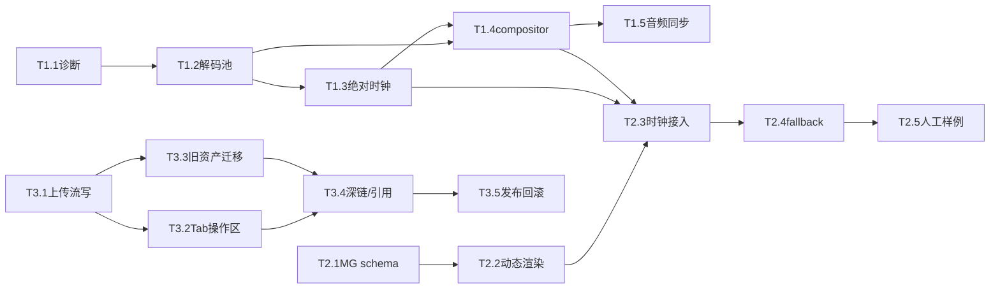

# 编辑器预览与资源库结构开发计划

版本：1.0　日期：2026-11-02　对应 PRD：`docs/frontend-preview-and-library-prd-2026-11-02.md`　范围：Clipwright 前端编辑器与工作区 API

> 本文是实施计划，不重写 PRD。代码行号按本计划编写时的工作树快照定位；实现前先核对变更后行号。人日按 8 小时，不含用户人工验收耗时。任何“开关”若注明“新增”，均为本计划实施时新增到现有 `settingsStore`/`editorPrefs` 风格中的单一布尔项，不代表代码现有配置。

## 0. 口径基线

| 议题 | 本计划执行口径（可推翻） | PRD 对应依据 |
|---|---|---|
| 旧素材迁移 | 用户显式触发；先 dry-run，再确认复制；不自动批量复制 | §7.2、§9.1、§14.1 |
| 工作区实体操作 | 目录树不新增删除/重命名实体文件；现有 remove 默认只删索引，purge 才删文件 | §9.1、§14.2；`workspace.py:297-322` |
| 解码预算 | 活跃解码最多 2 路；超额冻结非主层最近帧并显示降级提示，不阻塞主画面 | §4.1、§14.3 |
| MG 差异 | 预览头常驻“浏览器近似预览”；仅 `unsupported/approximate` 差异出现时显示差异角标 | §5.3、§14.4 |
| 历史外部资产 | 不在当前工作区时标“外部引用”，允许继续引用旧路径；不自动搬移 | §7.2、§14.5 |
| PRD 未变结论 | 保留 Canvas 多轨 compositor、单一 timeline clock、最终成片由后端权威；工作区目录树判定文件存在、索引只作元数据；不改变 timeline 主模型；不删旧资产；接口响应展示走 `asText`。 | §0、§3、§4、§7、§9 |

**本计划与 PRD 的差异清单**

| PRD 章节 | 本计划处理 |
|---|---|
| §10、§13 | 将 15 个原任务拆成可单独合并发布的任务包，补齐任务级依赖、开关默认值、前后端流式上传及明确人日。原 PRD 里没有真实开关名；这里给出新增 editorPrefs 键名，并显式标为待实现，不假称已有配置。 |
| §9.1、§12 | 流式上传采取 1 MiB 读块写 `.part`、成功后原子替换；单文件上限沿用 2 GiB。旧素材导入端点按 PRD 增量实现；未确认迁移授权前仅 dry-run。 |
| §11 | 本计划验收项逐一映射 PRD §11 的 12 项，另独立列出 60 秒连续播放与 MG 端到端播放；只设人工验收门槛，不把自动测试列为完成标准。 |
| §14 | 五项开放问题按本计划开头默认值实施，不作为本轮产品待拍板项重复询问。 |

## 1. 目标与非目标

**目标**：M1 将逐显示帧 seek 改为连续解码供帧，建立绝对 timeline clock、最多两路活跃解码与帧级诊断；M2 让结构化 MG spec 在同一 compositor 内可 seek/play/pause，并标明能力差异；M3 将工作区设为唯一媒体管理入口、上传写入 `materials/`、保留旧索引只读兼容并实现用户显式迁移。

**非目标**

- 不改成服务端预渲染整片或用 `/api/animation/preview` MP4 替代交互预览；保留现有 Hyperframes/既有渲染器作为最终输出权威（PRD §3、§4.2；`animation.py:170-216`）。
- 不重写 timeline/Clip/Track 数据模型，不引入新的顶层 clip 字段；MG spec 放 `Clip.metadata`（`types/timeline.ts:54-145`；`schema/timeline.py:58-184`）。
- 不改变 Agent、任务状态或终止机制；不得改 AGENTS.md #14（任务终态唯一驱动会话映射）与 #21（软着陆→收口→capped 判定单点），播放/暂停是 editor-local 状态，不能写任务状态（`AGENTS.md:72-76,119-138`）。
- 不引入 WebCodecs、FFmpeg.wasm、第三方动画 runtime 等重依赖；浏览器媒体 element + Canvas 2D 已覆盖本阶段目标，部署负担与兼容面不成比例。
- 不新增后端 service 层；仅在现有 API route 与工作区既有 service/索引模块内实现上传和 legacy import。
- 不做全格式专业 NLE、代理生成、HDR/色彩管理、任意 CSS 逐像素一致性，也不删除/重命名工作区实体文件。
- 不跑 pytest/vitest。开发期只允许 `npx tsc --noEmit`、`python -m py_compile` 编译检查；交付门槛是下文的人工验收点，不以“测试通过”作为任务完成标准。

## 2. 现状影响面

### M1：连续播放与合成

| 文件:行号 | 现状与计划改动 |
|---|---|
| `src/features/preview/PreviewPanel.tsx:111-166` | 音频同步 effect 每次 playhead 更新同步检查 element，100ms 节流、偏差 seek；改为 timeline clock 驱动 clip-local 时间、20ms 节流/边界触发。 |
| `PreviewPanel.tsx:168-207` | 播放 loop 逐帧累加 `dt` 并截断到 1/15s；改绝对 anchor 计算，保留 loop、变速、终点钳位。 |
| `PreviewPanel.tsx:209-225` | 卸载暂停媒体、后台隐藏暂停；扩展为冻结 anchor、暂停 video 和恢复后重锚。 |
| `PreviewPanel.tsx:439-464,502-522` | 当前帧采样与 canvas rAF；rAF 只负责 playhead/UI 与静态层刷新，视频帧回调触发合成。 |
| `PreviewPanel.tsx:921-949`、`compositeOrder.ts:3-6` | 共享 canvas 按 track.index 升序合成；保留顺序，做每 clip 隔离层及预算筛选。 |
| `PreviewPanel.tsx:983-1038` | video 分支每次调用 `seekVideo()` 后立即 `drawImage`；播放时换成 getPresentedFrame，scrub/随机定位仍允许 seek。 |
| `PreviewPanel.tsx:1341-1444` | 共享 ctx save/restore、transition/mask/filter 与 layer cache key；校正 cache key 覆盖和 ctx 状态回收。 |
| `PreviewPanel.tsx:1412-1438` | 源帧号量化缓存；播放帧回调计数必须防止同帧重复计数，cache budget 上限 256 MiB。 |
| `src/services/media/mediaManager.ts:70-189` | 注册视频 element；本地文件 `preload=auto`，URL 注册 metadata；改为惰性激活及有限解码池。 |
| `mediaManager.ts:266-344` | unregister/pauseAll/prebuffer/seekVideo；新增 `activateClip/deactivateClip/getPresentedFrame/destroy` 生命周期，scrub 专用 seek 保留。 |
| `mediaManager.ts:346-432` | 缩略图使用独立隐藏 video 且 `preload=auto`；thumbnail 并发限制为 1，防止绕过双解码预算。 |
| `src/stores/previewStore.ts:4-43,45-142` | `currentTimeSec` 是播放头与 timeline UI 的单一 store 来源；增运行时 epoch/diagnostics，不新增第二个 playing 真值。 |
| `src/stores/timelineStore.ts:115-135,151-161` | 设置 timeline/元数据同步 fps、duration，异步注册媒体；项目切换需清理旧活跃集而不清错新项目。 |
| `src/features/timeline/components/TimelinePanel.tsx:64-68,286-294,554` | 轨道激活与播放头显示依赖 previewStore；scrub 仍只写该 store。 |

**M1 高危点**：共享 Canvas 2D ctx 的 transform/clip/filter/composite 状态泄漏；媒体 element 的 pause/src/load/revoke 次序与 callback 竞态；`previewStore.currentTimeSec` 是唯一时间线时间来源，不可另造播放器播放头；timelineStore 动态注册与项目切换的资源归属；缩略图独立 video 会令实际解码超预算。

### M2：MG adapter

| 文件:行号 | 现状与计划改动 |
|---|---|
| `PreviewPanel.tsx:1129-1178` | animation clip 当前是脉冲占位；替换成 adapter display-list 绘制，失败仍显示清晰占位。 |
| `PreviewPanel.tsx:1353-1366,1412-1444` | 通用关键帧影响 transform/opacity/speed；MG 自有 local time/keyframes 独立求值，不能混写普通 clip.keyframes。 |
| `src/features/preview/mgHtmlPreview.ts:1-13,23-89,107-140` | 当前 sandbox iframe helper 可 seek/play/pause，但不是 compositor layer；保留为低保真 fallback 的隔离参考，不向主 DOM 注入 HTML。 |
| `src/features/timeline/engine/easing.ts:8-14,18-51,96-223` | 已有 cubic bezier、ease/back/elastic/bounce 及属性插值；adapter 映射表从此处与后端 validator 规范名对齐。 |
| `src/types/timeline.ts:54-145`、`clipwright/schema/timeline.py:58-184` | 前后端 metadata 为扩展字典；增加 TS 窄化 MgSpec，不改后端顶层 Clip shape。 |
| `clipwright/animation/mg/validator.py:7-23,65-97,100-174` | 元素类型/动画属性/easing 白名单权威；前端不得放宽为任意 CSS。 |
| `clipwright/animation/mg_renderer.py:71-124,233-307,310-581` | 后端 sanitize CSS/image 与 HTML 生成；参考安全边界，不能把返回 HTML 当作可信渲染源码。 |
| `clipwright/api/animation.py:119-167` | `/mg/html` 已有 HTML fallback 请求/响应，不新增逐帧 API 往返；`/preview` 是短片渲染路径。 |

### M3：资源库与工作区

| 文件:行号 | 现状与计划改动 |
|---|---|
| `src/features/assets/AssetPanel.tsx:21-30,36-52` | 有 `library` 与 `workspace` 双 Tab；searchQuery 是组件 local state。改 Tab 和 store 查询状态。 |
| `AssetPanel.tsx:111-162,218-239,276-305` | 上传仍走 `assetApi.upload`；通用搜索/上传总显示；失败回退到非持久化 demo assets。改为 workspace upload，所有 Tab 操作区隔离，错误保留文件名而不伪装成功。 |
| `src/features/assets/WorkspaceMediaTree.tsx:18-22,36-66,68-143` | 目录树按实时磁盘列文件，搜索纯前端过滤；加上传/刷新与索引状态、拖入时间线入口，外部引用独立标示。 |
| `src/stores/assetStore.ts:5-53` | `AssetTab` 含 library、默认 library；history 最多 50 条；activeTab/searchQuery 未持久化。需保留 alias 解析和迁移。 |
| `src/services/api/workspace.ts:149-201` | mediaTree 与 `workspaceApi.upload` 已存在；缺少 sha/index 状态类型及流上传进度类型。 |
| `src/services/api/asset.ts:49-79` | 老素材上传仍存在；保留 legacy list/remove 兼容，不作为新上传路径。 |
| `clipwright/api/workspace.py:259-294` | media-tree 以实时目录为准；upload 在 288 行 `await file.read()` 全读内存，随后一次 `write_bytes`；改 chunked temp write + atomic replace。 |
| `clipwright/api/workspace.py:297-322` | remove 默认仅删除索引、`purge=true` 删除磁盘；目录树不增实体删除/重命名。 |
| `clipwright/services/workspace.py:411-506` | `materials_files/media_tree` 扫目录并受 limit 控制；仍需明确 5000 文件上限与索引 join，不重复构建服务层。 |
| `clipwright/api/asset.py:90-128`、`services/asset_manager.py:90-120` | 旧资产 API/`assets/index.json` 路径与工作区材料目录不同；旧读取保留只读兼容。 |

**M3 高危点**：Tab 结构变更会影响默认入口、空态和 deep link；上传切换物理目录会造成“已上传素材消失”；外部路径引用不等同工作区 `rel`；后端上传原子替换必须处理同名覆盖/磁盘不足；`AssetPanel` 当前失败会放入 demo 数据，必须消除这种误报。

## 3. 架构落地细节

### 3.1 播放时钟

`PlaybackAnchor = { timelineSec, wallMs, speed, epoch }`，只由 `PreviewPanel` playback controller 持有；每次启动/暂停恢复/seek/速率变化/loop 回绕/visibility 恢复都重建 anchor。播放头在 rAF 回调计算 `anchor.timelineSec + (now-anchor.wallMs)/1000 * anchor.speed`，直接 `setCurrentTime`；禁止 delta 累加与 1/15 秒截断。rAF 负责 UI/playhead 更新及无视频时的静态合成；`requestVideoFrameCallback` 负责记录 presentedFrames、媒体时间戳与触发视频帧合成。浏览器不支持该 API 时按 display rAF 检查 readyState/currentTime 变化，最差每显示刷新合成一次，不做 seek 轮询。

暂停保存准确当前时刻并 pause 活跃媒体；隐藏页面沿用既有“自动暂停”策略，不后台追赶；恢复后由用户再播放并新建 anchor。loop 每帧对 `[lo,hi)` 取模并增加 epoch，逐 active video seek 一次后等新帧再清 loading。速率范围沿 previewStore 既有 0.25–4；媒体 playbackRate 为 `clip.speed * timelineSpeed`，倒放/负向 shuttle 退回 seek 模式，不假装 element 原生支持倒播。帧时间戳只校正媒体局部时间，不能写回全局 currentTime。

### 3.2 解码池、集合与漂移

活跃集合按时间窗计算：当前可见 video clips 中优先保留最高 z-index/最大画面面积主层；正在 overlap 转场的第二层保留；第三层及更多层冻结最近可呈现帧并标“低性能预览：冻结 N 层”。进入规则：当前时间进入 clip 区间，或距离开始 ≤2 秒且预算有空位；进入先 `preload=metadata`、`play()`，首帧到达后才清 loading。退出规则：越过结束点或离开 2 秒未来窗即 pause，降回 `metadata`；不得长期 `preload=auto`。池上限 2 路活跃解码，缩略图另设单独串行队列但不能与活跃播放同时抓同一视频帧；实际硬解码设备上限不可知，因此 thumbnail 在播放中延后。

局部期望源时间 `clipLocal=(timelineSec-start_sec)*clip.speed+source_offset_sec`。偏差 ≤80ms 不改速；80–250ms 以内暂调 `playbackRate` 为目标值 ±5%，最多 500ms后恢复；偏差 >250ms、source offset 改变、边界切换时暂停并 seek 一次，等 `seeked` 且 presented frame 新于 seek epoch 才画。若 500ms 纠偏后残差仍 >80ms，退回一次硬 seek；若失败/不支持速率则该 clip 逐帧 seek 并标降级，不拖住主层。PRD 阈值与 29.97fps 帧网格并存，比较采用秒而不是整数 timeline frame。

### 3.3 Compositor、缓存与超时

每个 clip 独立离屏 layer（尺寸按预览 canvas 像素、最大 1920×1080），内容绘制以 `save()` 开始、`restore()` 收口；主 ctx 只执行 layer compositing 和单 clip 的 mask/transition。任何异常通过 `try/finally` restore；禁止调用方 mask 裁剪污染后续 track。按 `orderTracksForComposite()` index 升序；同轨按 clip id 稳定顺序，重叠可见性仍用 timeline 时间判定。

cache key 覆盖 `asset_id + sourceFrame/presentedFrames + previewMediaVersion + geometry + dpr + clip transform + opacity/blend/filter/mask + style/text + MG spec hash + rendererVersion`；对每个活跃 layer 只缓存已完成的 bitmap/canvas，缓存池 256 MiB/项目 LRU，按 width×height×4 估算，超过立即淘汰最久未用项。视频帧缓存不复制全尺寸 ImageBitmap 常驻。源变化/clip 删除/项目切换通过 version 失效；占位结果不可缓存。单帧合成硬预算 16ms（1080p 目标）；超过时记录 p95/slow count，该帧不重试、不阻塞时钟，下一帧关闭非主层 mask/冻结层并显示降级徽标；不因单帧超时吞掉后续播放 tick。

### 3.4 MG adapter

新增 `src/features/preview/mgRenderer.ts`，输入 `MgSpec` 与 clip-local 秒，输出 display-list：`{version, width, height, commands:[{type:'text'|'shape'|'line'|'circle'|'ring'|'arc'|'bg'|'image', bounds, transform, alpha, style, text?, src?, z, warnings[]}]}`。`prepare(spec,params,assetResolver)` 校验结构并预载图片/字体；`evaluate(timeSec)` 先按每元素关键帧插值；`draw(layerCtx,rect,dpr)` 仅消费白名单命令；`dispose()` 释放监听与缓存。进合成路径由 `paintClipContent` 的 animation 分支调用，不按帧建 DOM/iframe。

easing 映射表以 `mg/validator.py:19-23,29-46` 的 canonical 名为输入、`timeline/engine/easing.ts:8-51,96-223` 的实现为执行源：linear/ease/ease-in/out/in-out/back-out/elastic-out/bounce；cubic-bezier 数组转 `{x1,y1,x2,y2}`；后端 alias 先 canonicalize，未知值 fallback linear 并列 warning。后端 elastic/bounce 是 cubic-bezier 近似时前端标 `approximate`。

不支持元素 fallback 顺序：Canvas white-list 原生实现 → 若资源/样式不可表达，画已支持字段并返回 `unsupported[]` 角标 → 仅在功能 flag 指定时用现有 `/api/animation/mg/html` 的 sandbox iframe 作为独立预览（不能直接采入主 compositor，不允许 `allow-same-origin`）→ 最后占位并说明原因。MG 图片只接受同源工作区代理 URL 或 blob URL；拒绝 `javascript:`、任意远程 URL 和 CSS `url()`；不 eval 模型字符串。浏览器近似预览文字坐标以 spec width/height 为逻辑画布，统一等比缩放和 center/left/right/top/bottom anchor；字体 ready 前显示“字体回退”，`measureText` 依 spec wrap/90% 宽限约束，禁止静默裁切。最终输出仍以后端 HTML/Hyperframes 为准。

### 3.5 资源库、上传和迁移

最终 Tab 为 `ai | workspace | history | dub | plugins`。`library` 输入/旧链接兼容映射到 workspace；不清空 history。工作区搜索、上传、刷新仅在 workspace Tab 显示；AI 语义搜索、配音、插件动作仍由各自面板管理。搜索值移到 `assetStore.searchQuery`，只过滤 media-tree 文件名，不做磁盘操作。无 projectId 时上传禁用；工作区文件树支持双击/拖放入 timeline，metadata 保存原 `local_path`，外部历史记录显示“外部引用”。

上传客户端继续使用已有 `workspaceApi.upload`，新增 progress callback 和返回 `saved/rel/kind/scan`；上传多文件串行逐文件请求、显示单文件与总进度，成功后刷新 media-tree，失败保留文件名和可读错误，禁止 demo fallback 冒充上传成功。后端 `workspace.py:274-294` 改为 `UploadFile` 分块读取，固定 1 MiB chunk，流式写到 `materials/<kind>/.<name>.<uuid>.part`；累计超 2 GiB 返回 413、空文件 400；fsync/关闭后 `os.replace` 原子落正式文件；失败删除 `.part` 并保留已存在的同名正式文件；随后调用既有 `scan_and_index`，不增加新 service 层。文件树受 5000 项扫描上限，超额响应明确 `truncated=true` 并提示缩小搜索/目录，不静默省略。

旧素材查询只读 `AssetManager` 索引；`POST /api/workspace/{id}/materials/import-legacy` 默认 dry-run，只接受显式 asset_id 列表、最多 200 项；execute 复制非移动、SHA256 去重，不覆盖，返回原 id 到新 rel 映射。用户历史记录不在当前工作区时作为外部引用继续按原 path 引用，不自动迁移。移除旧 Tab 不等于删除 `assets/`、索引或文件。

## 4. 数据与契约增量

### 接口

| 接口 | 请求/缺省 | 响应与错误 |
|---|---|---|
| `POST /api/workspace/{project_id}/materials`（现有） | multipart `file`；chunk 1 MiB；上限 2 GiB | `{project_id,saved,rel,kind,scan}`；400 不支持类型/空文件，404 workspace 不存在，413 超限，409 原子落盘冲突/写盘失败。新返回字段向后兼容。 |
| `GET /api/workspace/{project_id}/media-tree?limit=2000`（现有） | `limit` 缺省 2000，范围 1–5000 | 文件项增加 `sha256?:string`、`indexed_status?: indexed\|pending\|failed\|unindexed`，缺省 `unindexed`；增加 `truncated:boolean`。404 workspace 不存在。 |
| `POST /api/workspace/{project_id}/materials/import-legacy`（新增） | JSON `{dry_run:boolean=true,asset_ids?:string[]}`；最多 200 条；缺省 dry-run | `{dry_run,scanned,migrated:[{asset_id,sha256,old_path,rel}],reused:[{asset_id,sha256,rel}],failed:[{asset_id,reason}]}`；400 >200/参数不合法，404 项目或 asset 不存在，409 同名内容冲突。只复制不移动。 |
| `POST /api/animation/mg/html`（现有 fallback） | 复用 `{mg_json,params={},width=1280,height=720,fps=30}` | `{html,duration_sec,width,height,fps,animation_id,variables}`；400 无效 MG，404 模板缺失，500 渲染异常；不作为 Canvas 每帧接口。 |

API 参数验证错误必须由前后端转换成用户可读文本；服务错误字段渲染均经 `asText`，数组用 `textList`，符合 #13。同步 `docs/frontend-backend-parity.md` route/client matrix。

### 类型与 store

- `src/types/timeline.ts` 为 `Clip.metadata` 增窄化 `MgSpec`/`MgElement`/`MgKeyframe` 类型及 `mg_def?`、`mg_params?`、`preview_renderer?` 字面量；Python `Clip.metadata` 仍开放 dict，不加顶层字段。MG 时长缺省 3 秒、预览最多 8 秒；clip duration 仍 timeline 权威。
- `previewStore` 运行态增加 `playbackEpoch:number`、`clockMode:'raf'|'video-frame'|'fallback'`、`droppedFrames:number`、`lastPresentedTime:number|null`、`activeDecodeCount:number`；不得持久化入 timeline JSON。`currentTimeSec` 仍是唯一权威播放头；`isPlaying` 仍是 editor-local 状态。
- MediaManager 增 `activateClip/deactivateClip/getPresentedFrame/activateSet/destroy`；`seekVideo` 明确用于 scrub/随机 seek，不再由正常播放合成调用；回调携带 epoch 防止旧资源 callback 污染新项目。
- `WorkspaceMediaTree` props 增 `search/upload/onRefresh/onAddToTimeline`，或直接使用 hooks，但只允许一个数据责任方；workspace API 类型增加 `sha256/indexed_status/truncated` 与上传进度签名；AssetTab 删除 `library` 新入口但保留解析别名。

## 5. 工作分解（WBS）

> **执行进度（T1.1–T1.4 已落地，待人工验收）**：`npx tsc --noEmit` 通过（人工走查仍待做）。
> - T1.1：新增 `src/features/preview/playbackStats.ts`（解码路数/冻结数/已呈现/丢帧/漂移/store），
>   `PreviewPerfOverlay.tsx` 增「解码路数 · 已呈现 · 丢帧 · 播放头漂移」四行。
> - T1.2：`mediaManager.setActiveVideos(ids,{budget,rates})` + `activeDecodeCount()` /
>   `frozenAssets()` / `frameStats()`；`registerFile`/`registerUrl` 的 `preload` 从 `auto` 降为
>   `metadata`；`PreviewPanel` 新增 `applyDecodePool()`（按 z 序取最上层 ≤2 路、按 clip.speed×
>   播放速度设 playbackRate、其余 pause 保帧），暂停时把集合收空。
> - T1.3：播放循环改成**绝对时间锚点**（起播打 `(墙钟, 时间线, 速度)`，每帧用绝对差算位置；
>   外部 seek/变速/回绕才重打锚点），移除 `Math.min(dt, 1/15)` 截断。
> - T1.4：`compositeTimelineClips(..., playing)` / `drawClipToPreview(..., playing)` /
>   `ClipPaintEnv.playing` 贯通；播放中**不再每帧 seek**，只在漂移 >250ms 时纠一次；
>   暂停/拖动仍走 seek-to-frame。rVFC 计数在 `mediaManager.hookFrameCounter()`。
> - T1.5（音频 20ms 节流与切轨恢复）与 M2/M3 未开始。

> - T1.5（音频同步）：节流 100ms → **20ms**；`audioClips` 用 `useMemo` 建索引（不再每次遍历全部轨道）；
>   预缓冲扫描单独 500ms 节流（它扫全时间线，没必要跟着 20ms 走）。
> - M2 已开工（T2.1–T2.4）：新 `src/features/preview/mgRenderer.ts`（MG spec → canvas
>   display-list：text/shape/line/circle/ring/arc/bg/image、数字/颜色插值、后端 easing 映射、
>   图片源白名单只认同源/blob、`fidelity` 台账）；新 `src/features/preview/mgFidelity.ts`
>   （差异角标数据源）；`paintClipContent` 的 `animation` 分支改为**有 spec 就真渲染**，
>   无 spec 才回到"未渲染预览"占位；预览头「近似预览」在有差异时显示「N 处差异」。
>   T2.5 人工比对规程写在 `docs/mg-preview-fidelity-2026-11-02.md`（10 模板 × 5 时点登记表待人工填）。
> - M3 未开始。

> - M3 已落地（T3.1–T3.5）：
>   - T3.1 后端：`api/workspace.py` 上传改**1 MiB 流式分块写 `.part` → `os.replace` 原子替换**、
>     2 GiB 硬上限 413（并清 `.part`）、同名默认 **409**（`?overwrite=true` 才覆盖）；新增
>     `UPLOAD_MAX_BYTES` / `UPLOAD_CHUNK_BYTES` 常量。前端 `AssetPanel.handleUpload` 从
>     旧 `assetApi.upload` 改为 `workspaceApi.upload`（写 `<workspace>/materials/<kind>/`），
>     先拦 >2 GiB，并对 409/413 给可读提示。
>   - T3.2：搜索/上传操作区从「所有 Tab 常驻」改为**只在工作区 Tab**（素材库 Tab 保留只读搜索），
>     `assetStore.activeTab` 默认改 `workspace`。
>   - T3.3：后端 `GET /{id}/legacy-assets`（只读清单，带 `in_workspace`）与
>     `POST /{id}/legacy-import?dry_run=`（复制不移动、SHA256 去重、默认 dry_run）；
>     前端 `WorkspaceMediaTree` 顶部横幅「旧素材库里还有 N 个文件不在工作区 → 导入到工作区」，
>     点击先 dry-run 摆数字、确认后才真复制。
>   - T3.4：深链/回滚——旧 `library` Tab 与 `setActiveTab('library')` 仍可用，回滚只需把
>     `assetStore` 默认值改回 `'library'`；未新增"重新定位文件"向导（按计划口径）。
>   - T3.5：`api_reference.md` 与 `frontend-backend-parity.md` 已同步三个新/改端点。
> - **回滚开关已落地**（口径：新增 editorPrefs 布尔项、默认关）：
>   `settingsStore.previewContinuousPlayback`（默认 `false`，持久化在 `editorPrefs`）。
>   关 = 旧路径（每帧 seek 取帧）；开 = 连续解码 + 解码池 ≤2 路 + 播放中不 seek。
>   预览头有一个 Play 图标按钮可即时切换（`data-testid="preview-continuous-playback"`），
>   便于人工 A/B：同一个 60 秒素材，关/开各播一遍，看丢帧与漂移差异。
>   注意：**开关默认为关意味着默认仍是旧行为**，人工验收通过后由用户打开（符合计划口径）。
> - **尚待人工验收**：M1 平滑播放、M2 MG 真渲染与差异角标、M3 上传与旧素材迁移四条走查。

任务估算各期合计为 M1 18、M2 15、M3 10 人日；人工联调与阶段回归预留 6 人日。规模 S≤2、M=3–5、L≥6 人日；风险 H/M/L 表示影响×不确定性。下面“人工验收”才是完成门槛。

### M1：播放底座（5 项，18 人日）

| 编号 | 目标；涉及文件与函数（行号） | 前置依赖 | 人工验收点（现象） | 估算 | 风险 |
|---|---|---|---|---:|---|
| T1.1 | 建播放诊断与可见降级；`PreviewPanel.tsx:168-225,439-464,502-522,603`；`previewStore.ts:4-43,45-142` | 无 | 性能浮层能见到 active decode、presented/drop 帧、合成耗时；暂停时指标不继续增长。 | 3/M | M |
| T1.2 | 解码池与生命周期；`mediaManager.ts:70-189,266-344,346-432` | T1.1 | 单视频播放时只有 1 路 active；两路叠化最多 2 路；第三层冻结最近帧并出现徽标；停止后媒体静音。 | 5/L | H |
| T1.3 | anchor 时钟与边界；`PreviewPanel.tsx:111-225`；`previewStore.ts:60-84,119-141` | T1.2 | 1x/0.5x/2x 播放 60 秒播放头不因卡顿慢漂；loop 跨回绕无倒退闪跳；后台隐藏后媒体停声。 | 4/M | H |
| T1.4 | frame callback 与隔离 compositor；`PreviewPanel.tsx:921-949,983-1038,1341-1444`；`compositeOrder.ts:3-6` | T1.2、T1.3 | 两轨 0.5 秒叠化无黑帧；mask 不裁掉下一轨；视频帧更新时不再逐 rAF seek。 | 4/M | H |
| T1.5 | 音频同步和降级；`PreviewPanel.tsx:111-166,168-207`；`mediaManager.ts:293-314` | T1.3、T1.4 | 60 秒声画样片切轨后误差≤100ms；mute 即时生效；主层播放不中断。 | 2/M | H |

### M2：MG 与时间线动画（5 项，15 人日）

| 编号 | 目标；涉及文件与函数（行号） | 前置依赖 | 人工验收点（现象） | 估算 | 风险 |
|---|---|---|---|---:|---|
| T2.1 | 定义 MgSpec 与静态 adapter；`types/timeline.ts:54-145`；新增 `features/preview/mgRenderer.ts`；`validator.py:7-23,65-97` | 无；可与 T1.1/T1.2 并行 | text/shape/line/image spec 放入 animation clip 后，预览画出真实元素而非正弦占位。 | 3/M | M |
| T2.2 | 动态关键帧、安全资源与字体；`mgRenderer.ts`；`PreviewPanel.tsx:1129-1178,1353-1366`；`mg_renderer.py:71-124` | T2.1 | 拖至 0/25/50/75/100% 显示各自状态；非法 URL 不请求；缺字体有回退提示。 | 4/M | H |
| T2.3 | 接入统一 clock/compositor 生命周期；`PreviewPanel.tsx:921-949,1341-1444`；`previewStore.ts`；`mgHtmlPreview.ts:1-13,23-89` | T2.2、T1.3、T1.4 | 视频、文字、MG 同步播放/暂停/seek；离开 clip 或切项目后旧 MG 不残留。 | 4/M | H |
| T2.4 | fidelity 标记与 fallback；`previewFidelity.ts:4-45`；`mgHtmlPreview.ts:107-140`；`api/animation.py:119-167` | T2.3 | 不支持 CSS、无效图片、字体缺失只影响对应 clip，主预览不白屏；差异存在时出现角标。 | 2/M | M |
| T2.5 | 十样例、五时点人工比对及说明；`docs/animation_system.md`、前端 preview fidelity 文档 | T2.4 | 10 个模板在 0/25/50/75/100% 逐一对比；浏览器头常驻近似说明；导出不读取前端 canvas。 | 2/S | M |

### M3：资源库结构与上传（5 项，10 人日）

| 编号 | 目标；涉及文件与函数（行号） | 前置依赖 | 人工验收点（现象） | 估算 | 风险 |
|---|---|---|---|---:|---|
| T3.1 | 上传切工作区并流式写入；`AssetPanel.tsx:111-162`；`workspace.ts:180-190`；`api/workspace.py:274-294` | 无 | 上传大文件时内存不随全文件大小跃升；异常/取消后 `.part` 不出现在目录树；成功文件完整出现于 `materials/<kind>/`。 | 3/M | H |
| T3.2 | Tab、搜索/上传下沉；`AssetPanel.tsx:21-30,197-239,276-305`；`assetStore.ts:5-53` | T3.1 | 仅 workspace 出现通用搜索/上传；library 默认入口映射到 workspace；其它 Tab 控件不挪位。 | 2/S | M |
| T3.3 | legacy 只读查询与显式迁移；`api/workspace.py:240-294`；`services/workspace.py:411-506`；`asset.py:90-146` | T3.1 | dry-run 显示计划但目录不变；execute 后新路径可见、旧路径仍可读；同 SHA 显示 reused。 | 3/M | H |
| T3.4 | 外部引用/deep link/树内拖入；`WorkspaceMediaTree.tsx:18-66,103-143`；`assetStore.ts:5-53`；router/query consumer（全仓定位后修改） | T3.2、T3.3 | 旧 `tab=library` 链接落到 workspace；历史外部引用可加 timeline 且显示标识；拖入 clip 后刷新仍可定位。 | 1/S | M |
| T3.5 | 接口 parity、空态和 rollback；`workspace.ts:149-201`；`docs/frontend-backend-parity.md:342-354`；`settingsStore.ts:4-23,93-143` | T3.1–T3.4 | 无 projectId 按钮禁用；320px 不溢出；关闭开关后旧入口仍能查看旧资产，磁盘数据不变。 | 1/S | M |

## 6. 依赖与顺序

T2.1 可与 M1.1/M1.2 并行；T3.1 与 M1/M2 可并行，但上传写盘与工作区树必须同批联调；M1.4 与 M2.3 必须串行，因为 MG layer 依赖真实隔离 compositor。M1 必须先做：MG、waveform 和所有可预览类型都依赖唯一时间线时钟、可控活跃集合及稳定合成入口；否则 MG 播放只会接入第二套 wall clock 或在 seek 下继续显示旧帧，不能验收 PRD §3 的“统一 timeline time”。

## 7. 每期发布与回滚

| 期 | 开关（均为新增 editorPrefs 布尔项）与默认值 | 灰度 | 回滚步骤 |
|---|---|---|---|
| M1 | `previewContinuousPlayback=false`；合并后默认关闭，完成首轮人工验收后本地用户开启。关闭时保留旧 playback loop 与 seek 路径，诊断字段继续只读。 | 开发者本地用户，先一段 1080p 单视频，再单项目两轨叠化。 | 在编辑器设置关闭该项；刷新页面；检查旧 seek 播放入口生效；不撤销/改写 timeline 数据；若后台仍有媒体，离开编辑器触发 `pauseAll`。 |
| M2 | `previewMgCanvas=false`；MG Canvas renderer 单独关闭，普通视频不依赖；sandbox HTML fallback 仍受现有隔离属性约束。 | 单项目内部模板与 LLM spec，先无图片、再验证白名单 image。 | 关闭该项后 animation clip 回退现有占位；清 renderer registry 与离屏缓存；不改 `metadata.mg_def`，必要时单独关闭 HTML fallback。 |
| M3 | `workspaceAssetPanelV2=false`；关闭后恢复 `library` Tab 兼容 UI；后端 streaming upload 保持向后兼容，不回退成全读内存。 | 本地用户先单项目；稳定后逐项目启用，不批量迁移。 | 关闭 UI flag、保留旧 `/api/asset/list/upload` 只读/旧入口；确认已上传 `materials/` 文件仍可在工作区树见到；停止 legacy import；不删文件、不重命名目录、不清索引。 |

**命名约束**：当前检查到的 settingsStore 只有 `allowDemoFallback` 等 editorPrefs 字段（`settingsStore.ts:4-23,93-143`），上表三个键是明确拟增项；发布任务必须在 UI 与本地偏好落点完成后，才能宣称该期开关存在。

## 8. 风险登记册

| 风险/成因（代码证据） | 影响面 | 缓解 | 触发后的应急动作 |
|---|---|---|---|
| 预览与成片不一致：Canvas 与 Hyperframes/FFmpeg 不同，MG easing/字体也不同（`PreviewPanel.tsx:1341-1444`；`mg_renderer.py:233-307,405-448`） | 用户依据近似画面作剪辑决策 | 全局近似提示；差异角标只在实际差异时出现；10 模板×5 时点人工对比；不复用 canvas 帧导出 | 关闭 `previewMgCanvas` 对问题 MG 回占位；保留后端成片输出并标明差异，不宣称像素一致。 |
| 解码并发打爆：`registerTimeline` 注册全 timeline video（`mediaManager.ts:174-187`）；thumb video 独立（`:397-420`） | 硬解码器/GPU/内存饱和，预览卡顿或浏览器崩溃 | active≤2，预加载未来最多 2 个且只 metadata，缩略图播放时串行延后；离开窗 pause | 关闭连续播放 flag；限制到 1 路，冻结非主层；停缩略图队列并让用户重新打开项目。 |
| 合并后旧素材“看不见”：旧上传进 `assets/`，media-tree 只扫 workspace materials（`asset.py:90-128`；`workspace.py:259-271`） | 用户误认素材丢失、旧工程无法继续编辑 | legacy index 只读显示；显式迁移、SHA 去重、复制不移动；合并 UI 前先完成列表兼容 | 关 `workspaceAssetPanelV2` 恢复 library；不清旧索引与文件；暂停迁移。 |
| 深链失效：Tab 类型含 `library` 且默认 library（`assetStore.ts:5,28-38`），URL consumer 未核实 | 书签、历史入口打开错误 Tab | 全仓搜索 query/tab 消费者；留 alias 至少一个发布周期 | 将旧 tab 参数 redirect 到 workspace；不删除 alias，发补丁修复路由。 |
| MG spec 注入/XSS：spec 可能模型生成，后端仅有自己的 CSS/image 安全校验（`validator.py:65-174`；`mg_renderer.py:71-124`） | 主页面脚本执行、任意请求、canvas taint | Canvas adapter 只消费类型/属性白名单；image 仅同源/blob；不得执行 HTML；fallback iframe sandbox 不开 same-origin | 关闭 HTML fallback 与 `previewMgCanvas`；仅显示不可信动画占位，保留原 spec 供后端验证。 |
| Canvas 缓存内存增长：现 cache key 覆盖像素维度但没有计划中的统一预算（`PreviewPanel.tsx:1412-1438`） | 4K/大量文字图层长期占用内存 | 按 RGBA byte 估算 256 MiB/项目 LRU；项目切换 dispose；占位不缓存；清理 listener | 降至 128 MiB、关闭 MG layer cache；清缓存后仍保持不缓存视频全帧。 |
| 全读上传造成内存峰值：`workspace.py:288-291` | 大文件请求耗尽 worker 内存、同名损坏 | 1 MiB chunk、2 GiB 上限、`.part` + 原子替换、失败删除临时文件 | 上传失败返回错误、不覆盖旧文件；暂时禁用新 UI 上传按钮，保留旧文件及索引。 |
| 当前共享 ctx clip 边界可能泄漏：`PreviewPanel.tsx:1389-1444` | mask/filter/blend 影响后续 track | 每 clip save/restore finally；mask 只施加离屏层；双轨人工视觉覆盖 | 关闭问题 clip 的 mask/高级 transition，显示 fidelity warning；回滚 compositor flag。 |
| session/终止不变量被误改：播放与全局任务状态都在 app store 环境，但规范明确任务终态唯一驱动会话（`AGENTS.md:72-76,119-138`） | 会话被错误推进/停止/无法续跑 | 只改 previewStore；review 列出 #14/#21；所有播放控制不调用 task/session API | 撤回 session/task 改动；仅回滚预览功能开关，不动任务数据。 |

## 9. 人工验收清单

所有项以人工点击和可见现象确认，不跑 pytest/vitest；清单逐项映射 PRD §11。

### M1：连续播放（PRD §11.1–4）

1. 打开 1920×1080、30fps、60 秒单视频，点击播放并观察一分钟 → 视频不是按 seek 停顿；新帧连续变化，诊断累计丢失/重复新帧≤30，playhead 与秒表差≤100ms。
2. 播放中拖到 5 个随机位置再播放 → 每次明确呈现 seek/loading，只有新帧到达才清除状态；本地 SSD 300ms 内恢复、网络 1000ms 内恢复，无旧帧闪回。
3. 两段视频做 0.5 秒叠化，随后在第三路重叠 → 前两路同屏无黑帧且 active≤2；第三路冻结非主层最近帧并出现降级徽标。
4. 播放闪光/拍手声画样片 60 秒并中途切轨 → 声画偏差≤100ms、切轨恢复≤250ms；点击 mute/轨道 mute 后立即静音。
5. 改速 0.5x、1x、2x，后台切走后返回 → 播放头按速率推进；隐藏时音画停止；回前台不会把后台墙钟时间补播。
6. **端到端：60 秒平滑播放**。载入 1080p/30fps 素材 → 开启性能浮层 → 播放满 60 秒 → 观察画面、presented/drop 指标、首末播放头与外部秒表 → 全程非逐帧 seek、丢失/重复≤30、误差≤100ms。

### M2：MG 与时间线（PRD §11.5–7）

7. 把带 text、shape、image 和至少两组 keyframes 的 MG spec 加到 animation clip，播放到中段 → 看到真实元素与运动，不再是“未渲染预览”。
8. **端到端：MG 动画在预览中播放**。同一时间线放视频、文字、MG → 播放、暂停、拖到 50%、再播放至 MG 片段末尾 → MG 与视频同步，seek 精确变化，越出片段后 MG 消失；导出仍以后端结果为准，预览头保留“浏览器近似预览”。
9. MG 使用不支持 CSS 特性、缺失字体、无效图片地址 → 仅该 clip 显示 unsupported/fallback/字体回退，不白屏、不执行外域请求。
10. 将 10 个模板分别定位 0/25/50/75/100% 并与后端输出对照 → 差异项有角标记录；通过项不出现错误角标。

### M3：工作区资源库（PRD §11.8–12）

11. workspace Tab 上传 MP4、PNG、WAV 多文件并刷新页面 → 文件分别位于 `materials/video|image|audio/`，树仍可见且索引状态显示；拖到 timeline 可生成可重载 clip。
12. 对旧素材点 dry-run，再确认 execute → dry-run 不改文件；执行后新路径与 SHA 去重结果可见，旧路径/旧文件仍保留。
13. 依次点 AI 匹配、工作区、历史、配音、插件 → 通用搜索与上传只在 workspace；AI 自身语义搜索仍在 AI Tab。
14. 在工作区搜索子目录文件名再清除搜索 → 仅过滤文件显示；清除后完整恢复，磁盘文件不变化。
15. 无 projectId 打开 workspace 并尝试上传，再把面板缩到 320px → 上传禁用且提示打开项目；输入/36×36 上传按钮不溢出不互挡。
16. 打开 `tab=library` 旧链接并从历史选一个不在当前工作区的素材 → 自动落 workspace 或显示 history 正常内容；该素材标“外部引用”，继续添加时仍用旧路径且不复制文件。
17. 上传一个大于 1 GiB 文件并中途断开 → worker 不整文件缓存；正式文件不被半截覆盖，`.part` 被清理，UI显示该文件失败并可重试。

## 10. 估算与里程碑

### 任务级人日

| 阶段 | 任务估算 | 小计 |
|---|---|---:|
| M1 | T1.1 3 + T1.2 5 + T1.3 4 + T1.4 4 + T1.5 2 | 18 |
| M2 | T2.1 3 + T2.2 4 + T2.3 4 + T2.4 2 + T2.5 2 | 15 |
| M3 | T3.1 3 + T3.2 2 + T3.3 3 + T3.4 1 + T3.5 1 | 10 |
| 联调/人工走查准备 | 前后端接口对齐、准备样片/模板、人工反馈修正 6 | 6 |
| **总计** | **43 任务人日 + 6 联调 = 49 人日** | **49** |

**关键路径**：依赖图上的主链为 T1.1→T1.2→T1.3→T1.4→T2.3→T2.4→T2.5 = 24 人日；T2.1→T2.2 共 7 人日可在 M1 前半段并行完成，T1.5 在 T1.4 后与 T2.3 并行，M3 也可并行。因此关键路径不是把 M1、M2 小计直接相加。另预留 6 人日联调/人工反馈；按单独工作量计，总量仍为 49 人日。M3 的 legacy import 若遇数据兼容问题，不阻断 M1/M2 发布。

**里程碑**：M1 18 人日，完成后可单独发布连续播放底座；M2 15 人日，依赖 compositor 后可单独发布 MG 预览；M3 10 人日，可与前两期并行独立发布工作区改造；阶段交付累计 49 人日（含 6 联调）。

**日历工期估计**（有效工作日、人员持续可用，联调人日均按阶段尾部反馈窗口排入）：两人约 27 个工作日，三人约 26 个工作日。两人方案的 49 人日总量下界为 24.5 日，但主依赖链为 24 日；三人方案仍受同一 24 日串行链限制，额外 6 人日反馈窗口分别约占 3/2 日并可分配多人并行，取整后估为 27/26 日。M3 与 M1/M2 同期开工；外部产品拍板、跨团队排队不计。不能用总人日除人数覆盖 24 日主链。

**如果只能先做一件事**：先做 M1.1+M1.2（诊断 + 有限解码池），优先让单视频连续供帧且把解码并发变成可观测、可控；这同时解决流畅度根因并给 MG/compositor 后续提供稳定帧源，不先做纯 UI Tab 改名。

## 11. 需要产品拍板（本计划新暴露，最多 4 项）

1. **连续播放开关的默认策略**：本计划首发默认关闭，人工验收后本地用户开启；若产品要求所有新项目默认开启，须接受无法逐用户回滚的兼容风险。此项不同于 PRD 既定阈值。
2. **工作区上传同名文件策略**：本计划默认拒绝覆盖并返回 409，用户改名后重传；是否要由产品提供“覆盖”按钮？默认不提供，以免破坏已引用路径。
3. **超过 2 GiB 上传限制的 UI 口径**：计划返回 413 并提示分批/压缩；是否需在客户端上传前直接拦截？默认前端提示 + 后端硬限制双重校验。
4. **外部引用失效时的呈现**：允许引用旧路径，但若源盘不可达仍保留 timeline clip 与路径提示，不静默移除；是否要求额外提供“重新定位文件”操作？本期默认不新增重新定位向导。
