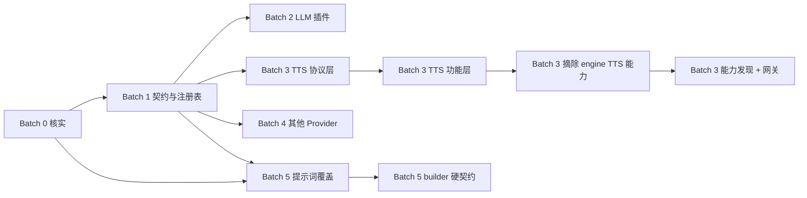

# Provider 插件化与提示词覆盖编码计划

## 0. 目标与完成定义

目标：依据已完成 PRD 与本次核实事实，将 LLM、语音、其他 Provider 与提示词符号覆盖能力实现为遵守既有贡献契约的插件扩展，并先消化 PRD 中 70 处待核实项。

完成定义（DoD）：Batch 0 的 70 处待核实（**加裁定 3/4 新增的 9 处 = 79 处，编号 H-001…H-079**）均有结论、证据和去向；Batch 1–5 每项任务均完成并通过本计划限定的编译检查及人工验收；既有同名内置让位、TTS 身份/缓存及提示词覆盖顺序保持；密钥不明文、前端不写死 Provider 字段；测试目录的 provider/TTS/prompt 断言已逐项盘点；文档与不变量同步；未新增 demo 插件；CI 在 Python 3.12 下通过 `python -m pytest -q`。测试套件由人执行，编码期不得运行 pytest/vitest。

**裁定 3/4（2026-11-02 晚）已并入 DoD**（PRD §15）：

- 裁定 3：engine **不再默认携带 TTS 能力**——`dub_script` 编排、切句/对齐策略、内置 provider 默认注册全部离开 engine；TTS 变成「主 agent 识别需要 → 能力解析 → 功能插件提供」的链路；「开始创作」页的 TTS 入口由功能插件经 `UI_SLOT` 贡献，无插件时入口不出现；能力缺失是一等状态（`NOT_FOUND` + 如实告知），不是异常，也不许直连服务兜底。
- 裁定 4：**全部 8 个 `build_*` 与 26 个常量符号都可被插件替换**；builder 覆盖必须过**签名 / 占位符 / 双 dry-render（两组样例输出必须不同）/ 纯度**四关，失败回落默认 builder；**不产出任何 demo 插件**，只交付能力入口（符号清单接口 + 契约文档 + 校验器 + 内联负例）。

## 1. 现状与改动面摘要

- 改动面：贡献契约/注册与分发、Provider 协议适配、后端 API/schema、管理页 schema 驱动、提示词按符号覆盖、文档与兼容性检查。
- LLM 唯一入口：`clipwright/providers/llm/__init__.py:25-31`；同名插件已注册时内置注册立即让位。
- TTS 唯一入口：`clipwright/services/voice.py:715` `_get_provider`；身份只来自 `contribution.id`，并保留凭据指纹缓存键 `:731-737`。
- 提示词唯一来源：`clipwright/prompts.py`；覆盖顺序固定为 `prompts.py < Category < Persona < Skill < 插件`。
- 贡献注册：`plugins/base.py:74`、`plugins/contribution_dispatch.py:41,46,49,50,141`；Provider 协议见 `providers/base.py:16,43,108,126`。
- API 与前端：`api/providers.py:30,36,45,81,87,102,111,123`、`src/pages/admin/ProvidersPage.tsx:15-19`、`src/services/api/providers.ts`。
- TTS 实际主要承载工作流/编排，不按大量表单控件估算；提示词消费点共 8 处，须先核对 PRD 的其他待核实主张。
- **裁定 3 后改动面变大**：TTS 编排（`services/voice.py:887 dub_script`）、切句（`:127 split_text`）与内置默认注册（`providers/tts/__init__.py:39`）都要从 engine 摘走；`PublicUploadManager`（`:228`）降级为通用服务。前端实测 TTS 控件只有 5 个（`DubView.tsx` 2 个 / `VoicePage.tsx` 3 个），所以前端改动集中在**入口由插件贡献**而非重写页面。
- **裁定 4 后 builder 不能只做占位符比对**：8 个 `build_*` 是行为接口，必须有签名 + 双 dry-render + 纯度校验，否则插件可以「参数收下却不用」，把运行时数字写死。

## 2. 分批计划（Batch 0–5）

### Batch 0：核实（第一批，禁止跳过）

把 PRD 70 处「待核实」逐条登记为 H-001 至 H-070。每项均需回答问题、记录证据命令/文件/行号、结论（成立/不成立/需作者裁定）及影响任务；输出到本计划对应核实台账，完成后将台账结果同步 PRD 进度块。下表为可执行核实分组；实施者必须将每组展开为有原始 PRD 节号与原文定位的逐条记录，不得把一个结论套给多项。

| 编号 | 要回答的问题 | 命令/文件 | 产出位置 |
|---|---|---|---|
| B0-T1 | 70 处待核实分别落在哪些事实域、哪些已由本事实包覆盖？ | `rg -n "待核实" "J:\\Clipwright\\docs\\provider-pluginization-and-prompt-override-prd-2026-11-02.md"`；对照 PRD §1–§15 | 本计划 §2 Batch 0 核实台账，逐条 H-001…H-070 |
| B0-T2 | ContributionKind 名单、数量、可贡献点与新增限制是否与 PRD 一致？ | `clipwright/plugins/contribution.py`；`plugins/base.py`；`plugins/contribution_dispatch.py` | 同上，契约事实栏 |
| B0-T3 | manifest 字段、权限/签名/依赖/启停及配置注入实际 schema 是什么？ | `clipwright/plugins/` 下 manifest/schema/loader；`rg -n "manifest|ContributionRegistry|permission|secret" clipwright/plugins` | 同上，插件加载事实栏 |
| B0-T4 | 冲突、优先级、reload/回滚的现行行为及测试断言是什么？ | `clipwright/plugins/` 注册、加载、reload 实现；`rg -n "ContributionRegistry|reload|conflict|priority" tests` | 同上，注册与生命周期事实栏 |
| B0-T5 | LLM Provider 协议、isobase 调用边界、role 解析与 reasoning 透传是否可扩展？ | `clipwright/providers/base.py`；`clipwright/services/llm.py`；锁文件中 isobase 版本 | 同上，LLM 事实栏 |
| B0-T6 | TTS 凭据、上传器、别名、缓存失效、异常与 `/dub` 对齐工作流边界是什么？**（裁定 3 追加 4 问）** ① 是否已有 agent 经能力名/工具调用触发配音，还是只有前端点 `/dub`？② `PublicUploadManager`（`services/voice.py:228`）除 TTS 外还有谁在用？③ `ensure_tts_providers_registered()`（`providers/tts/__init__.py:39`）与 `settings_store.apply_all()` 谁先？④ `TTS_PROVIDER` 贡献当前由 `contribution_dispatch` 的哪个分支消费？ | `clipwright/services/voice.py`；`clipwright/providers/tts/__init__.py`；`clipwright/api/voice.py`；`rg -n "PublicUploadManager|ensure_tts_providers_registered|dub_script|TTS_PROVIDER" clipwright tests` | 同上，TTS 事实栏 |
| B0-T7 | embedding/rerank/STT 的协议、注册、API 与设置动态选项现状是什么？ | `clipwright/providers/{embedding,rerank,stt}/`；`clipwright/api/providers.py`；`clipwright/api/settings.py` | 同上，其他 Provider 事实栏 |
| B0-T8 | 提示词 26 常量、8 builder、8 个消费模块、插件注入路径及测试快照在哪里？**（裁定 4 追加 3 问）** ① 8 个 builder 的实际签名与**逐符号调用点**（现仅核实到 8 个模块级导入点）？② `plugins/prompt_registry.py` 是否已有 `mode: append/replace` 概念？③ Category / Persona / Skill 三层是**真能覆盖**提示词，还是只能附加？ | `clipwright/prompts.py`；事实包列出的 8 个导入点；`clipwright/plugins/prompt_registry.py`；`rg -n "build_(budget_note|plan_translate_system|bgm_match_system|anim_marker_system|anim_marker_user|material_queries_batch_prompt|material_queries_prompt|material_english_prompt)" clipwright tests` | 同上，prompt 符号清单及消费者矩阵 |
| B0-T9 | 管理页 schema、密钥表单、角色绑定及 API 前后端字段如何映射？**（裁定 3 追加 1 问）** `UI_SLOT` 贡献在前端是否已有 slot host 消费点（决定「开始创作」页 TTS 入口能否直接由插件贡献）？ | `src/pages/admin/ProvidersPage.tsx`；`src/services/api/providers.ts`；`clipwright/api/providers.py`；`rg -n -i "UI_SLOT|ui_slot|slot" J:\\Clipweight-Client\\src clipwright` | 同上，前后端字段映射 |
| B0-T10 | 哪些现有测试直接断言 provider/TTS/prompt 行为，插件发现是否会触发导入？ | `rg -n -i "provider|tts|prompt|ContributionRegistry|_get_provider" tests`；逐个阅读命中测试与插件加载入口 | 同上，测试清单及兼容基线 |
| B0-T11 | 文档同步点、部署/配置开关与回滚可用边界是什么？ | `AGENTS.md`、`docs/api_reference.md`、`docs/frontend-backend-parity.md`、PRD 进度块；配置加载代码 | 同上，文档/运维结论 |
| B0-T12 | 每项原始待核实是否有明确结论、证据与后续任务/作者决策？ | 对 H-001…H-070 做逐项审阅；`rg -n "H-[0-9]{3}"` | 本计划核实台账验收栏；PRD 进度块 |

> **裁定 3/4 新增的 9 处待核实**已分别并入 **B0-T6 / B0-T8 / B0-T9** 三行，不新增核实任务、不改 Batch 0 的 12 项/4.0 人日口径；台账编号从 **H-071** 起续编。
>
> **其中 7 条已于 2026-11-02 晚闭环**（结论与证据见 PRD §15.7）：配音调用链已有 `call_skill("dub")`、`dub` 是既有能力名、`PublicUploadManager` 无外部调用方、`TTS_PROVIDER` 有 dispatch 分支、8 个 builder 签名与调用点、`prompt_registry` 无 symbol/mode、Category/Persona/Skill 只能注入参数。
>
> **仍开 2 条**（W1 必答）：① `ensure_tts_providers_registered()` 与 `settings_store.apply_all()` 的启动时序先后；② builder 覆盖的长度上限与纯度检查实现方式（静态 vs 沙箱）。

### Batch 1：契约与注册表

| 编号 | 目标 | 涉及文件与函数（事实包行号） | 改动要点 | 前置依赖 | 验证方式 | 人日 | 风险 |
|---|---|---|---|---|---|---:|:---:|
| B1-T1 | 定稿贡献种类与 Provider kind 映射 | `plugins/contribution.py:22,29,33-37`；`services/provider_sources.py:27,34` | 先核实是否已有可复用 kind；仅当缺少语义扩展点才增枚举，保持名单冻结规则与向后兼容映射。 | B0-T2/B0-T7 | `python -m py_compile` 相关模块；人工核对序列化 kind | 1.0 | M |
| B1-T2 | 定义 Provider contribution manifest schema | `plugins/base.py:74`；`providers/base.py:16,43,108,126` | 明确 id、kind、协议版本、能力描述、配置 schema、secret 声明及工厂入口；字段均有版本兼容规则。 | B1-T1 | `python -m py_compile`；人工 manifest 正反例验收 | 1.5 | H |
| B1-T3 | 实现冲突、优先级及内置让位规则 | `plugins/contribution_dispatch.py:41,46,49,50,141`；`providers/llm/__init__.py:25-31` | 将同名覆盖与冲突拒绝明确分开；LLM 内置让位保持先查 registry 再注册 builtin。 | B1-T1/B1-T2 | `python -m py_compile`；人工同名/异名场景 | 1.5 | H |
| B1-T4 | 定义密钥声明、脱敏与存储边界 | `services/provider_sources.py:86`；`api/providers.py:36,111` | 复用现有加密存储/掩码；响应只回掩码和是否已配置状态，禁止日志及错误回显明文。 | B0-T3/B0-T9 | `python -m py_compile`；人工检查请求、响应、日志 | 1.0 | H |
| B1-T5 | 建立 API/schema 对贡献的动态映射，并**冻结通用能力网关契约** | `api/providers.py:30,36,45,81,87,102,111,123`；`api/settings.py:57,62`；`api/tool.py:17,51`；`tool/capabilities.py:161` | `available/roles` 从注册贡献导出；存量 source CRUD 契约不变，校验以 kind/schema 为准。**网关契约按 PRD §15.1.5 表冻结**：`POST /api/capability/{name}`、body `{params}`、响应 `ToolExecResult`、解析走 `resolve_name`、状态码 404/422/503/200、复用 `_validate_tool_params` 与 `permission_tier` 审计；**不新增 `API_ROUTE` 贡献种类**（已裁定路线 B）。 | B1-T1/B1-T2 | `python -m py_compile`；人工 API 现象核对 + 网关四类状态码 | 1.5 | M |
| B1-T6 | 让管理表单由 schema 驱动 | `src/pages/admin/ProvidersPage.tsx:6,15-19,59`；`src/services/api/providers.ts` | Provider 字段从服务端 schema 渲染，不在前端写死厂商字段；保留 llm/embedding/rerank/tts tab 与 role 语义。 | B1-T5 | `npx tsc --noEmit`；人工空 schema/未知字段/密钥掩码验收 | 2.0 | H |

### Batch 2：OpenAI 兼容插件 + Anthropic 插件

| 编号 | 目标 | 涉及文件与函数（事实包行号） | 改动要点 | 前置依赖 | 验证方式 | 人日 | 风险 |
|---|---|---|---|---|---|---:|:---:|
| B2-T1 | 定义 OpenAI 兼容 Provider 插件边界 | `providers/base.py:43,186,203,221`；`services/llm.py:19,39,54,63,90-107` | 适配既有协议能力、消息规范化及 reasoning 透传；不把 isobase 类型误认为本地协议定义。 | B1-T2 | `python -m py_compile`；人工核对协议适配矩阵 | 1.0 | M |
| B2-T2 | 实现 OpenAI 兼容 Provider 插件包 | `clipwright/plugins/`；`services/llm.py:54,63` | 以贡献 id 唯一标识厂商/端点配置；插件缺失或加载失败时不阻断内置 OpenAI/ollama。 | B2-T1/B1-T3 | `python -m py_compile`；人工加载、卸载、失败隔离 | 2.0 | H |
| B2-T3 | 实现 Anthropic Provider 插件并接管同名内置 | `providers/llm/__init__.py:25-31`；`services/llm.py:54,63` | 插件注册 `anthropic` 后由既有让位逻辑跳过 builtin；插件不可用时恢复内置注册路径。 | B2-T1/B1-T3 | `python -m py_compile`；人工有/无插件两种启动现象 | 1.5 | H |
| B2-T4 | 接通 role/source 解析和配置脱敏 | `services/llm.py:39,54,63,90-107`；`services/provider_sources.py:27,34,86` | 保持 role binding 先解析 source，reasoning 原样按协议能力透传；UI/API 只展示脱敏数据。 | B1-T4/B1-T5/B2-T2/B2-T3 | `python -m py_compile`、`npx tsc --noEmit`；人工切换 main/flash | 1.5 | H |

### Batch 3：TTS 双插件（协议层与功能层）—— 已按 PRD §15 裁定 3/6 修订为 8 项 / 15.0 人日

> 修订点：① engine 不再默认携带 TTS 能力（含编排），必须额外摘除 `dub_script` 编排与内置默认注册、新增能力发现链路与插件 HTTP 入口（**B3-T6/T7/T8 新增**）；② 「开始创作」页入口改为**新增 slot `create.dub` 并把 03 配音步骤整块迁给插件**（第六轮裁定，B3-T5 由 1.5 → 2.5）。B3-T4 也由 2.0 上调到 2.5（编排整体下沉）。

| 编号 | 目标 | 涉及文件与函数（事实包行号） | 改动要点 | 前置依赖 | 验证方式 | 人日 | 风险 |
|---|---|---|---|---|---|---:|:---:|
| B3-T1 | 抽清 TTS 协议插件接入边界 | `services/voice.py:347,368,379,390`；`providers/tts/__init__.py:39,52` | 按 `BaseVoiceProvider` clone/synthesize 契约接入；CosyVoice WebSocket/dashscope 适配独立于功能编排。 | B1-T2/B0-T6 | `python -m py_compile`；人工协议能力清单 | 1.0 | M |
| B3-T2 | 实现 CosyVoice 协议层 Provider 插件 | `services/voice.py:5,8,228,322,335,340`；`providers/tts/__init__.py:55-67` | 将 SDK/WebSocket 细节放入协议插件；按声明需要 uploader 时注入公网上传器与凭据对象。 | B3-T1/B1-T4 | `python -m py_compile`；人工 SDK 缺失/上传器注入验收 | 2.0 | H |
| B3-T3 | 保持 TTS 名称解析与指纹缓存语义 | `services/voice.py:715,731-737`；`providers/tts/__init__.py:17,35` | `contribution.id` 是唯一 provider 名；别名只经 normalize；缓存键仍包含凭据指纹字段，凭据变化不得复用旧实例。 | B3-T2/B1-T3 | `python -m py_compile`；人工切换 id/凭据观察实例更新 | 1.0 | H |
| B3-T4 | 功能层插件契约：切句/克隆/合成 + **整篇 `/dub` 编排整体下沉** | `services/voice.py:127,347,368,379,887`（`dub_script`）；`api/voice.py:56,95,115,122,132,151` | 切句、字幕对齐、整篇配音编排全部成为**插件内**实现；engine 只留基座（凭据存储、公网上传器、落盘）。不得保留 engine 侧编排副本，也不得让 `/dub` 走「服务层直连」。 | B3-T1/B3-T3 | `python -m py_compile`；人工上传→克隆→合成→dub 流程 | 2.5 | H |
| B3-T5 | 前端：**新增 `create.dub` slot** + HomePage 挂 host + 迁移 03 配音步骤（第六轮裁定 C） | `src/features/plugins/slots.ts:14-45`（`SlotName` / `SLOT_NAMES`，14→15）；`src/pages/HomePage.tsx:1040-1195`（原硬编码块）、`:371`（`stepDone.dub`）、`:1059-1063,1106-1113`（localStorage 偏好）；`docs/pluginization-plan-2026-09-10.md §6 D-0`；`docs/frontend-backend-parity.md` | ① `SlotName` 联合类型与 `SLOT_NAMES` 加 `'create.dub'`，注释版本升一版；② **先过 SlotRegistry 契约评审**（名单冻结的第一次变更）；③ HomePage 在 03 步骤位置改 `usePluginSlots('create.dub')` 渲染，**移除**原硬编码控件块；④ `stepDone.dub` 改由插件控件值/能力可用性驱动；⑤ 音色/自动配音偏好迁移（保留读旧 `localStorage` 键）；⑥ 无插件时空态（说明或整块不渲染，评审定）；⑦ 控件复用现有 `UILayout`（`string`/`select`/`checkbox`/`slider`），未知类型拒绝并给可读错误。 | B1-T6/B3-T4 | `npx tsc --noEmit`；人工有/无插件两种页面现象 + 03 步骤不残留旧表单 | 2.5 | H |
| **B3-T6**（新） | **engine 侧摘除 TTS 编排与内置默认注册** | `services/voice.py:887`（编排路径）、`providers/tts/__init__.py:39`（默认就绪语义）、`services/voice.py:228`（`PublicUploadManager` 降级为通用服务） | `ensure_tts_providers_registered()` 改为「有插件才注册」；内置实现只在**无同名插件且显式启用**时存在，默认可整体关闭；与 `providers/llm/__init__.py:25-31` 让位语义同构。 | B3-T4/B1-T3 | `python -m py_compile`；人工空环境启动确认无 TTS 能力注册 | 2.5 | H |
| **B3-T7**（新） | **能力发现与「无 TTS 插件」一等状态** | `tool/capabilities.py`（`SKILL_CAPABILITY_ALIASES["dub"]`）；`agents/audio_agent.py:445`（既有 `call_skill("dub")` 调用点，**不改**）；`capability_matrix.TIER_MAP` **必须保持为空** | **沿用既有能力名 `dub`，不新造**：把 builtin `dub_script` 技能（`skill/dub.py:14`、`skill/builtin.py:193,199`）改为由功能插件贡献同名技能；`skill_resolve()` 实时查注册表，装卸后下次调用即生效；解析不到时 agent 如实说「无配音能力」并继续其余交付（把不可用写进 notes），**禁止**直连 `VoiceService` 兜底。 | B3-T6/B1-T2 | `python -m py_compile`；人工空环境跑真实任务观察降级话术与日志 | 2.0 | H |
| **B3-T8**（新） | **通用能力网关实现 + `/api/voice/*` 薄转发**（路线 B 已裁定） | 新增 `POST /api/capability/{name}`；`api/tool.py:17,51`（复用路径白名单与执行）；`tool/capabilities.py:161`（`resolve_name`）；`api/voice.py:56,95,115,122,132,151` | 薄封装，**不新增 `ContributionKind`**：body `{params}` → `resolve_name(name)` → `ToolRegistry.execute(resolved.name, **params)` → 返回 `ToolExecResult`；状态码 404（解析不到）/422（参数或路径不合规）/503（凭据或上传器缺失）/200；`costly`/`dangerous` 档记审计。`/api/voice/*` 只做转发、不承载编排。**网关内禁止任何针对 `dub` 的专属分支**。 | B1-T5/B3-T7 | `python -m py_compile`；人工四类状态码 + 薄转发无编排 | 1.5 | H |

### Batch 4：embedding / rerank / stt（其他 Tab）

| 编号 | 目标 | 涉及文件与函数（事实包行号） | 改动要点 | 前置依赖 | 验证方式 | 人日 | 风险 |
|---|---|---|---|---|---|---:|:---:|
| B4-T1 | 接入 embedding Provider 贡献 | `contribution.py:37`（行号先核实）；`providers/base.py`；`services/provider_sources.py:27,34` | 先核实实际协议与调用消费点，再按 B1 schema 注册；缺 Provider 时保持现行降级行为。 | B0-T7/B1-T2 | `python -m py_compile`；人工缺省/插件启用行为 | 1.5 | M |
| B4-T2 | 接入 rerank Provider 贡献 | `contribution.py`（具体成员行号先核实）；`providers/base.py`；`services/provider_sources.py:27,34` | 以现有 role/kind 映射接入，不新增 agent 侧厂商分支。 | B0-T7/B1-T2 | `python -m py_compile`；人工 role 选择与无插件回退 | 1.5 | M |
| B4-T3 | 接入 STT Provider 贡献 | `providers/base.py:126`；`providers/stt/__init__.py:52-68` | 维持现有 STT 协议与注册入口；故障隔离，不改变已有默认选择。 | B0-T7/B1-T2 | `python -m py_compile`；人工加载/缺失/错误提示 | 1.5 | M |
| B4-T4 | 完成其他 Tab 的前后端一致性 | `api/providers.py:30,36,45,81,87,102,111,123`；`ProvidersPage.tsx:15-19`；`providers.ts` | 校验 available、source CRUD、role 选择及 schema 表单同源；不向前端添加固定 provider 字段。 | B1-T5/B1-T6/B4-T1/B4-T2/B4-T3 | `npx tsc --noEmit`、`python -m py_compile`；人工四 Tab 对账 | 1.5 | M |

### Batch 5：提示词覆盖插件契约（可与 Batch 2–4 并行）—— 已按 PRD §15 裁定 4 修订为 8 项 / 12.0 人日

> 修订点：覆盖范围由「部分 `build_*`」扩到**全部 8 个 + 26 常量**；builder 不能只比占位符，必须过**签名 / 占位符 / 双 dry-render / 纯度**四关；**不新建 demo 插件**，只交付能力入口（符号清单接口 + 契约文档 + 校验器 + 内联负例）。**B5-T7 / B5-T8 为新增任务**，B5-T1 工时上调。

| 编号 | 目标 | 涉及文件与函数（事实包行号） | 改动要点 | 前置依赖 | 验证方式 | 人日 | 风险 |
|---|---|---|---|---|---|---:|:---:|
| B5-T1 | 导出并冻结 26 常量 + **全部 8 个 `build_*`** 的符号清单**与签名** | `clipwright/prompts.py`；8 个模块级导入点见事实包；`plugins/prompt_registry.py:99` | 用 `inspect.signature` 自动导出每个 builder 的参数名/顺序/默认值并冻结为契约基线；逐符号 `rg` 核对**调用点**（当前只核实到 8 个模块级导入点，未建立 builder→调用点映射）。不改文案。 | B0-T8 | `python -m py_compile`；人工清单与签名基线审阅 | 1.5 | M |
| B5-T2 | 常量符号覆盖 schema（`mode=replace`）与 append 兼容 | `contribution.py:22,29`；`plugins/prompt_registry.py:99`；`contribution_dispatch.py:141` | 插件声明精确符号名与替代文本；未知符号拒绝；新增 `mode: append|replace`，**缺省 `append`** 保证 4 个存量贡献者行为不变；禁止任意模块导入或全局配置副作用。 | B5-T1/B1-T2 | `python -m py_compile`；人工未知符号拒绝 + 存量 append 行为验收 | 1.5 | H |
| **B5-T3**（加强） | **builder 覆盖硬契约校验器**（签名 / 占位符 / 双 dry-render / **静态纯度检查**） | `clipwright/prompts.py` 8 个 builder；`plugins/prompt_registry.py:99` | ① `inspect.signature` 与默认 builder 完全一致；② 输出不得残留 `{xxx}`；③ **两组不同样例参数各跑一次，输出必须不同**（参数声明了却不用 → 拒绝）；④ **纯度用静态检查（已裁定）**：`ast` 白名单扫描 —— 除 `from __future__ import annotations` 外**任何 import 拒绝**；禁调用 `eval/exec/compile/__import__/open/input/globals/locals/vars/setattr/delattr/getattr`；源码出现 `os/sys/subprocess/socket/requests/httpx/pathlib/shutil/tempfile/random/time/datetime/uuid/asyncio` 任一名即拒绝；禁 `async`/`await`/`yield`/装饰器；AST 节点 ≤ 600、嵌套 ≤ 8、`return` ≤ 8、源码 ≤ 32 KB；⑤ 输出长度 ≤ `max(3× 默认输出, 6000)` 字符（dry-render 后量）；⑥ 插件抛异常 → **回落默认 builder** 并记录。**不启用运行期沙箱**（见 PRD §15.2.7）。 | B5-T1/B5-T2 | `python -m py_compile`；人工五类负例 + 四类静态负例（import / 黑名单调用 / 超复杂度 / 超长输出）+ 一条合规正例 | 2.5 | H |
| B5-T4 | 落实覆盖顺序与冲突规则 | `prompts.py`；`prompt_registry.py:31-35,99` | **已核实**：现有 `PluginPrompt` 只有 `plugin_id/agent_name/prompt/priority`，无 symbol/mode，`get_for_agent()` 是 append（priority 降序）；Category/Persona/Skill **只能注入参数**（builder 的 `category_hint`/`persona_style`/`brief_hint`），**不能覆盖文案**。按 PRD §15.2.5 落地「默认 + 附加 + 新增符号替换 + 参数注入」，**不要**照旧文实现四层覆盖通道。 | B5-T3 | `python -m py_compile`；人工五层同符号覆盖观察 | 1.5 | H |
| B5-T5 | 接入 8 个消费点并保持默认行为 | `agents/audio_agent.py:27`、`edit_agent.py:32`、`material_agent.py:23`、`quality_agent.py:41`、`requirements_agent.py:26`、`structure_agent.py:27`、`animation/mg/generator.py:23`、`services/agent_loop.py:309` | 每个消费点只经统一解析取符号值；无贡献时实际 prompt 与基线一致；插件附加段不丢；builder 解析失败必须回落默认实现。 | B5-T4 | `python -m py_compile`；人工 stub LLM 捕获改前/改后真实 prompt | 2.0 | H |
| B5-T6 | 验证提示词值快照与插件失败隔离 | `prompts.py` 全部 34 符号；`plugins/prompt_registry.py:99`；`plugins/builtin_contributions.py:163,195` | 比对 26 常量 + 8 builder 默认输出，差异必须为 0；内置贡献也要走新校验；坏插件只记录失败，不污染其他提示词和主链路。 | B5-T5 | `python -m py_compile`；人工快照及坏插件隔离 | 1.0 | H |
| **B5-T7**（新） | **来源标识与符号清单/诊断接口** | `prompt_registry.py:99`；拟新增 `GET` 符号清单端点 | 每段最终文本带 `source=default|category:<id>|persona:<id>|skill:<id>|plugin:<id>@<version>`；接口列出可覆盖符号、签名、是否被覆盖、当前生效来源；不展示敏感上下文。 | B5-T3/B5-T5 | `python -m py_compile`；人工查看覆盖前后来源变化 | 1.0 | M |
| **B5-T8**（新） | **「只交付能力入口、不建 demo 插件」的落地与负例** | `plugins/`（**不得新增目录**）；契约文档；校验器 | 交付：契约文档 + 校验器可读诊断 + 符号清单接口；负例用**内联假贡献对象**写在测试里，不产出可安装的示例插件。**存量 demo/example 已裁定保留**（`sandbox_demo` 是 subprocess 运行时 + 权限拒绝的活体回归样本，`example_full` 等本轮不动）——本任务不删任何既有插件目录。 | B5-T3/B5-T7 | 人工确认 `plugins/` 无新增 demo 目录；负例逐项被拒绝/回落 | 1.0 | M |

## 3. 关键顺序与依赖图

Batch 2 必须等 Batch 1：插件 manifest、kind、冲突与密钥规则是可加载和安全配置的前提。Batch 5 在符号清单和贡献 schema 定稿后，可与 Batch 2–4 并行；它依赖统一契约，不依赖各 Provider 的实现。

**裁定 3 改变了 Batch 3 的收尾序列**（原计划到「功能层」就结束）：协议层 → 功能层（含 `/dub` 编排下沉）→ **摘除 engine 侧的编排与默认注册（B3-T6）** → **能力发现与网关（B3-T7/T8）**。B3-T6 必须排在 T4 之后，否则会出现「功能层还没接管、engine 已把编排删掉」的空窗期；B3-T7/T8 必须排在 T6 之后，否则能力名指向的仍是 engine 里的默认注册。

**裁定 C（新增 `create.dub` slot）给 B3-T5 加了一个外部前置**：`slots.ts` 名单是冻结的，**SlotRegistry 契约评审必须提前发起**（评审等待不计工程人日，但会压关键路径）。B3-T5 内部顺序固定为「评审通过 → 改 `slots.ts`（`SlotName` + `SLOT_NAMES`）→ HomePage 挂 host 并删除旧硬编码块 → `stepDone.dub` / `localStorage` 偏好迁移 → 空态」。评审没通过就不许动 `slots.ts`，否则等于绕过名单纪律。B3-T5（前端）与 B3-T4（后端）可并行，但都必须在 B3-T6 之前完成，避免「engine 已删编排、前端还指着旧硬编码」的双向空窗。

## 4. 唯一入口改动守则

### ① `providers/llm/__init__.py:25-31` 内置让位语义

可以改：把注册调用接到统一初始化时序、补充诊断日志、增加插件加载失败后的内置恢复路径。绝对不能改：先注册 builtin 再让插件覆盖；不能把同名覆盖改成静默双注册；不能让插件失败时跳过全部内置 Provider。验收现象：注册 `anthropic` 插件时内置不抢占；插件未加载时 `anthropic/openai/ollama` 仍可用。

### ② `services/voice.py:715` TTS provider 唯一来源与凭据指纹缓存

可以改：从统一 contribution registry 解析 entry，扩展稳定的凭据指纹字段并同步失效策略。绝对不能改：以 UI 字段、别名表或 provider 类名作为身份真相；不能删除 `api_key[:6]|proxy|timeout|base_url` 等现有指纹语义；不能让凭据改变后复用旧 provider。验收现象：名称以 `contribution.id` 唯一解析，凭据变化产生新实例。

### ③ `clipwright/prompts.py` 唯一来源与覆盖层次（**已按核实更正**）

可以改：为符号解析增加插件覆盖层和可追踪的解析结果。绝对不能改：把提示词文案搬到插件、agent 或配置读取逻辑；不能改变默认 26 常量+8 builder 的值。

**层次更正（2026-11-02 晚核实）**：原守则写的 `prompts.py < Category < Persona < Skill < 插件` **不存在于代码**。真实结构是：`prompts.py` 默认值 + 插件 **agent 级 append**（`PluginPromptRegistry`，按 `priority` 降序，`plugins/prompt_registry.py:31-35,99`）+ 裁定 4 新增的**符号级 replace**；Category / Persona / Skill 只能通过 builder 的**关键字参数**（`category_hint` / `persona_style` / `brief_hint`）注入参数，**没有文本覆盖通道**。按错误的四层顺序实现会造出四个不存在的覆盖通道。

验收现象：无插件时真实发出的 prompt 快照与基线一致；有插件时仅目标符号按层级覆盖；append 与 replace 在 schema 上可区分（`mode` 字段，缺省 `append`）。

### ④ `services/voice.py:887` 编排与 `providers/tts/__init__.py:39` 默认注册 —— engine 必须**失去**（裁定 3）

这是本轮新增的守则，方向与①②③相反：前三处是「不许被改坏」，这一处是「必须被改走」。

可以改：把 `dub_script` 编排、切句/对齐策略整体迁入功能插件；把 `ensure_tts_providers_registered()` 改成「有插件才注册」；把 `PublicUploadManager`（`:228`）降级为通用服务。

绝对不能改：迁完后在 engine 里留一份「临时兜底」的编排副本或默认注册后门；把 `/api/voice/*` 变成绕过插件直连 `services/voice.py` 的快车道；用「内置实现默认可用」掩盖插件缺失。验收现象：空环境启动后 `contribution` 注册表里没有任何 TTS provider；主 agent 请求配音得到 `NOT_FOUND` 且如实告知。

### ⑤ builder 覆盖必须过四关（裁定 4）

可以改：为 8 个 `build_*` 增加插件覆盖层，按符号解析并记录来源。

绝对不能改：只做占位符集合比对就放行 builder 覆盖；让「参数声明了却不用」的实现通过（必须双 dry-render 输出不同）；让插件 builder 的异常冒到调用方（必须回落默认并记录）；让插件读配置或联网。

**纯度检查方式已裁定为静态检查**（`ast` 白名单 + 黑名单调用，不启用运行期沙箱，规则见 PRD §15.2.7）：除 `from __future__ import annotations` 外禁止任何 import；禁 `eval/exec/compile/__import__/open/input/globals/locals/vars/setattr/delattr/getattr`；源码出现 `os/sys/subprocess/socket/requests/httpx/pathlib/shutil/tempfile/random/time/datetime/uuid/asyncio` 即拒；禁 `async/await/yield/装饰器`；AST 节点 ≤ 600、嵌套 ≤ 8、`return` ≤ 8、源码 ≤ 32 KB；输出 ≤ `max(3× 默认, 6000)` 字符。**已知残余风险**：静态检查挡不住刻意混淆，兜底是白名单语法 + 双 dry-render + 出问题禁用插件；真要隔离再上子进程（`sandbox_demo` 已证明可行）。

验收现象：五类行为负例（签名不匹配 / 占位符残留 / 参数不用 / 抛异常 / 非 str）与四类静态负例（import / 黑名单调用 / 超复杂度 / 超长输出）各自被拒绝或回落，合规的纯字符串拼接写法**不被误杀**，任务不崩。

### ⑥ 通用能力网关是插件对外 HTTP 的唯一通道（裁定 3 · 路线 B，2026-11-02 第四轮定）

可以改：实现 `POST /api/capability/{name}` 的薄封装、补审计、补状态码区分；把 `/api/voice/*` 改成转发。

绝对不能改：在网关里写「if name == 'dub'」这类专属分支；让网关承载业务编排（编排属于能力实现）；新增 `API_ROUTE` 贡献种类（已否决）；让插件绕过网关自挂 router。验收现象：网关代码里搜不到任何具体 provider/能力名的 if 分支；不装插件时 `404`、凭据缺失时 `503`、参数或路径不合规时 `422`；`/api/voice/*` 转发层不含编排逻辑。

## 5. 测试与 CI 影响面

人工复查既有测试，禁止臆造文件名：

- 后端测试目录：在 `J:\\Clipwright` 执行 `rg -n -i "provider|tts|prompt|ContributionRegistry|_get_provider|anthropic|openai|cosyvoice|qwen-tts" tests`；对所有命中逐个阅读并标记行为断言、fixture 与启动副作用。
- 插件测试目录（如仓库实际存在）：`rg -n -i "plugin|manifest|loader|contribution|reload" tests`；确认新增插件扫描不是 pytest 自动导入入口。
- 前端测试目录：在 `J:\\Clipweight-Client` 执行 `rg -n -i "ProvidersPage|providersForKind|KIND_ROLES|provider" src`，再按实际测试目录搜索同一关键词；本任务不运行 vitest。
- CI 绿的条件：Python 3.12 下 `python -m pytest -q` 全绿；编码期只运行 `python -m py_compile` 与 `npx tsc --noEmit`，不运行 pytest/vitest。
- 新增插件目录必须由显式 manifest/启用配置发现；pytest 导入 `clipwright` 或测试收集不得自动导入插件包。单个插件导入失败须隔离为该插件不可用、写错误通道/诊断日志并继续加载其余插件及内置 Provider；不得吞掉系统级契约错误。
- 必须扫 tests 中 provider/TTS/prompt 断言并记录旧行为基线；不得通过改断言掩盖默认行为变化。

## 6. 文档与不变量同步

- `AGENTS.md`：加入本计划确认的不变量：贡献 id 身份、插件故障隔离、密钥不明文、TIER_MAP 保持为空、提示词唯一来源和覆盖顺序；**新增两条**（裁定 3/4）：#19 下补「TTS 能力由插件提供，engine 不默认具备（含 `/dub` 编排与内置默认注册）」；#23 下补「builder 覆盖需过签名/占位符/双 dry-render/纯度四关，失败回落默认」。不提前写入尚未裁定的 schema 细节。
- `docs/api_reference.md`：更新 Provider source/available/roles CRUD 的实际字段、脱敏规则、动态 schema 和各 kind 的错误响应；新增 `POST /api/capability/{name}` 网关说明（可复用现成的 `POST /api/tool/execute`，`api/tool.py:51`）与配音能力名 `dub`（**沿用，不新造**），并标明 `/api/voice/*` 为过渡期薄转发。
- `docs/frontend-backend-parity.md`：逐项对齐四个 Provider Tab、客户端 API 方法、角色映射与 schema 表单；注明支持 kind 与服务端实际返回一致；记录 **`create.dub`** slot 的贡献形状与 HomePage 渲染入口。
- `docs/pluginization-plan-2026-09-10.md §6 D-0`（**slot 冻结名单表，本轮第一次变更**）：加入 `create.dub` 一行（「开始创作」向导的配音步骤内容），并注明变更轮次与评审记录；漏改这一处会让后续 slot 评审失去依据。
- 上游 PRD 进度块：记录 PRD §15 修订后的 W1–W5（W3 8 项 / W5 8 项）与本计划 B0–B5 的映射、70 项核实结论 + §15.1.7/§15.2.6 新增 9 项待核实、每批状态/证据链接及未决作者裁定。
- `docs/voice_tts.md`：更新 TTS 协议插件与功能层插件边界、engine 不再承载编排、provider id 与缓存语义、能力名与降级话术。
- 提示词相关文档：记录 34 个符号（26 常量 + 8 builder）的覆盖契约、builder 四关校验、默认快照零差异及 8 个消费点，不复制提示词正文。

## 7. 回滚策略

| 批次 | 回滚动作 |
|---|---|
| Batch 0 | 只改计划/PRD核实台账；如记录错误，修正结论和证据，不动运行代码。 |
| Batch 1 | 关闭新增 registry/schema 路由开关（具体配置键由 B0-T11 核实后登记）；若契约已被持久化使用，保留读兼容，仅关闭新写入；恢复原 API/schema 映射。 |
| Batch 2 | 禁用 OpenAI 兼容与 Anthropic 插件 manifest；保留 `providers/llm/__init__.py:25-31` 内置注册路径；删除新增插件目录前先确认无本地配置依赖。 |
| Batch 3 | 禁用 CosyVoice 协议插件与 TTS 功能插件 → **配音能力整体 unavailable（这是裁定 3 下的正确降级，不是故障）**；**不保留**「临时打开内置实现」的开关（已裁定：插件验证通过即删内置，要回旧行为就回滚提交）。不清除 source/凭据数据，按原 `contribution.id` 回退；`/api/voice/*` 薄转发在插件缺失时统一 `503`，恢复直连需回滚到删除前的提交。 |
| Batch 4 | 禁用 embedding/rerank/STT 插件贡献，恢复各现有内置注册和 role 默认；API 回退到现有 available 集合。 |
| Batch 5 | 关闭 prompt contribution 开关；解析器回落到 `prompts.py` 默认值（**注意：不存在 Category/Persona/Skill 的覆盖层可回落**，它们只是参数注入，见 §4 守则③）；**builder 覆盖层整体摘除时，所有 builder 回到 `prompts.py` 默认实现**；移除插件覆盖注册，不回写或修改基线 prompt 文案。 |
| 通用能力网关（B3-T8） | 关闭/摘除网关路由 → 前端改回 `/api/voice/*` 薄转发；网关是**新增**端点，摘除不影响既有 `/api/tool/execute`。 |
| `create.dub` slot（B3-T5） | slot 是**前端名单的第一次变更（14→15）**，回滚要同时回三处：`slots.ts` 的 `SlotName`/`SLOT_NAMES` 去掉该项、HomePage 恢复原硬编码 03 步骤块、D-0 文档撤行。**不能只回一半**（只撤类型会让贡献变成非法 slot；只撤 HomePage 会让 slot 空挂）。 |

每个开关名在 Batch 0 核实实际配置系统后，须在相应任务合并前写入本表；若现有系统无独立开关，回滚动作采用禁用 manifest/恢复前一提交，不新造未受控运行时开关。

## 8. 风险登记册

| 风险 | 后果 | 控制与验收 |
|---|---|---|
| 插件坏拖垮主链路 | Provider 初始化或 prompt 消费整体失败 | 单插件导入/工厂失败隔离；人工注入坏插件，确认其他插件和 builtin 可用。 |
| 密钥泄漏 | API 响应、日志、异常或前端状态暴露凭据 | 服务端加密存储、响应掩码、异常清洗；人工检查网络响应与日志无明文。 |
| 存量 source 丢失 | 升级后角色绑定失效或配置无法读取 | 保留旧字段读兼容、迁移可回滚；对照迁移前后 source id/role 数量。 |
| 提示词被改坏 | 默认行为漂移、模型输出回归 | 34 符号快照与真实路径捕获；无插件差异必须为 0。 |
| 同名覆盖冲突 | 插件抢占或双实例，内置意外消失 | kind+id 唯一冲突规则和 LLM 让位验证；重复 id 明确拒绝并诊断。 |
| isobase 升级不兼容 | Provider 适配协议、消息格式或 reasoning 失效 | Batch 0 锁定版本和协议边界；不随功能任务升级 isobase，升级另行评审。 |
| CI 因插件导入失败变红 | pytest 收集阶段环境依赖或导入副作用 | 插件显式发现、导入隔离；核对 pytest 收集路径，Python 3.12 CI 全绿。 |
| TTS 凭据变更仍命中旧缓存 | 请求继续使用旧密钥或代理 | 保留凭据指纹缓存键；人工切换凭据验证实例更新。 |
| 前端 schema 与后端脱节 | 表单提交被拒或密钥字段误显 | schema 作为服务端唯一字段定义；四 Tab 人工前后端对账。 |
| **摘除 engine TTS 后出现空窗期**（裁定 3） | 功能层已接管、engine 编排已删，但插件未装载 → 所有配音请求失败 | 严格按 B3-T4 → T6 → T7 顺序；空环境验收走「`NOT_FOUND` + 如实告知」话术，不许 500；`/api/voice/*` 薄转发只在插件存在时转发。 |
| **「开始创作」页 TTS 入口残留**（裁定 3） | 无插件时入口仍出现，用户点了报 500 | 入口必须由 `UI_SLOT` 贡献；人工在空环境检查入口**不存在**，而不是灰掉。 |
| **slot host 不存在导致前端无法验收**（裁定 3） | `UI_SLOT` 没有消费点，入口贡献无处渲染 | **已核实：host 存在**（`slots.ts` 14 个冻结 slot + `usePluginSlots.ts`）；真正的风险变成「**创作页没有对应 slot**」——见下一条。 |
| **新增 slot 漏改名单/文档**（裁定 C） | `create.dub` 只加在 `slots.ts` 或只加在文档 → 贡献被判非法 slot 丢弃 / 评审失去依据 | PRD §15.9 八项清单逐项打勾：`SlotName`、`SLOT_NAMES`、D-0 名单表、HomePage 挂 host、`stepDone.dub`、`localStorage` 偏好迁移、空态、`frontend-backend-parity.md`。 |
| **03 步骤残留旧硬编码**（裁定 C） | 插件控件与 HomePage 原硬编码块同时渲染，用户看到两套配音表单 | HomePage `:1040-1195` 原控件块必须删除；人工在无插件/有插件两种状态下各看一遍 03 步骤。 |
| **网关变成新的后门**（路线 B） | 有人为了快，在网关里写 `if name == 'dub'` 的专属分支或直接调服务 | 守则 ⑥：网关内搜不到任何具体能力名分支；`/api/voice/*` 只转发；验收按四类状态码（404/422/503/200）跑。 |
| **静态检查被绕过**（裁定 4） | 有人用动态手段（`getattr` 构造调用、字符串拼接后 call）逃过 AST 白名单 | `getattr`/`eval`/`__import__` 本身在拒绝清单；只接受白名单语法；双 dry-render + 输出长度上限兜底；出现绕过案例再升级为子进程执行。 |
| **builder 假覆盖**（裁定 4） | 插件收下参数却不用，运行时数字（预算/轮次）被写死 | 双 dry-render 两组样例输出必须不同；不满足即拒绝；另加「输出含真实入参值」验收。 |
| **插件 builder 抛异常拖垮任务**（裁定 4） | 单个插件导致 agent 起不来或 prompt 组装失败 | 异常必须回落默认 builder 并记录；坏插件不影响其他 agent（B5-T6 隔离验收）。 |
| **误建 demo 插件**（裁定 4） | 违反「不提供 demo」的要求，`plugins/` 多出示例 | B5-T8 明确：负例用内联假贡献对象写在测试里；人工核对 `plugins/` 无新增目录。 |

## 9. 人工验收清单

- Batch 0：逐条打开 H-001…H-070，检查每条均有问题、命令/文件、证据位置、结论及关联任务；70 条无空项；PRD 进度块有汇总。
- Batch 1：启动无插件基线，确认旧 source/role 可读；新增未知 kind 被拒；密钥保存后再读取只见掩码；schema 表单不依赖厂商硬编码字段。
- Batch 2：注册 `anthropic` 插件后确认 builtin 让位；禁用插件重启后确认内置 `anthropic/openai/ollama` 可解析；切换 main/flash source 时 reasoning 能力按协议保留。
- Batch 3：按 **PRD §15.3 的 9 条**逐项验收。要点：空环境启动后注册表里**没有任何 TTS provider**、builtin `dub_script` 技能已移除；主 agent 请求配音时 `call_skill("dub")` 解析不到、如实告知「无配音能力」且继续其余交付；**「开始创作」页 `03 配音与字幕` 步骤**——无插件时**没有插件控件、也看不到旧硬编码表单**（空态或整块不渲染），装插件后控件出现在**原位**、未知控件类型给可读错误；`stepDone.dub` 归插件驱动、旧 `localStorage` 偏好能读回；只装功能插件不装协议插件时无「半可用」状态；`needs_uploader` 上传器注入正常；名称由 contribution id 解析；换凭据后缓存实例更新；**通用能力网关四类状态码**（404 未装 / 422 参数或路径不合规 / 503 凭据或上传器缺失 / 200 成功）逐条跑到；`/api/voice/*` 薄转发不承载编排。
- Batch 4：在 embedding、rerank、TTS 及现有 STT 对应 Tab 检查 available、role、增删改和动态 schema；缺插件时现有回退/缺失提示不变。
- Batch 5：按 **PRD §15.4 的 16 条**逐项验收。要点：无 prompt 插件时 26 常量+8 builder 快照零差异，并 stub `LLMService.ask` 比较真实 prompt；**8 个 builder 逐个**覆盖成功；五类**行为**负例（签名不匹配 / 占位符残留 / 参数不用 / 抛异常 / 非 str）各自被拒绝或回落；四类**静态**负例（`import` / `getattr`·`open`·`eval` 等黑名单调用 / AST 超复杂度 / 输出超长）各自被拒绝，且合规的纯字符串拼接写法**不被误杀**；同符号两插件冲突明确；禁用后回落 `prompts.py`；**`plugins/` 无新增 demo 目录**；现有 4 个 PROMPT 贡献者（kinetic_typography / logic_animations / lottie_animations / sandbox_demo）在 append 模式下行为不变。
- 收尾：人工在 Python 3.12 CI 执行 `python -m pytest -q`；编码期记录 `python -m py_compile` 与 `npx tsc --noEmit` 结果，不执行 pytest/vitest。

## 10. 总量与关键路径

按本计划任务编号统计（Batch 0 将 70 个原始核实项组织为 12 个可执行核实任务；其内部 H-001…H-070 必须逐条闭环）：Batch 0 为 12 项/4.0 人日；Batch 1 为 6 项/8.5 人日；Batch 2 为 4 项/6.0 人日；**Batch 3 为 8 项/15.0 人日**（B3-T6/T7/T8 新增；B3-T4 2.0→2.5；**B3-T5 1.0→2.5**，含新增 `create.dub` slot 与 03 步骤迁移）；Batch 4 为 4 项/6.0 人日；**Batch 5 为 8 项/12.0 人日**（B5-T7/T8 新增，B5-T1 1.0→1.5，原占位符校验任务升级为 builder 硬契约 + 静态纯度检查 1.5→2.5）。**总计 42 项、51.5 人日**（PRD §15.4 同口径；旧值 36 项/38.5 人日作废）。

关键路径：B0-T1→B0-T2…B0-T12（含逐条核实）→B1-T1→B1-T2→B1-T3/B1-T4→B1-T5→B1-T6→B2-T2/B2-T3→B2-T4；**B3 是更长的第二条链**：协议层 → 功能层（含 `/dub` 编排下沉）→ 摘除 engine 编排与默认注册（T6）→ 能力发现与网关（T7/T8），Batch 3 由 7.0 人日涨到 **15.0**，是 `max(B2, B3)` 的决定项；B3 内还有**外部等待**：`create.dub` 的 SlotRegistry 契约评审必须提前发起。以批次估时计，单人串行约 **51.5 个工作日**；2 人并行约 **29 个工作日**（Batch 0/1 顺序完成后，一人承担 Batch 2/3/4，另一人承担 Batch 5 与文档/兼容核对；Batch 3 到 15.0 人日后「一人承担 B2/B3/B4」这条假设更紧，必要时把 B4 的一部分切给第二人），集成验收仍需串行约 3 日。并行估算不压缩 CI 人工验收等待与 slot 评审等待。

## 11. 需要作者拍板

**已裁定（2026-11-02 晚，PRD §15，不再需要拍板）：**

- ~~TTS 功能层是否允许替换 `/dub` 编排~~ → **已裁定**：engine 不默认带 TTS 能力（**含编排**），TTS 由插件提供、主 agent 经能力解析调用；前端「开始创作」页入口也由插件贡献。
- ~~Prompt 是否允许第三方替换 8 个 builder~~ → **已裁定**：全部 8 个 `build_*` 与 26 常量都可覆盖；builder 必须过签名/占位符/双 dry-render/纯度四关；不提供 demo 插件，只交付能力入口。
- ~~内置 TTS 编排何时删、门槛多少~~ → **已裁定（2026-11-02 第三轮）**：插件完成并通过 PRD §15.3 验收后**立即删除**，不设观察期、不设安装覆盖率门槛；**不保留**「临时打开内置实现」的开关（要回旧行为就回滚提交）。
- ~~Category / Persona / Skill 是否真能覆盖提示词~~ → **已核实**：不能，只通过 builder 关键字参数注入；PRD §7.2 已按 §15.2.5 改写。
- ~~插件对外 HTTP 入口走 A / B / C 哪条~~ → **已裁定（2026-11-02 第四轮）：走 B 通用能力网关**。`POST /api/capability/{name}` 契约冻结在 B1-T5、实现在 B3-T8；**否决**新增 `API_ROUTE` 贡献种类，也否决插件自挂 router。
- ~~`plugins/sandbox_demo` 保留还是移除~~ → **已裁定（2026-11-02 第四轮）：保留**。它是 subprocess 运行时 + 声明即授权 + 写盘被拒的唯一活体回归样本；「不新建 demo」只约束本轮新增产物。其余 `example_full` / `example_caption_plugin` / `subagent_demo` 本轮不动。
- ~~builder 覆盖的长度上限与纯度检查用静态还是沙箱~~ → **已裁定（2026-11-02 第五轮）：用静态检查**（`ast` 白名单 + 黑名单调用，不启用运行期沙箱），阈值与规则见 PRD §15.2.7 与守则 ⑤。
- ~~「开始创作」页 TTS 入口挂哪个 slot~~ → **已裁定（2026-11-02 第六轮）：新增 slot `create.dub`**（名单 14 → 15）。B3-T5 由 1.5 → **2.5 人日**；落地八项清单见 PRD §15.9；**SlotRegistry 契约评审必须提前发起**（评审等待不计工程人日，但压关键路径），评审未过不许改 `slots.ts`。

**仍需作者/维护者拍板：**

1. Provider 同名覆盖是否统一采用「同 kind+id 拒绝重复，只有明确声明 replace 且有权时允许接管」；理由：LLM 当前允许插件同名接管内置，但一般插件冲突策略尚待核实。
2. OpenAI 兼容插件是否以单一插件承载多个 endpoint/config source，还是一个插件 id 对应一个端点实例；理由：影响 id 唯一性、迁移与前端列表粒度。

> 产品侧的「入口挂哪个 slot」「纯静态还是沙箱」「走哪条 HTTP 路线」「demo 插件留不留」「何时删内置」已全部裁定，不再列在上表。
4. `ensure_tts_providers_registered()` 与 `settings_store.apply_all()` 的启动时序（影响 B3-T6 的落地方式）。
