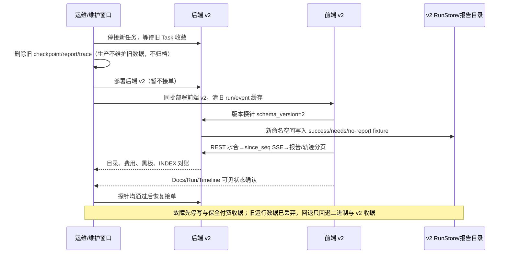
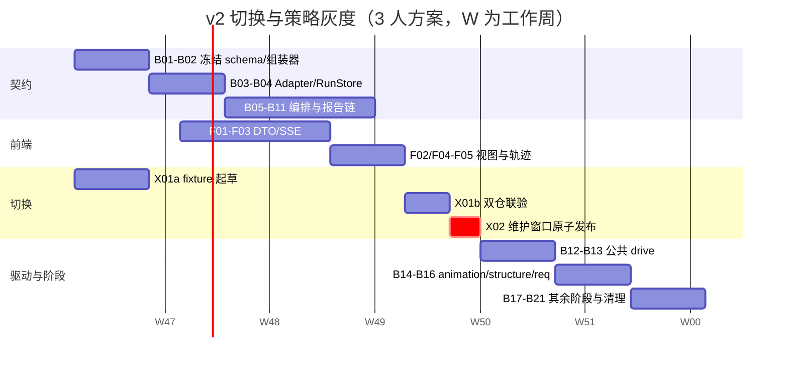

# Clipwright 阶段 Agent 自主循环与双仓契约 Coding Plan

## 0 文档信息

| 属性 | 内容 |
|---|---|
| 版本 | v1.2 · 2026-11-20 · 待实施（v1.2 同步 PRD v0.4：聊天同批、预算分级、视觉分流、无旧数据、开关命名、时长/token 不设上限） |
| 作者 | gpt-6-sol（tk1688 provider） |
| 后端基线 | `J:\Clipwright` · `9d8b236a2de33b07b12b24ba3bd4f9be730ba7e6` |
| 前端基线 | `J:\Clipweight-Client` · `06946c27fa917858693ebe1427e873c1c47d923d` |
| 权威前置 | [阶段 Agent PRD v0.2](stage-agents-agentic-loop-prd-2026-11-20.md)；本计划按其 §4–§10 验收 |
| 范本 | [动画 Coding Plan](animation-agentic-tool-loop-coding-plan.md)、[现代 Agent 收口计划](modern-agent-closeout-plan-2026-10-27.md) |
| 后端环境 | Python 3.14 / FastAPI / Pydantic v2；实施验证 `python -m pytest tests -q` |
| 前端环境 | React / TypeScript / Vite；实施验证 `npx tsc --noEmit`、`npm run test`、`npm run build` |
| 阅读方式 | `B:` 为 `J:\Clipwright\` 相对路径；`F:` 为 `J:\Clipweight-Client\` 相对路径；行号均指切换前工作树，实施时重定位 |
| 当前操作 | 只读代码、只生成本计划；没有修改业务代码，没有执行测试或提交 |

### 0.1 范围与硬边界

| 项目 | 约束 |
|---|---|
| 架构 | 不改原子能力→Agent 编排→类型插件→Persona→用户接口五层；不创建第二个 AgentRunner |
| 派发 | 主 Agent 继续拥有阶段选择、Goal/Plan/TaskFinish 与收口权；阶段策略只能选择自身动作 |
| 阶段 | requirements、structure、edit、audio、quality 接公共 Loop；Material P0 接统一结果、P2 开自主决策；Animation P1 迁 MG |
| 结果 | 公开阶段结果仅 `AgentResult(schema_version=2)`；业务 payload 内聚在 `outputs`，取消 `StageResult` |
| 文档 | 自由 Markdown 只给人读；机器只读 RunStore、Result、提交收据和索引；不解析章节作派发输入 |
| 历史 | 不做旧数据兼容、双读、回填或章节转换；切换前旧 run/report/trace/checkpoint 隔离只读 |
| 前端 | 所有模型、API、事件 detail 的可见文本统一走 `asText/textList`；协议缺失显错，不假装空态 |
| 运行 | SSE-only，taskId 原子切换，REST 水合后 `since_seq` 接流，终态不复建流 |
| 安全 | 能力动态解析、tier 自声明且未知 fail-closed，`TIER_MAP` 保持空；模型不能更改 workspace/task/权限 |

### 0.2 名词与交付判据

| 名词 | 可核查定义 |
|---|---|
| 真实 run | 每次执行独立 `run_id`、递增 attempt；`idem_key` 只控制干净成功复用 |
| 同一结果 | REST、SSE、工具回执、黑板、报告目录与指标都投影同一已提交 `AgentResult` |
| 一次 finalize | 早退/取消/拒绝/熔断/成功均通过组装器，终态只发布一次，结算只过一次 |
| 动作循环 | `services/agent_loop.py` 唯一 `drive` while；Kernel/Stage/Research/MG 仅提供 policy |
| 完成证据 | 最新 artifact SHA、输入背景 hash、scope 与成功观察匹配；文本 final 不等于成功 |
| 联验 | 同一 fixture 在后端响应、前端解析、SSE/REST 水合及用户路径中一致 |

## 1 实施策略

### 1.1 一次性 v2 契约切换

| 门 | 产出 | 允许上线内容 | 禁止行为 |
|---|---|---|---|
| P0 冻结 | JSON schema、状态表、事件 fixture、前端 decoder；PRD §5 明确 nullable 与列表语义 | 可在分支并行实现；生产仍为旧版本 | 不在生产只发新版后端，也不使旧客户端读取新版报告 |
| P0-2/3 | ResultAssembler、唯一阶段 Adapter、报告 reader、双仓页面及契约联测 | 完成集成、构造维护窗口清单 | 不在同一工作区双写新旧报告/索引 |
| P0-4 | 维护窗口原子切换双仓；旧 run/report/trace **直接丢弃**（生产不维护旧数据，不归档）；v2 空命名空间；窗口 ≤1 小时 | 新 Task 全量 v2 契约；版本探针通过才恢复接单 | 不把旧 checkpoint 当 v2 恢复、不对旧运行数据做迁回或自动重试 |
| P1 | 公共驱动、动画 MG、structure 与 requirements 策略灰度 | 保持 v2 wire 不变，逐策略启用 | 不以业务策略灰度切回旧 schema |
| P2 | edit/audio/quality、material/research、清理重复循环 | 逐阶段开通，先 edit→audio→quality 同 revision 联验 | 不保留 `_quality_issues` 隐式动作或绕预算第二循环 |

PRD §7.4 的静默空值风险是硬阻断：旧 `next_for/preview/headline` 读取端遇自由正文时会返回空、无标题或假“还没有报告”；旧 `failure.needs`、`stage/attempt` 轨迹回落同样会静默误导。所谓“边改边兼容”必须双写两份权威事实和容忍两种索引，会让旧客户端把缺字段解释为合法空态，无法证明 Kernel 派发一致。因此只保留可观察的 v2 策略开关，不保留 v1 wire 解码。

### 1.2 双仓同版本发布时序



### 1.3 合同冻结准则

- `schema_version=2` 同时出现在 AgentResult、公开事件 detail 和 WorkspaceReport；缺失或版本不符为协议错误。
- P0-4 切换前拒绝混版；后端与前端健康探针匹配同一合同指纹，不能只凭 HTTP 200。
- `RunSpec.expect`、输入快照、实际 limits、task scope、权限租约由 Runner 固定；模型请求只可收紧。
- outer surface `ok` 是成功取得业务回执，不代表 `output.status=ok`；所有推进按业务状态与收据。
- 生产验证前后两套目录不共享可写索引；旧数据只读，不对历史用户进行暗中数据迁移。
- `created_at` 前端按后端数值秒或显式定义的 ISO 校验；不依赖 JS 隐式日期解析。
- 未核实的仓外消费者、开关命名、实际 provider 能力和运行样本列在 §9；发布前需补证据。

## 2 前后端契约变更总表

表中 `B:`/`F:` 后的 `file:line` 均为本次静态阅读或检索到的现有落点；“目标函数”仅在任务说明中使用，不伪装为已有代码。前端无消费者的行记 `—`，不可编造调用。每行“默认值”是 v2 合同，不意味着吞掉坏数据。

| 契约点 | 后端 producer(file:line) | 后端 consumer | 前端 consumer(file:line) | 变更类型 | 破坏性与默认值 | 联验用例 |
|---|---|---|---|---|---|---|
| `AgentResult.schema_version=2/run_id/kind/task_id/trace_id/attempt/stage/role` | B:`clipwright/schema/run.py:55`、B:`clipwright/services/agent_run.py:327` | B:`clipwright/api/task.py:623`、B:`clipwright/services/agent_run.py:493` | F:`src/types/task.ts:303`、F:`src/features/task/eventSchema.ts:342` | 新增/改语义 | 必填；stage 在 research 为空，attempt≥1；无版本或跨 task 拒绝 | `contract_identity_and_scope` |
| `brief`, `mode` | B:`clipwright/schema/run.py:69`（`brief` 现存）、B:`clipwright/services/agent_run.py:477-478`（幂等复用后回填） | B:`services/stage_subagent.py` 发布链 | F:`src/features/task/TaskRunDetail.tsx:134`（已读 `run?.brief`） | 新增键/改语义 | `brief` 可空串；`mode=task / inline`（inline 禁写黑板）；目标模型 `extra="forbid"`，漏字段即校验失败 | `brief_roundtrip_and_empty` |
| `status/terminal_reason/summary` | B:`clipwright/schema/run.py:66`、B:`clipwright/services/agent_run.py:465` | B:`clipwright/tool/surface.py:846`、B:`clipwright/services/agent_kernel.py:548` | F:`src/features/task/TaskRunDetail.tsx:161`、F:`src/features/copilot/CopilotSubagentTab.tsx:52` | 新增/改语义 | 七终态；summary 非空；`dry_run` 不再误映 ok | `terminal_status_matrix` |
| `outputs` 各阶段 typed payload | B:`clipwright/services/stage_subagent.py:744`、B:`clipwright/schema/agent.py:115` | B:`clipwright/services/stage_merge.py:36`、B:`clipwright/services/agent_run.py:592` | F:`src/features/task/TaskRunDetail.tsx:135` | 改语义 | 保留合法 `[]/false/0`；大值引用化；坏 schema 显错 | `payload_false_zero_empty` |
| `writes/details` | B:`clipwright/services/stage_subagent.py:755` | B:`clipwright/services/agent_run.py:597`、B:`clipwright/services/agent_kernel.py:548` | F:`src/features/task/TaskRunDetail.tsx:141` | 改语义 | writes 仅提交收据；details 许可键小值，排除私有配置 | `write_receipt_privacy` |
| `needs[]/failure/error` | B:`clipwright/services/stage_subagent.py:520`、B:`clipwright/services/agent_run.py:587` | B:`clipwright/services/agent_kernel.py:548` | F:`src/features/task/TaskRunDetail.tsx:198`、F:`src/features/task/eventSchema.ts:358` | 改语义 | 每字段一 Need，failure 可 null；needs/failed 等失败证据强制存在 | `needs_per_field` |
| `issues/redo_agent/redo_hint/redo_request` | B:`clipwright/services/stage_subagent.py:740`、B:`clipwright/agents/quality_agent.py:384` | B:`clipwright/services/stage_closure.py:44`、B:`clipwright/services/agent_kernel.py:548` | F:`src/types/task.ts:329`、F:`src/features/task/TaskRunDetail.tsx:226` | 新增/改语义 | issue `message/location` 保留；redo_agent 从 request 派生；redo_hint 仅展示 | `redo_sha_scope_issue` |
| `degradations/iterations` | B:`clipwright/services/stage_subagent.py:712`、B:`clipwright/schema/run.py:85` | B:`clipwright/services/agent_run.py:607`、B:`clipwright/services/evaluation.py:68` | F:`src/features/task/TaskRunDetail.tsx:248` | 改语义 | degraded 必有降级项；次数是实际 provider 决策轮 | `degradation_gate_and_rounds` |
| `report_path/report_seq/report_state/report_sha256/handoff_summary` | B:`clipwright/services/stage_subagent.py:772`、B:`clipwright/services/stage_report.py:155` | B:`clipwright/services/context_loader.py:362`、B:`clipwright/api/workspace.py:175` | F:`src/features/copilot/CopilotDocsTab.tsx:41`、F:`src/features/task/TaskRunDetail.tsx:134` | 新增/改语义 | 相对路径；state=written/unavailable/not_applicable；失败也保留原业务状态 | `report_absent_explicit` |
| `tool_calls/tool_calls_path/tool_calls_total/trace_state` | B:`clipwright/services/stage_subagent.py:672`、B:`clipwright/services/stage_subagent.py:832` | B:`clipwright/services/agent_run.py:515`、B:`clipwright/api/task.py:511` | F:`src/types/task.ts:314`、F:`src/features/task/TaskToolTrace.tsx:102` | 新增/改语义 | 列表仅采样，total 从全量 ledger；empty≠unavailable；路径按 run_id | `trace_201_calls_and_error` |
| `tokens/cost_usd/cost_unknown/duration_ms/provider/model/created_at` | B:`clipwright/services/stage_subagent.py:663`、B:`clipwright/schema/run.py:94` | B:`clipwright/services/agent_run.py:515`、B:`clipwright/services/agent_kernel.py:1185` | F:`src/types/task.ts:310`、F:`src/features/task/TaskRunDetail.tsx:111` | 改语义 | 未知为 null；已知零为 0；run 内调用只结算一次 | `known_zero_unknown_and_escrow` |
| `replayed/replay_of/spec_ref` | B:`clipwright/services/agent_run.py:335`、B:`clipwright/services/agent_run.py:362` | B:`clipwright/api/task.py:700` | F:`src/types/task.ts:317`、F:`src/features/copilot/CopilotSubagentTab.tsx:45` | 新增/改语义 | 缓存复用旧 run_id 且无第二次费用；真 replay 新 run_id、新 attempt | `replay_new_identity_snapshot` |
| `to_tool_payload` 业务状态与截断引用 | B:`clipwright/schema/run.py:104` | B:`clipwright/tool/surface.py:846`、B:`clipwright/services/agent_kernel.py:548` | F:`src/features/copilot/CopilotTaskRunTab.tsx:658`（间接事件展示） | 改语义/删除 | 删 `tool_calls_hint`、无界 details；保留 blocker+run_id+truncated_fields | `payload_budget_preserves_blocker` |
| `agent_run_start` detail | B:`clipwright/services/agent_run.py:390` | B:`clipwright/services/task_events.py:128` | F:`src/features/task/eventSchema.ts:342`、F:`src/features/copilot/RunningSubagents.tsx:30` | 新增 | 版本、run/trace/task/attempt、输入键；禁止泄露输入值 | `event_start_identity` |
| `agent_run_update` detail | B:`clipwright/services/agent_run.py:353`、B:`clipwright/services/agent_run.py:453` | B:`clipwright/services/task_events.py:128` | F:`src/features/copilot/CopilotSubagentTab.tsx:45`、F:`src/features/task/eventSchema.ts:343` | 改语义 | review 等待≠输入 needs；缓存只发 reuse update；状态不复写终态 | `review_update_vs_needs` |
| `agent_run_end` detail | B:`clipwright/services/agent_run.py:465` | B:`clipwright/services/agent_run.py:505` | F:`src/features/task/eventSchema.ts:344`、F:`src/features/task/TaskRuns.tsx:36` | 新增/改语义 | 一次 end；计数而非全量降级；缺 terminal_reason/report_state 显协议错 | `event_end_matches_rest` |
| `subagent_round/subagent_tool/subagent_progress` | B:`clipwright/agents/base.py:284`、B:`clipwright/agents/animation_agent.py:1961` | B:`clipwright/services/task_events.py:128` | F:`src/features/task/eventSchema.ts:265`、F:`src/features/task/EventFeed.tsx:48` | 新增/改语义 | 每轮一次 round、每调用含 call_id/seq/status；失败不得伪 success | `multi_call_observations` |
| `doc_write` detail | B:`clipwright/services/stage_subagent.py:820` | B:`clipwright/services/session_projection.py:42` | F:`src/features/task/eventSchema.ts:439`、F:`src/features/sessionTimeline/SessionTimeline.tsx:389` | 新增/改语义 | 保留 path/by/seq，补 run_id/bytes/status；无正文不伪 doc_write | `doc_write_real_bytes` |
| `degradation` detail | B:`clipwright/services/stage_subagent.py:809` | B:`clipwright/services/agent_run.py:465` | F:`src/features/task/EventFeed.tsx:48`、F:`src/features/task/eventSchema.ts:246` | 改语义 | 失败与取消不被报告故障覆盖为 degraded | `failed_report_io_keeps_failed` |
| `step_end/progress` detail | B:`clipwright/services/stage_subagent.py:824`、B:`clipwright/services/stage_subagent.py:365` | B:`clipwright/services/progress.py:80` | F:`src/stores/taskStore.ts:166`、F:`src/features/task/eventSchema.ts:303` | 改语义 | 先提交后 end；completed 来自任务已提交且可用的结果，未知 total=null | `progress_task_receipts` |
| `report` 事件（Kernel 卡/阶段文件区分） | B:`clipwright/services/agent_kernel.py:2412` | B:`clipwright/services/session_projection.py:42` | F:`src/features/task/eventSchema.ts:439`、F:`src/features/task/EventFeed.tsx:48` | 改语义 | 类别明确；无文件时 path=null；历史 `_emit_report` 调用待验证 | `report_kind_no_path` |
| `task_end.detail` | B:`clipwright/services/agent_kernel.py:2119` | B:`clipwright/services/task_events.py:128` | F:`src/stores/taskStore.ts:166`（终态处理位置待复核） | 改语义 | completed/unfinished、terminal_reason、escrow；缺清单保留原 finish | `task_end_preserves_finish` |
| `WorkspaceReport` DTO | B:`clipwright/services/stage_report.py:223`、B:`clipwright/api/workspace.py:175` | B:`clipwright/services/stage_report.py:249` | F:`src/services/api/workspace.ts:83`、F:`src/features/copilot/CopilotDocsTab.tsx:110` | 删除/新增 | 删 headline/preview/next_for，加 schema_version/run_id/report_state/summary/handoff_summary；空正文显 unavailable | `workspace_dto_v2_only` |
| `read_report(section)` / 全文分页 | B:`clipwright/tool/reports.py:101`、B:`clipwright/services/stage_report.py:239` | B:`clipwright/services/agent_loop.py:56` | F:`src/services/api/workspace.ts:243`、F:`src/features/copilot/CopilotDocsTab.tsx:45` | 删除/新增 | 传 section 显式错误；offset/max_chars 硬上限及 total_chars/next_offset | `report_section_400_and_page` |
| `TaskRunSummary/Detail` REST | B:`clipwright/api/task.py:623`、B:`clipwright/api/task.py:659` | B:`clipwright/services/agent_run.py:130` | F:`src/types/task.ts:303`、F:`src/features/task/TaskRunDetail.tsx:122` | 改语义 | Summary 的 tool_calls/degradations 为数量；Detail 为采样/列表；live 单独标志 | `run_list_detail_projection` |
| run trace 归属与 404 | B:`clipwright/api/task.py:511`、B:`clipwright/services/agent_run.py:130` | B:`clipwright/services/stage_subagent.py:832` | F:`src/services/api/task.ts:235`、F:`src/features/task/TaskToolTrace.tsx:102` | 改名/改语义 | 用 task_id/run_id 寻址；明确 attempt 不命中返回 404，跨任务拒绝 | `trace_wrong_task_and_attempt` |
| quality issues 投影/redo | B:`clipwright/agents/quality_agent.py:384`、B:`clipwright/services/task_results.py:63` | B:`clipwright/services/stage_closure.py:44` | F:`src/features/task/TaskRunDetail.tsx:226`、F:`src/features/agent/AgentPanel.tsx:1779` | 新增/改语义 | `passed=false` 不丢；issue.message/location 有值；redo 按 SHA 与 issue IDs 校验 | `quality_issue_message_redo` |
| eval/golden 统计与 DTO | B:`clipwright/services/evaluation.py:146`、B:`clipwright/services/golden_eval.py:112` | B:`clipwright/api/eval.py:70` | F:`src/services/api/eval.ts:49`、F:`src/features/pipeline/EvalPanel.tsx:50` | 新增/改语义 | capped 单列，0 成本仍为 0，JSON 报告≠工作区 Markdown | `golden_capped_zero_cost` |

### 2.1 适配实现纪律

- v2 JSON 必填键即使 nullable 也要发键；客户端区分键缺失、合法 null、合法空列表、读取失败。
- 事件类型尽量不改名；SSE 从 task REST 快照水合，按同 task seq 合并，跨 task 不比较序号。
- `asText` 转可见标量、`textList` 转可见列表；结构化 issue、Need 与路径先检查形状，再渲染。
- `section` 只用于旧参数拒绝测试；业务代码删掉固定四节的生产和消费，静态扫同名无关模块需人工复核。
- 事件 `agent_run_end` 仅计数/引用，详情从 REST 查；不能把采样当完整轨迹。
- 新目录报告 `seq` 可直接查超过 500 的项，Index 可重建，不从 Markdown 标题和 front-matter 推机器数据。

## 3 任务分解

### 3.1 派工规则与依赖图

- 编号 B=【后端】，F=【前端】，X=【双仓同批】；总计 29 项：B21/F5/X3（X01a 起草、X01b 联验）。X 项标注“同一 PR 或同批发布”，不要求跨仓单一 Git 提交。
- 规模 S≈0.25–0.5、M≈0.5–1、L≈1–1.5 人日；L 必须在同一能力边界内分小 PR/子提交，发布同批。
- “文件与函数级改动”列均以已核实旧代码函数为锚，新增目标函数标“新增”；测试名是计划新增的具体用例，不声称现有。
- 每项默认不更改 wire 版本，除非 X02 维护窗口；任一领域策略关停也保留 ResultAssembler 和 v2 报告。
- 主路径：B01→X01a→B02→B03/B04→B05/B06→B07/B08→B09/B10/B11→F01–F05→X01b→X02→B12/B13→B14–B21。X01a 给 F 组“可贴的 fixture”，X01b 只做双仓同字节联验，不得把联验排到 F 组之前。
- 后端每任务最多三个主要生产文件；需要附属测试文件单列；跨文件边界用已稳定的 v2 fixture 作为接口。

### B01 · P0-1 冻结结果与失败 schema【后端】

| 字段 | 派工说明 |
|---|---|
| 任务 ID | B01 · P0-1 |
| 仓库 | 后端 `J:\Clipwright` |
| 文件与函数级改动 | `schema/run.py:23,28,55` 收紧 `RunSpec/AgentResult`、状态 validator、nullable；`schema/agent.py:58,115` 提取 `Need/FailureReport/Issue/Degradation`，去镜像 needs；`schema/stage.py:32,58` 只保留输入 spec 与阶段名，切换时删除 StageResult |
| 依赖（任务 ID） | 无，先冻结 JSON schema/字段枚举 |
| 测试（文件+用例名） | 新增 `tests/contracts/test_agent_result_v2.py::test_terminal_matrix`、`::test_false_zero_empty_and_extra_forbid`、`::test_brief_and_dry_run_enum` |
| 验收标准（可执行断言） | `schema_version==2`、七终态各有非空 reason/summary；needs 无条目、degraded 无降级项、failed 无 failure 均 ValidationError；合法 `false/0/[]` 保留；`RunStatus` 扩入 `dry_run`（`schema/run.py:24`），`brief` 带值/空串两例均通过 `model_validate` |
| 回滚点 | 上生产前撤 B01 合同；上线后只随 X02 双仓整体回退 |
| 规模（S/M/L） | M |
| 并行性 | 与 X01a fixture 起草并行，B02 必须等冻结 |

边界：`PluginAgentOutput` 是外部贡献的边缘输入，Adapter 验证后再形成宿主结果，不能暴露第二套公开终态。`StageSpec` 可保留纯输入 policy，不可再公开 `to_public()`。

### B02 · P0-1 ResultAssembler 唯一终态【后端】

| 字段 | 派工说明 |
|---|---|
| 任务 ID | B02 · P0-1 |
| 仓库 | 后端 `J:\Clipwright` |
| 文件与函数级改动 | `services/agent_run.py:327,448` 新增 `ResultAssembler.build/finalize` 或紧邻独立模块 `services/result_assembler.py`（新增）；`schema/run.py:104` 修 `to_tool_payload`：完整 ledger total、失败采样、path/hash ref、truncated_fields |
| 依赖（任务 ID） | B01 |
| 测试（文件+用例名） | `tests/contracts/test_agent_result_v2.py::test_finalize_all_exits_once`、`::test_payload_truncation_retains_blocker` |
| 验收标准（可执行断言） | ok/needs/failed/refused/cancelled/dry_run、报告 I/O 失败各只一次 finalize；删除 `tool_calls_hint`，有限 details，关键 blocker 与可查 run_id 不丢；未知费用 null |
| 回滚点 | P0-4 前复原组装器调用；P0-4 后仅全版回退 |
| 规模（S/M/L） | M |
| 并行性 | 与 B04 RunStore 可并行实现，接口先取 X01a fixture |

组装器负责生成 `handoff_summary`、统一 issue/redo 投影、记录 provenance 与账务收据；不得按 `payload.get(k)` 丢弃 false 或有效空值。失败报告 I/O 仅附诊断，不覆盖原失败/取消。

### B03 · P0-2 唯一阶段 Adapter【后端】

| 字段 | 派工说明 |
|---|---|
| 任务 ID | B03 · P0-2 |
| 仓库 | 后端 `J:\Clipwright` |
| 文件与函数级改动 | 新增 `services/stage_adapter.py::run_stage(run_context)`（**唯一阶段领域 Adapter，全仓唯一符号**）；`services/stage_subagent.py:87,281,428` 注册 requirements typed input，`run`/`run_stage` 删除或窄转发到 `stage_adapter.run_stage`；`services/agent_run.py:553,688` 去重复 StageResult 转换与 `_map_status`，仅向 Adapter 透传身份 |
| 依赖（任务 ID） | B01、B02 |
| 测试（文件+用例名） | `tests/test_stage_subagent.py::test_full_inline_needs_cancel_dry_run_same_contract`、`tests/test_agent_run.py::test_one_stage_adapter`、`::test_single_run_stage_symbol` |
| 验收标准（可执行断言） | requirements 工厂可达，full/inline/早退皆 AgentResult v2；`dry_run` 在 `agent_run._map_status:695` 与 `stage_subagent.run:335-340` 两层都不映 ok；全仓 `def run_stage` 仅命中 `stage_adapter.py`（窄转发须 docstring 注明“唯一 Adapter 的转发”）；拒绝/熔断各有一次 end；inline 不写生产 Task 黑板 |
| 回滚点 | 切换前复旧 Adapter；切换后随 X02 回退 |
| 规模（S/M/L） | L（按输入分支与取消分支两个小 PR） |
| 并行性 | 与 B04 并行；B05 依赖阶段返回签名 |

生产只留 `agent_run.run` 入口；`stage_subagent.run`（dict 包装）与 `stage_subagent.run_stage`（现执行入口）只允许删除或窄转发到 `stage_adapter.run_stage`，全仓不得出现第二个阶段 Adapter 符号。`run_skill_round` 外围轮从 `stage_subagent.py:607` 收到统一预算，不能额外花轮数。

### B04 · P0-2 RunStore、真实 run 身份和账本【后端】

| 字段 | 派工说明 |
|---|---|
| 任务 ID | B04 · P0-2 |
| 仓库 | 后端 `J:\Clipwright` |
| 文件与函数级改动 | `services/agent_run.py:313,327,448` 按 task/stage 分配 run_id/attempt、持久 spec_ref/输入 hash、清理阶段 `_RUNS/_IDEM`；`services/stage_subagent.py:721,832` 改全量 ledger 按 run_id 路径落盘并去重复缓存 |
| 依赖（任务 ID） | B01、B02 |
| 测试（文件+用例名） | `tests/clipwright/test_agent_run_replay.py::test_refresh_new_id_attempt_and_no_double_charge`、`::test_recover_inflight_receipt` |
| 验收标准（可执行断言） | 相同 idem_key 干净成功只返回旧 run 不重发报告；refresh/degraded 新 run_id 与 attempt；跨任务 attempt 可重号但 trace 不互串；in-flight 不安全副作用先对账 |
| 回滚点 | P0-4 前撤持久层；之后保全 v2 收据、隔离目录再双仓回退 |
| 规模（S/M/L） | L（分身份/存取两个小 PR） |
| 并行性 | 与 B03 同合同并行；B10 要等稳定 run_id |

`RunStore` 是唯一持久事实源，`_LIVE` 可留易失句柄但不可作恢复真相；ledger 每动作含 call_id/seq/parent/scope/artifact_sha/status/failure IDs、费用引用与 resolved_by。

### B05 · P0-2 黑板 CAS、输入与 inline 消费【后端】

| 字段 | 派工说明 |
|---|---|
| 任务 ID | B05 · P0-2 |
| 仓库 | 后端 `J:\Clipwright` |
| 文件与函数级改动 | `services/stage_inputs.py:166` 冻结显式/blackboard_ref 来源版本并解析 artifact/相对路径；`services/stage_merge.py:36,49` typed outputs、私有草稿 CAS、按真实 receipt 填 writes；`services/task_blackboard.py:82,115` 核对 owner 和 revision 冲突 |
| 依赖（任务 ID） | B02、B03、B04 |
| 测试（文件+用例名） | `tests/test_stage_subagent.py::test_merge_failed_does_not_publish_timeline`、`tests/clipwright/test_stage_inputs_v2.py::test_inline_scope_and_redo_cas` |
| 验收标准（可执行断言） | failed/取消/dry_run 无共享 timeline 写；audio 未成功定稿 final_timeline 不报 ok；redo 先私有草稿后 CAS；缺键逐字段 Need；相对路径/引用可解析 |
| 回滚点 | P0-4 前撤 stage merge；上线后退回切换前黑板快照，禁止自动重放已付费调用 |
| 规模（S/M/L） | L（输入与 CAS 各自小 PR） |
| 并行性 | 与 B06 报告写盘并行；requirements_service 的局部 inline `.timeline/.scenes/.candidate_clips` 消费在本任务验收名单中核对 `services/requirements_service.py:1778,1864,2629` |

旧 `stage_subagent.py:437` 的重做前公共 timeline 回退改为私有草稿，失败不会扰动既有 committed revision；Material `material_notes`、Audio `audio_config_internal` 明确各归公开诊断/私有配置。

### B06 · P0-3 报告自由正文与原子目录【后端】

| 字段 | 派工说明 |
|---|---|
| 任务 ID | B06 · P0-3 |
| 仓库 | 后端 `J:\Clipwright` |
| 文件与函数级改动 | `services/stage_report.py:53,108,155,200,249` 用自由 Markdown、v2 目录和可重建 INDEX 替代四节解析；`services/stage_subagent.py:772,820` finalize 统一写盘、真实 bytes 与 doc_write；`services/progress.py:80` INDEX 保留时间线内容 |
| 依赖（任务 ID） | B01、B02、B04 |
| 测试（文件+用例名） | `tests/test_docs_protocol.py::test_arbitrary_markdown_same_projection`、`tests/clipwright/test_progress_index.py::test_index_rebuild_and_escape` |
| 验收标准（可执行断言） | 无标题/改标题/异语言/伪章节正文列表与 Kernel 决策一致；report_sha 校验、path 相对、seq 唯一；INDEX 转义管道与换行，索引故障不篡改 Result |
| 回滚点 | 切换前撤目录 writer；切换后只读保全 v2 报告再整体回退 |
| 规模（S/M/L） | L（writer 与 INDEX 可分子 PR） |
| 并行性 | 与 B05、F01 可并行；X02 必须等待 |

有 workspace 的失败/needs/refused 也尝试正文；无 workspace/dry_run 置 not_applicable；I/O 失败置 unavailable 并按 PRD §7.2 明确降级，NUL 非法正文可见报错。目录仅发布已提交记录，不以 H1/front-matter 作机器索引。

### B07 · P0-3 报告 reader、上下文与工具签名【后端】

| 字段 | 派工说明 |
|---|---|
| 任务 ID | B07 · P0-3 |
| 仓库 | 后端 `J:\Clipwright` |
| 文件与函数级改动 | `tool/reports.py:51,88,101` 共用 seq reader、offset/max_chars 硬上限及 `section` 显式错误；`services/context_loader.py:332,362` 用 lineage recent runs 按 blocker/needs/redo/refs/handoff 装载；`services/agent_loop.py:56` 更新 `read_report` schema/缓存签名 |
| 依赖（任务 ID） | B04、B06 |
| 测试（文件+用例名） | `tests/test_docs_protocol.py::test_report_over_500_offset_and_section_rejected`、`::test_bad_body_does_not_erase_handoff`、`tests/clipwright/test_tool_dedupe.py::test_report_cache_generation` |
| 验收标准（可执行断言） | seq>500 正常分页，工具 max_chars≤8000、API≤20000，`total_chars/next_offset/truncated/content` 可续读；错 SHA 提 report_projection_invalid；报告正文含注入指令不影响派发 |
| 回滚点 | P0-4 前撤新 reader；上线后与 B06/X02 同版回退 |
| 规模（S/M/L） | M |
| 并行性 | B06 完成后与 B08 同步推进 |

更新 `context_loaded` 的 source/count/missing/truncated；同任务 lineage 最多 3 条优先活跃 blocker，不允许因正文丢失将结构化上下文替换成空串。

### B08 · P0-3 进度收据与事件投影【后端】

| 字段 | 派工说明 |
|---|---|
| 任务 ID | B08 · P0-3 |
| 仓库 | 后端 `J:\Clipwright` |
| 文件与函数级改动 | `services/stage_subagent.py:365,724,824` 完成数从当前 task 的 Plan+已提交结果计算，end 延至提交后；`services/session_projection.py:42` 文档产物按 project/run/seq 作用域投影；`services/agent_kernel.py:2412` 查 `_emit_report` 调用，删死码或改读 outputs |
| 依赖（任务 ID） | B02、B04、B06 |
| 测试（文件+用例名） | `tests/clipwright/test_progress_index.py::test_failed_needs_dry_run_not_complete`、`tests/test_event_contract.py::test_doc_step_report_projection` |
| 验收标准（可执行断言） | 无计划 total=null；failed/needs/cancelled/dry_run 不增加完成；可接受降级仅按 Gate；报告未写 `doc_write` 不伪 bytes；事件均含 v2 run 归属 |
| 回滚点 | X02 维护窗口前撤事件投影；之后双仓整体回退 |
| 规模（S/M/L） | M |
| 并行性 | B06 基础目录可用后，与 B07/B09 并行 |

报告数量不再用工作区最近 200 报告按 stage 去重，不把任务 A 的旧阶段计入任务 B；`task_end.detail.completed/unfinished` 始终有内容，前端缺项不覆盖既有 finish。

### B09 · P0-3 Workspace API 与报告 DTO【后端】

| 字段 | 派工说明 |
|---|---|
| 任务 ID | B09 · P0-3 |
| 仓库 | 后端 `J:\Clipwright` |
| 文件与函数级改动 | `api/workspace.py:175,192` 列表新 DTO、project/task/stage/status 分页与详情按 seq；`services/stage_report.py:200` 目录作用域校验和单份报告 reader |
| 依赖（任务 ID） | B06、B07 |
| 测试（文件+用例名） | `tests/test_workspace_report_v2.py::test_report_dto_no_old_keys`、`::test_seq_501_and_hash_error` |
| 验收标准（可执行断言） | DTO 严格含 schema_version/run_id/task_id/summary/handoff_summary/report_state，绝不含 headline/preview/next_for；404 未知、409 索引不一致；`docs/brief.md`/plan API 不变 |
| 回滚点 | 和 F01/F02、X02 同批，先停写再双仓回退 |
| 规模（S/M/L） | M |
| 并行性 | 可与 B10 并行，和 F01/F02 同一 PR 或同批发布 |

列表 count 对目录而非文件扫描；输入 path 只能为已登记且 workspace 内的相对路径。详情区分原始存储截断和请求返回分页。

### B10 · P0-3 Task run/trace/replay API【后端】

| 字段 | 派工说明 |
|---|---|
| 任务 ID | B10 · P0-3 |
| 仓库 | 后端 `J:\Clipwright` |
| 文件与函数级改动 | `api/task.py:511,611,623,659,700` run_id 轨迹分页、严格 404、列表计数与详情 v2、replay 用 spec_ref/输入 hash；`services/agent_run.py:125,130,144` RunStore 查询与 task 归属 |
| 依赖（任务 ID） | B02、B04、B05 |
| 测试（文件+用例名） | `tests/clipwright/test_run_addressing_api.py::test_wrong_task_trace_and_replay_rejected`、`::test_missing_attempt_404` |
| 验收标准（可执行断言） | 任务 owner 与 run.task_id 双验；明确 attempt 不回落最新；trace_state=empty/unavailable 可区分；run 详情/列表计数与 end 同源；重放旧输入与授权快照 |
| 回滚点 | 与 F04/X02 一起回退旧 API 与快照；新版实际费用先保全 |
| 规模（S/M/L） | L（轨迹与 replay 两个小 PR） |
| 并行性 | 与 B09 并行，F04 必须用冻结样本联验 |

缓存费用仅展示历史已知值、账务增量为 0；trace 文件 `seq_in_run` 不抽样计 total，路径不允许客户端指定，200 条以上同样可分页。

### B11 · P0-3 Evaluation/golden 与 eval 路由【后端】

| 字段 | 派工说明 |
|---|---|
| 任务 ID | B11 · P0-3 |
| 仓库 | 后端 `J:\Clipwright` |
| 文件与函数级改动 | `services/evaluation.py:68,146` 使用 ledger total、未知费用与 capped 单列；`services/golden_eval.py:47,112` 工作区隔离及 v2 可查性；`api/eval.py:70,91` 保留评估 JSON 路由，输出新增统计键 |
| 依赖（任务 ID） | B02、B04、B06 |
| 测试（文件+用例名） | `tests/test_evaluation.py::test_capped_excluded_zero_cost_preserved`、`tests/clipwright/test_golden_eval_v2.py::test_runs_isolated_and_refs_resolve` |
| 验收标准（可执行断言） | capped 不进成功率分子/分母，0 USD 保持 0；`len(tool_calls)` 不当全量；golden 每次独立目录，可定位 run/report/trace |
| 回滚点 | X02 前撤字段；X02 后连前端 eval DTO 同版回退 |
| 规模（S/M/L） | M |
| 并行性 | 与 B09/B10 并行，F05 的 eval 小面板按此合同联验 |

`replay_bundle` 应保留事件、run、报告引用与缺损状态；样本统计的 unknown cost/no provider 不被 `or None` 误处理。

### B12 · P1-1 AgentLoop 与 ToolSurface【后端】

| 字段 | 派工说明 |
|---|---|
| 任务 ID | B12 · P1-1 |
| 仓库 | 后端 `J:\Clipwright` |
| 文件与函数级改动 | `services/agent_loop.py:163,308,365` 新增唯一 `drive`、Decision/Observation/GateVerdict policy hooks，复用原生回填；`tool/surface.py:811,846` 动态能力与 tier/租约双校验；`services/llm.py:902` 单 turn OpenAI/Anthropic 消息及请求级 usage 收据 |
| 依赖（任务 ID） | B01、B02、B04、X02（上线启用） |
| 测试（文件+用例名） | `tests/test_agent_loop.py::test_multi_call_observe_revise_final`、`::test_cancel_before_next_dispatch`、`::test_schema_changed_and_no_native_support` |
| 验收标准（可执行断言） | 一次 provider turn 算一轮，batch 每 call 都有收据；闸顺序 cancel→closeout→轮→调用→墙钟→预留；超限后 0 新调用；未知 tier fail-closed（不执行）；**costly 无租约按保守单价预留，预留不足走降级 `budget_limited`（硬约束才 `budget_unreserved`），不因预算拒绝整阶段**；墙钟/`max_tokens` 未配置时不启用对应闸 |
| 回滚点 | P1 阶段策略开关关；若共享 loop 本身有缺陷，整批 P1 回退，不用旧 loop 冒充 v2 驱动 |
| 规模（S/M/L） | L（按模型消息/受控 dispatch 分小 PR） |
| 并行性 | 与 B13 的 Kernel hook 设计并行，但联验须先 B12；B14–B21 依赖 |

两类 Adapter 验证：ToolRegistry/Skill 执行结果与动画 handler；账本 failure 指纹排除时间/自由文本，成功校验可 resolved_by 消除对应 blocker，修订使旧证据失效。read-only closeout 构建 schema 失败 fail-closed，`capability_matrix.TIER_MAP` 继续为空。

### B13 · P1-1 Kernel/Base 复用、预算单点【后端】

| 字段 | 派工说明 |
|---|---|
| 任务 ID | B13 · P1-1 |
| 仓库 | 后端 `J:\Clipwright` |
| 文件与函数级改动 | `agents/base.py:81,242,463` 抽共享 `execute→drive/finalize`，helper 改委托；`services/agent_kernel.py:1130,1185,1760,2006` TaskPolicy 接入 drive、保留 Goal/Plan/TaskFinish/soft landing/escrow；`services/agent_loop.py:619` 收口工具面失败 fail-closed |
| 依赖（任务 ID） | B02、B12 |
| 测试（文件+用例名） | `tests/test_agent_kernel.py::test_closeout_escrow_and_capped_unchanged`、`tests/test_agent_loop.py::test_kernel_and_stage_share_driver` |
| 验收标准（可执行断言） | normal/closeout 与旧任务策略一致；`budget_usd=null` 不造金额上限；质量 escrow 唯一付费例外、结算 hook 一处；`remediated` 只认新且非降级的具体 blocker 证据 |
| 回滚点 | 关 P1 策略并回退共享驱动批次；不得单独恢复旧绕闸 `_executor` |
| 规模（S/M/L） | L（Base helper、Kernel hook 小 PR） |
| 并行性 | 与 B14 动画 policy 开发并行，联验需 B12 稳定 |

主 Agent 拥有 `capped` 第三终态，不等于 Stage failed；后台补派/replay 与质量派发都进入同一 Task 预算/取消/closeout 队列；终态后迟到费用只进审计不复活 SSE。

**执行拆分（2026-11-20）**：B13 已拆成 **B13a（Base 侧，已完成）** 与 **B13b（Kernel 内部收敛，延后）**。
- B13a：`settings.agent_loop_shared_driver` 开关 + `BaseAgent._drive_tool_loop` 复用公共 `drive`（白名单/预算/`subagent_round` 事件），关闭时行为不变；测试见 `tests/contracts/test_base_shared_driver.py`。
- B13b（2026-11-20 追加）：`LLMService.with_tools` 已提供 `agent_loop_shared_driver=true` 时的公共 `drive` 路径——真正控制轮次/预算/取消的是 `drive`，该函数只做 provider 消息适配（含 anthropic/openai 两种 tool_result 样式、preamble/reasoning 回调）。Kernel 的工具循环就建立在 `with_tools` 上，因此打开开关即让 Kernel 走公共驱动。**默认已翻转为 true（2026-11-20）**：旧的自建 `for _round` 循环已删除，`with_tools` 只保留 provider 适配；回滚走二进制版本，不再保留第二套循环。`agent_loop_shared_driver` 仍保留给 Base 阶段侧兼容。


### B14 · P1-2 Animation MG 收窄【后端】

| 字段 | 派工说明 |
|---|---|
| 任务 ID | B14 · P1-2 |
| 仓库 | 后端 `J:\Clipwright` |
| 文件与函数级改动 | `animation/agentic_runtime.py:13,108,154` 改 MG policy/证据 Gate，不再自建 while 或 cap 后补生成；`animation/agent_tools.py:41,62` 工具真实 tier、移除无 handler 的 ask_user；`agents/animation_agent.py:1927,1987,2018` 单阶段共享预算，删除第二次视觉轮 |
| 依赖（任务 ID） | B12、B13 |
| 测试（文件+用例名） | `tests/clipwright/test_agentic_runtime.py::test_revised_mg_invalidates_old_frames`、`::test_two_clips_share_parent_budget` |
| 验收标准（可执行断言） | 同 clip_id+artifact_sha+背景 hash、有效 HTML/非空帧/技术与视觉合格才 final；失败观察不作通过证据；额度尽后无补工具/视觉轮；失败镜头 issue 含 clip_id |
| 回滚点 | `animation.agentic_loop.enabled=false`（现名仅作历史参考；新灰度名见 §4），统一运行时降级生成仍留报告与证据 |
| 规模（S/M/L） | L（MG policy 与阶段接线拆子 PR） |
| 并行性 | 与 B15/B16 开发并行；样片验收先于其它 P1 策略放量 |

`animation/agentic_loop.py:30` 旧 loop 及 `agentic/ledger.py:9` 的通用部分迁入公共驱动，领域 handler 保留；`prompts/__init__.py:58` 单一导出源，新增 `prompts/stage_loop.py`，旧 `DECIDE_SYSTEM`、修复文案先逐字快照，有意改动另存 prompt diff。

**执行补充（2026-11-20，B14b）**：视觉证据已按版本绑定——`mg_fingerprint(mg_def)`（sha256 前 16 位）写入每条观察的 `evidence_sha`；`preview_html / capture_preview_frames / inspect_frames` 必须出现在**最近一次 `generate_mg/revise_mg` 之后**且 `evidence_sha` 与当前 `mg_def` 相同，否则完成门会要求重新 preview/inspect（旧证据不能放行 final）。单测见 `tests/contracts/test_animation_runtime_v14.py`。

### B15 · P1-3 Structure 自检回灌【后端】

| 字段 | 派工说明 |
|---|---|
| 任务 ID | B15 · P1-3 |
| 仓库 | 后端 `J:\Clipwright` |
| 文件与函数级改动 | `agents/structure_agent.py:337,598,634,662` 把生成、覆盖/时长/引用验证改 StagePolicy seed/gate/观察；`prompts/agents.py:4` 固定工具名称指令移到新增 `prompts/stage_loop.py` 并通过 `prompts/__init__.py:58` 导出 |
| 依赖（任务 ID） | B12、B13 |
| 测试（文件+用例名） | `tests/clipwright/test_structure_agent_loop.py::test_empty_scenes_revise_in_same_run`、`::test_coverage_duration_and_refs_gate` |
| 验收标准（可执行断言） | 0 场景首轮拒绝→`scenes_invalid` 回灌→同 run 第二轮修正；时长缺 20% 不判 ok；material_refs 不被覆写，skeleton scenes 唯一真相；模板回退显式 degraded |
| 回滚点 | `stage_loop_structure_enabled=false` 仅回确定性结构生成，仍走 v2 result/gate |
| 规模（S/M/L） | M |
| 并行性 | 与 B16/B14 并行，Structure 验收先于 Edit |

工具面只授予已有 `describe_mg/list_animations/media_probe/content_query/get_type_spec/structure_analysis`，`scene_detect` 可选，`image_generate` 需父授权；`scenes_validate` 为待登记 read 能力，不能把业务 validator 当未经审计的直连工具。生产 `with_tools` 迁成公共 provider turn。

**执行补充（2026-11-20，B15b）**：结构自检已改为**公共 `drive` 的 gate**——`candidate`（当前场景）经 `gate` 校验，未过则把 `missing` 作为 `gate_rejected` 回灌给 `decide`，由 `decide` 带 findings 重新生成；轮次/预算由 `LoopBudget` 控制，不再有 agent 内自建 while。生成器持续给不出场景时短路退出并如实返回 problems。

### B16 · P1-3 Requirements 规划接线【后端】

| 字段 | 派工说明 |
|---|---|
| 任务 ID | B16 · P1-3 |
| 仓库 | 后端 `J:\Clipwright` |
| 文件与函数级改动 | `agents/requirements_agent.py:85,144,195` 规划/改写 Policy、CreativeBrief gate、逐字段 Need；`services/stage_inputs.py:18,137` requirements typed 装配；**`services/requirements_service.py:2232,2319,2341,2630` 需求聊天同批接 `RequirementsPolicy`/`drive`（保留流式与 `ask_user`，删除 `with_tools` 回退 2341–2364 与重复 brief 校验）**；同一 brief 单写者 |
| 依赖（任务 ID） | B03、B12、B13 |
| 测试（文件+用例名） | `tests/clipwright/test_requirements_agent_loop.py::test_missing_audience_then_fix`、`::test_unauthorized_web_absent`、`::test_chat_and_stage_same_validator` |
| 验收标准（可执行断言） | 工厂 requirements 可达，缺 audience/禁忌每字段独立 Need；缺 brief_draft 不再 PASS；**聊天与阶段对同一输入产出 `creative_brief` 时过同一校验函数**，`ask_user` 映射为 `Need(human)` 且回答回到同一 run；`test_requirements_ask_user.py`、`test_requirements_plan_translate_retry.py` 与 plan-only 回归；未授权 web 工具不展示 |
| 回滚点 | `stage_loop_requirements_enabled=false`：阶段与聊天**同时**退回单发结构化生成，不恢复已删除的 `with_tools` 回退 |
| 规模（S/M/L） | L（阶段 M + 聊天接线约 2–4 人日） |
| 并行性 | 与 B15 并行；阶段与聊天的产品入口**同批验收**，不得只验收其一 |

允许 `content_query/read_file/get_type_spec`、获授权事实缺口时 web_search/web_fetch、structure_analysis；新增 `brief_validate` read 能力待登记。模板兜底标 `brief_template_fallback`，硬字段缺失进 needs，外部检索不可用不得伪造“来源已核对”。

### B17 · P2-1 Edit 局部修正【后端】

| 字段 | 派工说明 |
|---|---|
| 任务 ID | B17 · P2-1 |
| 仓库 | 后端 `J:\Clipwright` |
| 文件与函数级改动 | `agents/edit_agent.py:302,980,1018` 粗剪 seed、源窗/字幕/配音证据 gate、局部 clip 修订；`agents/base.py:483,497` 删除 `last_tool_calls` 重置，程序化与模型工具共 ledger；`services/stage_merge.py:49` 只提交验证通过的 timeline revision |
| 依赖（任务 ID） | B05、B12、B13、B15 |
| 测试（文件+用例名） | `tests/clipwright/test_edit_agent_loop.py::test_out_of_range_one_clip_only`、`::test_programmatic_calls_preserved` |
| 验收标准（可执行断言） | 越界 clip 修正后未变 clip 字节相同；PV 未安装主线 ok+pv_skipped；source_window 超界无候选 needs；invalid timeline 不提交；video_trim 与 loop 工具均在全量账本 |
| 回滚点 | `stage_loop_edit_enabled=false` 回已验确定性剪辑，但 v2 输出与必验 gate 不关 |
| 规模（S/M/L） | M |
| 并行性 | 和 B18/B19 研发并行；最终同 revision 联验先 edit |

能力 `media_probe/video_trim/image_clip/transition/video_speed/frame_check/subtitle_overflow/color_match`；PV 插件 `pv_audit/pv_preview` 缺失只跳可选检查；`dub_duration_probe` 待登记 read 能力并以实测时长作 gate 证据。

### B18 · P2-1 Audio 配音与对齐【后端】

| 字段 | 派工说明 |
|---|---|
| 任务 ID | B18 · P2-1 |
| 仓库 | 后端 `J:\Clipwright` |
| 文件与函数级改动 | `agents/audio_agent.py:79,229,362` BGM/混音策略 seed，`audio_agent.py:614,880` 上传/合成/字幕时间证据 gate；`services/stage_merge.py:106` final_timeline 原子定稿，失败保留既有 revision |
| 依赖（任务 ID） | B05、B12、B17（集成验收） |
| 测试（文件+用例名） | `tests/clipwright/test_audio_agent_loop.py::test_uploaded_dub_never_tts`、`::test_bgm_missing_degraded_no_fake_bpm`、`::test_tts_timeout_receipt_before_retry`、`::test_budget_limited_falls_back` |
| 验收标准（可执行断言） | 上传配音工具账无 tts、字幕按实测时长对齐；BGM 无源为 degraded 并无假 BPM；TTS 未授权 needs；**预留不足时换自动配音/无配音并 `degraded(budget_limited)`，不判 failed**；对齐失败不覆盖已提交 timeline |
| 回滚点 | `stage_loop_audio_enabled=false` 仍保留样式/实测对齐硬 gate，不允许旧静默成功 |
| 规模（S/M/L） | M |
| 并行性 | 与 B17/B19 开发并行，验收先看 B17 timeline |

工具面 `media_probe/bpm_detect/audio_mix/tts/transcribe/audio_silence_detect` 与 dub/captions/rhythm_analysis 技能；Skill 内子调用计入同一 run、最高 tier 预检；`audio_config_internal` 绝不进公开 details/报告/SSE。

### B19 · P2-1 Quality 验证与 redo【后端】

| 字段 | 派工说明 |
|---|---|
| 任务 ID | B19 · P2-1 |
| 仓库 | 后端 `J:\Clipwright` |
| 文件与函数级改动 | `agents/quality_agent.py:337,384,550,955` 技术 seed/视觉语义 gate、coverage 与 issues；`services/stage_closure.py:44` 按 scope/source_run/sha/issue_ids 生成 redo；`services/task_results.py:63` 当前 revision 质检摘要投影 |
| 依赖（任务 ID） | B02、B12、B18（集成验收） |
| 测试（文件+用例名） | `tests/clipwright/test_quality_agent_loop.py::test_bad_semantic_json_unverified`、`::test_technical_error_redo_sha`、`::test_closeout_escrow_zero`、`::test_budget_limited_readonly` |
| 验收标准（可执行断言） | 新 timeline SHA 使旧 verdict stale；技术 error failed+`redo_request`；语义坏 JSON 未验证而非 pass；收口余额不足不发新 costly call，记 `escrow_exhausted`；**非收口期预算不足只允许只读证据并记 `degraded(budget_limited)`**；**`redo_request` 仅本阶段 `failed` 且 `base_artifact_sha` 可校验时产生，不得与 `needs` 同时出现** |
| 回滚点 | `stage_loop_quality_enabled=false` 回确定性必检，质检 error 和未验项依 v2 gate 不许假通过 |
| 规模（S/M/L） | M |
| 并行性 | 与 B17/B18 研发并行，集成联验最后执行 |

允许 frame_check/subtitle_overflow/media_probe/black_frame_detect/audio_silence_detect；vision_score 成本门，pv_audit 可选；`quality_evidence` 待登记只读标准化工具。`passed=false` 和 `score=0` 保留，主观 warning 与技术 error 分开；不在 Quality 内直接改 timeline。

### B20 · P2-2 Material 自主检索【后端】

| 字段 | 派工说明 |
|---|---|
| 任务 ID | B20 · P2-2 |
| 仓库 | 后端 `J:\Clipwright` |
| 文件与函数级改动 | `agents/material_agent.py:255,452,754` 保留原检索算法，P0 收据/P2 接 `material_search/vision_score/media_probe` 决策、候选与场景覆盖 gate；`schema/agent.py:206` 取消 material_notes 隐式 exclude 回传，notes 明确进 handoff/details |
| 依赖（任务 ID） | B02、B12、B15 |
| 测试（文件+用例名） | `tests/clipwright/test_material_agent_loop.py::test_failed_search_switches_source`、`::test_empty_candidate_vs_failed_lookup` |
| 验收标准（可执行断言） | failed source 观察驱动下一轮换能力；每场候选存在且授权登记；有效空候选与检索失败区分；文字 notes 与完整下载/视觉收据可追 |
| 回滚点 | `stage_loop_material_enabled=false` 保留 v2 收据并回原搜索算法 |
| 规模（S/M/L） | M |
| 并行性 | 与 B21 并行；在 Structure 输出稳定后实测 |

默认 8 轮/16 动作；**墙钟与 `max_tokens` 只预留字段、不设上限**（`None`=provider 自夹），父预算可收紧；插件替换或撤权下轮重解能力，不让 agent 直接 import 业务服务绕过权限。

### B21 · P2-2 Research 与旧循环清理【后端】

| 字段 | 派工说明 |
|---|---|
| 任务 ID | B21 · P2-2 |
| 仓库 | 后端 `J:\Clipwright` |
| 文件与函数级改动 | `services/agent_run.py:620` `_run_research` 接 ResearchPolicy、审批 waiting typed Need；`supervisor/spawn.py` 调研 worker 保留审批策略（函数级入口实施前定位）；`services/agent_loop.py:308` 移除重复轮控分支只保留公共驱动 |
| 依赖（任务 ID） | B02、B12、B13、B14–B19（删重复轮控必须在各阶段切换完成后） |
| 测试（文件+用例名） | `tests/clipwright/test_research_policy_v2.py::test_pending_review_not_executed`、`::test_policy_revoke_mid_run` |
| 验收标准（可执行断言） | pending_review 不执行付费写工具，Need/review 一致；撤权后下一次 call 拒绝；Research/Stage/Kernel 原生回填由同一驱动，调研不获得第二级派发 |
| 回滚点 | `stage_loop_research_enabled=false` 回当前批准调研实现，但仍用 v2 ResultAssembler；公共驱动批失败整体回退 |
| 规模（S/M/L） | M |
| 并行性 | 与 B20/阶段任务并行；删除重复循环要等全部调用方迁完 |

`supervisor/spawn.py` 的具体函数行号本次未核，实施前重定位；不要把 PRD 提议符号当现有函数。插件 Agent 边缘协议在宿主 Adapter 验证，不绕过审批/深度限制。

### F01 · P0-3 前端报告 DTO 和 API parser【前端】

| 字段 | 派工说明 |
|---|---|
| 任务 ID | F01 · P0-3 |
| 仓库 | 前端 `J:\Clipweight-Client` |
| 文件与函数级改动 | `src/services/api/workspace.ts:83,233,243` 新 WorkspaceReport 与列表校验/详情分页解析；`src/lib/render.ts:18,41` 复用 `asText/textList` 不对任意对象隐式插入 React 子节点 |
| 依赖（任务 ID） | B01、B09 的 fixture；X01a（起草版，不等待联验） |
| 测试（文件+用例名） | 新增 `src/services/api/workspace.contract.test.ts::rejectsMissingSchemaAndSummary`、`::distinguishesUnavailableFromEmpty` |
| 验收标准（可执行断言） | headline/preview/next_for 无 TS 引用；summary/handoff 正文严格验证；无报告=空态，API 失败=重试错误态，report_state=unavailable=正文不可用；成本 null 显未知 |
| 回滚点 | X02 双仓同版回退，不能保留 v2 DTO 连旧端 |
| 规模（S/M/L） | M |
| 并行性 | 与 B09/F04 并行；同一 PR 或同批发布 |

前端组件读取 `unknown` 经解析函数确定形状；所有可见摘要过 asText，列表文本过 textList；HTTP 409 给“报告索引需重建”而非“还没有报告”。

### F02 · P0-3 Docs/Stage 报告视图【前端】

| 字段 | 派工说明 |
|---|---|
| 任务 ID | F02 · P0-3 |
| 仓库 | 前端 `J:\Clipweight-Client` |
| 文件与函数级改动 | `src/features/copilot/CopilotDocsTab.tsx:19,41,99` 并行请求各自错误态、run/seq 正文分页；`src/features/copilot/CopilotStageTab.tsx:7,15` 按阶段过滤、summary 与 report_state 展示 |
| 依赖（任务 ID） | F01、B09 |
| 测试（文件+用例名） | `src/features/copilot/CopilotDocsTab.test.tsx::showsApiErrorNotNoReports`、`::readsUntitledReportBySeq`；`CopilotStageTab.test.tsx::showsMissingBody` |
| 验收标准（可执行断言） | 无 H1 与任意标题仍能点开；空列表只由 200+[] 产生；读失败有重试、不会覆盖已显示有效正文；offset 分页继续读；相对 path 展示不自行拼绝对路径 |
| 回滚点 | 与 F01/B09/X02 同版回退 |
| 规模（S/M/L） | M |
| 并行性 | 与 F03/F04 并行；同一 PR 或同批发布 |

API/模型字段显示全部走 asText/textList，合法 `report_state=not_applicable` 显“本次未生成正文”；读取失败显示 HTTP 错误/重试；内容采用受控 Markdown、不执行 HTML。

### F03 · P0-3 SSE schema 与 taskStore 水合【前端】

| 字段 | 派工说明 |
|---|---|
| 任务 ID | F03 · P0-3 |
| 仓库 | 前端 `J:\Clipweight-Client` |
| 文件与函数级改动 | `src/features/task/eventSchema.ts:250,265,303,342,439` v2 detail decoder、subagent_round 与关键键缺失显错；`src/stores/taskStore.ts:166,360` taskId+代际重置与 REST 水合/since_seq 去重 |
| 依赖（任务 ID） | B01、B08、X01a |
| 测试（文件+用例名） | `src/features/task/eventSchema.test.ts::v2MissingRunIdIsProtocolError`、`src/stores/taskStore.switching.test.ts::oldHydrationCannotOverwriteNewTask` |
| 验收标准（可执行断言） | start/update/end 顺序折同 run；SSE 断线后 REST 先水合，seq 仅任务内比较；终态主动关流；task_end 缺 completed 时保留已有 finish |
| 回滚点 | X02 双仓回退时同时清客户端旧缓存 |
| 规模（S/M/L） | M |
| 并行性 | 与 F01/F02 并行；同一 PR 或同批发布 |

合法 `needs=[]` 显“无待补”、关键键缺失显“协议不匹配”；事件任意 detail 的可见文本经过 asText/textList；未知 event 类型保留原始诊断不崩页。

### F04 · P0-3 运行详情、轨迹和子 Agent 卡【前端】

| 字段 | 派工说明 |
|---|---|
| 任务 ID | F04 · P0-3 |
| 仓库 | 前端 `J:\Clipweight-Client` |
| 文件与函数级改动 | `src/types/task.ts:303,345` Summary 数字与 Detail 列表及 nullable；`src/features/task/TaskRunDetail.tsx:111,134,198,226,252` 结构化 Need/Issue/redo/未知费用；`src/features/task/TaskToolTrace.tsx:102` 按 run_id 请求全量轨迹 |
| 依赖（任务 ID） | B02、B10、F03 |
| 测试（文件+用例名） | `src/features/task/TaskRunDetail.test.tsx::issueMessageAndNullCost`、`src/features/task/TaskToolTrace.test.tsx::emptyVersusUnavailable` |
| 验收标准（可执行断言） | 0 次调用明确“未调用”、trace_state=unavailable 显重试；Issue.message/location 可见，Need 每条独立，redo_request 仅合法 scope 可操作；run_id 与 task 不符显 404 |
| 回滚点 | 随 B10/X02 双仓回退 |
| 规模（S/M/L） | L（类型/详情与轨迹可拆两个小 PR） |
| 并行性 | 与 F02 并行；同一 PR 或同批发布 |

额外同任务验收视图：`src/features/task/TaskRuns.tsx:36` 列表、`src/features/copilot/CopilotTaskRunTab.tsx:658` 步骤、`src/features/copilot/CopilotSubagentTab.tsx:45` 与 `RunningSubagents.tsx:47` 卡片。上述 4 个组件由本项联验清单逐个改，若开发超过 1 天按组件拆内部子 PR，不另计合同任务。所有直接 `String(rawObject)` 和 `{field}` 改 asText/textList；加载中、HTTP 错、无记录分开。

### F05 · P0-3 事件时间线、评估显示【前端】

| 字段 | 派工说明 |
|---|---|
| 任务 ID | F05 · P0-3 |
| 仓库 | 前端 `J:\Clipweight-Client` |
| 文件与函数级改动 | `src/features/task/EventFeed.tsx:48,57,191` doc/report/degradation 分类与详情；`src/features/sessionTimeline/SessionTimeline.tsx:389,492` 相对报告定位走 workspace reader；`src/services/api/eval.ts:49` capped/unknown/0 评估 DTO 解析 |
| 依赖（任务 ID） | B08、B11、F01、F03 |
| 测试（文件+用例名） | `src/features/copilot/EventPresentation.test.tsx::docWriteRelativePath`、`src/features/sessionTimeline/SessionTimeline.test.tsx::opensReportBySeq` |
| 验收标准（可执行断言） | doc_write 相对 path 不走通用绝对文件打开；事件中的对象 detail 不崩 React；评估 `capped_count` 与 cost=0 显示正确，eval JSON 与工作区报告不混同 |
| 回滚点 | 与 B08/B11/X02 同版回退 |
| 规模（S/M/L） | M |
| 并行性 | F01/F03 合同稳定后并行完善；同一 PR 或同批发布 |

`src/features/pipeline/EvalPanel.tsx:50` 消费新 DTO 为空/加载/错误各显状态；EventFeed 与 SessionTimeline 显示文本统一经 asText/textList，不渲染模型 HTML。

### X01a · P0-1 契约 fixture 起草与 stub 基建【双仓同批】

| 字段 | 派工说明 |
|---|---|
| 任务 ID | X01a · P0-1 |
| 仓库 | 双仓同批（同一 PR 或同批发布） |
| 文件与函数级改动 | 后端新增 `tests/contracts/agent_result_v2/*.json` 与 `tests/contracts/test_agent_result_v2.py`；前端新增 `src/services/api/contracts/agent_result_v2/*.json`；测试 helper 新增 scripted provider（建议 `tests/contracts/stub_provider.py`） |
| 依赖（任务 ID） | B01 字段清单冻结前即可起草，字段名以 PRD §5.1 为准；不等待 F 组 |
| 测试（文件+用例名） | `tests/contracts/test_agent_result_v2.py::test_snapshot_roundtrip`、`::test_brief_empty_and_dry_run_enum` |
| 验收标准（可执行断言） | 七终态 + `brief` 带值/空串 + `dry_run` 各一份 fixture；每份 `model_validate` 通过；fixture 在**旧实现**上必须失败（红）——证明它真的约束了新契约 |
| 回滚点 | P0-4 前撤 fixture；上线后 fixture 与双仓版本同时回退 |
| 规模（S/M/L） | S |
| 并行性 | W1 与 B01 并行起草；冻结后解锁 F01/F03 |

### X01b · P0-1 双仓 fixture 联验【双仓同批】

| 字段 | 派工说明 |
|---|---|
| 任务 ID | X01b · P0-1 |
| 仓库 | 双仓同批（同一 PR 或同批发布） |
| 文件与函数级改动 | 前端 `src/features/task/eventSchema.test.ts` 消费同字节 fixture；`src/services/api/contracts/contract.test.ts` 逐份 decoder；`scripts/dump_contracts.py` 生成脚本与后端 fixture 对账 |
| 依赖（任务 ID） | X01a、F01、F03、F04（联验必须在 F 组消费端就绪之后） |
| 测试（文件+用例名） | `tests/contracts/test_wire_fixture.py::test_snapshot_roundtrip_and_identical_hash`、`src/services/api/contracts/contract.test.ts::decodeEveryTerminalAndEvent` |
| 验收标准（可执行断言） | 每终态/空值/正文缺失/200+轨迹/跨任务引用 fixture 两仓 SHA 一致；缺键、null、空数组、坏形状四种 decode 结果可区分；无网络/provider 依赖 |
| 回滚点 | P0-4 前撤 fixture；上线后随双仓整体回退 |
| 规模（S/M/L） | M |
| 并行性 | W4 联验；不得早于 F01/F03 合入，也不得晚于 X02 |

对同一领域样本做 v1/v2 双差测试：只比可接受的 `outputs` 业务语义（场景覆盖、字幕时间、clip 范围），不要求正文/ID 字节相同；确认 `false/0/[]` 未丢、坏 shape 显错。fixture 校验脚本名与位置见 §5。

### X02 · P0-4 维护窗口双仓原子发布【双仓同批】

| 字段 | 派工说明 |
|---|---|
| 任务 ID | X02 · P0-4 |
| 仓库 | 双仓同批（同一 PR 或同批发布） |
| 文件与函数级改动 | 后端 `api/workspace.py:175`/`api/task.py:623` 加版本探针（建议单独 `api/contract.py`，新增前核实路由挂载）；前端 `src/services/api/workspace.ts:233`/`src/stores/taskStore.ts:360` 校验版本与清缓存；运维发布清单在本计划 §5 |
| 依赖（任务 ID） | B01–B11、F01–F05、X01b 全部联测通过 |
| 测试（文件+用例名） | `tests/contracts/test_wire_fixture.py::test_mixed_version_rejected`、`src/services/api/contracts/contract.test.ts::versionMismatchBlocksRunUI` |
| 验收标准（可执行断言） | 旧活跃 Task=0 才停写并清理旧运行产物（不备份、不归档，排除素材/成片/用户文档）；后端/前端版本探针同指纹，成功/needs/无报告/trace/SSE/INDEX 全路径通过；恢复只装载 v2；错版 UI 不显示假空态 |
| 回滚点 | 停新任务→保存 v2 run 与费用/收据→隔离 v2 目录→双仓部署旧版（旧运行数据已按裁定丢弃，不提供回读）；未知副作用人工对账后决定重派 |
| 规模（S/M/L） | L（运维窗口和双仓 smoke） |
| 并行性 | 必须串行；任何一项失败不接单、不先发布另一仓 |

版本探针 API 文件名为建议新增、当前行号未验证；不修改 `/api/eval/reports` 的 JSON 报告语义。保全项目素材、用户文档和成片，只隔离旧 run/report/tool trace/checkpoint/INDEX 数据。

### 3.2 逐阶段 Gate 与灰度矩阵

| 阶段 | 现有证据位置 | 首发完成门与必须保留的业务回归 | 灰度关闭后的允许状态 |
|---|---|---|---|
| Requirements | B:`agents/requirements_agent.py:85,144` | CreativeBrief 关键字段、来源与冲突；缺受众/时长/禁忌分别 Need，未授权来源不得伪造；**聊天与阶段同校验函数** | 阶段与聊天都退回单发生成 + v2 needs/degraded（不恢复 `with_tools` 回退） |
| Structure | B:`agents/structure_agent.py:634,662,750` | scenes 稳定 ID、正时长、脚本覆盖/目标时长、material_refs 可读；兜底标降级 | 确定性模板仍过相同 Gate |
| Edit | B:`agents/edit_agent.py:980,1018` | timeline schema、源窗≤实测素材、字幕溢出；局部修正未变 clip 不变（配音时长归 Audio，见 PRD §6.3） | PV 可跳过，核心时间线不绕 gate |
| Audio | B:`agents/audio_agent.py:614,880` | TTS 授权、混音削波/时长、实测配音-字幕区间、样式继承；定稿原子 | 无 BGM 显降级，旧 committed timeline 保留 |
| Quality | B:`agents/quality_agent.py:384,550,955` | 技术 error 必阻断、必检证据与 timeline SHA 同版、坏语义输出标未验、结构化 redo | 技术检查继续执行；未验不算 passed |
| Material | B:`agents/material_agent.py:754,938` | 授权、下载登记、每场覆盖、候选真实存在；检索失败与有效空分开 | 旧检索算法，v2 收据与显式 needs |
| Animation MG | B:`agents/animation_agent.py:1927,2018` | 每 clip 同 SHA+背景 hash 的 HTML/帧/视觉与技术 QA，修订失效旧证据 | 受预算降级生成，未验视觉显式标注 |

### 3.3 不可跨越的交接边界

- 主任务只看 `output.status` 与 `needs/redo_request/report_state`；`tool_result.status=ok` 只表示已取到回执。
- Requirement input 缺键不能合并成一条 Need；Research 审批 waiting 不能与上游输入 needs 混淆。
- 闭环中每个 tool/skill 既有执行收据又有观察；`success` 字样不是完成门证据。
- Task closeout 继续只读工具面，唯一付费质量 escrow 通道按 Task 已冻结储备结算。
- 目录重建从 committed run 投影，不读任意自由 Markdown 标题/章节；报告可读失败也要保留结构化终态。

## 4 分阶段排期与依赖

### 4.1 里程碑与退出判据

| 里程碑 | 任务集 | 退出判据（可执行） | 面向 |
|---|---|---|---|
| M0 契约冻结 | B01、B02、B03、B04、X01a | `pytest tests/contracts -q` 全绿；七终态 + `brief`/`dry_run` JSON snapshot 通过；fixture 同时被后端 Adapter 测试与前端 decoder 测试消费 | 全员对齐 wire，生产仍旧版 |
| M1 切换 | B05–B11、F01–F05、X01b、X02 | 维护窗口中双仓 v2 探针通过；Docs/Stage/Run/Trace/Timeline 五个页面在空态、有据态、坏数据态都能区分；INDEX 可重建 | 用户可见 v2 |
| M2 公共驱动 | B12、B13 | Kernel 常态/收口/断线与 stub 基线一致；同一 stage fixture 经 `drive` 与旧路径产出的业务 `outputs` 语义相同（双差测试） | 驱动层统一 |
| M3 参考与首批 | B14、B15、B16 | MG 证据门、Structure 失败回灌、Requirements 工厂可达三条桩测通过；灰度策略逐条开启 | animation/structure/requirements |
| M4 其余阶段 | B17–B21 | edit→audio→quality 同 revision 联验通过；material/research 收口；重复 while 与旧缓存删除 | 全阶段 |

### 4.2 排期（3 人并行：BE-A 契约与编排，BE-B 报告链与阶段，FE 随 M1 合流）

| 周 | BE-A | BE-B | FE | 关键路径/门 |
|---|---|---|---|---|
| W1 | B01 → B02 | X01a fixture 起草与事件样本 | 读契约、decoder 骨架 | **M0 冻结（B01→X01a→B02）** |
| W2 | B03、B04 | B05（取 B03/B04 接口） | F01（贴 fixture） | B03/B04 并行 |
| W3 | B06、B07、B08 | B09、B10、B11 | F01 完成 → F02、F03 | **B05→B07→B09** |
| W4 | F04 联调字段修订；X01b 双仓联验 | 报告链回归、坏数据用例 | F04、F05 | **M1 退出（X01b→X02 串行）** |
| W5 | B12、B13 | B14、B15、B16 | 冒烟脚本、回归 | **M2/M3** |
| W6 | B17、B18 | B19、B20、B21 | 质量摘要/Eval 回归 | **M4 + 策略灰度** |

> W1–W4 的串行由契约冻结与维护窗口决定，加人也不会缩短；W5–W6 才是可并行的策略灰度期。注意 B14/B15/B16 依赖 B12/B13 合入，允许半周重叠；若严格执行依赖则整体顺延 1 周（7 周）。



### 4.3 灰度开关

开关统一由 **`settings.stage_loop_<stage>_enabled`** 单点读取（settings 属性名、下划线风格）；`CLIPWRIGHT_ANIMATION_AGENTIC_LOOP` 只作 **legacy alias**（读写同一设置，不再各处 `os.environ.get`）。`agent_loop.shared_driver` 的 settings 属性名为 `agent_loop_shared_driver`。开关只切**业务策略**，不切 wire；任一开关关掉，阶段仍返回 `AgentResult(schema_version=2)` 并写自由正文报告。

| 开关 | 默认（切换后） | 生效范围 | 回退效果 |
|---|---|---|---|
| `stage_loop_structure_enabled` | off → M3 开 | structure 是否走 `drive`；off 时走确定性/单发路径但仍经完成门与统一结果 | 回到旧生成路径，wire 不变 |
| `stage_loop_requirements_enabled` | off → M3 开 | requirements 阶段**与需求聊天**都回退到单发结构化生成 + needs；聊天保留流式渲染，**不恢复 `with_tools` 回退** | 同一 brief 单写者不变，wire 不变 |
| `stage_loop_edit_enabled` | off → M4 开 | 剪辑局部修正循环；off 时保留确定性粗剪 | 旧剪辑路径 |
| `stage_loop_audio_enabled` | off → M4 开 | 配音/音乐决策循环；off 时按配置分支 | 旧音频路径 |
| `stage_loop_quality_enabled` | off → M4 开 | 质检决策循环；off 时确定性检查 + 单发语义复核 | 旧质检路径 |
| `agent_loop_shared_driver` | off → M2 评估后开 | Kernel 是否复用 `drive`；off 时 Kernel 走既有 `_run_tool_loop` | 主 Agent 行为不变 |
| `animation_agentic_loop`（legacy env `CLIPWRIGHT_ANIMATION_AGENTIC_LOOP`） | 维持现网值 | animation MG | 沿用 PRD §6.6 受预算降级 |

## 5 验证与发布清单

### 5.1 后端命令（在 `J:\Clipwright`）

```powershell
python -m pytest tests/contracts -q
python -m pytest tests -q
python -c "import clipwright.main"
python -m pytest tests/test_task_api.py tests/test_event_contract.py tests/test_stage_subagent.py tests/test_agent_run.py tests/test_docs_protocol.py tests/test_evaluation.py -q
python -m pytest tests/clipwright/test_run_addressing_api.py tests/clipwright/test_agent_run_replay.py tests/clipwright/test_agentic_loop.py -q
```

`tests -q` 在本机曾于 53% 附近长时间无进展（既有长跑用例），属已知环境问题；发布门禁以 contracts + 上述子集 + 一次完整跑通记录为准，不通过“跳过”规避。

### 5.2 前端命令（在 `J:\Clipweight-Client`）

```powershell
npx tsc --noEmit
npm run test
npm run build
```

### 5.3 契约 fixture 与 CI

| 项 | 建议 |
|---|---|
| 目录 | `J:\Clipwright\tests\contracts\fixtures\`（JSON），前端在 `src/contracts/fixtures.ts` 引用同一份内容（构建期同步脚本或手动同步并加注释指向来源） |
| 生成 | 新增 `scripts/dump_contracts.py`：导入 v2 schema，输出七终态各一份 `AgentResult`、四类事件 detail、`WorkspaceReport`、`TaskRunSummary/Detail` 的样例；**只许从 pydantic 模型生成**，不许手写绕过校验 |
| 消费 | 后端 `tests/contracts/test_contract_fixtures.py` 逐份 `model_validate`；前端 `src/contracts/contract.test.ts` 逐份过 decoder，断言“缺键 / null / 空数组 / 坏形状”四种结果可区分 |
| CI 门禁 | 任一 fixture 变更必须在 PR 描述里写“breaking 或 additive”；`schema_version` 改动需人工批准 |
| 失败语义 | fixture 校验失败 = 阻断合并；禁止把失败用例标 skip 或放宽 validator |

### 5.4 冒烟清单（用户路径）

| 路径 | 预期 | 观测点 |
|---|---|---|
| 新建制作 → 规划 → 结构 | 任务进入 `plan_ready`/`pipeline_done`；结构结果有场景与时长 | `agent_run_end` 有 `schema_version/terminal_reason`；`step_end` 在报告提交后 |
| 素材 → 剪辑 | 时间线可播放；剪辑结果 `writes` 有收据 | `subagent_tool` 覆盖每次 trim；`tool_calls_total` 与 REST 一致 |
| 动画 | MG 有 `mg_def` 与抽帧证据；无证据不 final | `subagent_round` 轮数 ≤ 上限；`gate_rejected` 可见 |
| 音频 | 上传配音不触发 TTS；无 BGM 时显式降级 | `degradations` 有 `bgm_missing`；`cost_unknown` 语义正确 |
| 质检 | 技术 error 阻断、主观项 warning；redo 带 scope/sha | `redo_request` 字段完整；`quality issues.message` 不丢 |
| 报告 Tab（ Docs / Stage ） | 无标题/任意语言正文可读；无正文显 unavailable | `report_state`；无 `preview/next_for` 依赖 |
| 运行详情 / 子 Agent 卡 / 轨迹 | 列表与详情一致；轨迹按 run 可分页 | 跨任务 run 返回 404；`trace_state=empty` 不显示为失败 |
| 会话时间线 `doc_write` | 报告可点击打开，路径可复制 | `detail.path/by/seq/bytes` |
| 重放 | 新 run_id + 新 attempt，不二次扣费 | `replayed=false`，`cost_usd` 增量 0（缓存复用） |

### 5.5 维护窗口执行序列

1. 公告与冻结：停止接新 Task；等待活跃 Task 收敛或走既有取消路径；记录当前版本与合同指纹。
2. **清理（生产不维护旧数据，不备份、不归档）**：删除旧 `reports/`、`checkpoints/`、`tool_calls/`、`INDEX.md` 与旧 state sidecar。**只删运行产物**：脚本先 `dry-run` 打印命中清单，人工对照排除清单（`materials/`、`docs/`、成片、用户文档）后才执行；不接受通配符以外的路径参数。
3. 部署后端 v2（不接单）→ 跑 §5.1 的 contracts 与冒烟探针。
4. 部署前端 v2 → 清客户端 localStorage 中 run/event 缓存 → 刷新后 REST 水合。
5. 探针：健康端点返回 `schema_version=2` 与合同指纹；前端 `window.__DSH_BOOT__` 版本匹配；否则**立即回滚**。
6. 放开接单，观察 30 分钟：错误率、`protocol_error`、`report_state=unavailable`、`needs` 分布。**总窗口目标 ≤1 小时**。
7. 异常处置：冻结写入、保全 v2 收据；双仓回退旧版本（旧运行数据已按裁定丢弃，**不提供回滚读取旧报告**）；已产生的付费写操作人工对账，禁止无感重放。

## 6 风险、回滚与观测

### 6.1 版本不一致三场景

| 场景 | 现象 | 检测 | 处置 |
|---|---|---|---|
| 旧客户端 + 新服务 | `WorkspaceReport` 缺 `headline/preview/next_for` → 列表无标题、预览空、假“还没有报告”；`readReport(section)` 返回 400 | 前端 decoder 报 `unknown_field`；服务端 4xx 计数 | 前端版本探针不匹配时**禁止进入**；回退前端或全量回退 |
| 新客户端 + 旧服务 | `schema_version` 缺失、`report_state` 无值 → 页面显“协议错误” | 前端 `contractVersionMismatch` 指标 | 客户端只读降级 + 提示升级；不得写回旧 schema |
| 单边发布（只发后端或只发前端） | 一半请求成功、一半 400/空态；任务可创建但详情不可读 | 探针双端不一致告警 | 维护窗口内视为回滚条件；恢复双仓同版后再放量 |

### 6.2 风险与回滚动作

| 风险 | 触发条件 | 检测指标 | 回滚动作 |
|---|---|---|---|
| 接线错误导致阶段全部 `needs` | `AgentResult` 字段名/必填与调用方不一致 | `terminal_reason=input_insufficient` 占比突增 | 关 `stage_loop_<stage>_enabled`；保留 v2 结果 |
| 报告链断裂 | `report_state=unavailable` 或 INDEX 为空 | 该指标 >1% 或前端“无报告”投诉 | 只读降级：结果仍可查；修复 writer 后重建 INDEX |
| 双扣费 | 同一动作在 `_on_tool_call` 与 adapter 各结算一次 | `task.usage.cost_usd` 与 run 求和不等 | 立即停写、对账；关闭 `agent_loop.shared_driver` |
| 轨迹覆盖 | 某阶段工具轮重置 `last_tool_calls` | `tool_calls_total` < 实际 | 修 `run_tool_loop` 记账；无需回滚 |
| 阶段挂死 | 共享 `drive` 闸门未生效 | `duration_ms` 接近墙钟上限且无 `subagent_round` | 关对应 `stage_loop_<stage>_enabled`；保留 watchdog |
| 主 Agent 退化 | shared driver 下 Kernel 行为变化 | 任务成功率、`capped` 占比 | 关 `agent_loop.shared_driver`，回旧 `_run_tool_loop` |
| 前端空白页 | 未做 `asText/textList` 的形状检查 | 前端 error boundary 计数 | 回退前端构建；后端不回退 |
| 清理误删 | 维护窗口清理脚本路径拼错，命中素材/成片/用户文档 | `dry-run` 清单与排除清单不一致 | 停止窗口；按磁盘级备份恢复（运维负责）；脚本只接受白名单子路径，禁止通配根目录 |

### 6.3 观测指标

| 指标 | 来源 | 初始阈值（预发校准） |
|---|---|---|
| `protocol_error_total` | 前后端 decoder/validator | 0（阻断发布） |
| `report_state_unavailable_ratio` | `agent_run_end.detail` | <1% |
| `terminal_status_distribution` | `agent_run_end` | 与基线同类任务偏差 <10% |
| `cost_per_task_p95` | Task usage | 回归 ≤15% |
| `stage_p95_latency` | `subagent_round` 时间差 | 回归 ≤20% |
| `gate_rejected_per_run` | 观察流 | M3 后逐周下降，非持续 >3 次/run |
| `trace_task_mismatch` | trace API | 0 |

## 7 文件清单

### 7.1 后端

| 类型 | 文件 |
|---|---|
| 新增 | `services/result_assembler.py`、`services/run_store.py`（或 `agent_run.py` 内聚）、`prompts/stage_loop.py`、`tests/contracts/`（fixtures + 用例）、`scripts/dump_contracts.py`、`tests/clipwright/test_{requirements,structure,edit,audio,quality}_agent_loop.py` |
| 修改 | `schema/{run,stage,agent}.py`、`services/{agent_run,stage_subagent,agent_loop,agent_kernel,stage_report,context_loader,progress,session_projection,evaluation,golden_eval,stage_merge,stage_closure,task_results}.py`、`agents/{base,requirements_agent,structure_agent,edit_agent,audio_agent,quality_agent,material_agent,animation_agent}.py`、`animation/{agentic_runtime,agentic_loop,agent_tools,agent_tool_impl}.py`、`animation/agentic/*`、`tool/{reports,surface,capabilities}.py`、`api/{workspace,task,eval}.py`、`prompts/{__init__,agents,loop}.py` |
| 删除 | `StageResult` 及其 `to_public()`、`agent_run._map_status`、阶段 `_RUNS/_IDEM`、`stage_report.build_sections/_section_text/_parse_front_matter` 的业务解析、`read_report.section`、`FailureReport.needs` 镜像、`_quality_issues` 隐式注入、`agent_kernel._emit_report`（无调用点） |

### 7.2 前端

| 类型 | 文件 |
|---|---|
| 新增 | `src/contracts/fixtures.ts`、`src/contracts/contract.test.ts`、`src/contracts/decode.ts`（如现有 decoder 不宜直接复用） |
| 修改 | `src/services/api/workspace.ts`、`src/services/api/task.ts`、`src/services/api/eval.ts`、`src/types/task.ts`、`src/features/copilot/{CopilotDocsTab,CopilotStageTab,CopilotTaskRunTab,CopilotSubagentTab,RunningSubagents}.tsx`、`src/features/task/{TaskRuns,TaskRunDetail,TaskToolTrace,EventFeed,eventSchema,TaskFinishSummary}.ts(x)`、`src/stores/taskStore.ts`、`src/features/sessionTimeline/SessionTimeline.tsx`、`src/features/agent/AgentPanel.tsx`、`src/features/pipeline/EvalPanel.tsx` |
| 删除 | `WorkspaceReport.headline/preview/next_for` 读取、`workspaceApi.report(..., section)` 分支、按固定小节名匹配的任何 UI 逻辑 |

## 8 工作量与人力

### 8.1 汇总

| 规模 | 任务数 | 单价（人日） | 小计 |
|---|---:|---:|---:|
| S | 1 | 0.35 | 0.35 |
| M | 17 | 0.75 | 12.75 |
| L | 11 | 1.25 | 13.75 |
| 合计 | 29 | — | **26.85 人日（≈26.9）** |

假设：① 每项含自测与代码审查往返，不含返工；② 不含 X02 维护窗口的值班成本（约 1 人日）；③ 加 15% 不确定性缓冲 → **约 31 人日**；④ 已熟悉本仓的工程师，新人需 +30%。

### 8.2 并行方案

| 人力 | 日历工期（含 15% 缓冲） | 说明 |
|---|---|---|
| 1 人 | 约 6–7 周 | 26.9 人日 + 缓冲 ≈ 31 工作日；严格按 §3.1 依赖串行，M1 前不放量 |
| 2 人（BE + FE） | 约 6–7 周 | FE 贴 fixture 并行，W4 后合流；后端仍受 M1 串行门限制 |
| 3 人（BE-A + BE-B + FE） | 约 6 周（严格执行依赖 7 周） | W1–W4 由契约与窗口串行决定，加人无法缩短；W5–W6 并行的收益只体现在 P1/P2 灰度 |

> 关键路径（到 M1）≈ 9.6 人日的串行工作（B01→X01a→B02→B04→B05→B07→B10→F04→X01b→X02）。**6 周是日历约束（维护窗口 + 可用人力），不是工作量推导**：3 人并行时 M1 的理论下限约 2 周，实际受排期与审查往返拉长；2 人以上对 M1 的边际收益接近 0，差异只在窗口后的策略灰度速度。

## 9 已裁定与未决

用户已于 2026-11-20 就 7 项拍板，口径以 PRD v0.4 §11 为准；**本计划无待确认项**。以下只记录裁定对任务的影响，避免实施时再翻。

| 裁定 | 落点任务/章节（本计划） |
|---|---|
| 同批接需求聊天 | B16（范围与验收已扩）；§4.3 `stage_loop_requirements_enabled` 的回退语义 |
| 预算分级 + 保守单价、超额不影响制作 | B12 验收；B18/B19 降级断言；§6.2 预算风险行 |
| 视觉证据按能力可用性分流 | B14 完成门与回滚点 |
| 生产不维护旧数据、窗口 ≤1h | §1.1 P0-4 行、§5.5 执行序列、§6.2 清理风险行 |
| `shared_driver` 放量门限 | §4.3 开关默认、§6.3 指标表 |
| `needs` × `redo_request` 互斥 | B19 验收（redo 仅 quality/edit 的 failed 可发） |
| 开关命名 `settings.stage_loop_<stage>_enabled` | §4.3 表 head、各任务回滚点 |
