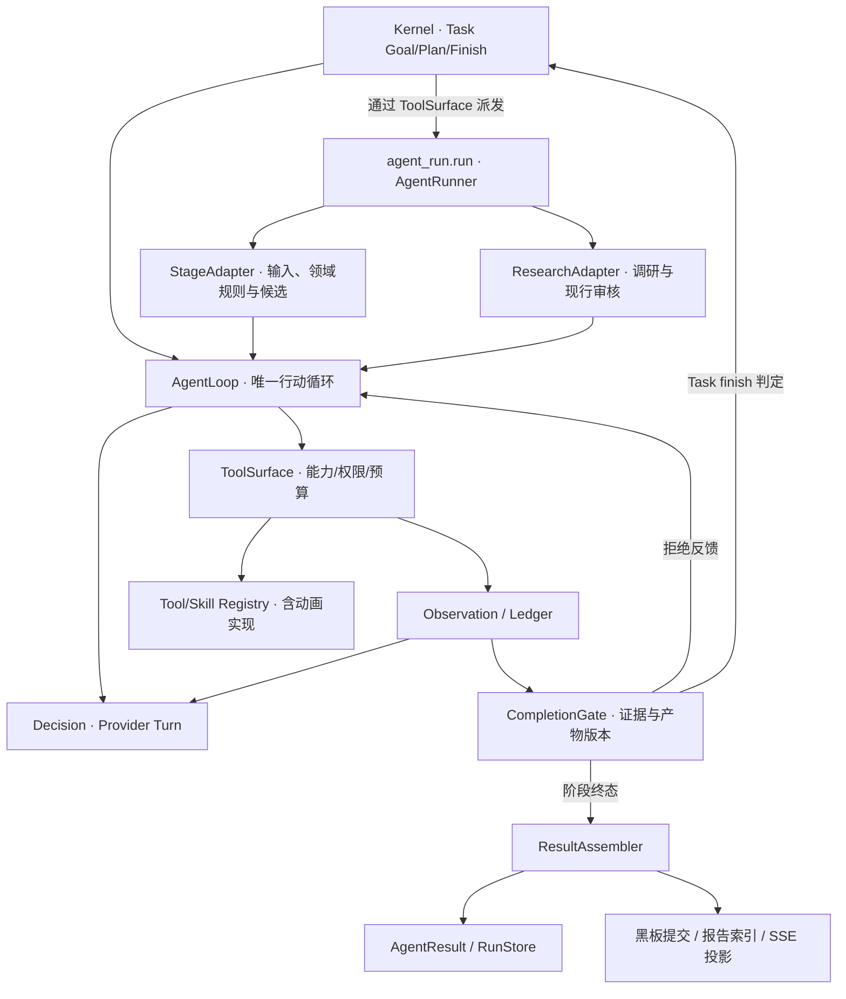
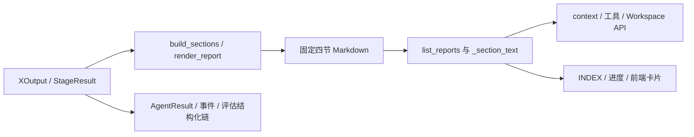

# Clipwright 阶段 Agent 自主工具循环与交接协议 PRD

## 0. 文档信息

| 项目 | 内容 |
|---|---|
| 版本、状态 | v0.4 · 评审稿 · 2026-11-20 |
| 作者 | gpt-6-sol（tk1688 provider）· Clipwright 架构评审 |
| 后端基线 | `J:\Clipwright` · `feat_zam_animation_improvements` · `9d8b236a2de33b07b12b24ba3bd4f9be730ba7e6` |
| 前端基线 | `J:\Clipweight-Client` · `ref_zam_subagents_agentic_loop` · `06946c27fa917858693ebe1427e873c1c47d923d` |
| 修订记录 | v0.1：双仓静态审计、契约与切换方案初稿。v0.2：补公共 AgentLoop 伪代码（§4.1）、逐 Agent 细化（§6.1–6.5）、需求追溯表（§1.1）；修正作者字段；未新增未经核实断言。v0.3（评审 F1–F4）：§5.1 增 `brief`/`mode` 并写明 `dry_run` 的两个丢失点（`agent_run._map_status:695`、`stage_subagent.run:335-340`）；§5.2 明确 `dry_run` 不写黑板/正文；§8 裁决唯一阶段 Adapter 为 `services/stage_adapter.py::run_stage`；§6.4/§6.5 回归路径补 `tests/clipwright/` 前缀。**v0.4（用户 2026-11-20 裁定）**：① requirements 聊天同批接入（§6.1）；② 预算分级 + 保守单价预留、超额不影响制作（§8）；③ 动画视觉证据按能力可用性分流（§6.6）；④ 生产不维护旧数据、切换不归档（§9.1）；⑤ 采纳 shared_driver 放量门限（§11）；⑥ `needs` 与 `redo_request` 互斥且限定产生者（§5.2）；⑦ 开关统一 `settings.stage_loop_<stage>_enabled`（§6.6/§11）；⑧ **墙钟与 `max_tokens` 只预留字段、不设硬编码上限**（§4.1/§6/§8）。行号按上述工作树。未运行服务、测试或应用 import，测试覆盖仅指已读用例。实际部署的开关、provider、数据分布和仓外消费者未验证。 |
| 范围 | 五个待改造阶段、Material 统一接线并分期启用、Animation MG 参考路径迁移、主 Agent 共用驱动、交接与双仓切换。保持五层、主 Agent 派发权、需求会话及用户确认实施的产品流程。 |

**文档沿袭与覆盖关系**

| 前序裁定 | 本 PRD 的落点 |
|---|---|
| 现代 Agent 的原生工具回合、显式证据、统一 run | 沿用判据与运行时资产。按现有 `AgentResult.outputs` 收敛，替换历史草案的模板/章节索引和 `XOutput` 作为返回值的方案。[现代 Agent PRD:11](modern-agent-prd-2026-10-27.md#L11)（11–29、155–222、239–340） |
| 主 Agent 自主派发、工作区人与机器双通道 | 保留 append-only、人读正文与按需读取。替换 §17 的三节必填/四节模板与按小节装载，使用结构化 run 结果。[主 Agent PRD:915](master-agent-prd-2026-10-26.md#L915)（915–1144） |
| 可寻址 run、操作台账、可见降级与评估 | 复用 TaskEvent、run 查询与评估入口，保留字段语义。按本次生产口径执行同版切换，覆盖旧评审提的兼容周期。[现代 Agent 评审:105](modern-agent-review-prd-2026-10-30.md#L105)（105–198） [收口开发计划:11](modern-agent-closeout-plan-2026-10-27.md#L11)（11–45、65–103） |
| 动画工具、失败观察、视觉 QA | 沿用工具/技能和观察反馈设计。技术出片与视觉验收分开，实录里的 5/5 仅作为历史样本记录。[动画 PRD:67](animation-agentic-tool-loop-prd.md#L67)（67–179） [动画 Coding Plan:65](animation-agentic-tool-loop-coding-plan.md#L65)（65–146） [动画运行记录:185](animation-agentic-round-record-2026-11-19.md#L185)（20–33、132–199） |
| 终止裁定和运行红线 | 主任务 soft landing、`capped` 与 escrow 按 §15 最终裁定。后端地图证实 #1/#8/#11/#12，题述 #13/#21/#23 在前端仓的项目地图可核对。当前提示词入口实际为 `clipwright.prompts` 包，文件布局见 §4。 [后端 AGENTS.md:59](../AGENTS.md#L59)（59–94） [前端 AGENTS.md:73](<J:/Clipweight-Client/AGENTS.md#L73>)（73–76、123–145、164–180） [终止 PRD:273](agent-termination-prd-2026-11-02.md#L273)（273–284） |

## 1. 结论摘要

| 阶段 | 判定 | 基线分 | 关键证据 |
|---|---|---:|---|
| requirements | **否** | 0.5/8 | 阶段类只做简报结构化生成及重试，独立需求会话具有自己的工具路径。阶段名已列入枚举，实际阶段工厂未登记。 [requirements_agent.py:85](../clipwright/agents/requirements_agent.py#L85)（85–99、144–160） [stage_subagent.py:34](../clipwright/services/stage_subagent.py#L34)（34–41、87–94） [requirements_service.py:2341](../clipwright/services/requirements_service.py#L2341) |
| structure | **部分** | 4.5/8 | `with_tools` 单个调用包含多轮原生 tool/result。阶段收到最终文本后解析 scenes，失败反馈主要走模板、覆盖率兜底及外层重试。 [structure_agent.py:634](../clipwright/agents/structure_agent.py#L634)（634–748） [llm.py:902](../clipwright/services/llm.py#L902)（902–996） |
| edit | **部分** | 3/8 | PV 自检需开关与项目存在，原生工具轮为 2 轮 / 4 次，回执只追加状态和调用数，剪辑时间线按原路径返回。 [edit_agent.py:980](../clipwright/agents/edit_agent.py#L980)（980–1014） |
| audio | **否** | 2/8 | BGM LLM 给分配数据，BPM 与配音由代码择时调用工具/技能。 [audio_agent.py:242](../clipwright/agents/audio_agent.py#L242)（242–257、362–389、446–455、1166–1243） |
| quality | **否** | 2/8 | 声明工具白名单，代码按预设条件执行技术、视觉、语义与 PV 检查，再聚合 verdict。 [quality_agent.py:76](../clipwright/agents/quality_agent.py#L76)（76–89、337–428、550–589、955–970） |

| 改造主线 | 预计收益 | 上线风险与观察点 |
|---|---|---|
| 每阶段走同一 `AgentLoop` | 工具失败和验收缺口可以驱动下一次行动，影响范围可精确到场景、轨道、clip 或字段。 | 工具面扩大、调用数和 p95 时延上涨。先验证编排分支与限额，再分批开策略。 |
| 每次阶段运行只返回 `AgentResult` | 失败、需求、用量、写回和 replay 归于同一个实际 run。主 Agent、SSE、前端读取稳定投影。 | 黑板误提交、重复扣费、重放拿到别的 run。以原子提交、快照和归属校验锁住。 |
| 自由 Markdown 与结构化交接同批切换 | 改标题、换语言或缺正文时，交接事实仍可读取。 | 旧消费者容易把缺字段显示成空。双仓同版、坏数据显式告警、旧解析静态门禁。 |

### 1.1 需求追溯

| 用户问题 | 结论 | 章节 | 关键证据 |
|---|---|---|---|
| 需求 / 结构 / 剪辑 / 音频 / 质检 Agent 是否“支持 tool call 与 agent loop 的现代自主 Agent” | requirements 否（无工具面）· structure 部分（一次 `with_tools` 后解析正文）· edit 部分（可选 2/4 轮附加自检）· audio 否 · quality 否；五者均不满足“观察驱动下一动作 + 内建完成门”。 | §1 判定表、§3 基线勾选、§6 逐 Agent 方案 | `requirements_agent.py:85`、`structure_agent.py:634`、`edit_agent.py:985`、`audio_agent.py:79`、`quality_agent.py:81`；对照 `animation/agentic_runtime.py:96` |
| 阶段结果是否统一为 `AgentResult` | 否——当前三层契约 `XOutput → StageResult → AgentResult` 逐层转换；目标为 `AgentResult` 唯一公开结果，`XOutput` 降为 `outputs` 载荷、`StageResult` 删除。 | §5 数据契约、§8 编排层、§9.1 删除范围 | `schema/agent.py:115`、`schema/stage.py:58`、`schema/run.py:55`、`agent_run.py:688`（`dry_run→ok` 的隐性丢状态） |
| 交接文档是否固定格式 → 取消并评估衔接影响 | 是——YAML 信封 + 固定四节（我做了什么 / 结果如何 / 发现的问题 / 给下一位），且被 `_section_text` 反解析成 `preview/next_for`。目标：正文自由 Markdown、机器事实只进 `AgentResult`、下游同批切换。 | §7（含 §7.3 同批清单、§7.4 影响矩阵与静默检测） | `stage_report.py:53,108,239`、`context_loader.py:363`、`tool/reports.py:138`、前端 `workspace.ts:83` |


## 2. 现状审计

### 2.1 横向对比

下表中的“报告”列描述实际阶段入口写法。阶段类返回对象，公共模块才合成并落报告。实际完成路径由阶段运行模块调用 `build_sections` 与 `write_report`，输入不全、拒绝、超时等早退走各自返回分支。 [stage_subagent.py:502](../clipwright/services/stage_subagent.py#L502)（502–570、634–661、772–829）

| Agent | 入口、模型与工具语义 | 结果、报告与失败 | 可观测和测试证据 |
|---|---|---|---|
| requirements | `execute` → `_generate_brief` → `llm_or_fallback(…structured_output…, retries=2)`。库概览与索引内容由代码注入。提到 `content_query` 的文案没有给该类接工具。`translate_scenes` 另有单独结构化调用和可读规划书回退。 [requirements_agent.py:85](../clipwright/agents/requirements_agent.py#L85)（85–160、195–240） | `RequirementsOutput(creative_brief, animation_intents)`。缺 `brief_draft` 得 `{}`，仍可走 PASS。动画意图验证异常被跳过。阶段工厂缺此项，装配分支给字典而 `execute` 要求 `RequirementsInput`。以当前仓内入口核查为准，运行部署未验证。 [requirements_agent.py:85](../clipwright/agents/requirements_agent.py#L85)（85–99、157–193） [stage_subagent.py:34](../clipwright/services/stage_subagent.py#L34)（34–41、87–94、513–519、588–590） | 阶段类开始/失败日志。生产会话 `RequirementsService._handle_gathering` 有流式与 gated `with_tools`，并有独立规划翻译。现有 ask_user、翻译重试用例覆盖服务；阶段类直接 loop/运行用例未验证。 [requirements_service.py:2232](../clipwright/services/requirements_service.py#L2232)（2232–2364、2695、3963） [test_requirements_ask_user.py:50](../tests/clipwright/test_requirements_ask_user.py#L50) [test_requirements_plan_translate_retry.py:58](../tests/test_requirements_plan_translate_retry.py#L58) |
| structure | `execute` 可复用已有规划。生成路径收集 agent-callable 工具、补两项能力、追加可用技能，`_generate_scenes` 可重试或按开关另出一稿。`with_tools` 服务逐轮发 schemas、消费 calls 并按 provider 回填。 [structure_agent.py:337](../clipwright/agents/structure_agent.py#L337)（337–466、598–697） [llm.py:902](../clipwright/services/llm.py#L902)（902–996） | `StructureOutput(script_skeleton, scenes)`；解析最终正文或累计 preamble，再验证。无场景、超时或覆盖不足有确定性兜底和降级。对齐、接地、plan drift 在业务层完成。通用报告。 [structure_agent.py:662](../clipwright/agents/structure_agent.py#L662)（662–794） | 生成日志、plan drift 事件，运行时汇总操作。用例验证文稿覆盖、音频时长对齐及动画标记，最终候选失败回灌的验收用例未验证。 [structure_agent.py:750](../clipwright/agents/structure_agent.py#L750) [test_structure_script_coverage.py:49](../tests/test_structure_script_coverage.py#L49) [test_structure_scene_duration_alignment.py:30](../tests/test_structure_scene_duration_alignment.py#L30) [test_structure_agent.py:68](../tests/clipwright/test_structure_agent.py#L68) |
| material | `execute` 读取 skeleton scenes。关键词生成、批处理、翻译分别走 `ask`，代码发起来源检索和视觉打分。存在按结果重搜等业务重试。 [material_agent.py:255](../clipwright/agents/material_agent.py#L255)（255–275、310–354、452–457、712–735、754–864、1140–1235） | `MaterialOutput(candidate_clips, material_notes)`；有缺源或结果为空等分支、错误输出和通用报告。`material_notes` 被 schema 标成 exclude，常规 `model_dump` 无法带给报告或黑板。 [material_agent.py:774](../clipwright/agents/material_agent.py#L774)（774–807、938–1016） [schema/agent.py:206](../clipwright/schema/agent.py#L206) [stage_merge.py:36](../clipwright/services/stage_merge.py#L36) | 检索走 `operation`，视觉能力经 `call_tool`。已有失败重搜、候选换位和执行集成桩。 [material_agent.py:452](../clipwright/agents/material_agent.py#L452) [material_agent.py:723](../clipwright/agents/material_agent.py#L723) [test_material_agent.py:201](../tests/clipwright/test_material_agent.py#L201)（201–329） |
| edit | `execute` 生成粗剪并调用工具。剪辑档案通过 `structured_output` 给模型选择有限的参数。末尾可选 PV 工具轮。 [edit_agent.py:281](../clipwright/agents/edit_agent.py#L281)（281–304、419–439、690–709、980–1004、1018–1092） | `EditOutput(timeline, edit_notes)`。LLM 档案不可用回退规则，PV 自检结果只追加说明。外层异常转失败；共用报告。 [edit_agent.py:996](../clipwright/agents/edit_agent.py#L996)（996–1014、1027–1039、1070–1095） | 程序化能力通常走 `BaseAgent._note_tool_call`。可选工具轮记录名字和参数，并重置 `last_tool_calls`，因此有覆盖前序轨迹和缺状态的风险。既有档案约束、注入、规则降级用例。 [agents/base.py:284](../clipwright/agents/base.py#L284)（284–357、483–514、531–546） [test_edit_agent_llm.py:283](../tests/clipwright/test_edit_agent_llm.py#L283)（283–357） |
| animation | MG 分支 `CLIPWRIGHT_ANIMATION_AGENTIC_LOOP=1/true/yes` 才启用，实例传 8/12，调用 runtime 时还另开视觉一轮。其他路径依原实现运行。 [animation_agent.py:1927](../clipwright/agents/animation_agent.py#L1927)（1927–2049、2178–2205） | `AnimationOutput(timeline, issues, redo_agent, redo_hint, animation_plan, generated_mg_count)`，保留按 clip 返工契约。观察和 final 守卫具备可复用语义，详见 §2.2。 [animation_agent.py:720](../clipwright/agents/animation_agent.py#L720)（720–742） [agentic_runtime.py:108](../clipwright/animation/agentic_runtime.py#L108)（108–170） | 有上下文台账与事件，但首轮动作日志有硬编码 `success`，第二轮视觉动作未见同样逐条记录。测试证据包括工具/技能/上限、旧 action parse、黑板重做和动画缓存。 [animation_agent.py:1961](../clipwright/agents/animation_agent.py#L1961)（1961–1986、2018–2046、2207–2226） [test_agentic_loop.py:7](../tests/clipwright/test_agentic_loop.py#L7) [test_agentic_runtime.py:19](../tests/clipwright/test_agentic_runtime.py#L19) [test_animation_loop_fixes.py:78](../tests/clipwright/test_animation_loop_fixes.py#L78)（78–102、255） |
| audio | `execute` 按配置取 BGM、音量包络、BPM、TTS 技能与对齐。LLM BGM 匹配是结构化输出，异常回退规则。 [audio_agent.py:79](../clipwright/agents/audio_agent.py#L79)（79–89、229–257、362–399、446–455、1166–1243） | `AudioOutput(timeline, audio_notes)`；`audio_config_internal` 排除序列化。保留用户上传配音、字幕样式、对齐降级与缺配音诊断；共用报告。 [audio_agent.py:614](../clipwright/agents/audio_agent.py#L614)（614–747、880–911） [schema/agent.py:295](../clipwright/schema/agent.py#L295) | `call_tool` 和 `call_skill` 的通用记录。测试有 BGM 分配失败回退、无 SFX 字幕对齐与降级。 [agents/base.py:242](../clipwright/agents/base.py#L242)（242–357、388–412） [test_audio_agent_llm.py:229](../tests/clipwright/test_audio_agent_llm.py#L229) [test_audio_uploaded_dub_alignment.py:55](../tests/clipwright/test_audio_uploaded_dub_alignment.py#L55)（55–125） |
| quality | `execute` 执行静态检查，按配置追加视觉、语义、PV 审计；没有阶段级 provider 工具决策循环。`tool_whitelist` 与代码里直接择时调用能力可共存。 [quality_agent.py:83](../clipwright/agents/quality_agent.py#L83)（83–121、337–381、550–589、756–795、955–970） | `QualityOutput(passed, issues, fix_suggestions, redo_agent, score)`。技术 error 阻断，主观审查项降为 warning。共用报告；通用阶段失败推断可把仅 FAIL 无详情的 verdict 变成 `unknown`。 [quality_agent.py:384](../clipwright/agents/quality_agent.py#L384)（384–428） [stage_subagent.py:262](../clipwright/services/stage_subagent.py#L262)（262–278） | 能力调用有通用记录。帧检查异常/坏形状与语义 LLM 空输出的现有测试体现不同跳过语义。 [test_quality_agent_content.py:263](../tests/clipwright/test_quality_agent_content.py#L263) [test_quality_semantic_qa.py:122](../tests/clipwright/test_quality_semantic_qa.py#L122)（122–179） |

**主 Agent 参照。** `AgentKernel._run_tool_loop` 装载上下文、发布 `context_loaded`，把控制闸与成本回调传给 `agent_loop.run_loop`。任务级 Plan/Goal 约束保留，实际轮内下一动作取原生 `tool_calls`。`agent_tool_schemas` 和 `build_tools(closeout=...)` 编译工具面，`_executor` 检查闸门、执行、发 `tool_call/tool_result`。收口与最终 `final_timeline` 校验归 Kernel。另有两个应覆盖的计数及策略边角：`run_loop` 用 `len(calls)+1` 估算轮次，批量调用会使它偏离真实模型轮数。`build_tools` 构建失败会回落不区分收口的兼容 schema。 [agent_kernel.py:1130](../clipwright/services/agent_kernel.py#L1130)（1130–1197、1284–1317、1420–1467、1968–2094） [agent_loop.py:43](../clipwright/services/agent_loop.py#L43)（43–56、163–178、365–562、619–632、713–723）

**共享运行壳与直接入口。** `BaseAgent` 的 `call_tool` 解析能力并在缺失时返回 `NOT_FOUND`，直接调用会写 `subagent_tool`。备用 `run_tool_loop` 的默认 3/6 属于 Base helper。阶段包装还可能追加 `run_skill_round`，这使 requirements 之外的多个阶段可拥有外围工具轮。`run_stage` 的 `max_turns` 在阶段 spec 与适配器可见，当前实际业务轮数还受各路径局部策略控制，不能把 spec 数值当成整次阶段调用的硬上限。阶段墙钟存在请求下限，并允许 0 表示不设上限。 [agents/base.py:163](../clipwright/agents/base.py#L163)（163–212、242–357、463–546） [stage_subagent.py:65](../clipwright/services/stage_subagent.py#L65)（65–83、587–621） [agent_run.py:575](../clipwright/services/agent_run.py#L575)（575–586）

### 2.2 Animation 参考实现与可复用范围

| 接缝 | 现有实现、缺口 | 提取决定 |
|---|---|---|
| 决策 | `generate(messages, tools)` 读取 `tool_calls[0]`。再一轮用最近 6 条观察重新构造消息。无 calls 回看自由 JSON，坏参数可能回退生成。内联系统词仍要求 JSON。 [agentic_runtime.py:13](../clipwright/animation/agentic_runtime.py#L13)（13–19、32–94） | 借用“动作由 provider 发出、观察参与决策”，协议编码使用 `LLMService` 现有 OpenAI/Anthropic 实现。无 native tool-call 能力显式报不可用。一个 batch 的每个 call 都有回执或拒绝。 |
| 观察、账本 | `Observation` 带 status、failures、ref/raw/data；`Failure` 有位置、预期、观测和指纹。`unresolved()` 聚合所有历史 blocking，没解决记录。部分业务异常直接追加 dict，未必进入 ledger。 [contracts.py:8](../clipwright/animation/agentic/contracts.py#L8)（8–56） [ledger.py:9](../clipwright/animation/agentic/ledger.py#L9)（9–35） [agentic_loop.py:55](../clipwright/animation/agentic_loop.py#L55) | 用两类真实 Adapter 验证接口：ToolRegistry/Skill 执行结果与动画 handler 结果。账本支持追加 `resolved_by` 和按版本失效。异常、坏形状、拒绝产生同型观察。 |
| 完成门 | final 要有 `mg_def` 与 HTML、抽帧、视觉检查。缺项时当前守卫代发工具；匹配依据主要是观察名或字段存在，可能拿旧版本证据，也可拿到失败观察。 [agentic_runtime.py:117](../clipwright/animation/agentic_runtime.py#L117)（117–152） [agent_tool_impl.py:117](../clipwright/animation/agent_tool_impl.py#L117)（117–142、145–177） | 检查同一 `clip_id+artifact_sha+输入背景哈希`，有效 HTML/非空帧/合格技术与视觉结果。修订使旧证据失效。拒绝 final 回灌具体缺证据或 blocker，模型选择下一动作。 |
| 限额与发布 | 通用 loop 的 skill 不计 tool calls；`run` 在结束后仍可补生成，检查 `isinstance(o, dict)` 与通常的 `Observation` 有形状差异。调用者又能执行额外修复和第二轮，并从观察取 MG。 [agentic_loop.py:30](../clipwright/animation/agentic_loop.py#L30)（30–65） [agentic_runtime.py:154](../clipwright/animation/agentic_runtime.py#L154)（154–170） [animation_agent.py:1987](../clipwright/agents/animation_agent.py#L1987)（1987–2049） | 一次阶段一个父预算。每镜头独立 evidence scope，使用同一循环实现和共享剩余量。删除上限后追加生成和 wrapper 再开视觉循环的路径。 |
| 工具权限与前端 | `AnimationToolSpec.permission` 自成一套词表，registry dispatch 用固定名字。HTML、抽帧具写入副作用，现表标 `read`。注册了 `ask_user`，安装列表无其 handler。修复提示词内联。 [agent_tools.py:8](../clipwright/animation/agent_tools.py#L8)（8–14、41–71） [agent_tool_impl.py:117](../clipwright/animation/agent_tool_impl.py#L117)（117–131、152–169、192–211） | 保留原子实现，接入共用注册/审计或同档位的受控贡献 Adapter。预览写入对应真实档位，模型无法覆盖 workspace 参数；动作完成现场发事件。没有 handler 的能力从 schema 移除。 |

## 3. 「现代 agent」判定基线

评分为能力证据盘点，每个基线 `✓=1`、`△=0.5`、`—=0`。基于阶段业务路径；由运行壳提供的部分保障至多计 `△`。**“是”要求生产默认路径通过全部八项；“部分”要求业务路径至少含真实原生工具回合，缺其余一项或多项；“否”表示业务无此类回合。** 整体 Animation MG 是已实现的参考切片，完整生产基线仍需补齐。Material 纳入统一架构，切片判定为否。

| 基线（上线可勾选） | Req | Structure | Edit | Audio | Quality | Material | Animation MG | 证据与复核方式 |
|---|:---:|:---:|:---:|:---:|:---:|:---:|:---:|---|
| ☐ N 原生 `tool_calls`，带 schema 与 call ID | — | ✓ | △ | — | — | — | △ | Structure 原生，Edit 仅可选，Animation 开关且只取首个。 [structure_agent.py:650](../clipwright/agents/structure_agent.py#L650) [edit_agent.py:985](../clipwright/agents/edit_agent.py#L985) [agentic_runtime.py:49](../clipwright/animation/agentic_runtime.py#L49) |
| ☐ L 多轮 plan–act–observe–reflect，后续动作受观察影响 | — | ✓ | △ | — | — | — | ✓ | Structure 在 `with_tools` 内有完整工具回填。Edit 有同驱动附加轮。Animation 下一轮接观察摘要。验收用 stub 记录“先失败后改动作”。 [llm.py:915](../clipwright/services/llm.py#L915)（915–992） [agentic_runtime.py:62](../clipwright/animation/agentic_runtime.py#L62) [agentic_loop.py:43](../clipwright/animation/agentic_loop.py#L43) |
| ☐ C 自检和修复，最新版本证据方可通过完成门 | — | △ | — | — | — | — | △ | Structure 解析校验后有模板修正，缺阶段级反馈；Edit 自检回执入 notes，无条件影响时间线的证据；Quality 是下游审查，本 run 无模型重选证据；Animation 可请求 revise，证据未绑定版本。 [structure_agent.py:662](../clipwright/agents/structure_agent.py#L662) [edit_agent.py:996](../clipwright/agents/edit_agent.py#L996) [quality_agent.py:384](../clipwright/agents/quality_agent.py#L384) [agentic_runtime.py:117](../clipwright/animation/agentic_runtime.py#L117) |
| ☐ B 所有路径轮数/调用数/墙钟/预算有界 | — | △ | △ | △ | △ | △ | △ | 外层墙钟、局部计数与 Kernel 结算分布于不同模块；Animation 有 cap 后调用。验收覆盖 fallback、skill 内部、取消在飞动作。 [stage_subagent.py:65](../clipwright/services/stage_subagent.py#L65) [stage_subagent.py:587](../clipwright/services/stage_subagent.py#L587) [agentic_runtime.py:162](../clipwright/animation/agentic_runtime.py#L162) [agent_kernel.py:1185](../clipwright/services/agent_kernel.py#L1185) |
| ☐ F 结构化失败、可重试性、needs 与降级 | △ | △ | △ | △ | △ | △ | △ | 共享模型和异常包装具备部分字段，缺统一逐动作失败证据，动画有位置化 Failure。 [schema/agent.py:58](../clipwright/schema/agent.py#L58)（58–86、115–132） [stage_subagent.py:262](../clipwright/services/stage_subagent.py#L262) [contracts.py:8](../clipwright/animation/agentic/contracts.py#L8) |
| ☐ O 有可关联事件、可恢复的完整台账 | — | △ | △ | △ | △ | △ | △ | 可见度随入口和调用方式变化；采样必须与原始台账分开。 [agents/base.py:284](../clipwright/agents/base.py#L284)（284–357、497–545） [agent_run.py:465](../clipwright/services/agent_run.py#L465) [animation_agent.py:1961](../clipwright/agents/animation_agent.py#L1961) |
| ☐ R 可重放、幂等且副作用有收据 | — | △ | △ | △ | △ | △ | △ | 已有真实 run 身份与缓存标识，公开重放仅重用 stage 与 brief。 [agent_run.py:327](../clipwright/services/agent_run.py#L327)（327–368、477–483） [api/task.py:700](../clipwright/api/task.py#L700)（700–729） |
| ☐ U 单一结果 + 稳定交接 | — | — | — | — | — | — | — | 三层结果与两条投影仍存。验收要求所有终态只持久化同一 `AgentResult`。 [schema/agent.py:115](../clipwright/schema/agent.py#L115) [schema/stage.py:58](../clipwright/schema/stage.py#L58) [agent_run.py:586](../clipwright/services/agent_run.py#L586)（586–617） |

## 4. 目标架构

编排层内集中运行重复逻辑。`agent_run.run` 作为已有 **AgentRunner** 模块，不新造同职责入口。唯一 **AgentLoop** 放入现有 `services/agent_loop.py`，底层 `LLMService` 提供单次 turn、消息格式和实际用量。依赖检查和下一动作分开：领域策略决定需要什么证据、是否可完成，模型决定如何取得证据。已有 deterministic handler 原位拆成可调用能力。Tier、能力和 provider 协议通过现有注册/解析机制。 [agent_loop.py:163](../clipwright/services/agent_loop.py#L163)（163–178、365–562、619–724） [llm.py:873](../clipwright/services/llm.py#L873)（873–996） [tool/capabilities.py:117](../clipwright/tool/capabilities.py#L117)（117–153）



| 模块 | 接口约束与实现归属 |
|---|---|
| Decision | 每次模型请求收集实际 provider、model、usage 与原生 call IDs。兼容两种现有协议消息形态；模型可能给批量 calls，默认顺序执行，遇取消或超限停止启动后续调用。允许简短用户可见叙述。只有 provider 实际返回的可展示数据进事件。 |
| ToolSurface | 取阶段允许能力、运行快照与实时可用性的交集，调用前重新解析并对齐已发布 schema。工具实现变更且参数不兼容，回 `schema_changed` 并刷新下一轮。工具自声明 tier，缺档位 fail-closed，`TIER_MAP` 保持空。Skill 声明或展开权限，按内部最高 tier 预检，内部子操作同一 run 预算，不存在直连后门。模型不得改 workspace、task、route 或权限。 |
| Observation/Ledger | 每个真实操作记录前后状态和计数，含 `call_id`、`seq_in_run`、`parent_call_id`、scope、artifact 版本、status、failure IDs、usage 引用。校验成功只能按规则解决相关失败，保留原历史。重复 blocker 按稳定 code＋位置＋相关版本归并，排除时钟、自由文本等漂移值。 |
| CompletionGate | 宿主验证 `RunSpec.expect`、绑定证据、输出 schema、用户授权和写回条件。`final` 的文本、preamble 或工具返回 `success` 均只构成候选/观察。优先回灌阻塞项，允许迭代至门限。超过限额只能用已验证证据判断 partial/失败。 |
| Failure/Needs | 区分动作失败与阶段终态。逐缺失字段生成 `Need`，映射可供给阶段或 human；保留定位、可重试类别与机器可检索的证据。语义无法判定或未执行都显式记录。 |
| ResultAssembler | 运行身份、时间、用量、台账与诊断由宿主管理。阶段绑定业务输出，不解释公共生命周期。一次 finalize 同时处理成功与早退；黑板、报告、评估与事件使用同源投影。见 §5、§7、§8。 |

**接口草图（目标符号）。** `RunContext` 由运行壳建立，含 `AgentContext`、run 身份、输入快照、deadline、预算租约、事件与账本。`BaseAgent.execute` 的共享实现调用 `drive` 和 `finalize`，阶段只提供 policy 与业务函数。`LoopExit` 只在驱动与组装器之间传递。若输入拒绝或取消发生在进入 `execute` 之前，Runner 将对应 exit 交给同一个 `finalize`，并以 `run_id` 保证提交与发布只发生一次。Kernel 以 Task policy hooks 接入同一驱动，仍掌握 TaskFinish、Goal/Plan 与 closeout。Base 的 helper 和 `LLMService.with_tools` 在切换期间可保留 API，最终仅委托同一驱动。Animation runtime 收窄到 MG policy/工具结果适配，不留第二个 while。用删除测试验证抽象：删掉共用循环会使 Kernel、阶段、调研三处重新承担 native 回填、闸门、取消和调用归因；领域 Adapter 的代码留在对应领域。

```python
class BaseAgent(Generic[I], ABC):
    async def execute(self, input_data: I, context: AgentContext, *,
                      run: RunContext) -> AgentResult:
        exit = await drive(run, self.loop_policy(input_data, context))
        return await finalize(run, exit)

async def run(spec: RunSpec, task: Task) -> AgentResult: ...
async def drive(run: RunContext, policy: LoopPolicy) -> LoopExit: ...
async def decide(run: RunContext, view: LedgerView, surface: ToolView) -> Decision: ...
async def dispatch(run: RunContext, call: NativeToolCall) -> Observation: ...
def check(run: RunContext, candidate: FinalCandidate, ledger: LedgerView) -> GateVerdict: ...
async def finalize(run: RunContext, exit: LoopExit) -> AgentResult: ...
```

**提示词落点。** #23 按 `clipwright.prompts` 单一所有权落实。当前没有独立 `clipwright/prompts.py`，实际包用 `__init__.py` 统一导出、`agents.py` 放阶段默认词、`loop.py` 放 Kernel 策略、`engine/` 放生成器规则。新增 `prompts/stage_loop.py`，由包入口导出；存量覆盖用 `resolve_constant` / `safe_builder`，继续包内单一来源、Category → Persona → Skill → 插件覆盖。将本次涉及的 `DECIDE_SYSTEM`、动画修复、结构阶段固定工具名称指令、主循环纠错文案归到该包。搬运先做逐字快照，有意改语义另做 diff 与运行时 prompt snapshot。 [prompts/__init__.py:58](../clipwright/prompts/__init__.py#L58)（58–114、139–180） [prompts/agents.py:4](../clipwright/prompts/agents.py#L4)（4–16） [prompts/loop.py:4](../clipwright/prompts/loop.py#L4)（4–17） [agentic_runtime.py:13](../clipwright/animation/agentic_runtime.py#L13) [agent_tool_impl.py:152](../clipwright/animation/agent_tool_impl.py#L152) [agent_loop.py:659](../clipwright/services/agent_loop.py#L659)

### 4.1 公共 AgentLoop 伪代码

`drive` 是唯一 while 循环。Kernel（Task Goal/Plan/closeout）、5 个阶段、调研 worker、animation MG 都调用它，只替换 `LoopPolicy`；不允许再出现第二套“自己写 while + 自己解析 tool_calls”的实现。

```python
async def drive(run: RunContext, policy: LoopPolicy) -> LoopExit:
    """唯一行动循环。宿主负责证据、上限与终态；模型只负责选下一个动作。"""
    run.ledger.extend(await policy.seed(run))          # 确定性观察，不花模型钱
    while True:
        if run.cancelled:                              # 用户停止 / 任务取消
            return LoopExit("cancelled", reason="user_cancelled", ledger=run.ledger)
        if blocked := run.gate.hit():                  # 轮数/调用数/墙钟/预算/closeout
            return LoopExit("failed", reason=blocked, ledger=run.ledger)

        view = run.ledger.view(rounds=run.rounds_used, budget=run.budget.remaining())
        decision = await decide(run, view, run.surface)  # provider 原生 tool_calls
        emit("subagent_round", {"run_id": run.run_id, "round": run.rounds_used + 1,
                                "visible_calls": [c.name for c in decision.calls]})
        run.rounds_used += 1

        if not decision.calls:                         # 模型宣布收尾 → 先过完成门
            verdict = policy.gate(run, FinalCandidate.from_text(decision.text))
            if verdict.accepted:
                return LoopExit("ok", verdict=verdict, ledger=run.ledger)
            # 缺证据/缺产物：把 verdict 变成一条观察回灌，模型选下一个动作
            run.ledger.append(run.observe("gate_rejected", code=verdict.code,
                                          missing=verdict.missing, digest=verdict.digest))
            continue

        for call in decision.calls:                    # 一轮多 call 顺序执行，超限即停
            if blocked := run.gate.hit():
                return LoopExit("failed", reason=blocked, ledger=run.ledger)
            obs = await run.surface.dispatch(call)     # 能力解析 + tier 校验 + 预算预留
            run.ledger.append(obs)                     # 含 call_id / seq / 版本 / 失败指纹
            emit("subagent_tool", obs.event_payload())  # 成功/拒绝/异常/取消都可见

            if obs.kind == "final_candidate":          # 工具也可提交候选（如 animation 的 mg_def）
                verdict = policy.gate(run, FinalCandidate.from_observation(obs))
                if verdict.accepted:
                    return LoopExit("ok", verdict=verdict, ledger=run.ledger)
                run.ledger.append(run.observe("gate_rejected", code=verdict.code,
                                              missing=verdict.missing))

async def finalize(run: RunContext, exit: LoopExit) -> AgentResult:
    """唯一出口：黑板提交、报告写盘、目录索引、事件、账务都在这里发生一次。"""
    result = ResultAssembler.build(run, exit)          # 见 §5.1 字段表
    await run.commit(result)                           # staging + CAS + run_id 幂等
    emit_end(run, result)                              # agent_run_end 同一投影
    return result
```

**与现有资产的对应关系**

| 调用方 | Policy | 复用的现成部分 | 必须删除的旧实现 |
|---|---|---|---|
| Kernel 主 Agent | `TaskPolicy`（Goal/Plan/closeout） | `agent_loop.build_tools/_executor/事件`，`_gate_hit/_enter_closeout` | 不再自己维护 `run_loop` 的轮内解析 |
| 5 个阶段 Agent | `StagePolicy`（§6 各自的 gate） | `BaseAgent.call_tool` 的能力解析、`_note_tool_call` 记账 | 各阶段自写的 `with_tools` + 正文解析（structure 662、edit 996） |
| 调研 worker | `ResearchPolicy` | `enforce_tool_policy`、`spawn_subagent` 的审批语义 | `_run_research` 里重复的 usage/status 翻装 |
| animation MG | `MgPolicy` | `AnimationAgentRuntime` 的 `final` 守卫、`FailureLedger`、tool adapters | `agentic_runtime` 的第二次 `run`、cap 后补生成（`agentic_runtime.py:154-170`） |

**事件与取消语义**：每轮发一次 `subagent_round`（新增聚合事件，字段 `run_id/round/visible_calls`），每次动作发一次 `subagent_tool`；取消在“下一个动作前”与“dispatch 前后”三处检查，已发出的外部写操作只做收据保留、不重发。`drive` 不吞异常：未分类异常统一转 `internal_defect` 的 `LoopExit`，再由 `finalize` 落 `failed`。

**闸门顺序（固定，不可由 policy 改写）**：`cancel → closeout/只读面 → 轮数 → 调用数 → 墙钟 → 预算预留`。预算在 dispatch 前按工具 `permission_tier` 分级预留（见 §8）：`costly` 必须能按保守单价预留，预留不足时**降级而不是拒绝**（换便宜实现 / 跳过可选付费，记 `budget_limited`）。

**超时与输出预算不写死（用户 2026-11-20 裁定）**：`StageBudget.wall_sec` 与 `max_tokens` 只保留字段，`None` = 不设上限（由 provider 自夹），配置了才生效；**禁止**在 Agent、policy 或默认参数里写死秒数/ token 上限。轮数（`rounds`）与动作数（`actions`）是策略预算，可以给默认值，但同样可被父任务收紧。


## 5. 数据契约

### 5.1 `AgentResult` 唯一公开阶段结果

下表的“必填”指对外 JSON 形状，允许空值的字段仍提供有类型的默认值。每种终态由同一个 `ResultAssembler` 校验，序列化输出也用于 run 查询和持久化。适配器生成中间候选可保留强类型业务载荷；只有返回的 `AgentResult` 可发表为阶段结果。

| 字段 | 类型与必填 | 迁移、语义 |
|---|---|---|
| `schema_version`, `run_id`, `kind`, `task_id`, `trace_id`, `attempt`, `stage`, `role` | 必填，版本=2，attempt≥1；stage 对阶段必填，research 用空 stage | 宿主一次分配。inline 同样生成 run_id，用宿主会话/局部运行 scope 归属，明确 `mode=inline` 并禁止写生产 Task 黑板。发布前生成 run 快照。 |
| `brief`, `mode` | 必填键；`brief` 可空串，`mode ∈ {task, inline}` | `brief` = 本次派发的原始要求，是重放快照与前端 `TaskRunDetail` 的数据源（现 `schema/run.py:69` 已有该字段、`agent_run.py:477` 幂等复用后回填、前端 `TaskRunDetail.tsx:134` 直接读取）。目标模型 `extra="forbid"`，字段表若漏它，真实 run 会在冻结后校验失败。`mode=inline` 禁止写生产 Task 黑板。 |
| `status`, `terminal_reason`, `summary` | 必填，枚举＋非空短摘要 | 七终态 `ok/degraded/needs/failed/refused/cancelled/dry_run`。**`dry_run` 的现有丢失点共 2 处**：`agent_run._map_status` 把它映射成 `ok`（`agent_run.py:695`），`stage_subagent.run` 的 `("ok","degraded","dry_run")` 分支对外返回 `status="ok"`（`stage_subagent.py:335-340`）；两处必须同批改，否则 Kernel 永远看不到 `dry_run` 终态。`RunStatus`（`schema/run.py:24`）当前 8 值、无 `dry_run`，需扩入；移除 `pending/running` 时同步 `_LIVE` 与 `list_runs.live`。pending/running 留给 live RunState。阶段 `needs` 源于显式输入/人工待决。阶段撞限用 `limit_*` 原因映射未完成为 failed 或可安全交接的 degraded；Task `capped` 独立。 |
| `outputs`, `writes`, `details` | 必填，typed stage payload map、成功提交键数组、有限诊断 map | 原 `StageResult.artifacts` → `outputs`，大数据用 `ArtifactRef`，有效空数组与 false 保留。`writes` 由提交收据生成。`details` 只放少量非权威展示诊断，禁止与业务产物重复。 |
| `needs`, `failure`, `error` | 必填键。`Need[]`、可空 `FailureReport`、可空 `str` | `needs[]` 为唯一缺项真相，迁出 `FailureReport.needs`。`failure` 带 code/category/retryable/blocking_point/location/evidence/attempts，research review 保留类型化子字段。失败/拒绝、取消和阻塞需要原因；`error` 是服务器可读简讯，禁止用自由文本做路由。 |
| `issues`, `redo_agent`, `redo_hint`, `redo_request` | 结构化 issues 列表必填，其余可空 | `Issue` 统一保留 `issue_id/code/severity/category/message/location/clip_id/evidence_ref`，含动画已有 reason/retry/scene_title 的归一映射。`redo_request` 为 scope、target stage、issue IDs、source run、base artifact/sha 及允许的 typed overrides。`redo_hint` 给人看，`redo_agent` 为显示投影，由同一 redo_request 派生，不能双写两份权威值。 |
| `degradations`, `iterations` | 必填，`Degradation[]`、实际决策轮数 | 复用 kind/detail/scope/impact，增加证据引用与可接受性策略引用。业务失败或取消可同时有降级记录，不能被报告失败覆盖为 degraded。 |
| `report_path`, `report_seq`, `report_state`, `report_sha256`, `handoff_summary` | 必填键；path/seq/hash 可空，state 枚举，摘要必填 | 保存工作区相对路径及报告序号。`written/unavailable/not_applicable` 明确正文状态。结构化交接摘要用非空短句；无额外事项可由宿主生成明确文案。正文候选仅在组装期存在，读者按引用取正文。 |
| `tool_calls`, `tool_calls_path`, `tool_calls_total`, `trace_state` | 必填键；路径可空 | 完整 JSON/JSONL 账本按 `run_id` 寻址，`tool_calls` 为有限采样，`tool_calls_total` 从记账数生成。`trace_state=complete/partial/empty/unavailable`，0 次调用与读取失败分别显示。 |
| `tokens`, `cost_usd`, `cost_unknown`, `duration_ms`, `provider`, `model`, `created_at` | 必填键；未知 token/金额/路由为 `null`，`duration_ms≥0` | 按请求与操作收据归因。`cost_usd` 语义定义为本 run 已知费用合计，全部未知填 null；`cost_unknown=true` 允许与已知部分并存。无实际计费且已知时为 0；质量账与 task 账见 §8。多路由记录主要决策路由，明细归台账。 |
| `replayed`, `replay_of`, `spec_ref` | 必填键，布尔与可空引用 | `replayed` 为本次投影属性，写入的实际 run 始终 false。缓存回执复用旧身份。显式重跑用 `replay_of` 指旧 run，取已授权 spec 快照与输入哈希。 |

前态对应证据见 [schema/run.py:28](../clipwright/schema/run.py#L28)（28–154）、[schema/stage.py:32](../clipwright/schema/stage.py#L32)（32–96）、[schema/agent.py:58](../clipwright/schema/agent.py#L58)（58–132）、[stage_subagent.py:663](../clipwright/services/stage_subagent.py#L663)（663–769）。

| 现有模型来源 | 新 `outputs` 及其他字段 | 根约束 |
|---|---|---|
| `RequirementsOutput` | `{creative_brief, animation_intents}`；规划改写模式另返回明确 `production_plan` 或变更提案 | 创意简报按已有 `CreativeBrief` 验证。机器规划与用户可阅读的需求文档的既有流程持续。 [schema/agent.py:324](../clipwright/schema/agent.py#L324)（324–342） |
| `StructureOutput` | `{script_skeleton, scenes}`；允许 scenes 引用或从 skeleton 安全投影 | 保持下游 skeleton scenes、原始 `material_refs` 与规划复用。避免存两份独立可变场景真相。 [schema/agent.py:176](../clipwright/schema/agent.py#L176) [structure_agent.py:773](../clipwright/agents/structure_agent.py#L773) |
| `MaterialOutput` | `{candidate_clips}`；用户可见 material notes 移入 `handoff_summary` 或有限 `details`，未匹配场景进入 `issues/needs` | 有效空候选与检索失败分开。`exclude=True` 不再承担隐式回传逻辑。 [schema/agent.py:206](../clipwright/schema/agent.py#L206) |
| `EditOutput` | `{timeline}`＋`details.edit_notes` | 诊断留小值，合并仅按合法 timeline revision，保留原来需要实测配音时长的验收。 [schema/agent.py:229](../clipwright/schema/agent.py#L229) |
| `AnimationOutput` | `{timeline, animation_plan, generated_mg_count}`＋顶层 issues/redo | 部分成功的镜头和失败 clip 分开。只有通过门禁的候选可成为黑板时间线，失败镜头的旧证据可作为诊断引用。 [schema/agent.py:266](../clipwright/schema/agent.py#L266) |
| `AudioOutput` | `{timeline}`＋`details.audio_notes`，由合并/定稿生成 `final_timeline`（成功后补为已提交 ref） | `audio_config_internal` 留在 run 内部。TTS 凭据、服务绝对路径、私有配置不进入报告或 SSE。 [schema/agent.py:295](../clipwright/schema/agent.py#L295) [stage_merge.py:106](../clipwright/services/stage_merge.py#L106)（106–125） |
| `QualityOutput` | `{passed, score, fix_suggestions, coverage}`＋顶层 issues/redo | `passed=false` 保留诊断和 verdict，`coverage` 显式区分已执行/跳过/无法验证。防止丢弃 `False` 或把缺证据写成 `passed=true`。 [schema/agent.py:344](../clipwright/schema/agent.py#L344) [quality_agent.py:384](../clipwright/agents/quality_agent.py#L384) |
| `AgentOutputBase` / `StageResult` | `decision` 映射终态和领域 verdict；`artifacts→outputs`；复制成本、失败等逻辑迁至 assembler；旧 `_llm_usage` 注入改为请求级收据 | 保留 `XInput` 与业务子模型。删七个 `XOutput` 返回类型；需要时定义 `<Stage>Payload` 供 `outputs` 验证，无生命周期字段。原 `_map_status("dry_run")` 目前会变成 `ok`，必须改为显式 `dry_run` 终态。`PluginAgentOutput` 仅作为外部贡献协议的边缘输入，不直接在阶段入口出现，见 §8。 [schema/agent.py:115](../clipwright/schema/agent.py#L115)（115–132、360–378） [stage_subagent.py:744](../clipwright/services/stage_subagent.py#L744)（744–769） [agent_run.py:586](../clipwright/services/agent_run.py#L586)（586–617、688–696） |

```python
# 字段与约束节选，完整公共形状以上表为准。
class Need(BaseModel):
    model_config = ConfigDict(extra="forbid")
    field: str = Field(min_length=1)
    why: str = Field(min_length=1)
    from_stage: StageName | None = None
    resolution: Literal["upstream", "human", "capability"]
    evidence_ref: str | None = None

class AgentResult(BaseModel):
    model_config = ConfigDict(extra="forbid")
    schema_version: Literal[2] = 2
    run_id: str = Field(min_length=1)
    task_id: str = Field(min_length=1)
    attempt: int = Field(ge=1)
    kind: Literal["stage", "research"]
    brief: str = ""                            # 本次派发原始要求：重放快照与前端详情的数据源（schema/run.py:69）
    mode: Literal["task", "inline"] = "task"   # inline 禁止写生产 Task 黑板
    status: Literal["ok", "degraded", "needs", "failed", "refused", "cancelled", "dry_run"]
    terminal_reason: str = Field(min_length=1)
    summary: str = Field(min_length=1, max_length=800)
    outputs: dict[str, JsonValue] = Field(default_factory=dict)
    needs: list[Need] = Field(default_factory=list)
    failure: FailureReport | None = None
    degradations: list[Degradation] = Field(default_factory=list)

    @model_validator(mode="after")
    def require_terminal_evidence(self) -> Self:
        if self.status in {"needs", "failed", "refused", "cancelled"} and self.failure is None:
            raise ValueError("缺少终态失败证据")
        if self.status == "needs" and not self.needs:
            raise ValueError("needs 终态缺少缺项")
        if self.status == "degraded" and not self.degradations:
            raise ValueError("degraded 终态缺少降级项")
        if self.status == "ok" and (self.failure or self.degradations or self.needs):
            raise ValueError("ok 携带尚未解决的阻塞或降级")
        return self
```

### 5.2 失败、降级与派发结果映射

| 条件 | `AgentResult.status` / 原因 | Kernel 行动 |
|---|---|---|
| 产物和证据齐全，所需写回已提交 | `ok` / `completed` | 继续评估下游前置条件。 |
| 有可用产物，但采用受允许的回退或发生交接故障 | `degraded` / 具体降级码 | 核对范围与可接受性。可修复项重派，允许接受项出具收据。 |
| 必需输入、能力或人工确认缺失 | `needs` / `input_insufficient`、`capability_unavailable` 或 `needs_review` | 对每个 `Need` 按 `resolution` 映射上游、插件配置或人工处理，更新快照后再派。 |
| 有技术性阻塞、无可交接候选或出现内部异常 | `failed` / 领域失败码、`limit_rounds`、`limit_calls`、`limit_wall`、`limit_budget` 或 `internal_defect` | 保留诊断。仅可重试失败在授权、预算及去重收据允许时再试。 |
| 授权、路由或深度政策拒绝 | `refused` / 具体政策码 | 展示理由。使用当前允许的能力或请求明确授权。 |
| 用户取消或预检完成 | `cancelled` / `user_cancelled`；或 `dry_run` / `validated_only` | 保留已执行操作收据；取消中止后续写回；预检返回输入来源与校验结果，不写黑板、不写报告正文。**`dry_run` 在 `_map_status` 与 `stage_subagent.run` 两层都不得被折成 `ok`**（见 §5.1）。 |

`surface` 外层调用状态定义为 `ok`（已取得 `ok/degraded/needs/dry_run` 回执）、`refused` 或 `error`（failed/cancelled）。凡推进阶段、写 timeline、派生完成数或标记降级修复，均使用业务状态、证据与提交收据。旧 surface 映射和逐字段缺输入构造见 [surface.py:846](../clipwright/tool/surface.py#L846) 与 [stage_subagent.py:948](../clipwright/services/stage_subagent.py#L948)。

**`needs` 与 `redo_request` 互斥（用户 2026-11-20 裁定：②+限定产生者）**

| 有 `needs` | 有 `redo_request` | 允许的 `status` | Kernel 动作 |
|:---:|:---:|---|---|
| 无 | 无 | `ok` / `degraded` / `cancelled` / `dry_run` | 正常推进或收尾 |
| 有 | 无 | `needs` | 逐字段补输入、等人工确认或换能力，补齐后再派 |
| 无 | 有 | `failed` | 先校验 `redo_request`（来源 run / `base_artifact_sha` / issue IDs），通过后按 scope 重派 |
| 有 | 有 | **禁止**（`ValidationError`） | 两个方向的分叉会让 Kernel 无法决定补输入还是重做，必须由产生者先选一个 |

- **合法产生者仅限** `quality` 与 `edit` 的 `failed`：前者在技术错误且能给出最小返工范围时产生，后者在时间线非法且可定位到 clip 时产生；其余阶段/终态**禁止**发 `redo_request`。
- `redo_request` 必带 `source_run_id`、`base_artifact_sha`、`issue_ids`；缺任一即视为协议错误，Kernel 降级为“保留诊断、不重派”。
- Kernel 优先级固定：**先处理 `needs`（补输入）→ 再考虑 `redo_request`（重做）**；同一 run 不得同时携带两者。

### 5.3 `to_tool_payload()` 与预算投影

| 操作 | 目标模型可见字段与行为 |
|---|---|
| 保留 | `run_id/kind/stage/role/status/summary/outputs/writes/needs/issues/redo_agent/redo_hint/degradations/report_path/failure/error/tokens/cost_usd/duration_ms/tool_calls/tool_calls_path/tool_call_stats/tool_calls_total`。`degraded` 与计数保留一版 wire 形状作为派生值，按 §8 内外状态区分。 |
| 新增或纠正 | `schema_version/attempt/terminal_reason/report_seq/report_state/handoff_summary/redo_request/replayed/cost_unknown/trace_state`；产物引用保留安全相对 path、id、sha 和 preview。带 `message` 与剪辑定位的 issue 统一格式；阻塞/缺项优先。工具总数从 ledger 生成。 |
| 删除或收窄 | 去掉冗长 `tool_calls_hint` 和无界 `details` dump，改为少量许可键/摘要；不发绝对路径、全量 transcript、模型内部推理、私有配置。failure/needs/outputs/issue 按总字节配额，超限显式附 `truncated_fields`、total 和可查 run_id，关键 blocker 至少 1 条。完整 needs 不截断于权威对象。 |

现函数需要修正 `_tool_call_digest(self.tool_calls)` 可能只看采样、`_preview` 丢 path/hash、`issues` 字段集无 QualityIssue `message/location`、`details` 原样投影、`replayed` 仅外层明确可见的组合。Kernel 提示词用 `output.status` 判断业务终态，按 `needs`、`redo_request` 和 `report_state` 决策，以 `run_id` 查遗漏；引用需按 schema 传递。`failure` 统一通过 `model_dump(mode="json")` 投影并裁剪，移除 `.get()` 与 Pydantic 对象混读。 [schema/run.py:104](../clipwright/schema/run.py#L104)（104–209） [schema/agent.py:316](../clipwright/schema/agent.py#L316) [tool/surface.py:846](../clipwright/tool/surface.py#L846)（846–869）

## 6. 逐 Agent 改造方案

每节统一四段：**现状调用链 → 目标 LoopPolicy 伪代码 → 工具面（能力名）→ 完成门/失败码 → 验收用例**。能力名必须能在 `tool/capabilities.py:26`（`CAPABILITY_ALIASES`）或工具的 `capability` 自声明里找到；标“待登记”的，是封装现有领域函数的新能力，不允许 Agent 直接 `import` 服务当后门（AGENTS.md 不变量 19）。首发轮数/动作数按 §11 灰度确认；**墙钟与 `max_tokens` 只预留字段、不设硬编码上限**（`None`=不限，provider 自夹）；所有值都受父任务剩余预算约束（§8「阶段预算执行」）。

### 6.1 requirements · 规划与改写

**现状调用链**

- `RequirementsAgent.execute`（`requirements_agent.py:85`）→ `_generate_brief`：单发 `llm_or_fallback(llm.ask(..., structured_output=CreativeBrief), retries=2)`（85–160）；`translate_scenes` 另一次结构化调用 + 可读规划书回退（195–240）。
- 无 `tool_whitelist` / `capability_prefer`，全类不调用 `call_tool`：`BaseAgent` 的能力面（`agents/base.py:242`）对它完全闲置。
- 未进阶段工厂：`agent_for` 对 requirements 直接抛错（`stage_subagent.py:87`），`run_stage` 另有 `stage != "requirements"` 特判（516）；需求会话由 `RequirementsService` 独立承担（`requirements_service.py:2232`）。
- 返回 `RequirementsOutput(creative_brief, animation_intents)`（`schema/agent.py:334`）；缺 `brief_draft` 时拿到 `{}` 仍走 PASS。

**目标 LoopPolicy**

```python
class RequirementsPolicy(LoopPolicy):
    # 只产出草案/修订与问题清单；规划书正式稿仍由需求会话确认后提交
    def seed(self, run):
        return [run.observe("input_snapshot", sha=run.inputs_sha),
                run.observe("brief_revision", revision=run.inputs.get("brief_revision", 0))]
    def gate(self, run, candidate) -> GateVerdict:
        brief = candidate.outputs.get("creative_brief") or {}
        missing = validate_creative_brief(brief)          # schema/requirements.py:48
        if missing:
            return GateVerdict.revise(
                code="brief_field_missing",
                needs=[Need(field=m, why="用户未提供且不可推断", resolution="human") for m in missing],
            )
        return GateVerdict.accept()                        # 只提交草案 + animation_intents
    def budget(self):                                      # 由 RunContext 授予，不在 Agent 内写死
        return StageBudget(rounds=6, actions=12, wall_sec=None, max_tokens=None)  # 时间/token 不设上限
```

决策提示词只描述“还差哪些字段、可查哪些来源”，不描述“必须调用某工具”。

**需求聊天同批接入（用户 2026-11-20 裁定：同批，不推迟到 P2）**：`RequirementsService._handle_gathering`（`requirements_service.py:2232`）与阶段共用同一 `RequirementsPolicy`/`drive`。
- **保留**：SSE 流式（`on_delta`/`on_reasoning`，2319–2349）、会话时间线与 `ask_user`。`drive` 的每轮事件与文本 delta 合并进同一会话投影，不新建第二条流。
- **映射**：`ask_user` 追问 → `Need(resolution="human", from_stage="requirements")`；回答回填后重新进入**同一** run，不新建 Task。
- **单一写者**：确认前只产出草案；规划书正式稿仍由确认动作提交；删除 `with_tools` 回退路径（`2341-2364`）与重复 brief 校验，保证“同一 brief 只有一个写者”（会话与 Kernel 不得同时生成）。
- **验收**：聊天路径与阶段路径对同一输入产出 `creative_brief` 时过**同一个校验函数**；`test_requirements_ask_user.py`、`test_requirements_plan_translate_retry.py` 全绿；新增“同一输入、两条入口、同一 outputs 语义”的对比用例。

**工具面**

| 能力名 | 默认实现 / 来源 | tier | 状态 |
|---|---|---|---|
| `content_query` | `tool/content_query.py:29` | read | 复用：素材/知识库索引检索 |
| `read_file` | `tool/fs_tools.py:78` | read | 复用：run 作用域内读 `docs/*`，绝对路径与越界一律拒绝 |
| `get_type_spec` | `tool/type_spec_tool.py:22` | read | 复用：类型插件规格 |
| `web_search` / `web_fetch` | `tool/web_search_tool.py:46,135` | costly | 复用：仅“事实缺口 + 已授权”时可见；未配置即 NOT_FOUND |
| `structure_analysis`（技能） | `skill` 注册表 · `analyze_video_structure` | read | 复用：参考片结构拆解 |
| `brief_validate` | 待登记：封装 `CreativeBrief` 校验与逐字段缺失清单（`schema/requirements.py:48`） | read | 新增：宿主确定性能力，避免模型自判“够用” |

**完成门 / 失败码**

| 条件 | 结果 |
|---|---|
| 关键字段齐备、来源已核对、无未决冲突 | `ok` |
| 字段齐备但用了模板/跳过检索 | `degraded`（`brief_template_fallback` / `source_unverified`） |
| 缺用户信息（受众、时长、禁忌） | `needs` + 每字段一条 `Need(resolution="human")` |
| 外部检索超时或能力缺失 | `failed`（`external_unavailable` / `capability_unavailable`），硬约束字段不得降级 |
| 撞 6 轮 / 12 动作（墙钟仅在显式配置时生效） | `failed`（`limit_rounds` / `limit_calls`；配置了墙钟才是 `limit_wall`） |

**验收用例**

- 桩 provider：首轮 candidate 漏 `audience`，Gate 回灌两条 needs，第二轮补齐 → `ok`；断言 `needs` 每字段一条、未拼成字符串。
- 无用户补充：终态必须是 `needs`，`summary` 不得声称“已确认”。
- 未授权检索：`web_search` 不在工具面，模型无法退化直连 `WebSearchService`（不变量 19）。
- 回归：`tests/clipwright/test_requirements_ask_user.py`、`tests/test_requirements_plan_translate_retry.py` 全绿；新增 `tests/clipwright/test_requirements_agent_loop.py`。

### 6.2 structure · 证据驱动的分镜生成

**现状调用链**

- `StructureAgent.execute`（`structure_agent.py:337`）装配输入；598–631 把**全部** `ToolRegistry.list_agent_callable()` + `list_animations`/`describe_mg` 兜底 + 可用技能编成 schema。
- `_generate_scenes`（634–697）一次 `llm.with_tools(..., max_tokens=MAX_OUTPUT_TOKENS)`（650–661），把最终 `content` 或累计 `preamble` 当 JSON 解析（662–670），随后 `_validate_scenes`；无场景/超时走模板兜底（699–790）。
- 工具轮**只用于生成**：模型可以在轮内调工具，但校验发生在循环退出之后，失败证据无法回灌到同一轮决策——这就是“部分现代”的核心缺口。

**目标 LoopPolicy**

```python
class StructurePolicy(LoopPolicy):
    def gate(self, run, candidate) -> GateVerdict:
        scenes = candidate.outputs.get("scenes") or []
        problems = []
        problems += schema_problems(scenes)                     # 稳定 scene_id / 正时长 / 必填字段
        problems += duration_problems(scenes, run.inputs["target_duration_s"])   # 误差 ≤ 配置阈值
        problems += coverage_problems(scenes, run.inputs["script_text"])         # 口播覆盖率
        problems += reference_problems(scenes, run.workspace)   # material_refs 可读且未被改写
        if problems:
            return GateVerdict.revise(code=problems[0].code, findings=problems)
        return GateVerdict.accept(outputs={"script_skeleton": ..., "scenes": scenes})
    def on_gate_rejected(self, run, verdict):
        # 关键：拒绝反馈必须回到模型可见的观察里，而不是落到模板兜底
        return [run.observe("scenes_invalid", findings=verdict.findings, digest=verdict.digest)]
```

**工具面**

| 能力名 | 默认实现 / 来源 | tier | 状态 |
|---|---|---|---|
| `describe_mg` | `tool/describe_llm_mg.py:70` | costly | 复用（`mg_dynamic` 判定） |
| `list_animations` | `tool/animation_list.py:19` | read | 复用 |
| `media_probe` | `tool/video.py:457` | read | 复用（旁白/素材时长） |
| `content_query` | `tool/content_query.py:29` | read | 复用（已索引镜头检索） |
| `get_type_spec` | `tool/type_spec_tool.py:22` | read | 复用（类型规则） |
| `structure_analysis`（技能） | `analyze_video_structure` | read | 复用（参考片拆解） |
| `scene_detect` | `tool/vision.py:21` | read | 可选：素材切点与分镜对齐 |
| `image_generate` | `tool/image_generate.py:40` | costly | 仅在父策略显式授权时进入工具面 |
| `scenes_validate` | 待登记：封装 `_validate_scenes` 与覆盖/时长校验 | read | 新增：把现有校验从“循环外”变成“门” |

**完成门 / 失败码**

| 条件 | 结果 |
|---|---|
| 结构合法 + 时长/覆盖/引用全过 | `ok` |
| 仅轻微问题（如单场景时长越界已被门修正并留痕） | `degraded` + `issues` |
| 模板兜底仍可用但模型输出不可解析 | `degraded`（`scenes_fallback`），并保留原始解析失败证据 |
| 缺已确认稿 / 目标时长 | `needs`（`input_insufficient`，每字段一条） |
| 撞 8 轮 / 16 动作（墙钟仅在显式配置时生效） | `failed`（`limit_*`） |

**验收用例**

- 桩 provider：首轮 0 场景 → Gate 回灌 `scenes_invalid` → 第二轮按 findings 修正 → `ok`；断言首轮失败证据在同一 run 的 `tool_calls`/`observations` 可见。
- 时长不足 20%：不得直接 accepted；必须 revise 或显式 `degraded`。
- 回归：`tests/test_structure_script_coverage.py`、`tests/test_structure_scene_duration_alignment.py`、`tests/clipwright/test_structure_agent.py`；新增 `tests/clipwright/test_structure_agent_loop.py`。

### 6.3 edit · 可修正的局部剪辑

**现状调用链**

- `EditAgent.execute`（`edit_agent.py:281`）以确定性算法构建粗剪；剪辑档案由 `_llm_decide_edit_profile`（1018–1092）给有限参数，失败回退规则。
- 278–304 声明 `tool_whitelist`（`video_trim`/`image_to_clip`/`transition_apply`/`pv_engine_*`/`frame_validator` 等），但主路径不跑工具轮。
- 唯一工具轮在 985–1004：`pv_llm_on`（配置/`extra_params.enable_pv_llm_tools`）且已生成 PV 工程时，`run_tool_loop(max_rounds=2, max_calls=4)`；结果只追加一行 notes。
- 模型不能根据审计结果改时间线；`run_tool_loop` 开头会重置 `last_tool_calls`（`agents/base.py:486`），因此该轮会**覆盖**前序程序化调用轨迹。

**目标 LoopPolicy**

```python
class EditPolicy(LoopPolicy):
    def seed(self, run):
        return [run.observe("timeline_draft", artifact=run.draft_ref),      # 确定性粗剪
                run.observe("profile", data=run.inputs.get("edit_profile") or {})]
    def gate(self, run, candidate) -> GateVerdict:
        tl = candidate.outputs["timeline"]
        problems  = timeline_schema_problems(tl)                 # 轨道/片段/时长/字幕区间
        problems += source_window_problems(tl, run.workspace)    # 源窗 ≤ 素材时长、素材可读
        # 配音在 audio 阶段之后：只有上游显式提供实测配音时长时才校验，否则记 unverified
        problems += subtitle_overflow_problems(tl)               # subtitle_overflow 证据
        return GateVerdict.revise(problems) if problems else GateVerdict.accept()
```

**工具面**

| 能力名 | 默认实现 / 来源 | tier | 状态 |
|---|---|---|---|
| `media_probe` | `tool/video.py:457` | read | 复用 |
| `video_trim` | `tool/video.py:127` | write_local | 复用 |
| `image_clip` | `tool/image.py:37` | write_local | 复用 |
| `transition` | `tool/effects.py:95` | write_local | 复用 |
| `video_speed` | `tool/effects.py:41` | write_local | 复用 |
| `frame_check` | `tool/frame_validator.py:190` | read | 复用 |
| `subtitle_overflow` | `tool/quality.py:126` | read | 复用 |
| `color_match` | `tool/color.py:115` | write_local | 复用（LUT/亮度匹配） |
| `pv_audit` / `pv_preview` | PV 引擎插件贡献（`pv_engine_audit`/`pv_engine_stills`，仓内未注册） | read | 插件可选：无插件即 NOT_FOUND，不得阻断主线 |
| `dub_duration_probe` | 待登记：封装配音实测时长读取 | read | 新增（对齐门证据） |

**完成门 / 失败码**

| 条件 | 结果 |
|---|---|
| 时间线合法、源窗可实现、字幕不溢出 | `ok` |
| 可选 PV 审计缺失 / 未开 | `ok`（不因可选能力缺失降级）+ `details.pv_skipped` |
| 主路径工具失败但已换候选 | `degraded`（`candidate_substituted`）+ 每次替换证据 |
| 素材不可读 / 源窗超界且无替代 | `needs`（`asset_unreadable` / `source_window_out_of_range`，`resolution="upstream"`） |
| 时间线结构非法 | `failed`（`timeline_invalid`），不得提交黑板 |

**验收用例**

- 首轮审计发现 1 个 clip 越界 → 只改该 clip 后 `ok`；断言未改 clip 字节级稳定。
- 未安装 PV 插件：`pv_audit` 解析为 NOT_FOUND，主线 `ok` 且 `details` 有跳过原因。
- 工具轨迹：程序化 `video_trim` 与循环内调用都在同一 `tool_calls` 里（不再被重置覆盖）。
- 回归：`tests/clipwright/test_edit_agent_llm.py`；新增 `tests/clipwright/test_edit_agent_loop.py`。

### 6.4 audio · 证据驱动的配音、音乐与字幕对齐

**现状调用链**

- `AudioAgent.execute`（`audio_agent.py:79`）按配置：BGM 选择（229–257，结构化 LLM，异常回退规则）→ 音量包络（362–399）→ BPM（446–455）→ TTS/技能配音（614–747）→ 字幕对齐（880–911）。
- 没有阶段级工具轮：模型只输出“BGM 分配数据”，工具/技能由代码择时调用；失败按分支降级。
- `audio_config_internal` 被 `exclude=True`（`schema/agent.py:295`），不可序列化回传给报告。

**目标 LoopPolicy**

```python
class AudioPolicy(LoopPolicy):
    def seed(self, run):
        return [run.observe("dub_mode", mode=run.inputs.get("dub_mode")),   # upload|tts|none
                run.observe("timeline_ref", artifact=run.inputs["timeline_ref"])]
    def gate(self, run, candidate) -> GateVerdict:
        tl = candidate.outputs["timeline"]
        problems  = dub_authorization_problems(run.inputs)      # 未授权禁止 TTS
        problems += mix_problems(tl)                            # 削波/轨道冲突/时长
        problems += alignment_problems(tl, run.ledger)          # 实测配音 vs 字幕区间
        problems += subtitle_style_problems(tl)                 # 样式继承/区间不倒置
        return GateVerdict.revise(problems) if problems else GateVerdict.accept()
```

**工具面**

| 能力名 | 默认实现 / 来源 | tier | 状态 |
|---|---|---|---|
| `media_probe` | `tool/video.py:457` | read | 复用（配音/音轨时长） |
| `bpm_detect` | `tool/audio.py:121` | read | 复用（卡点证据，缺失时不造数） |
| `audio_mix` | `tool/audio.py:287` | write_local | 复用 |
| `tts` | `tool/voice.py:62` | costly | 仅 `dub_mode=tts` 且已授权；未知金额需租约 |
| `transcribe` | `tool/transcribe.py:18` | costly | 可选（字幕时间戳） |
| `dub`（技能） | `dub_script` | write_local | 复用 |
| `captions`（技能） | `generate_captions` | write_local | 复用 |
| `rhythm_analysis`（技能） | `analyze_audio_rhythm` | read | 复用（节奏分析） |
| `audio_silence_detect` | `tool/quality.py:83` | read | 可选（静音检测） |

**完成门 / 失败码**

| 条件 | 结果 |
|---|---|
| 音轨/字幕齐全、对齐误差在阈值内、无削波 | `ok` |
| 无 BGM 可选、静音交付且已留痕 | `degraded`（`bgm_missing`） |
| TTS 不可用但可退回自动配音/无配音 | `degraded`（`tts_unavailable`），不得静默 |
| 未授权 TTS / 上传配音缺失 | `needs`（`dub_unauthorized` / `input_insufficient`） |
| 对齐失败且无可修手段 | `failed`（`alignment_mismatch`），保留上一版 committed timeline |

**验收用例**

- 上传配音：不触发 TTS（断言 `tool_calls` 无 `tts`），字幕按实测时长对齐。
- 无 BGM 配置：不生成假 BPM，终态 `degraded(bgm_missing)` 且 `summary` 写明。
- 首轮 TTS 超时：先查收据/幂等键，不得立即二次合成（防双计费）。
- 回归：`tests/clipwright/test_audio_agent_llm.py`、`tests/clipwright/test_audio_uploaded_dub_alignment.py`；新增 `tests/clipwright/test_audio_agent_loop.py`。

### 6.5 quality · 可复核的质检与返工请求

**现状调用链**

- `QualityAgent.execute`（`quality_agent.py:337`）先跑确定性检查，再按配置追加视觉（550–589 区段）、语义（955–970）与 PV 审计。
- 81–89 声明 `tool_whitelist`，但没有阶段级决策循环：能力调用时机由代码写死，`tool_whitelist` 与实际调用可共存却不一致。
- 输出 `QualityOutput(passed, issues, fix_suggestions, redo_agent, score)`（`schema/agent.py:344`）；技术 error 阻断，主观项降 warning。
- 质检不修时间线，重做由 Kernel 决策；但 `redo` 目前是字符串 `redo_agent` + 自由文本 `redo_hint`，缺少可校验的 scope/issue 证据。

**目标 LoopPolicy**

```python
class QualityPolicy(LoopPolicy):
    def seed(self, run):
        return deterministic_checks(run)                 # 种子观察：能白嫖的检查先跑
    def gate(self, run, candidate) -> GateVerdict:
        evidence = run.ledger.coverage([
            "media_probe", "frame_check", "subtitle_overflow", "vision_score", "pv_audit",
        ])
        problems  = blocking_issues(candidate.outputs["issues"])       # severity=error
        problems += unverified_blocking_checks(evidence)               # 必检项没有证据
        problems += stale_verdict(candidate, run.inputs["timeline_sha"])  # verdict 绑版本
        if problems:
            return GateVerdict.revise(problems, code="quality_gate_failed")
        return GateVerdict.accept(outputs={"passed": ..., "score": ...,
                                           "coverage": evidence.summary()})
```

**工具面**

| 能力名 | 默认实现 / 来源 | tier | 状态 |
|---|---|---|---|
| `frame_check` | `tool/frame_validator.py:190` | read | 复用 |
| `subtitle_overflow` | `tool/quality.py:126` | read | 复用 |
| `media_probe` | `tool/video.py:457` | read | 复用 |
| `black_frame_detect` | `tool/quality.py:19` | read | 复用 |
| `audio_silence_detect` | `tool/quality.py:83` | read | 复用 |
| `vision_score` | `tool/stubs.py:28` | costly | 仅配置允许时进入工具面 |
| `pv_audit` | PV 引擎插件（仓内未注册） | read | 可选，缺失即 NOT_FOUND |
| `quality_evidence` | 待登记：把确定性检查结果标准化成 Observation | read | 新增（供门与循环共用） |

**完成门 / 失败码**

| 条件 | 结果 |
|---|---|
| 必检项全有证据、无 error、主观项已记录 | `ok` |
| 有 warning 或非必检项未验 | `degraded`（`unverified_non_blocking`） |
| 技术 error / 必检项无证据 | `failed`（`quality_gate_failed`），附 `redo_request` |
| 能力缺失或余额不足导致无法验证 | `needs`（`capability_unavailable` / `budget_unreserved`），禁止写“已通过” |
| 收口期 | 至多 2 决策轮 / 4 动作，零余额只允许只读证据 |

**验收用例**

- 新时间线（hash 变化）不得复用旧 verdict；桩测断言 `verdict_stale`。
- 语义检查返回坏 JSON：记 `unverified`，不得算通过。
- 技术 error：`failed` + `redo_request{scope, target_stage, issue_ids, base_sha}`，Kernel 据此重派。
- 收口越价动作被拒：断言 0 次新调用、留 `escrow_exhausted`。
- 回归：`tests/clipwright/test_quality_agent_content.py`、`tests/clipwright/test_quality_semantic_qa.py`；新增 `tests/clipwright/test_quality_agent_loop.py`。

### 6.6 Material 与 Animation 迁移范围

| 阶段 | 同版与后续 |
|---|---|
| Material | P0 统一结果、记录检索/视觉/下载收据，保留现有检索算法。P2 分批启用能力驱动（`material_search`/`vision_score`/`media_probe`），建议 8 轮 / 16 动作（墙钟仅显式配置时生效，不设默认上限）。必验授权、工作区登记、候选存在性、每场覆盖。`material_notes` 的 `exclude=True` 改为显式 `handoff_summary`/`details`（`schema/agent.py:213`）。参考 `tests/clipwright/test_material_agent.py:201`。 |
| Animation | P1 先迁 MG 路径：证据按同一 `clip_id + artifact_sha + 背景哈希` 绑定，整阶段共享预算；非 MG 路径继续按已知规则，但仍走统一完成门。原 fallback 变成受预算约束的降级策略，由结果与事件标记。删除 `agentic_runtime` 的“结束后补生成”与 cap 后再开视觉轮（`agentic_runtime.py:154-170`、`animation_agent.py:1987-2049`）。**视觉证据按能力可用性分流（用户 2026-11-20 裁定）**：`vision` 能力可用时必须 `inspect_frames`，blocking findings 必须 `revise_mg`；不可用或连续失败达阈值 → 以 `degraded(unverified_visual)` 交付，未验项进 `degradations` 并在前端 MG 卡显角标，**不判 failed**。开关统一 `settings.stage_loop_<stage>_enabled`；既有 `CLIPWRIGHT_ANIMATION_AGENTIC_LOOP` 仅作 legacy alias（单点读取）。 |


## 7. 交接文档：取消固定格式

### 7.1 现状解析链

**当前格式固定。** `build_sections` 把 Agent 文字或结构化字段折成四节，`render_report` 写 YAML 信封、H1、固定四节和可选产物节。`list_reports` 扫根下的 Markdown，取 front-matter、首个 H1 和固定小节，`preview` 最多 300 字，`next_for` 最多 600 字。`_section_text` 在找不到标题时返回空串。`context_loader` 在两者中优先用 `next_for`，并非把两节都完整装载。 [stage_report.py:53](../clipwright/services/stage_report.py#L53)（53–152、180–246） [context_loader.py:362](../clipwright/services/context_loader.py#L362)（362–376）



### 7.2 目标形态与提交行为

| 方面 | 决定 |
|---|---|
| 正文 | Agent 在提交候选时可给自由 Markdown。各阶段可用自己的叙事、有或没有标题。没有或不可用时由宿主用该结果的真实状态生成简短正文，同时记录正文回退原因。报告写盘 append-only，名称由宿主分配，按 workspace report seq 寻址。 |
| 最小机器信封 | Markdown 可带宿主写的 `schema_version/run_id/report_seq` 便于人找回 run。查询链只用索引核对 `AgentResult` 和 Markdown hash，正文标题/H1/信封不参与机器决策。阶段业务事实只存于 `AgentResult`。目录的可重建投影只持有 `{project_id, report_seq, run_id, result_ref}` 与路径索引所需键。 |
| 发布 | 先保留 run 的阶段快照和文件写入意图。受控写入临时文件并原子换名，校验成功再提交结果记录。黑板提交使用 staging/CAS 与同 run 的提交收据，恢复时可完成已确认提交或清理未发布孤儿。即使不存在报告，结构化终态仍要查询得到。最后更新目录及 SSE。INDEX 更新失败可重建并告警。 |
| 错误可见 | 有 workspace 的成功、失败、缺输入与拒绝均尝试写报告。无工作区、dry-run 和仅预览写明 not_applicable。I/O 失败写 `report_state=unavailable`＋降级与事件，状态原为 ok 时转 degraded，保留原有失败/取消/拒绝及 blocker。NUL 等非法正文显式验证。报告路径与正文中的外部来源均按非可信数据处理。 |
| 读接口 | 列表可按 project/task、stage、状态筛选并分页。保留 seq 和 path 的可查语义，path 仅限已登记目录内；直接按 seq 查找，避免最近 500 条之外的报告无法寻址。正文统一 `offset/max_chars`，默认及硬上限工具 8000、API 20000，字段给 `total_chars/next_offset/truncated/content`。输入 `section` 返回明确的不支持参数错误。保留正文的存储上限和截断标记，读端区分存储截断和返回分页。 |

### 7.3 下游同批清单

**S 为生产原子切换项。V 为联验项。** 按两个仓的 `stage_report`、报告路由、固定标题、`next_for`、report/step/run 事件与前端类型等静态引用核对。代码外引用和部署脚本实际用法未验证，发布入口在停写前需确认。

| 级别 | 消费者/事实与证据 | 同版做法与漏改表现 |
|---|---|---|
| S | `stage_subagent.run_stage` 构造固定报告、把 path/seq 写入结果，分别发 `doc_write`、`degradation`、`step_end`。文档事件当前 `bytes=0`。 [stage_subagent.py:772](../clipwright/services/stage_subagent.py#L772)（772–829） | 统一 finalize，包括早退。`doc_write.detail` 保留 path/by/seq，补实际 bytes、run_id、status；未写成发诊断。`step_end.detail` 从同一结果组装。漏改会出现无报告指针与事件/结果状态不一致。 |
| S | `context_loader.load` 纳入 reports 来源，`_reports_digest` 取最近 3 份，异常或全无返回空。继续上下文另读 `agent_run.list_runs` 快照。 [context_loader.py:150](../clipwright/services/context_loader.py#L150)（150–154、332–376） | recent runs 按本任务 lineage 与项目权限取最多 3 条，预算优先保留当前 blocker、needs、redo 和 refs，后附 handoff。写 `context_loaded.detail` 的 source/count/missing/truncated，报告正文坏掉仍能载入结构化交接。 |
| S | `ListReportsTool` 透传 `list_reports`；`ReadReportTool` 按 seq 查索引，`section` 用 `_section_text`，超限提示指定小节。现 `max` 实现为下限，不限制大请求。两者在主循环的可重复查询名单。 [tool/reports.py:17](../clipwright/tool/reports.py#L17)（17–18、51–153） [agent_loop.py:56](../clipwright/services/agent_loop.py#L56) | 单一 reader、分页上限、参数拒绝和 schema 说明同批。更新 Kernel prompt、缓存签名含 offset/hash，目录列表缓存因 workspace generation 变动失效。漏改会出现虚假的“没有这一节”和重复空读。 |
| S | `stage_report.update_index` 用列表投影出 `seq / stage / status / attempt / headline / cost / 文件` 七列，追加 `progress.timeline_lines`。后者读 `progress.md` 的列表行。 [stage_report.py:249](../clipwright/services/stage_report.py#L249)（249–294） [progress.py:80](../clipwright/services/progress.py#L80) | 列表从新目录和结果生成。`headline` 列改用 `summary`，cost 区分未知，转义表格管道、换行与链接，保留进度时间线。计数对目录，不扫描 Markdown 文件数。INDEX 仍为只读投影，坏掉不干扰业务。 |
| S | `Workspace API` 列表透传列表形状，详情按 seq 取路径与全文，区分 404/409。`/docs` 另供 brief/plan。 [api/workspace.py:175](../clipwright/api/workspace.py#L175)（175–225） | report DTO 改为 `schema_version,seq,run_id,task_id,stage,status,attempt,path,summary,handoff_summary,cost_usd,cost_unknown,created_at,report_state`。`headline/preview/next_for` 删除。分页与作用域统一，保留需求 docs 原契约。 |
| S | `_stage_progress_counts` 数工作区最近 200 报告的 distinct stage，分母为 6，未按状态和 task 限定。阶段 start/end 和主 Kernel 读这个计数，当前阶段 end 在报告写入前。 [stage_subagent.py:365](../clipwright/services/stage_subagent.py#L365)（365–380、476–482、728–736） [agent_kernel.py:1575](../clipwright/services/agent_kernel.py#L1575) | 从该 task 的本计划与实际 `AgentResult` 提交收据数计算。成功且可供下游的业务结果可计完成，failed/needs/cancelled/dry_run 不计完成，降级可用与否据 Gate。无计划给 `total=null`，旧六阶段基准只作适用模式的显示，区分 Plan-only 和生产。end 播报放提交后。 |
| S | 前端 `WorkspaceReport` 与 API client，`CopilotDocsTab` 用 按 `next_for`、`preview`、`headline` 的顺序取首个非空值，API 错误可回落空。`CopilotStageTab` 按 `stage` 过滤，显示 seq/status/headline，按 seq 读正文。 [workspace.ts:83](<J:/Clipweight-Client/src/services/api/workspace.ts#L83>)（83–93、233–252） [CopilotDocsTab.tsx:19](<J:/Clipweight-Client/src/features/copilot/CopilotDocsTab.tsx#L19>)（19–61、101–110） [CopilotStageTab.tsx:15](<J:/Clipweight-Client/src/features/copilot/CopilotStageTab.tsx#L15>)（15–52） | 读 `summary/handoff_summary/report_state`，状态与 API 错误分开。按 run/seq 定位全文，错误显示可重试状态。用 `asText/textList` 或受控 Markdown 渲染，忽略模型 HTML。漏改将出现无标题、空预览和假“还没有报告”。 |
| S | `agent_run._emit_run` / end 返回 path、cost、duration、failure、needs 等。`EventFeed` 展开路径，`eventSchema` 解析 `doc_write/report`、`agent_run_*`、`step_end/progress`。`session_projection` 把 `doc_write` 投影成 artifact。`_emit_report` 定义里仍查 `output.artifacts`，本仓搜索未确认生产调用。 [agent_run.py:465](../clipwright/services/agent_run.py#L465) [EventFeed.tsx:48](<J:/Clipweight-Client/src/features/task/EventFeed.tsx#L48>) [eventSchema.ts:303](<J:/Clipweight-Client/src/features/task/eventSchema.ts#L303>)（303–360、421–451） [session_projection.py:42](../clipwright/services/session_projection.py#L42) [agent_kernel.py:2412](../clipwright/services/agent_kernel.py#L2412)（2412–2446） | 事件保留原 type；parser、折叠器、会话投影接收结构化状态与 path。若 `_emit_report` 无调用且 CI 核对无外部引用，删死代码；若有调用则改读 outputs。所有消费先验版本、run 归属和字段形状。 |
| S | `CopilotTaskRunTab` 折 stage trace。`CopilotSubagentTab` 与 `RunningSubagents` 从 `taskStore.runEvents` 折状态与缺项。`TaskRuns`/`TaskRunDetail` 从 Task REST 获取摘要/详情。`TaskToolTrace` 另读轨迹。 [CopilotTaskRunTab.tsx:34](<J:/Clipweight-Client/src/features/copilot/CopilotTaskRunTab.tsx#L34>) [CopilotSubagentTab.tsx:45](<J:/Clipweight-Client/src/features/copilot/CopilotSubagentTab.tsx#L45>) [RunningSubagents.tsx:47](<J:/Clipweight-Client/src/features/copilot/RunningSubagents.tsx#L47>) [taskStore.ts:360](<J:/Clipweight-Client/src/stores/taskStore.ts#L360>) [TaskRuns.tsx:123](<J:/Clipweight-Client/src/features/task/TaskRuns.tsx#L123>) [TaskRunDetail.tsx:136](<J:/Clipweight-Client/src/features/task/TaskRunDetail.tsx#L136>) [TaskToolTrace.tsx:128](<J:/Clipweight-Client/src/features/task/TaskToolTrace.tsx#L128>) | 保留现有展示所需字段，按 §8 发布含明确失败和需要的事件。轨迹用 run_id 查，按状态显示采样和读取错误。closeout 报告另见 `TaskFinishSummary`，需回归路径、完成未完成清单。 [TaskFinishSummary.tsx:89](<J:/Clipweight-Client/src/features/task/TaskFinishSummary.tsx#L89>) |
| S | 自愈 `BaseAgent.quality_issues_hint` 读 `context.extra_params._quality_issues`，Structure/Edit 注入，API supervisor 同名 helper 读取旧结果。后端搜索只发现该 key 的消费与说明，当前主任务路径中写入点未验证。当前 Quality verdict 来自结果和黑板，Kernel 自动补派读 `failure.needs`。 [agents/base.py:611](../clipwright/agents/base.py#L611) [structure_agent.py:507](../clipwright/agents/structure_agent.py#L507) [edit_agent.py:429](../clipwright/agents/edit_agent.py#L429) [api/supervisor.py:111](../clipwright/api/supervisor.py#L111)（111–162） [agent_kernel.py:548](../clipwright/services/agent_kernel.py#L548) | 改用受校验的 `redo_request` 引用及顶层 `needs[]`。`stage_closure` 给 Kernel 合法的下游失效范围。任务级质检摘要从来源 run 与当前 revision 投影，照顾前端 AgentPanel。旧 API 的同名 helper 保持独立验证是否仍有入口。 [stage_closure.py:44](../clipwright/services/stage_closure.py#L44) [task_results.py:63](../clipwright/services/task_results.py#L63) [AgentPanel.tsx:1779](<J:/Clipweight-Client/src/features/agent/AgentPanel.tsx#L1779>) |
| S | 会话时间线把 `doc_write` 当产物展示，从 `item.meta.path` 打开文件。 [session_projection.py:32](../clipwright/services/session_projection.py#L32)（32–57） [SessionTimeline.tsx:389](<J:/Clipweight-Client/src/features/sessionTimeline/SessionTimeline.tsx#L389>)（389–411） | 报告路径改为工作区相对后，按 project_id/run_id/seq 走工作区报告读取。现有通用文件动作应使用服务端按作用域解析后的路径。旧点击仍走通用打开逻辑会出现有列表无正文。 |
| V | `evaluation.record_run` 由 `_after_run` 写入，用 `len(result.tool_calls)`；`replay_bundle` 带事件、run、记忆与指标。Task capped 分开聚合。 [agent_run.py:505](../clipwright/services/agent_run.py#L505)（505–545） [evaluation.py:146](../clipwright/services/evaluation.py#L146)（146–169、251–297） | 结构化联验。统计取 ledger total 与未知费用类型。回放包附精确 run/报告引用和缺损状态。按测试验证标题变化、无正文时结果与指标一致。 |
| V | `golden_eval.run_once` 真跑 Kernel，取 Task usage 与终态；`run_many` 给 done 记 1、其他 0，并保存 JSON。eval API 的同名 `list_reports/read_report` 与 `/latest` 读取评估 JSON。前端 EvalPanel 经 `evalApi` 读。 [golden_eval.py:63](../clipwright/services/golden_eval.py#L63)（63–147、170–176） [api/eval.py:35](../clipwright/api/eval.py#L35)（35–99） [EvalPanel.tsx:50](<J:/Clipweight-Client/src/features/pipeline/EvalPanel.tsx#L50>)（50–81） [eval.ts:49](<J:/Clipweight-Client/src/services/api/eval.ts#L49>) | 无固定章节依赖，保留 JSON 读路由。为每次试运行隔离目录，注入结构化报告可查性与事实留存验收。修复 golden capped 被算失败，且已有的 0 成本被 `or None` 归空，保持评价口径可信。新增键同步前端 DTO。 |
| S | `test_docs_protocol` 断言四节和报告摘要装载，`test_progress_index` 验证时间线生成，`test_tool_dedupe` 覆盖报告读。 [test_docs_protocol.py:81](../tests/test_docs_protocol.py#L81)（81–106、146–206、276） [test_progress_index.py:76](../tests/clipwright/test_progress_index.py#L76)（76–98） [test_tool_dedupe.py:17](../tests/clipwright/test_tool_dedupe.py#L17) | 替换旧小节断言，保留不可篡改、读权限、索引和预算断言。加按 task/run 归属、全文分页、自由正文和缺省状态用例。 |

### 7.4 衔接影响与静默检测

| 影响 | 严重度 | 缓解和上线判据 |
|---|---:|---|
| 主 Agent 看到空摘要或过时 needs | 高 | 固定预算内突出最新同一 lineage 的活跃 blocker。损坏索引/结构化结果时发送 `report_projection_invalid`，显示来源与可查 run_id。合法空态必须能解释无历史、无正文或无新增事项。 |
| 下游误读 Markdown 指令或错跑修复 | 高 | `needs` 每字段一条。按 `source_run_id + artifact_sha + issue_ids` 验证 redo 后才重派。报告正文只作非可信说明。按同样 structured result 替换三种不同正文，断言 Kernel 派发输入一致。 |
| INDEX、工作区列表与进度不一致 | 中 | 目录行可由 committed runs 重建。构建后对账 count、重复 seq、跨 task 引用、hash。进度来自 task 的完成收据，测试失败早退与报告写异常不会伪造完成。 |
| 前端下钻缺字段、读不到报告或轨迹 | 高 | API 与 SSE 契约针对字段逐项断言。未知 cost、null path、空问题列表有不同合法语义。对 payload 缺 `summary`、`needs`、`run_id` 等关键键视为协议错误。测试回放与 SSE 水合。 |
| Evaluation 统计误判 | 中 | golden 单次记录结果状态、结果/轨迹引用完整性与费用未知；capped 只单列。对历史基准按同新口径生成比较组。 |
| 故障定位与测试 | 高 | 结构化校验失败计数按服务、schema 版本、原因聚合，残缺保存脱敏诊断。预发快照记录 `context_loaded` sources、报告读错误、索引陈旧与前端 decoder 错误。合约烟测要求所有该类错误为 0，故障注入用例必须产生可见诊断。 |

静默检测用三组固定 fixture。① 无标题、标题改名或任意语言的合法正文。② 正文注入 `## 给下一位` 与真假指令。③ 缺目录项、错误 sha、坏 schema、找不到正文。前两组的 list、context、redo、INDEX 业务投影一致，第三组必须返回明确错误或可见的降级字段。静态回收规则对 `build_sections/_section_text/next_for/section` 启用定向扫描，允许同名无关模块和仅验证旧参数被拒的测试。

## 8. 编排层与 Kernel 改动

| 接缝 | 现状证据 | 改动与约束 |
|---|---|---|
|阶段入口、直接调用 | `stage_subagent.run` 有自己的 `_IDEM`、dict 包装和 `run_stage`。`agent_run._run_stage` 再造一遍结果。`run_inline` 返回 XOutput，需求侧素材/动画局部修补和结构预览直接取 `.candidate_clips/.timeline/.scenes`，结构另取 `_llm_usage`。 [stage_subagent.py:281](../clipwright/services/stage_subagent.py#L281)（281–362、428–429） [agent_run.py:553](../clipwright/services/agent_run.py#L553)（553–617） [requirements_service.py:1778](../clipwright/services/requirements_service.py#L1778)（1778–1796、1864–1878、2629–2669） | 唯一阶段领域 Adapter 定名为 **`services/stage_adapter.py::run_stage`**（新增模块，全仓唯一符号），返回 `AgentResult`；`agent_run._run_stage` 收窄为纯结果转换或删除。`stage_subagent.run`（dict 包装）与既有 `stage_subagent.run_stage`（现执行入口）的终局只有两种：删除，或窄转发到 `stage_adapter.run_stage`——**不允许第三种写法**。生产只留一个执行入口。`run_inline` 同一 Runner 独立 scope，适配业务 API 从 outputs 取已验证/解引用载荷，读终态分支。废弃额外会话用量差值。 |
| 调研与插件 | `agent_run._run_research` 使用 `enforce_tool_policy` 和 `spawn_subagent`，把 pending review、结果和 usage 翻成 AgentResult。另有 `PluginAgentInput/Output` 声明以及独立插件运行约定。 [agent_run.py:620](../clipwright/services/agent_run.py#L620)（620–685） [schema/agent.py:360](../clipwright/schema/agent.py#L360) [AGENTS.md:265](../AGENTS.md#L265) | ResearchAdapter 复用同一 finalize，只读调研通过同一 Loop；现行需要审批的能力保留原策略网关，审核等待带 `Need` 和 review，待验证后再切真实执行。外部插件版本和协议单独管理，以宿主 Adapter 验证其业务产物并返回统一模型。插件不能绕过撤权或使阶段获得额外派发深度。 |
| RunSpec/权限/入口 | surface 解析 `input_refs` 并构造 RunSpec，透出 `output/status/failure/cost`。显式模型和 timeout 存在于 RunSpec，当前这段构造没有从工具 payload 传入 provider/model/timeouts。 [tool/surface.py:811](../clipwright/tool/surface.py#L811)（811–873） [schema/run.py:28](../clipwright/schema/run.py#L28) | `RunSpec` 持输入引用、合并模式、实际 limits、权限及上下文版本快照，`StageSpec` 如需保留只作纯阶段输入 policy。传递 `expect` 与已允许的显式限制，模型请求只能收紧授予值。统一解析相对路径与 artifact，必需字段可从明示 `blackboard_ref` 读取冻结版本，记录来源。 |
| 幂等与持久 | AgentRun 与 Stage 各有缓存，run 回放对照旧 id，API 真重跑仅传 stage/brief。Kernel sidecar 存阶段表，恢复时解析 `StageResult`。 [agent_run.py:313](../clipwright/services/agent_run.py#L313)（313–368、477–483） [api/task.py:700](../clipwright/api/task.py#L700)（700–729） [agent_kernel.py:2213](../clipwright/services/agent_kernel.py#L2213)（2213–2229、2284–2307） | 单一持久 RunStore，`run_id` 与 `idem_key` 都有 task scope，按阶段/角色原子分配 attempt。调用级 key 对输入版本、能力版本与批准 scope 做 hash。相同 key 只复用可验证干净成功，发生 degraded 或 refresh 新建执行。缓存回执不发布第二份报告、不重扣费。显式 replay 存 `replay_of` 并按原授权引用重跑。若引用不匹配或降级路径副作用结果未知，先核对执行收据。offline ledger replay 只回放动作/证据。重启恢复终态与台账，断点 in-flight 仅在可查/幂等时重试。 |
| 黑板与时间线 | 原代码尝试回退 timeline owner 后才执行，合并先于失败分类。白名单按阶段过滤，音频 finalize 写 `final_timeline`，超大时间线转引用。 [stage_subagent.py:437](../clipwright/services/stage_subagent.py#L437)（437–462、685–719） [stage_merge.py:25](../clipwright/services/stage_merge.py#L25)（25–33、49–129） [task_blackboard.py:82](../clipwright/services/task_blackboard.py#L82)（82–155） | 先查基础输入/证据版本，后原子提交允许的 keys，保留 owner 覆盖政策与引用能力。失败保留候选回执，无有效 timeline 不动共享 board。Quality issues 即使 verdict fail 也允许以当前 revision 的诊断投影提交。重做先在私有草稿上回退，按 scope 生成新 revision，验证后 CAS 提交并标记下游旧产物失效。音频定稿失败保留之前 committed timeline，禁止“写了 timeline 没写 final_timeline”却判成功。 |
| Kernel 与 closeout | loop executor 建工具面、发事件、透传结果。Kernel `_on_tool_call` 累计用量与 escrow、自动补 needs 和修复后同步。存在 recover 路径单独累加调用，修复当前用外层 ok 判定。 [agent_loop.py:365](../clipwright/services/agent_loop.py#L365)（365–562） [agent_kernel.py:548](../clipwright/services/agent_kernel.py#L548)（548–605、1185–1267、1420–1467、1760–1817、1968–2094） | 外层 `status` 为工具协议，新增清晰的 `output.status` 检查与统一 settlement hook。真实干净新 run 且证据解决具体 blocker 才记 `remediated`，requires/needs 有自己策略。补派进入同一个 task budget/closeout/cancel 队列，去掉未托管的后台补派。对 read-only closeout 作声明与调用时双检查，构建 schema 异常 fail-closed。保留任务单点完成门和 TaskFinish。 |
| 轨迹 API | 轨迹写 `reports/tool_calls/<stage>-<attempt>.json`，有内存 200 条删减。API 路径按 task workspace 与命名前缀寻找，指定 attempt 无命中时回落最新。 [agents/base.py:336](../clipwright/agents/base.py#L336) [stage_subagent.py:832](../clipwright/services/stage_subagent.py#L832)（832–855） [api/task.py:511](../clipwright/api/task.py#L511)（511–597） | 每次真实 run 用自己的文件与 `seq_in_run`。分页按 `task_id/run_id` 验证归属。旧 `stage+attempt` 查询如保留交互入口需先严格解析到该任务的 run，显式未命中返回 404。前端从同一个快照出发读 trace，拒绝跨任务、旧 attempt 和路径参数。 |

**事件形状。** 复用 `task_events.emit`/TaskEvent/SSE，真正执行的 run 一次 start、必要 update、一次 end。拒绝、熔断和异常也用统一状态投影。缓存命中只有 `agent_run_update` 或派发返回的 reuse 收据。Task SSE 保持 `since_seq`，只在当前 task 内排序。以 `{task_id,run_id,trace_id,attempt,span,causation_id}` 串行关联。所有 `detail` 使用版本字段与公开 DTO，现有顶层字段归因保持。 [task_events.py:128](../clipwright/services/task_events.py#L128) [api/task.py:208](../clipwright/api/task.py#L208)（208、262） [agent_run.py:327](../clipwright/services/agent_run.py#L327)（327–493）

| 事件/数据 | 固化字段与展示 |
|---|---|
| `agent_run_start` | run_id/kind/stage/role/attempt，脱敏 brief 摘要、显式输入键与版本，task/trace/父 call 身份。 |
| `agent_run_update` | phase、状态、reason、round、进度或 replayed；`needs_review` 语义与缺上游分开。内耗、迟到计费与取消状态的事件有 causation，终态后迟到费用只经审计/账务记录，避免把已经关闭的 Task SSE 当活流。 |
| `subagent_tool` / `subagent_progress` | run_id/attempt、call_id、seq_in_run、capability、实际 tool、状态、duration、证据引用与父动作 id。成功/拒绝/异常/取消均可见。用现有类型投影新增字段，验证消费时可正确折叠。 |
| `agent_run_end` | `status/terminal_reason/attempt/summary/needs/failure/report_path/report_seq/report_state/cost_usd/cost_unknown/duration_ms/tool_calls_path/tool_calls_total/trace_state`。现 `degradations` 的事件 DTO 是计数，详细列表留在 AgentResult，明确 `issues_count`，`details/issues/redo_hint/degradations/tool_calls` 的全量从 run REST/trace 取。 |
| `doc_write` / `degradation` / `step_end` / `report` | 路径字段的生产者、内容和写入状态见 §7。`report` 可继续表达 Kernel 结论，无阶段文件时在 DTO 标类别。`task_end.detail` 保留 `completed/unfinished/terminal_reason/reason` 和质量 escrow 字段。 |
| REST 与前端 | TaskRunSummary 列表的 tool_calls 为数量、degradations 为数量。TaskRunDetail 的 `tool_calls/tool_calls_path/details/issues/redo_hint/needs/degradations/report_path/tokens/cost_usd` 逐一按 §5 类型接入。现 `tokens` 的可见渲染未验证，属于新版必须联验项。前端把每个字段过数值检查或 `asText/textList`，可见地处理未知成本、空列表、读取失败。 [api/task.py:625](../clipwright/api/task.py#L625)（625–672） [task.ts:303](<J:/Clipweight-Client/src/types/task.ts#L303>)（303–369） [TaskRunDetail.tsx:136](<J:/Clipweight-Client/src/features/task/TaskRunDetail.tsx#L136>)（136–143、199–260） [render.ts:18](<J:/Clipweight-Client/src/lib/render.ts#L18>)（18–41） |

**黑板与持久化提交顺序。** 建议在现有持久化层使用 `run_id` 作唯一键，把终态结果和黑板 revision 指针提交到同一事务或同一个可原子替换的任务状态记录。提交前落不可变产物及报告到目标目录，目录读取只发布已提交记录。提交时比较预期 revision 并写入 `writes` 收据，失败或取消则保留上一版指针。提交完成后以同一 `run_id` 幂等投影事件与目录。索引重建和事件补发均从已提交记录恢复。入口继续继承续跑黑板并冻结来源版本，常态禁止音频读旧 timeline 定稿，显式 redo 才允许以指定上游版本建立私有草稿。 [stage_inputs.py:166](../clipwright/services/stage_inputs.py#L166) [agent_kernel.py:2233](../clipwright/services/agent_kernel.py#L2233)  

**阶段预算执行（用户 2026-11-20 裁定：分级 + 保守单价预留，超额不影响制作）。** 开始时取 `min(阶段配置上限, 父剩余额度, 授予租约)`；父任务 `budget_usd=null` 时沿用无限金额语义。工具按 `permission_tier` 分级：`read` / `write_local` 不预留；`costly` 需显式租约，未知单价按 `settings` 中的**保守单价**预留，结算按实际多退少补。**预留不足时不阻断阶段**：先换便宜实现或跳过可选付费步骤，记 `degraded(budget_limited)`；只有“硬约束必需且无可替代”的付费动作才转 `needs`（`budget_unreserved`），制作继续用免费路径完成。墙钟与 `max_tokens` 只预留字段（`None`=不限），不写死默认值。完成按实际费用或未知收据结算；子调用原地记账，Task 汇总只从统一 settlement hook 过账一次；缓存的历史费用仅展示并标 `replayed`，账务增量为 0。收口仅只读检查和获准的 quality escrow 派发，非 quality（包括自动补派与入队 replay）刷新授权时被拒。沿用 §15 裁定，保持 capped 口径。 [agent_loop.py:223](../clipwright/services/agent_loop.py#L223)（223–238、365–388） [agent_kernel.py:1185](../clipwright/services/agent_kernel.py#L1185)（1185–1197、1740–1817、1968–2044） [终止 PRD:273](agent-termination-prd-2026-11-02.md#L273)

## 9. 分阶段落地计划

P0 先固化合同与切换点。P1 迁参考路径和首批 Agent。P2 逐步启用其余阶段并合并研究驱动。阶段开关可以切换已受支持的业务策略，所有策略共用统一结果、台账、报告和权限接口。文件、依赖、测试与回退点如下。文件标“新增”或“建议”时为设计符号。

| 任务 | 文件与改动 | 依赖、可并行 | 验收 | 回滚点 |
|---|---|---|---|---|
| P0-1 冻结 schema | `schema/{run,stage,agent}.py`、`services/agent_run.py`、测试 schema 样本。统一 Failure/Needs、ResultAssembler、状态与预算收据。 | 起点。P0-2 与 P0-3 可在合同冻结后并行。 | 所有终态、空值和引用都有 validator/JSON snapshot，拒绝额外键、坏 status 或漏失败原因。 | 尚未切流，撤回合同提交与 fixture。 |
| P0-2 接入运行归属 | `stage_subagent.py`、`agent_run.py`、`stage_inputs.py`、`stage_merge.py`、`task_blackboard.py`、`requirements_service.py`。保留阶段算法，去重复包装和 early return 漏回执。 | P0-1；并行 P0-3。 | full/inline/needs/cancel/dry_run/研究路径均同 schema。失败、竞态时间线、回放各有确定性断言，Task usage 对账。 | 上线前可 revert 批次，上线后随整个版本对切。 |
| P0-3 交接同批替换 | `stage_report.py`、`tool/reports.py`、`context_loader.py`、`api/{workspace,task,eval}.py`、`progress.py`、`session_projection.py`、`evaluation.py`、`golden_eval.py`、前端 Workspace/Task DTO、Copilot/Task/评估消费者。 | P0-1，前后端并行开发，P0-2/3 同批部署。 | §7 清单逐项验证，三种任意正文的结构化投影一致，报表 API/评估/指数与 run 可对账。 | schema 切换前保留旧版快照并双仓同版本回退。 |
| P0-4 生产切换 | 双仓发版清单、版本探针、工作区目录隔离、checkpoint/replay 恢复开关配置。 | **必须串行**。P0-2/3 全部通过后进入维护窗口。 | 无活跃旧 run，发布后客户端和服务器 schema 版本一致，恢复只加载新版记录。 | 上线后旧版只见切换前的状态快照，隔离新版目录，防旧应用读取新版。 |
| P1-1 共用驱动 | `agent_loop.py`、`llm.py`、`BaseAgent`、`agent_kernel.py`、`surface.py`；提取动画通用 Observation/Ledger，复用 `(tool,result)` 消息编解码。 | P0-1 冻结后可预作，流量启用依赖 P0-4。 | Kernel 常态/收口/断线契约与 stub 基线相同；记录实际 rounds/calls。守卫和 provider fixtures 全绿。 | 同一驱动内回退可回退的阶段策略；驱动问题回滚该批成组。 |
| P1-2 Animation 迁移 | `animation/{agentic_runtime,agentic_loop,agent_tools,agent_tool_impl}.py`、`animation/agentic/*`、`animation_agent.py`、`prompts` 包。 | P1-1 seam；可与 P1-3 并行开发，先同版本样片验证。 | 同版 `mg_def` 的证据门、异常可修复、视觉重验、多个 clip 共享预算，真实费用与 trace 齐；**视觉能力不可用/连败 → `degraded(unverified_visual)` 且前端标注**。 | 关闭 MG agentic 业务策略，使用统一运行时内的降级生成，记录未验视觉能力。 |
| P1-3 Structure / Requirements（含需求聊天） | 对应 Agent、`prompts/stage_loop.py`、`stage_inputs.py`、`stage_subagent.py`、**需求聊天接线（`requirements_service._handle_gathering` 切同一 policy，保留流式/ask_user/确认，删 `with_tools` 回退）**、plan-only prompt。 | P0-4 与 P1-1，Structure 和 Requirements 候选可并行；**阶段与聊天的产品入口同批验收**，不得只验收其一。 | Structure 失败后改变动作并过门，分镜复用能力保留，Requirements 工厂与 typed input 可达；**聊天与阶段对同一输入产出同一 `creative_brief` 校验结果**；需求 chat / plan-only 路径回归。 | 用相同 runner 改回已验证策略开关；聊天撤回需同时恢复 `with_tools` 回退（仅回退版本内），Requirements 新入口单独撤出工具面。 |
| P2-1 Edit / Audio / Quality | 对应 Agent、`stage_merge.py`、`stage_closure.py`、`task_results.py`、阶段 prompt、前端 run verdict/质量摘要。 | 依赖 P1-1。研发并行，按 edit→audio→quality 的联验顺序验证同一 revision，按阶段灰度。 | §6 各闭环用例，精确 redo、质检主客观分类、最新 `final_timeline` 和 escrow 结算无退化。 | 按阶段关新决策策略，保留统一诊断与最小必验项。 |
| P2-2 Material / Research 与清理 | `material_agent.py`、`agent_run.py`、`supervisor/spawn.py`、`agent_loop.py`、`tool/capabilities.py` 的相关声明/适配。 | 依赖 P1-1。研究审批与素材验收可并行。 | 已授权的调研保持审核语义，素材可在失败观察后自主换策略。工具协议只有一份轮控实现。 | 关闭各能力决策策略，按审批版本门禁回退。 |

### 9.1 一次性切换与删除范围

1. 冻结两个仓库发布版本和合同指纹。暂停接受新的业务执行，等待活跃 Task 正常结束或按原取消路径收敛；不导出、不迁移旧 run/report/trace/checkpoint。
2. **生产环境不维护旧数据（用户 2026-11-20 裁定）**：切换前旧 `reports/`、`tool_calls/`、checkpoint、`INDEX.md` 直接丢弃（保留素材、用户文档、成片）；不双写、不双读、不回填、不做章节转换，也**不设归档保留期**。新的运行数据从空的 v2 run store / 报告目录开始；复用尚有价值的编辑项目，从已保存的正式方案/时间线发起新任务。窗口只覆盖“部署 + 探针 + 观察”，目标 **≤1 小时**，不因旧数据延长。
3. 同批部署双仓，启用版本探针与 schema 校验，清理客户端旧 run/event 缓存，刷新后按 Task 水合。探针包含运行成功、缺输入、无报告、分页读取、SSE、INDEX、黑板、前端下钻和评估摘要。确认告警阈值、结果留存与输入授权后恢复接单。
4. 切换后出现阻断时冻结写入，保全 v2 run/费用/收据，隔离 v2 目录。双仓回退旧版本和切换前快照，已经执行的昂贵写操作人工对账，禁止从旧快照无感重发。策略灰度回退不要求格式迁回旧版。

| 删除项 | 时点与替代 |
|---|---|
| `StageResult` 类、`.artifacts/.to_public()` 外层协议、`_map_status`、阶段 `_RUNS/_IDEM` 与旧阶段 sidecar 导入 | P0-4。用 `AgentResult` 和统一 RunStore。输入 `StageSpec` 收窄或消除由实际入口决定。 |
| 七个 XOutput 执行返回签名、`stage_merge.payload_of` 的无类型空 dict 回落、`FailureReport.needs` 镜像 | P0-4。用类型化 payload、顶层结构化 needs 与一次 finalize。旧请求级 `_llm_usage` 消费同批迁移。 |
| 固定 `build_sections/_section_text/_parse_front_matter` 的业务解析链、`report_text` 字典子节、`section` 参数、`preview/next_for/headline` DTO | P0-4。以目录和结果映射替代，保留正文独立读取，旧 `section` 输入显式错误。更新工具描述/提示词及旧测试。 |
| `_quality_issues` 隐式输入、字符串 `redo_hint` 的动作语义；旧 `stage/attempt` 轨迹文件匹配 | P0-4。用带版本的 `redo_request`/run_id。`redo_hint` 留用户可读。 |
| 功能重复的轮控实现、动画 cap 后的绕闸路径、临时 Agent 输出 Adapter | 对应 P1/P2 结束。底层 provider 消息协议与业务处理器可持续复用，删除重复循环。 |

## 10. 测试与验证

以下命令是派工后的验收门禁，本文审计阶段均未执行。后端从 `J:\Clipwright`，前端从 `J:\Clipweight-Client` 执行。历史统计用于参考。实施时在同一环境重录基线数据。

```powershell
python -m pytest tests -q
python -c "import clipwright.main"
python -m pytest tests/test_task_api.py tests/test_event_contract.py tests/test_agent_run.py tests/test_agent_loop.py tests/test_agent_kernel.py tests/test_stage_subagent.py tests/test_docs_protocol.py tests/test_evaluation.py -q
python -m pytest tests/clipwright/test_run_addressing_api.py tests/clipwright/test_agent_run_replay.py tests/clipwright/test_agentic_loop.py tests/clipwright/test_agentic_runtime.py tests/clipwright/test_progress_index.py -q
python scripts/e2e_smoke.py
python -m clipwright.services.golden_eval --topic g04_meme_burst --runs 3 --max-turns 48 --max-wall-sec 1800
```

```powershell
npm run typecheck
npm run test
npm run lint
npm run build
```

| 验证层 | 既有用例或新增断言 |
|---|---|
| 原生协议和回灌 | 脚本化 provider 返回第一次工具失败、随后修复动作、再合法 final。测试 OpenAI `tool_call_id` 与 Anthropic `tool_use_id`、一轮多 calls、非法参数、narration 顺序、无 native 支持、回合耗尽、重试和断线。复用 [llm.py:937](../clipwright/services/llm.py#L937)（937–996）和 [test_agentic_loop.py:7](../tests/clipwright/test_agentic_loop.py#L7)（7–38）。 |
| 阶段合同 | 从 [test_stage_subagent.py:183](../tests/test_stage_subagent.py#L183)（183–309）迁移 status/needs/dry-run/路由/墙钟。双差测试校验同一领域 fixture 的 `outputs` 语义一致，保留有效空数组、false/0，损坏引用显式反馈。每次 run 等同于一次终态与一次结算。 |
| 幂等、取消、恢复 | 延续 [test_agent_run_replay.py:39](../tests/clipwright/test_agent_run_replay.py#L39)（39–118）及 [test_run_addressing_api.py:58](../tests/clipwright/test_run_addressing_api.py#L58)（58–164）。新增同一 workspace 跨 task attempt 撞号、重跑 snapshot 与真实工具执行量、kill mid-write、取消迟到结果、费用未知、工具超限后的 0 新调用、超 200 条完整台账。 |
| 产品能力回归 | §2 覆盖点全部迁移，增加 §6 的逐阶段验收。对动画测试 revise 前帧不可验证 revised MG、失败观察不可冒充证据、预算后零调用；按 11-19 五样片做技术与视觉独立评审。 |
| 交接和前端 | [test_docs_protocol.py:81](../tests/test_docs_protocol.py#L81)（81–206）、[test_event_contract.py:31](../tests/test_event_contract.py#L31)（31–57）、[eventSchema.test.ts:57](<J:/Clipweight-Client/src/features/task/eventSchema.test.ts#L57>)。新增 event detail schema、报告坏数据和前端有错误态/未知态、`issue.message` 不丢、report seq 超 500 可读、RunDetail SSE/REST 一致。 |
| 安全和账务 | 缺插件、插件换实现或撤权、缺档位、根路径逃逸、危险工具拒绝、read-only closeout 禁止写入/付费。正常与 closeout 的 quality 付费只结算一次，未知成本与缓存历史费用不误入实际金额。模拟父/子并发预留与部分失败。 |
| 线上样本 | 审核通过的隔离工作区运行同一输入、模型与 seed policy 至少 3 次，采集 TaskGate、各阶段可渲染产物、成功/降级/拒绝/needs/capped 数、返工成功、费用与 p50/p95。前端从真实任务 SSE 看 stage/run/ledger/docs，恢复后结果一致。 |

**未退化的证据。** 确定性回归要求同输入的场景覆盖、旁白和字幕对齐、轨道编辑性、段落/素材路径、私有配置保护、定稿/计划物校验保持既有业务断言，结构化可见性和报告错误识别达到 100%。线上抽样比较按任务规模/阶段分层，门限建议先设成功率不得出现可解释的技术性下降，硬约束通过率 100%、双扣费和引用串任务为 0，p95 时延回归 ≤20%、单次完成平均已知费用回归 ≤15%。同一对比组报告 unknown 成本/no provider，不可用统计标样本不足并回补，使用预发数据确定各阶段默认预算与发布门阈值。详细报告包括样本数与 outcome 分布。

**`shared_driver` 放量阶梯（用户 2026-11-20 采纳）。** 内部任务 100% 开 3 天 → 10% 用户 → 50% → 100%，每档观察 ≥24h；任一 `protocol_error`、双计费、跨任务轨迹、`trace_task_mismatch` 非零即**自动关闭** `agent_loop.shared_driver`，不需要等人判断。放量期间保持 wire 版本不变，回退只回退驱动，不回退契约。

## 11. 风险与已裁定事项

| 风险 | 触发条件 | 应对 |
|---|---|---|
| 成本与时延 | optional 检查升级为默认、长片按 clip 重试、同一任务同时跑多阶段，超过 §10 阈值 | 分阶段启用，计量所有内部调用，先用已有观察，保守预留和 per-scope 上限，有限并发，保留结构化校验与状态。 |
| 非确定性 | 同输入的 tool choice 和正文产生不同结果 | 对结构化决定和证据做可重放评估，固定 seed/素材快照用于比较。业务 gate 和最小写入独立于模型选动作的波动。 |
| 重复调用和账务重复 | provider 重发、模型重试带重复参数、缓存返回历史 cost、取消后迟到 | 用 call 收据、fingerprint 与 run_id 隔离，交易性的外部操作依 provider idempotency key。无结果的外部写先对账，统一 settlement 做唯一增量。 |
| 权限与插件 | 显式模型路由不支持 tools、插件卸载、权限声明缺失或 ABI 变化 | 工具注册/执行双校验，无法使用时 NOT_FOUND/拒绝及可见诊断。插件只接受稳定输入接口，冻结新 schema 范围；对活跃插件做产物/字段契约联验。 |
| 收口与预算 | closeout 已生效，后台自动补派、人工 replay 或 quality 内工具超出授权 | post-dispatch 及 pre-call 两处校验 task 状态/租约。唯一付费例外只在已批准的质量通道内。保持 capped 与清单，余额不足产生缺验原因。 [终止 PRD:273](agent-termination-prd-2026-11-02.md#L273) |
| 生产切换和索引一致性 | 某消费方仍读取旧键、进程中断或前后端版本不齐 | 原子维护窗口、版本探针、保全切换前二进制与 v2 收据；旧数据按 §9.1 直接丢弃，不做归档或回填。错误明确，逐项核对 §7 S 表，无降级接受时暂停新任务。 |

| 已裁定项（2026-11-20 用户拍板） | 裁定内容 | 落点 |
|---|---|---|
| Requirements 开放范围 | **同批接需求聊天**：阶段与聊天共用 `RequirementsPolicy`/`drive`，保留流式与确认，删除 `with_tools` 回退与重复 brief 校验 | §6.1 |
| 预算、未知费率 | **分级 + 保守单价预留**：read/write_local 不预留；costly 需租约、未知单价按保守单价预留；**超额不影响制作**（换便宜实现/跳过可选付费并 `degraded`），只有硬约束必需且无替代才 `needs` | §8 |
| 质检与视觉回退 | **按能力可用性分流**：能力可用必验；不可用或连续失败达阈值 → `degraded(unverified_visual)` 交付并在前端标注，不判 `failed` | §6.6 |
| 旧数据与维护窗口 | **生产不维护旧数据**：不归档、不迁移、不设保留期；窗口 ≤1 小时，只覆盖部署 + 探针 + 观察 | §9.1 |
| 主循环放量门限 | **采纳**：done 率不低于基线、p95 ≤ +20%、成本 ≤ +15%、双计费 = 0；任一不达标不开 | §10 |
| `needs` × `redo_request` | **互斥 + 限定产生者**：仅 quality/edit 的 `failed` 且 `base_artifact_sha` 可校验时发 redo；Kernel 先补 needs 再考虑 redo | §5.2 |
| 开关命名/读取层 | `settings.stage_loop_<stage>_enabled` 单一读取层；`CLIPWRIGHT_ANIMATION_AGENTIC_LOOP` 仅 legacy alias | §6.6 |

### 验证清单（实际静态阅读与检索）

| 范围 | 已核对文件与关键行号 |
|---|---|
| 文档 | [后端 AGENTS.md:59](../AGENTS.md#L59)（59–175） [前端 AGENTS.md:73](<J:/Clipweight-Client/AGENTS.md#L73>)（73–76、123、164） [现代 Agent PRD:11](modern-agent-prd-2026-10-27.md#L11)（11–343） [主 Agent PRD:915](master-agent-prd-2026-10-26.md#L915)（915–1144） [现代评审:105](modern-agent-review-prd-2026-10-30.md#L105)（105–204） [收口开发计划:1](modern-agent-closeout-plan-2026-10-27.md#L1)（1–115） [动画 PRD:1](animation-agentic-tool-loop-prd.md#L1)（1–188） [动画 Coding Plan:1](animation-agentic-tool-loop-coding-plan.md#L1)（1–168） [动画运行记录:1](animation-agentic-round-record-2026-11-19.md#L1)（1–200） [终止 PRD:273](agent-termination-prd-2026-11-02.md#L273)（273–284）。 |
| 阶段与提示词 | [agents/base.py:81](../clipwright/agents/base.py#L81)（81–93、163–212、242–357、463–546、611–628） [requirements_agent.py:76](../clipwright/agents/requirements_agent.py#L76)（76–240） [structure_agent.py:598](../clipwright/agents/structure_agent.py#L598)（598–797） [material_agent.py:255](../clipwright/agents/material_agent.py#L255)（255、310、345、452、712–755、786、988–1016） [edit_agent.py:976](../clipwright/agents/edit_agent.py#L976)（976–1095） [audio_agent.py:242](../clipwright/agents/audio_agent.py#L242)（242、374、446、740、1205） [quality_agent.py:337](../clipwright/agents/quality_agent.py#L337)（337–428、560、778、960） [animation_agent.py:1927](../clipwright/agents/animation_agent.py#L1927)（720–742、1927–2067、2178–2229） [prompts/__init__.py:58](../clipwright/prompts/__init__.py#L58)（58–114） [prompts/agents.py:4](../clipwright/prompts/agents.py#L4)（4–16） [prompts/loop.py:4](../clipwright/prompts/loop.py#L4)（4–17）。 |
| 动画实现 | [agentic_runtime.py:13](../clipwright/animation/agentic_runtime.py#L13)（13–170） [agentic_loop.py:9](../clipwright/animation/agentic_loop.py#L9)（9–65） [contracts.py:8](../clipwright/animation/agentic/contracts.py#L8)（8–56） [ledger.py:9](../clipwright/animation/agentic/ledger.py#L9)（9–35） [adapters.py:27](../clipwright/animation/agentic/adapters.py#L27)（27–72） [agent_tools.py:8](../clipwright/animation/agent_tools.py#L8)（8–73） [agent_tool_impl.py:84](../clipwright/animation/agent_tool_impl.py#L84)（84–211）。 |
| 契约与编排 | [schema/run.py:28](../clipwright/schema/run.py#L28)（28–209） [schema/stage.py:16](../clipwright/schema/stage.py#L16)（16–106） [schema/agent.py:58](../clipwright/schema/agent.py#L58)（58–378 关键字段） [stage_subagent.py:281](../clipwright/services/stage_subagent.py#L281)（29–155、212–948） [agent_run.py:313](../clipwright/services/agent_run.py#L313)（313–692） [agent_kernel.py:1130](../clipwright/services/agent_kernel.py#L1130)（函数索引、548–605、1185–1294、1420–1467、1575、1760–2098、2213–2307、2412–2446） [agent_loop.py:163](../clipwright/services/agent_loop.py#L163)（43–56、163–241、365–562、607–726） [llm.py:833](../clipwright/services/llm.py#L833)（833–1007） [surface.py:811](../clipwright/tool/surface.py#L811)（774–873） [capabilities.py:26](../clipwright/tool/capabilities.py#L26)（26–168） [stage_inputs.py:18](../clipwright/services/stage_inputs.py#L18)（18–99、137、166） [stage_merge.py:25](../clipwright/services/stage_merge.py#L25)（25–135） [stage_closure.py:19](../clipwright/services/stage_closure.py#L19)（19–118） [task_blackboard.py:82](../clipwright/services/task_blackboard.py#L82)（82、115、156） [requirements_service.py:1772](../clipwright/services/requirements_service.py#L1772)（1772–1796、1864–1878、2232–2364、2630–2673、3963）。 |
| 报告、运行查询和评估 | [stage_report.py:53](../clipwright/services/stage_report.py#L53)（1–306） [context_loader.py:332](../clipwright/services/context_loader.py#L332)（150–154、332–378） [tool/reports.py:51](../clipwright/tool/reports.py#L51)（17–18、51–171） [api/workspace.py:175](../clipwright/api/workspace.py#L175)（175–225） [api/task.py:511](../clipwright/api/task.py#L511)（208、262、511–729） [api/eval.py:28](../clipwright/api/eval.py#L28)（28–99） [progress.py:80](../clipwright/services/progress.py#L80) [session_projection.py:42](../clipwright/services/session_projection.py#L42) [task_results.py:63](../clipwright/services/task_results.py#L63)（63–109） [evaluation.py:110](../clipwright/services/evaluation.py#L110)（110–173、251–297） [golden_eval.py:47](../clipwright/services/golden_eval.py#L47)（47–181）。 |
| 前端与用例 | §2、§7、§8、§10 中带前端绝对路径及测试文件的位置均来自双仓静态检索。重点核对 `WorkspaceReport`、`TaskRunSummary/Detail`、run/文档/进度事件的解析、Copilot 报告/阶段/下钻卡、轨迹与评估面板。 |
| 未验证 | 实际生产环境变量及 provider 能力、运行指标与通过率、仓外消费者、部署脚本的实际数据留存行为。本文列出的命令属于实施验收计划。 |